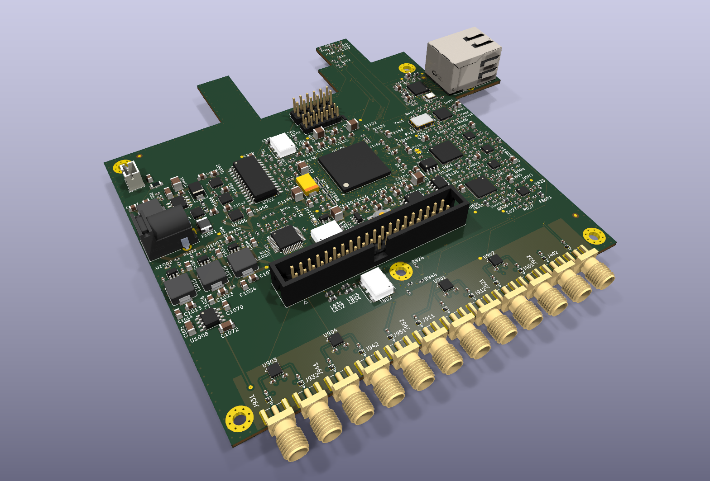
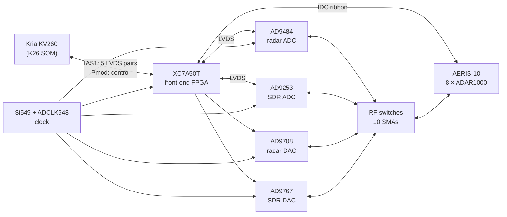
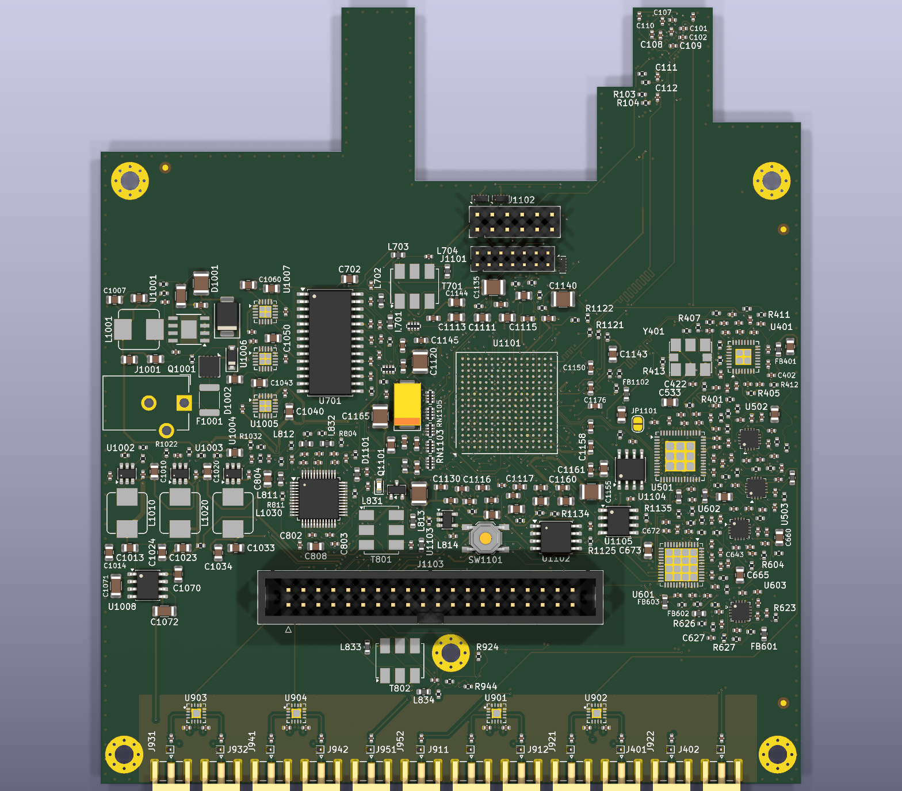
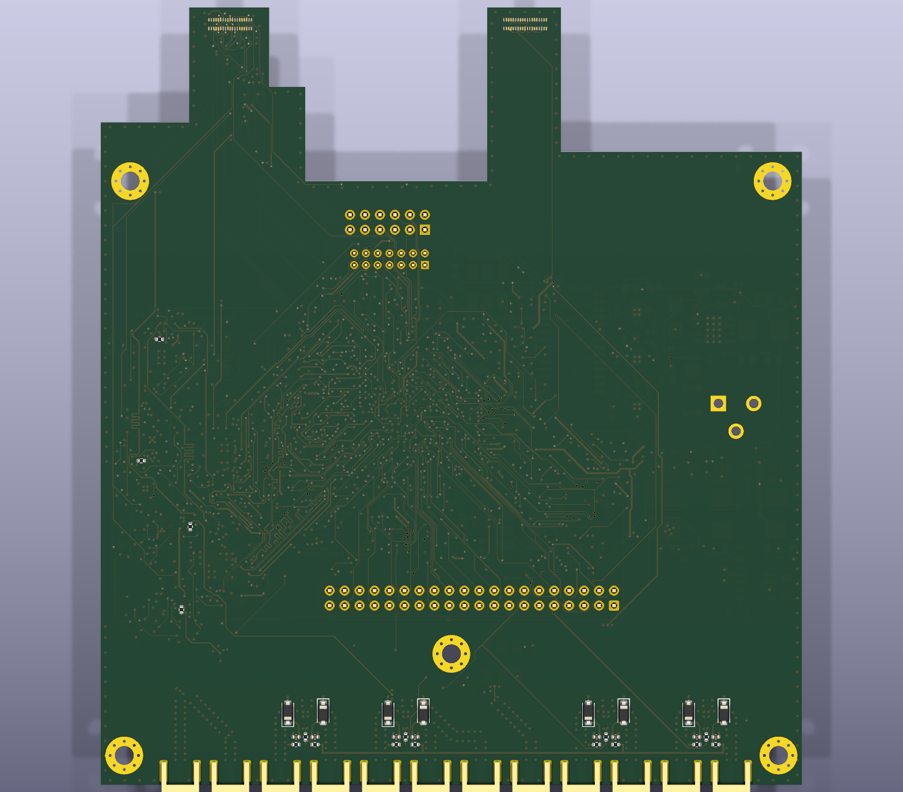
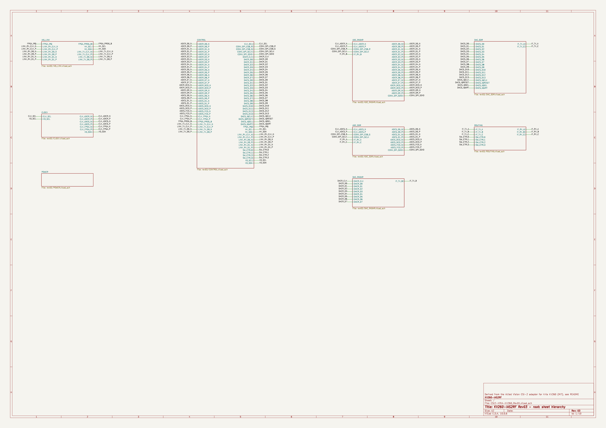

# KV260-IAS2RF — an RF front-end carrier for the AMD Kria KV260

**Status (10 November 2026): schematic and layout complete. The board is fully routed, with zero
DRC errors and zero schematic-parity problems. It has not been fabricated, and no hardware has
been validated.** A few review items remain before an order (see [Status](#status)).



An adapter board for the **AMD Kria KV260 Vision AI Starter Kit**. It plugs into the KV260's IAS1
camera connector and carries the converters, a common clock and a front-end FPGA. It serves two
signal chains:

- **Software-defined radio**: HF, AM, FM, airband, amateur bands and PMR446. Receive, and
  transmit on the bands a licence covers.
- **Radar at 10.5 GHz**: the IF of the X-band chain from the open
  [AERIS-10 / PLFM_RADAR](https://github.com/NawfalMotii79/PLFM_RADAR) project, with ADAR1000
  beamforming. The 10.5 GHz chain itself is reused from AERIS-10, not redesigned here. The board
  is sized for 8 ADAR1000s (32 channels), so it covers both the Nexus variant (4 chips) and the
  Extended one (8 chips).

> ### The finding that shapes the whole project
>
> The **IAS0 (J7) connector on the KV260 does not reach the programmable logic**: its MIPI lanes
> run into an AP1302 ISP soldered on the carrier card. Only **IAS1 (J8)** is wired straight to
> the SOM. On top of that, **the KV260 has no 40-pin Raspberry Pi header** (J9 is a 15-pin
> camera connector), and **the GTH transceivers are not exposed**.
>
> The real I/O budget between a KV260 and an external board is **8 differential pairs and about
> 14 single-ended signals**. That is why the board has its own FPGA. The evidence and sources are
> in [docs/BLOCKERS_AND_RISKS.md](docs/BLOCKERS_AND_RISKS.md).

---

## The board at a glance

| | |
|---|---|
| Size | 119 × 132 mm. It mounts on the KV260's IAS connectors and corner holes and overhangs to one side ([INTERFACE_SPEC §5.3](docs/INTERFACE_SPEC.md)) |
| Stackup | 6 layers, JLCPCB JLC06161H-2116A: signal, GND, signal, split power, GND, signal ([POWER_AND_STACKUP](docs/POWER_AND_STACKUP.md)) |
| Parts | 479, on one face |
| Front-end FPGA | Xilinx XC7A50T-2FTG256I (the same part as AERIS-10) with a 128 Mb QSPI flash, plus JTAG |
| Radar ADC | AD9484, 8 bit, 400 MSPS, driven by two cascaded AD8352s |
| SDR ADC | AD9253, 14 bit, two channels at 62.5 MSPS (one LVDS lane each) |
| Radar DAC | AD9708, with reconstruction filter and balun |
| SDR DAC | AD9767, dual 14 bit, two output chains |
| Clock | Si549 programmable XO (400 or 500 MHz, GPS-disciplinable) into an ADCLK948 LVPECL fan-out |
| RF routing | Four M3SWA2-34DR+ SPDT switches and ten edge SMAs, plus two clock SMAs |
| Link to the Kria | IAS1 (Hirose BM20B), five LVDS pairs at up to 1 Gb/s each, AC-coupled; the Pmod J2 for control |
| To AERIS-10 | 2×20 IDC ribbon for eight ADAR1000s |
| Power | 12 V in; buck and LDO tree for 5 V, 3.3 V, 2.5 V, 1.8 V and 1.0 V, plus −3.3 V for the switches |



| Top | Bottom |
|---|---|
|  |  |

The renders come from KiCad. Some parts have no 3D model, so they show only their pads (the FPGA's
BGA, for one).

---

## Schematics and layout

- **[Schematic, all 10 sheets (PDF)](docs/CSI2-KRIA-KV260_Rev03_schematic.pdf)**
- **[Layout, the six copper layers and both silkscreens (PDF)](docs/CSI2-KRIA-KV260_Rev03_layout.pdf)**
- KiCad 10 sources: [`CSI2-KRIA-KV260_Rev01.kicad_pro`](CSI2-KRIA-KV260_Rev01.kicad_pro), the root
  schematic and [`rev03/`](rev03/) (the nine sheets), the board
  [`CSI2-KRIA-KV260_Rev01.kicad_pcb`](CSI2-KRIA-KV260_Rev01.kicad_pcb), and the project's own
  symbols and footprints in [`symbols/`](symbols/) and [`footprints/`](footprints/). The file names
  keep the Rev01 name of the board they started from; the contents are Rev03.

| Sheet | Contents | Specification |
|---|---|---|
| [Root](docs/img/sch/ROOT.png) | Sheet hierarchy and the interface nets | [ARCHITECTURE](ARCHITECTURE.md) |
| [IAS_LINK](docs/img/sch/IAS_LINK.png) | The Hirose connectors, AC coupling and terminations of the link | [IAS_LINK_SPEC](docs/IAS_LINK_SPEC.md) |
| [CLOCK](docs/img/sch/CLOCK.png) | Si549, reference select and LVPECL fan-out | [CLOCK_SPEC](docs/CLOCK_SPEC.md) |
| [ADC_RADAR](docs/img/sch/ADC_RADAR.png) | AD9484 and its two AD8352 drivers | [ADC_RADAR_SPEC](docs/ADC_RADAR_SPEC.md) |
| [ADC_SDR](docs/img/sch/ADC_SDR.png) | AD9253, two channels | [ADC_SDR_SPEC](docs/ADC_SDR_SPEC.md) |
| [DAC_RADAR](docs/img/sch/DAC_RADAR.png) | AD9708, filter and balun | [DAC_RADAR_SPEC](docs/DAC_RADAR_SPEC.md) |
| [DAC_SDR](docs/img/sch/DAC_SDR.png) | AD9767 in interleaved mode, two output chains | [DAC_SDR_SPEC](docs/DAC_SDR_SPEC.md) |
| [ROUTING](docs/img/sch/ROUTING.png) | Four RF switches and the SMAs | [ROUTING_SPEC](docs/ROUTING_SPEC.md) |
| [CONTROL](docs/img/sch/CONTROL.png) | The front-end FPGA: banks, configuration, Pmod, AERIS ribbon, housekeeping | [CONTROL_SPEC](docs/CONTROL_SPEC.md) |
| [POWER](docs/img/sch/POWER.png) | The power tree | [POWER_SPEC](docs/POWER_SPEC.md) |



---

## Status

| Check | Result |
|---|---|
| ERC | 0 errors; 7 warnings, all explained: configuration and XADC pins tied to power on purpose ([CONTROL_SPEC §5](docs/CONTROL_SPEC.md)) |
| DRC, zones refilled | **0 errors, 0 unrouted connections, 0 schematic-parity problems.** The only warnings are 8 library-footprint notices |
| Planes | L2 and L5 carry only ground, no supply track (`_work/layout/planechk.py`); every supply pin reaches its island (the DRC's zero unrouted) |
| Mechanical fit | Registered on AMD's 3D model of the KV260: the mounting holes land within 5 µm ([INTERFACE_SPEC §5.3](docs/INTERFACE_SPEC.md)) |

**Open before ordering** ([docs/LAYOUT.md §6.2–6.3](docs/LAYOUT.md)):

1. **LVDS pairs run as two separate tracks** rather than as coupled pairs (about 125 Ω between the
   legs against the 100 Ω termination). Acceptable at these rates; a pair-routed board would be
   better. The skew (every pair at 1 Gb/s within 42 ps) and the termination stubs were fixed on
   10 Nov, and the trace widths agree with JLCPCB's calculator within 1–3 %
   ([FABRICATION.md](docs/FABRICATION.md)).
2. **Order the 2116A stack explicitly** (JLC06161H-2116A): the widths are solved for it. JLCPCB's
   calculator lists the cheaper JLC06161H-3313 first, whose L1–L2 prepreg is thinner (0.099 mm
   against 0.116 mm); on that stack the 183 µm RF lines would sit at about 45 Ω instead of 50 Ω
   ([FABRICATION.md](docs/FABRICATION.md)).
3. **The AERIS-10 end of the ribbon does not exist yet.**
4. **No firmware.** The FPGA design for the front end and the Kria side of the link are not
   written yet.

**Cost** ([docs/JLCPCB_QUOTE.md](docs/JLCPCB_QUOTE.md), 10 Nov 2026): about **$2,030 for two
assembled boards** and $4,190 for five, three quarters of it parts. Seven parts are out of stock at
LCSC today (the ADCs, the RF switches, the clock buffer, the DAC, a balun and the drivers): JLCPCB's
global sourcing or consigned parts cover them.

---

## Documentation

| Document | Contents |
|---|---|
| **[docs/VEHICLE_PLATFORM.md](docs/VEHICLE_PLATFORM.md)** | **System view.** The whole vehicle project: LiDAR, SDR, radar, OBD2 |
| [docs/SHOPPING_LIST.md](docs/SHOPPING_LIST.md) | Parts and checklist per stage, with indicative costs |
| [ARCHITECTURE.md](ARCHITECTURE.md) | Master document for this board: the Rev03 architecture and BOM |
| [docs/BLOCKERS_AND_RISKS.md](docs/BLOCKERS_AND_RISKS.md) | The five blockers, closed, with evidence and sources, plus the open risks |
| [docs/INTERFACE_SPEC.md](docs/INTERFACE_SPEC.md) | Pin map for J8 and the Pmod, the mechanical envelope, the adapter registered on the KV260 model |
| [docs/POWER_AND_STACKUP.md](docs/POWER_AND_STACKUP.md) | Per-rail current budget and the 6-layer stackup with computed trace widths |
| [docs/SYMBOLS.md](docs/SYMBOLS.md) | The project's symbols, each from its datasheet, cross-checked against a second source where one exists |
| Sheet specifications | One per schematic sheet, in the table above: every value and where it comes from |
| [docs/LAYOUT.md](docs/LAYOUT.md) | The board: outline, stackup, rules, the split power layer, placement, routing and the LVDS review |
| [docs/FABRICATION.md](docs/FABRICATION.md) | Ordering from JLCPCB: the output script, the order form, what is left for the day of the order |
| [docs/JLCPCB_QUOTE.md](docs/JLCPCB_QUOTE.md) | What the JLCPCB order would cost (10 Nov 2026): boards, assembly fees and every part with its LCSC link and price. About $2,030 for two assembled boards, $4,190 for five |
| [docs/ROADMAP.md](docs/ROADMAP.md) | Staged plan with verifiable exit criteria |
| [docs/AUDIT_Rev01.md](docs/AUDIT_Rev01.md), [docs/HISTORY_Rev01.md](docs/HISTORY_Rev01.md) | What the inherited files contained, and the record of the earlier work |

---

## Repository layout

| Path | Contents |
|---|---|
| `CSI2-KRIA-KV260_Rev01.*`, `rev03/` | The KiCad project: root schematic, nine sheets, board |
| `symbols/`, `footprints/` | The project's own libraries |
| `docs/` | Specifications, layout and fabrication notes, renders and the PDFs |
| `_work/` | The scripts behind every finding and every step of the layout: symbols and footprints, sheet checks, placement (`_work/layout/build_board.py`), plane and LVDS checks, fabrication outputs |
| `fab/` | Not tracked. `python _work/fab/make_fab.py` writes Gerbers, drill, BOM and CPL there for JLCPCB |
| `PCB/`, `Documents/` | The original Allied Vision sources (Altium) and their outputs, untouched |
| `_backup_original/`, `_deprecated/` | Snapshots of the inherited files and the sheets removed from the project |

Reproducing the checks and the outputs (KiCad 10):

```bash
kicad-cli sch erc --severity-all CSI2-KRIA-KV260_Rev01.kicad_sch
kicad-cli pcb drc --schematic-parity --refill-zones --severity-all CSI2-KRIA-KV260_Rev01.kicad_pcb
python _work/fab/make_fab.py                                   # fab/: Gerbers, drill, BOM, CPL
python _work/fab/quote.py                                      # today's LCSC prices and stock; refreshes docs/JLCPCB_QUOTE.md
python _work/layout/lvds_skew.py CSI2-KRIA-KV260_Rev01.kicad_pcb  # LVDS delays, skew and stubs; --stubs PS lists the branches (needs shapely)
```

---

## Related work

The DSP core this board will need already exists, runs on real silicon and is published
separately:

**[scanner64](https://github.com/PabloSoage/scanner64)**: a real-time multichannel DDC bank for
the KV260's PL. Measured on the board: 100.05 MSPS sustained, no samples dropped across
200 million, bit-exact against its Python model, 8.38 mW per channel, 169.9 MHz Fmax post-route.

That project answers, with hardware, the question this board is built around: whether the PL can
sustain a converter stream in real time. It can.

---

## Where the project came from, and attribution

This is a **fork** of the open hardware design
[Allied Vision Adapter Board CSI-2 for Kria KV260](https://github.com/alliedvision), published
under the MIT licence (see [LICENSE](LICENSE)). What is kept from that design:

- the board's mechanical fit to the KV260 (the outline was extended)
- the two Hirose BM20B(0.8)-34DP connectors (IAS0 / IAS1) and their wiring to the SOM

Everything else (the MIPI camera electronics, level shifters, USB power) was removed and replaced
by the RF chain described here. **This repository no longer produces an Allied Vision camera
adapter board.** If that is what you want, use the original project.

---

## Legal notice

This design transmits on regulated bands. Operating the SDR transmitter requires an amateur radio
licence or equivalent authorisation, and emission in 10.4–10.6 GHz is subject to national
allocations that are **not** free to use in every country. See the compliance section of
[ARCHITECTURE.md](ARCHITECTURE.md). Staying within the applicable law is the responsibility of
whoever builds and operates the equipment.

## Licence

MIT — see [LICENSE](LICENSE). The licence and attribution of the original Allied Vision project
are preserved.
