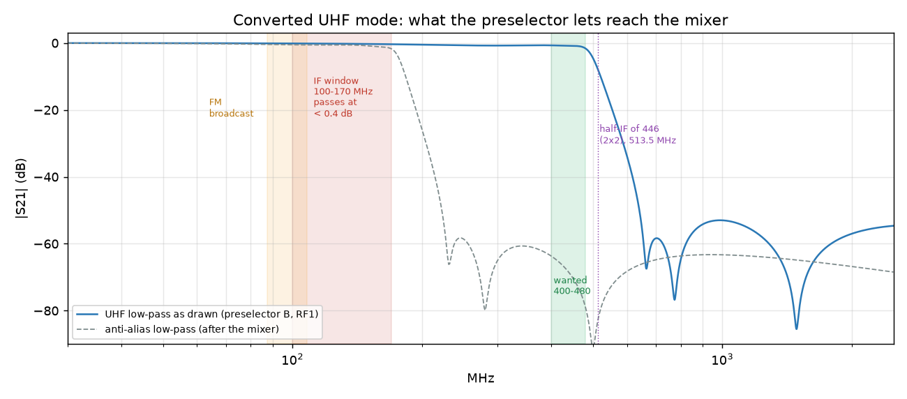
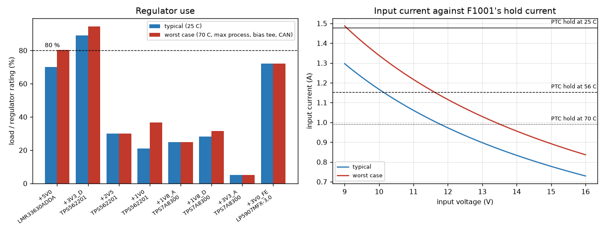

# Rev08 audit: RF and power, before the tag

*18 November 2026 · board as on `main` at `6df5766` · scripts `_work/sim/rev08_rf_audit.py`, `_work/power/power_audit.py`,
`_work/power_budget.py` · figures and data in [`docs/sim/`](sim/)*

A last pass over the whole board as an RF engineer would make it before ordering. It covers the receive and transmit
chains from HF to 3 GHz and the clocks. It also covers the power tree: what each part gets, what each regulator
carries and what the vehicle can do to the input, so that nothing on the board can be damaged.

The simulations already in the repository are reused where they apply. Three things are new:
- the Vivado power report of the routed FPGA;
- a study of the converter's preselection;
- a power audit with eight checks, including time-domain simulations of the start-up and of the ISO 7637-2 and
  ISO 16750-2 pulses.

The reused simulations are:
- the SMA and `J961` launches (openEMS), the eyes and the skew, the PDN impedance;
- the filters' Monte Carlo, the bias tee and the LNA chokes;
- the transmit-to-receive isolation (G3) and the thermal maps;
- the gateware's end-to-end benches (`tb_system`, `tb_e2e`) and the G-8 synthetic campaign.

Marks as elsewhere: `[V]` from a data sheet or a tool run on the design, `[E]` an engineering estimate.

## 0. Verdict

The analogue chains, the clocks and the SMA launches stand, and no rail can exceed an absolute maximum. The input
stage survives every ISO 7637-2 pulse, the suppressed load dump, a jump start and reverse battery.

The audit found **three ways to damage something**, **one design gap in the new VHF/UHF converter**, and **a power
budget that was short by 0.25 A at 12 V**. The budget had left out four loads and estimated the FPGA's VCCAUX at a
quarter of what Vivado reports. None of the fixes moves a part of the RF chains. Most are a part number, and two are
small copper edits in the power corner and on the Pmod.

| # | Finding | Severity | Fix | Board change |
|---|---|---|---|---|
| P1 | **`U1506` TCAN330: CANH/CANL absolute maximum ±14 V.** A car's CAN wire shorted to the battery (13.8–14.8 V while charging, 24 V on a jump start) destroys it; `D1531` PESD1CAN does not conduct below 24 V | **Damage** | **TCAN3404-Q1** (±58 V bus fault, 3.3 V, SOT-23-8 DDF, same pins: 5 SHDN and 8 STB both low = normal, as wired) | BOM only, footprint to confirm |
| P2 | **The Pmod back-powers whichever board is off.** Eight 3.3 V lines run with no series resistor on either board (the KV260's R276–R283 are 0 Ω). With one board powered and the other not, a driven line forward-biases the far FPGA's clamp diodes: up to about 100 mA a line (upper bound), and it raises the unpowered bank's VCCO | **Damage (latent)** | 220–330 Ω in series on the eight Pmod lines on this board. In the gateware, `PMOD_MISO` drives only while `PMOD_CS` is low, but an unpowered Kria holds CS low; `PMOD_SPARE2`, the debug UART's transmit line, idles high. Both should stay high-Z until the Kria has been seen | Yes: eight 0402 resistors near `J1102` |
| P3 | **`F1001` (PTC, 1.5 A hold) trips in a hot car.** The worst-case load is 1.12 A at 12 V and 1.27 A at 10.5 V. A polymer PTC holds 1.15 A at 56 °C and 0.99 A at 70 °C | Function (resets) | A PTC that holds at least 1.6 A at 70 °C (2920 size, ≥ 33 V), or a 3 A fuse with the harness fuse | Footprint change for a 2920 |
| P4 | **`U1006` (+1V8_D LDO) dissipates 0.94 W, not 0.50 W.** VCCAUX is 0.31–0.37 A (Vivado), not 0.1 A. Through the single path to the balls (184–263 mΩ, SI 4.4) VCCAUX can also sag to 1.665 V against 1.71 V | Margin, thermal | Feed `U1006` from **+2V5** (0.44 W) and set it to **1.85 V** (ground its 50 mV pin, as on `U1005`) | Yes: two copper edits in the power corner |
| P5 | **+3V3_D carries 1.78–1.89 A from a 2 A TPS562201** (89–95 %) | Margin | P4's fix brings it to 1.26 A (63 %); +2V5 goes to 1.23 A (62 %) | With P4 |
| R1 | **The converter has no IF rejection.** The UHF image filter is a low-pass, so 30–480 MHz all reach the mixer, the 100–170 MHz IF window included (≤ 0.4 dB). FM broadcast, airband, 2 m, marine VHF and PMR leak through the mixer onto the UHF tuning. The 1 GHz low-pass path does the same for 480–1000 MHz | **Design gap** | A high-pass ahead of the mixer on preselector B's UHF and 1 GHz low-pass paths, at least 50 dB from 170 MHz down | Yes: frame B (or a band-pass on a spare SP8T throw) |
| P6 | The board's thermal model and CFD take the FPGA at 0.73 W; Vivado gives **1.20 W at 25 °C and 1.55 W at 70 °C, maximum process** | Margin | Re-run the CFD with the Vivado figures and P4's 0.44 W; the 56 °C rating may move by a few degrees | No |
| P7 | VCCINT, VCCO and the 3.3 V parts' ±5 % windows are met nominally but not in the full worst-case stack (TPS562201 reference ±2.5 % over temperature) | Note | +1V0 to 1.02 V (one resistor); measure each rail on the first board | Resistor value |
| P8 | `U1315` (+3V0_FE) can reach dropout in the worst corner (26 mV of headroom against 180 mV), then the 580 kHz ripple of +3V3_D reaches the RFFC5072's supply | Note | LP5907-2.8 (the RFFC5072 runs from 2.7 V), or +3V3_D at 3.35 V | BOM only |
| R2–R7 | Half-IF response, LO leakage, the TCXO's pin 1, the bias tee against the antenna TVS, no limiter on `J961`, floating switch controls at power-up | Notes | Section 1.3 | Mostly none |

## 1. RF

### 1.1 What stands (reused simulations)

| Chain or item | Evidence | Result |
|---|---|---|
| SMA launches (12) and `J961` | openEMS, SI 2.1 and 9.10 | Return loss ≥ 39 dB at 500 MHz on the twelve; `J961` −18.1 dB at 1.1 GHz (0.07 dB mismatch loss) |
| HF input `IF_RX_C` | Rev07 anti-alias filter, Monte Carlo (SI 9.9) | ≥ 60 dB from 50 to 600 MHz, ≤ 1.7 dB in band |
| VHF/UHF filters with catalogue parts | `rev08_filters_mc.py`, 2,000 runs each | All four pass their masks at p1/p99 (REV08_PLAN 5.4) |
| Bias tee and LNA drain feed | `bias_tee.py` (SI 9.10) | ≤ 0.30 dB and ≤ 0.23 dB from 25 MHz to 1.1 GHz, no resonance |
| Coupling into converters and clocks | `txrx_isolation.py`, gate G3 | No LO, reference, IF or USB copper within 1.5 mm on the same layer; worst track coupling −102 dB |
| Converter cascade | `rev08_frontend.py` | NF 2.0 dB direct, 3.7 dB UHF, 7.1 dB ADS-B; full scale −52 to +2 dBm |
| Clock tree | SI 9.8 | Si549 + ADCLK948 ≈ 120 fs, about 80 dB SNR ceiling at a 120 MHz IF |
| Link, Ethernet, PDN | SI 3, 4, 9.7 | Eyes open at 1 and 1.25 Gb/s; VCCINT under target to 100 MHz |
| End to end | `tb_system` S1–S7 at 400 and 500 MHz, `tb_e2e`, G-8 campaign (FPGA_GATEWARE) | Pass, with their mutations failing as they should |

The pin-outs checked again against the data sheets in this pass: RFFC5072 (DS140110 pin table and the wideband application
schematic p.13), both baluns (TC4-1W+ secondary with centre tap to the mixer, 200 Ω; TC1-1-13M+), SPF5043Z, and
the TCXO's level (0.8 V p-p minimum into the 0.5–1.5 V p-p reference input). They match. The mixer's output pins are numbered 27 OPN / 28 OPP
in the pin table and the other way round in the application schematic. A receiver does not care (a 180° phase).

### 1.2 R1: the converter has no IF rejection

`rev08_rf_audit.py` runs the UHF low-pass with its drawn values (the lossy-inductor and pad model of `rev08_filters_mc.py`):



| Frequency | 88–108 MHz | 118–170 MHz | 446 MHz | 513.5 MHz | 581 MHz (LO) | 660–2500 MHz |
|---|---|---|---|---|---|---|
| UHF low-pass rejection | 0.1–0.2 dB | 0.2–0.4 dB | 0.8 dB (in band) | 7.9 dB | 27.8 dB | ≥ 53 dB |

The design checked the image (RF + 270 MHz, ≥ 50 dB) and the LO, but not the IF itself. Anything already at 100–170 MHz
reaches the mixer at full strength, after 22 dB of LNA. It then leaks to the mixer's output at the mixer's RF-to-IF
isolation and lands in the IF window as if it had been converted. It shows up at RF = LO − f:

| Tuned | LO | FM 100–108 shows at | Airband 118–137 at | 2 m, marine, PMR 144–174 at |
|---|---|---|---|---|
| 390 MHz (TETRA) | 525 | 417–425 MHz | 388–407 MHz | 351–381 MHz |
| 435 MHz (70 cm) | 570 | 462–470 MHz | 433–452 MHz | 396–426 MHz |
| 446 MHz (PMR446) | 581 | 473–481 MHz | 444–463 MHz | 407–437 MHz |

The data sheet plots the mixer's RF leakage only from 500 MHz up (45–60 dB below a 0 dBm input). Taking 35–50 dB at
135 MHz [E], the IF rejection is **31–46 dB**. A −30 dBm FM or airband carrier at the antenna then looks like a −61
to −76 dBm UHF signal, **53–68 dB above the −129 dBm floor in 12.5 kHz**. A receiver of this class is usually
specified at 70 dB or more. In a car, FM broadcast is always there, and so is airband near an airport. A 2 m or
marine transceiver on the same vehicle is far stronger.

The same VHF carriers also load the mixer: −20 dBm at the antenna is about 0 dBm at the mixer input, near its
compression with `P2MIXIDD` ≤ 3.

**Fix (frame B, before ordering).**
- A high-pass of at least 50 dB at 170 MHz and below, and under 1 dB from 390 MHz, in series with the UHF low-pass. A
  5th-order LC high-pass of 0402 parts, about 30 mm². The alternative is to replace the low-pass by a 390–480 MHz
  band-pass with the same number of parts. That also steepens the upper skirt, which helps R2.
- The same for the LFCN-1000+ path, with a corner near 300 MHz.
- The SAW and HFCN-1000+ paths need nothing.

**Mitigation without a board change:** software can recognise feedthrough because it does not move when the LO is
retuned. That is good for a spectrum display, not for unattended reception.

### 1.3 Smaller RF points

| # | Point | Consequence | What to do |
|---|---|---|---|
| R2 | Half-IF (2×2) response of 446 MHz at 513.5 MHz: the UHF low-pass takes off only 7.9 dB. 3×3 at 536 MHz: 14.5 dB | DVB-T channel 26 (506–514 MHz) sits on it; the mixer's own 2×2 suppression (not in the data sheet) is what is left | The band-pass of R1 fixes it; otherwise measure with a DVB-T multiplex |
| R3 | LO at the mixer input, estimated −45 dBm [E], back out of `J961` | −100 dBm through the UHF low-pass and the LNA; **about −49 dBm with the LNA bypassed on the 1 GHz low-pass path**, above the −57 dBm receiver spurious limit [E] | Gateware: keep the LNA in while the converter runs on the LFCN path; measure on the first board |
| R4 | LO at the ADC: −38 dBm at the mixer output [V plot], then 63–78 dB of anti-alias filter | −63 to −78 dBFS; aliased into the window at 125 MHz (TETRA) and 155 MHz (ADS-B) | Known fixed tones, 10–20 MHz off the wanted signal: nothing |
| R5 | TCXO pin 1 to its supply through 10 k (`R1341`) | If the fitted 1XXD part is the VC-TCXO variant, Vcont sits at 2.8 V, outside its 0.4–2.4 V range: +3 to +5 ppm (about 2 kHz at 446 MHz), no damage | Confirm the variant from the reel label; for a VC-TCXO, a divider to 1.4 V |
| R6 | Bias tee at 5 V against `D1301` PESD5V0F1BL (5 V stand-off) | With +5V0 at its 5.18 V maximum the antenna line sits above the TVS's stand-off: leakage, no damage [E] | Prefer `JP1301` at 3.3 V for antennas that accept it, or a 6 V stand-off TVS of the same capacitance |
| R7 | No limiter on `J961`; the SPF5043Z's absolute maximum is +25 dBm in | A transmitter on the same vehicle (a 2 m mobile at 1 m) can destroy the LNA | Note in BOARD_MANUAL; an external limiter for co-sited installs |
| R8 | The TCA6416A's ports are inputs until written: the PE4259, PE42442 and SKY13418 control pins float at power-up | Random path, perhaps a few hundred µA of extra current, no damage; the PE4312 powers up at 31.5 dB and the RFFC5072 off, so the ADC is protected | Gateware already writes the expander at start; pull-downs on the next revision |

The direct-sampling path, the radar and the HF chains are unchanged from SI 9.8–9.9. They keep the limits stated there: wideband
`J911`/`J922`, the DAC clocks from the FPGA, the switches below 10 MHz, exciter-level outputs, and switcher harmonics in HF.

## 2. Power

### 2.1 The budget, with Vivado's figures and the loads that were missing

`power_budget.py` used to carry the FPGA as estimates (VCCINT 700 mA, VCCAUX 100 mA). Four loads that are on the
board were not in it at all:
- the RTL8211FSI PHY, 0.5 W;
- the TCAN330, 55 mA while dominant;
- the fan, 0.1 A;
- the bias tee, up to 155 mA.

Vivado 2026.1 `report_power` on the routed Rev08 design (vectorless, so "Low" confidence until measured) gives:

| FPGA rail | 25 °C, typical | 70 °C, maximum process | Estimate until now |
|---|---|---|---|
| VCCINT + VCCBRAM | 420 mA | 735 mA | 700 mA |
| VCCAUX | 313 mA | 365 mA | 100 mA |
| VCCADC (from VCCAUX) | 21 mA | 31 mA | not counted |
| On-chip power | 1.20 W | 1.55 W | 0.73 W (the thermal model's figure) |

VCCAUX feeds the three MMCMs (0.40 W) and the I/O (0.33 W: IDELAY, ISERDES, LVDS).



| Rail | Regulator (rating) | Typical | Worst | Use | Dissipation, worst |
|---|---|---|---|---|---|
| +5V0 | LMR33630 (3 A) | 2.10 A | 2.41 A | 80 % | 1.34 W |
| +3V3_D | TPS562201 (2 A) | 1.78 A | 1.89 A | **95 %** | 0.69 W |
| +2V5 | TPS562201 (2 A) | 0.60 A | 0.60 A | 30 % | 0.20 W |
| +1V0 | TPS562201 (2 A) | 0.42 A | 0.74 A | 37 % | 0.10 W |
| +1V8_A | TPS7A8300 (2 A) | 0.50 A | 0.50 A | 25 % | 0.35 W |
| +1V8_D | TPS7A8300 (2 A) | 0.57 A | 0.63 A | 31 % | **0.94 W** |
| +3V3_A | TPS7A8300 (2 A) | 0.10 A | 0.10 A | 5 % | 0.17 W |
| +3V0_FE | LP5907 (0.25 A) | 0.18 A | 0.18 A | 72 % | 0.05 W |
| Input | | **0.97 A, 11.7 W** | **1.12 A, 13.4 W** | | |

The worst case is 70 °C with maximum process, the bias tee at its limit, CAN dominant and the fan running. **With P4's fix** (`U1006` fed from +2V5):
- the LDO dissipates 0.44 W;
- +3V3_D carries 1.26 A (63 %) and +2V5 1.23 A (62 %);
- the input is 1.07 A worst case.

### 2.2 Voltage windows and LDO headroom

Each rail's tolerance at the part is taken as the sum of:
- the regulator's reference over temperature (LMR33630 ±1.5 %, TPS562201 749–787 mV, TPS7A8300 ±1 %, LP5907 ±3 %);
- 1 % resistors;
- ripple and load step [E];
- the copper drop of SI 4.4.

Nothing reaches an absolute maximum. Against the recommended ranges:

| Part | Rail at the part, worst case | Range | Note |
|---|---|---|---|
| XC7A50T VCCAUX (at the balls) | 1.665–1.823 V | 1.71–1.89 | **P4**; with `U1006` at 1.85 V: 1.714–1.873 V |
| XC7A50T VCCINT | 0.922–1.055 V | 0.95–1.05 | P7: the TPS562201's ±2.5 % reference plus 34 mV of drop; nominal 1.005 V − 34 mV |
| XC7A50T VCCO 2.5 / 3.3 V, Si549, RTL8211FSI | 9–60 mV outside ±5 % at the corners | ±5 % | P7: on paper; measure |
| AD9484, AD9253 AVDD and DRVDD, AD8352, DACs, RFFC5072, the switches | inside | n/a | n/a |
| M3SWA2 VEE (LM2663) | −3.38 to −3.20 V | −3.3 typ, −3.6 limit | n/a |

| LDO | Worst headroom | Dropout at its load | |
|---|---|---|---|
| U1005 +1V8_A from +2V5 | 0.50 V | 0.05 V | OK |
| U1006 +1V8_D from +3V3_D (as drawn) / from +2V5 (P4) | 1.32 V / 0.55 V | 0.06 V | OK either way |
| U1007 +3V3_A from +5V0 | 1.52 V | 0.01 V | OK |
| U1315 +3V0_FE from +3V3_D through FB1301 | **0.03 V** (typical 0.29 V) | 0.18 V | **P8** |

### 2.3 Input current and F1001

The board is a constant-power load to the input. The worst case draws 1.12 A at 12 V, 1.27 A at 10.5 V (engine off,
a tired battery) and 1.49 A at 9 V. A polymer PTC's hold current falls with its own temperature [E: an 1812 series' derating table]:

| PTC at | 25 °C | 40 °C | 56 °C | 70 °C | 85 °C |
|---|---|---|---|---|---|
| Holds | 1.48 A | 1.32 A | 1.15 A | 0.99 A | 0.83 A |

The worst-case load trips it above 60 °C at 12 V, and above 44 °C at 10.5 V. The typical load trips it above 72 °C. The PTC sits inside an enclosure rated
to 56 °C ambient, so a hot car at idle can reset the board. P4's fix lowers the worst case by 50 mA, not enough on
its own. **Fix P3:** a PTC that holds ≥ 1.6 A at 70 °C (2.5 A class at 25 °C) and is rated ≥ 33 V. That is a 2920 part, since none exists in
1812. Otherwise, a fast fuse of about 3 A with the harness fuse (POWER_SPEC 1.1 already asks for one).

### 2.4 Start-up


The model has 12 V applied at t = 0 and:
- the LMR33630's 4 ms soft-start (2.9–6 ms);
- the three TPS562201 waking at 4.1 V of +5V0, then 1 ms of soft-start;
- the TPS7A8300s ramping by 6.2 µA (4.0–9.0) into their 10 nF;
- the LP5907, the charge pump and the divider following their inputs.

Run at nominal and at both soft-start corners:
- **Order:** VCCINT, VCCO_34 and VCCO_14/15 together at about 5 ms, then VCCAUX 0.4–1.4 ms later, then the ADCs' AVDD.
  DS181's order (VCCINT, VCCAUX, VCCO) is a recommendation for minimum inrush, not a requirement.
- **The one hard rule:** VCCO − VCCAUX > 2.625 V is allowed for at most 300 ms per power cycle. It happens for at most
  0.26 ms (slow LDO corner).
- **The ADC inputs:** they are AC-coupled (100 nF) from AD8352s on +5V0, which comes up first. The coupled current
  is C × dV/dt = 62 µA over the 4 ms ramp, so nothing reaches the AD9484's input clamps.
- **The camera, link and PHY:** no other constraint applies. The link is AC-coupled, and the PHY has its own RC
  power-on reset (`R1214`/`C1216`), which the FPGA can extend through `ETH_RSTN`.

### 2.5 Vehicle transients


Each pulse is applied at `J1001` through its source resistance and 1 µH of harness. The model is time-stepped with
backward Euler and Newton, and includes:
- the PTC;
- `D1003` (SMCJ33CA: VBR 36.7–40.6 V, 53.3 V at 28.2 A, 1500 W);
- `C1090`;
- the LM74502-Q1: OV cut-off at 18.3 V with its 1 µs turn-off and 10 µs turn-on, reverse polarity;
- two DMT10H015LFG (13.5 mΩ each);
- `D1001` (SMBJ18CA) and the +12V capacitors, derated 50 % for DC bias;
- the board as a constant-power load.

| Pulse | VIN_F | +12V | FET VDS | TVS energy (limit, Wunsch-Bell [E]) | |
|---|---|---|---|---|---|
| ISO 7637-2 pulse 1, −150 V, 10 Ω, 2 ms (supply cut) | −44.0 V | falls to 0.4 V (board resets) | 44 V | D1003 0.19 J (2.1 J) | Pass |
| Pulse 2a, +112 V, 2 Ω, 50 µs | +59.1 V | 18.6 V | 41 V | D1003 0.016 J (0.33 J) | Pass |
| Pulses 3a / 3b, −220 / +150 V, 50 Ω, 0.1 µs | ±0.1 V (C1090 absorbs them) | n/a | n/a | n/a | Pass |
| ISO 16750-2 load dump B, suppressed to 35 V, 400 ms | 35.0 V | 18.3 V, then the FETs open (board resets) | 32 V | none (below 36.7 V) | Pass |
| Load dump A, 87 V **unsuppressed**, 1 Ω, 400 ms | +54.6 V | 18.3 V, FETs open | 51 V | **D1003 116 J (30 J)** | **Fail** (known: POWER_SPEC 1.1) |
| Jump start, 24 V for 60 s | 24.0 V | FETs open | 20 V | none | Pass (board off while over 18.3 V) |
| Reverse battery, −14 V | −27.8 V (harness ringing) | 0.8 V | 29 V | none | Pass |

Limits held in every passing case:
- +12V stays under the LMR33630's 36 V;
- VIN_F stays inside the LM74502-Q1's ±65 V;
- the FETs stay under 100 V;
- the 25 V capacitors on +12V see at most 18.6 V.

Unsuppressed load dump is the one case the board cannot take. Every car built in the last twenty years has central
suppression (test B). For an old vehicle, fit a load-dump TVS (a DO-218 SM8S33A class) at the harness.

### 2.6 Outward supplies, and the lines between the boards

| Fault | Limiter | Result |
|---|---|---|
| `J961` bias tee shorted | AP22652, 95–155 mA, fault flag | Safe; FB1302 (250 mA) and L1301 (170 mA) are rated above the limit |
| GPS supply on `J1503` shorted | F1501, 0.2 A hold | Trips; +3V3_D sags briefly |
| Fan shorted | F1002, 0.5 A hold | Trips; +5V0 holds |
| **CAN wire to battery (P1)** | **none** (PESD1CAN from 24 V; TCAN330 ±14 V) | **U1506 destroyed** |
| USB host, board off | LP5907 from VBUS, 1 k to the FPGA | ≤ 3 mA into the FPGA |

| Line to the other board, one side unpowered | Current, upper bound | |
|---|---|---|
| Pmod, eight 3.3 V lines, 0 Ω both ends (P2) | about 100 mA a line | Fix: 220–330 Ω series (≤ 10 mA); SPI at a few MHz is unaffected |
| GPS PPS to J9 pin 12, through 220 Ω | 11 mA while the pulse is high (100 ms a second) | Acceptable; 330 Ω if P2's resistors are being fitted anyway |
| CAN RX to J9 pin 8 through 1.8 k / 1 k | 0.9 mA | OK |
| IAS1 LVDS | AC-coupled | OK |
| IAS1 I²C (open drain), PROG_B (74LVC1G07, Ioff) | none | OK |
| IAS1 FPGA_IRQ, 1.8 V push-pull, idle low | up to about 48 mA, only while an alert holds it high | Gateware: drive it only once the link has trained (no copper change) |

## 3. Proposed changes, in order

1. **BOM only:**
   - `U1506` TCAN3404-Q1 (P1);
   - `U1315` LP5907MFX-2.8 (P8);
   - `R` on `U1004`'s divider for 1.02 V (P7);
   - check the TCXO variant (R5).
2. **Copper, power corner:**
   - `U1006`'s input from +2V5, its 50 mV pin to ground (P4, P5);
   - `F1001` to a 2920 PTC (P3).
3. **Copper, Pmod:** eight series resistors at `J1102` (P2).
4. **Copper, frame B:** high-pass on the UHF and LFCN paths (R1).
5. **Gateware:**
   - `PMOD_MISO` and `PMOD_SPARE2` high-Z until the Kria is seen;
   - `FPGA_IRQ` (idle low, high on an alert) driven only after link training;
   - LNA kept in on the LFCN path (P2, R3).
6. **Then:**
   - re-run the CFD with the Vivado power (P6);
   - DRC, parity, every render and the book, as for the tag.

## 4. How to re-run

```
python _work/power_budget.py           # the budget, with the Vivado figures
python _work/power/power_audit.py      # the eight power checks, about 20 s; docs/sim/power_*.png, power_audit.json
python _work/sim/rev08_rf_audit.py     # the converter's preselection; docs/sim/rf_audit_uhf_path.png, rf_audit.json
```

To repeat the Vivado power report:
- open `fpga/artix/.build_rev06/artix_top_routed.dcp`;
- run `set_operating_conditions -ambient_temp 70 -process maximum -board_layers 8to11`;
- run `report_power`.
