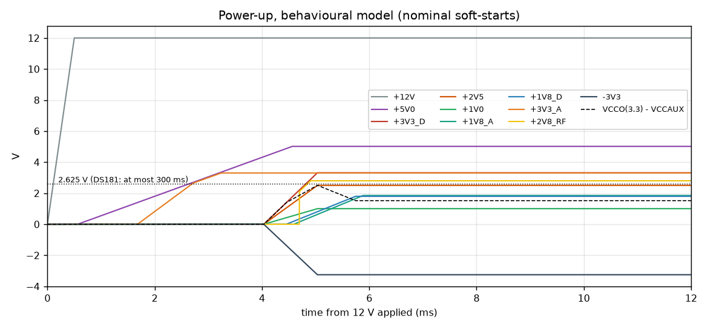
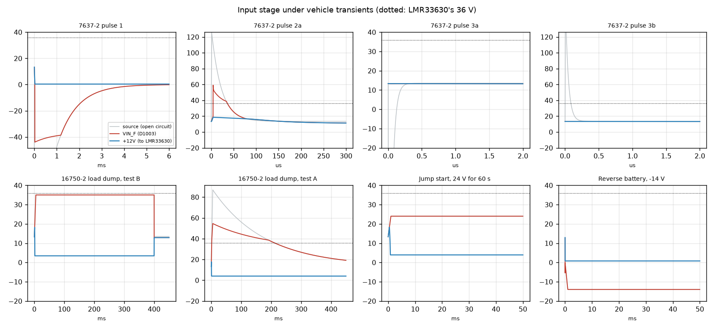

# Rev08 audit: RF and power, before the tag

*18 November 2026 · audited on `main` at `6df5766`, fixed the same day; re-audited on 19 November (section 5); ground offset addendum the same day (section 6) · scripts `_work/sim/rev08_rf_audit.py`,
`_work/power/power_audit.py`, `_work/power_budget.py`, `_work/rev08_audit_sch.py`, `_work/rev08_audit_pcb.py` · figures
and data in [`docs/sim/`](sim/)*

A last pass over the whole board as an RF engineer would make it before ordering. It covers the receive and transmit
chains from HF to 3 GHz and the clocks. It also covers the power tree: what each part gets, what each regulator
carries and what the vehicle can do to the input, so that nothing on the board can be damaged. Every finding was
then fixed. This page records both: what was found, with its numbers, and what changed.

The simulations already in the repository are reused where they apply. Three things are new:
- the Vivado power report of the routed FPGA;
- a study of the converter's preselection, now with the high-pass that fixes it;
- a power audit with eight checks, including time-domain simulations of the start-up and of the ISO 7637-2 and
  ISO 16750-2 pulses.

The reused simulations are:
- the SMA and `J961` launches (openEMS), the eyes and the skew, the PDN impedance;
- the filters' Monte Carlo, the bias tee and the LNA chokes;
- the transmit-to-receive isolation (G3) and the thermal maps;
- the gateware's end-to-end benches (`tb_system`, `tb_e2e`) and the G-8 synthetic campaign.

Marks as elsewhere: `[V]` from a data sheet or a tool run on the design, `[E]` an engineering estimate.

## 0. Verdict

**Before the fixes.** The analogue chains, the clocks and the SMA launches stood. No rail could exceed an absolute
maximum, and the input stage survived every ISO 7637-2 pulse, the suppressed load dump, a jump start and reverse
battery. But the audit found:
- three ways to damage something;
- one design gap in the new VHF/UHF converter;
- a power budget short by 0.3 A at 12 V. It had left out four loads and estimated the FPGA's VCCAUX at a quarter of
  what Vivado reports.

**After the fixes.** Every finding below is closed on the board, in the BOM or in the gateware, or is left as a
stated bench check. On the board as committed:
- DRC with schematic parity gives the same report as before the edits, and ERC the same 7 warnings (LAYOUT 6.9);
- `make_fab.py` gives 0 errors and 0 unrouted;
- the board files are reproduced by `rev08_audit_pcb.py` from the audited commit, UUIDs aside.

| # | Finding | Severity | Fix | Where |
|---|---|---|---|---|
| P1 | `U1506` TCAN330: CANH/CANL absolute maximum ±14 V. A CAN wire shorted to the battery (13.8-14.8 V while charging, 24 V on a jump start) destroys it; `D1531` PESD1CAN does not conduct below 24 V | Damage | **TCAN3403DDFRQ1** (±58 V bus fault, 3.3 V, SOT-23-8). Pin 5 is VIO, so it moved from ground to +3V3_D | Schematic, BOM, a 0.25 mm stub |
| P2 | The Pmod back-powers whichever board is off: eight 3.3 V lines with 0 Ω at both ends (the KV260's R276-R283), up to about 100 mA a line into the unpowered FPGA's clamp diodes | Damage (latent) | **Gateware on both FPGAs**. The Artix drives `PMOD_MISO` only while a Kria is present, and `PMOD_SPARE2` (the debug UART) open-drain. The K26 keeps its Pmod outputs high-Z until the adapter is alive | Gateware; no copper (the lines run as a 0.2-0.3 mm bus with no room for resistors) |
| P2b | The GPS PPS into an unpowered K26 through 220 Ω: 11 mA while the pulse is high | Damage (latent) | `R1542`/`R1543` 330 Ω: 7.6 mA | BOM |
| P2c | `FPGA_IRQ`, push-pull 1.8 V into the K26's HPA bank: up to about 48 mA while an alert holds it high with the KV260 off | Damage (latent) | Gateware: driven only once the IAS1 link has trained | Gateware |
| P3 | `F1001` (PTC, 1.5 A hold) trips in a hot car: 1.12 A worst case at 12 V, 1.28 A at 10.5 V, against 1.15 A held at 56 °C | Function (resets) | **mSMD200-24V, 2.0 A hold**, same 1812 footprint: worst case trips above 84 °C at 12 V and 73 °C at 10.5 V. A 2920 part does not fit | BOM |
| P4 | `U1006` (+1V8_D LDO) dissipates 0.91-0.94 W, not 0.50 W: VCCAUX is 0.31-0.37 A (Vivado), not 0.1 A. Through its single path to the balls (184-263 mΩ, SI 4.4), VCCAUX could sag to 1.665 V against 1.71 V | Margin | **+1V8_D at 1.85 V** (the 50 mV ANY-OUT pin grounded, as on `U1005`): VCCAUX 1.714-1.873 V at the balls. The LDO keeps its 0.91 W, checked in the CFD (P6) | Schematic, a 0.2 mm stub |
| P5 | +3V3_D carries 1.78-1.89 A from a 2 A TPS562201 (89-95 %) | Margin | **`U1002` TPS563201**: 3 A, pin for pin, with the same divider and inductor (63 %) | BOM |
| R1 | **The converter has no IF rejection.** The UHF image filter is a low-pass, so 30-480 MHz reached the mixer, the 100-170 MHz IF window included (≤ 0.4 dB). FM broadcast, airband, 2 m, marine VHF and PMR leaked through the mixer onto the UHF tuning; the 1 GHz low-pass path did the same for 480-1000 MHz | **Design gap** | **A 300 MHz high-pass ahead of preselector B** (5th-order elliptic, seven 0402 parts in frame A). IF rejection goes from 31-46 dB to 84-99 dB. Converted coverage now starts at 300 MHz | Schematic, board (LAYOUT 6.9) |
| P6 | The thermal model and the CFD took the FPGA at 0.73 W; Vivado gives 1.20 W at 25 °C and 1.55 W at 70 °C, maximum process | Margin | **CFD re-run** with 1.25 / 1.60 W (an upper bound: the industrial grade gives 1.22 / 1.45 W) and the new regulator losses. At 70 °C the XC7A50T reaches 102.1 °C without `HS4` (limit 100 °C) and **93.4 °C with it**. The enclosure's rating stays **63.3 °C**, set by `U401`'s board temperature, and there the XC7A50T is about 95 °C without `HS4`. **Fit `HS4` in a vehicle**: it is required above 68 °C with a K26I ([ENCLOSURE_V2_THERMAL](ENCLOSURE_V2_THERMAL.md) section 8) | Simulation; `HS4` in the assembly notes |
| P7 | VCCINT, VCCO and the 3.3 V parts' ±5 % windows were met nominally but not in the worst-case linear stack (the TPS562201's reference is ±2.5 % over temperature) | Note | `R1031` 3.24 k: +1V0 at 1.017 V, so the balls sit at 0.983 V at full load. Root-sum-square inside every window; measure each rail on the first board (the XADC reads VCCINT) | BOM |
| P8 | `U1315` (+3V0_RF) could reach dropout at the worst corner (26 mV of headroom against 180 mV), letting the 580 kHz ripple of +3V3_D onto the RFFC5072's supply | Note | **LP5907MFX-2.8**: the rail is `+2V8_RF`, with 232 mV of headroom at the worst corner | BOM, net rename |
| R2-R8 | Half-IF response, LO leakage, the TCXO's pin 1, the bias tee against the antenna TVS, no limiter on `J961`, floating switch controls at power-up | Notes | Section 1.3; R3 by gateware | Mostly none |

## 1. RF

### 1.1 What stands (reused simulations)

| Chain or item | Evidence | Result |
|---|---|---|
| SMA launches (12) and `J961` | openEMS, SI 2.1 and 9.10 | Return loss ≥ 39 dB at 500 MHz on the twelve; `J961` −18.1 dB at 1.1 GHz (0.07 dB mismatch loss) |
| HF input `IF_RX_C` | Rev07 anti-alias filter, Monte Carlo (SI 9.9) | ≥ 60 dB from 50 to 600 MHz, ≤ 1.7 dB in band |
| VHF/UHF filters with catalogue parts | `rev08_filters_mc.py`, 2,000 runs each | All four pass their masks at p1/p99 (REV08_PLAN 5.4) |
| Bias tee and LNA drain feed | `bias_tee.py` (SI 9.10) | ≤ 0.30 dB and ≤ 0.23 dB from 25 MHz to 1.1 GHz, no resonance |
| Coupling into converters and clocks | `txrx_isolation.py`, gate G3 | No LO, reference, IF or USB copper within 1.5 mm on the same layer; worst track coupling −102 dB |
| Converter cascade | `rev08_frontend.py` | NF 2.0 dB direct, 3.7 dB UHF, 7.1 dB ADS-B; full scale −52 to +2 dBm. The high-pass adds 1.1-1.5 dB ahead of the mixer, after the LNA's 22 dB: about 0.1 dB of NF |
| Clock tree | SI 9.8 | Si549 + ADCLK948 ≈ 120 fs, about 80 dB SNR ceiling at a 120 MHz IF |
| Link, Ethernet, PDN | SI 3, 4, 9.7 | Eyes open at 1 and 1.25 Gb/s; VCCINT under target to 100 MHz |
| End to end | `tb_system` S1-S7 at 400 and 500 MHz, `tb_e2e`, G-8 campaign (FPGA_GATEWARE) | Pass, with their mutations failing as they should |

The pin-outs were checked again in this pass against:
- the RFFC5072's data sheet (DS140110 pin table and the wideband application schematic, p.13);
- both baluns: the TC4-1W+ secondary with its centre tap to the mixer (200 Ω), and the TC1-1-13M+;
- the SPF5043Z;
- the TCXO's level: 0.8 V p-p minimum into the reference input's 0.5-1.5 V p-p.

They match. The mixer's output pins are numbered 27 OPN / 28 OPP in the pin table and the other way round in the
application schematic. A receiver does not care: it is a 180° phase.

### 1.2 R1: the converter had no IF rejection, and the high-pass that fixes it

`rev08_rf_audit.py` runs the preselection with its drawn values (the lossy-inductor and pad model of
`rev08_filters_mc.py`):


| Frequency | 88-108 MHz | 118-170 MHz | 250 MHz | 300 MHz | 446 MHz | 513.5 MHz | 660-2500 MHz |
|---|---|---|---|---|---|---|---|
| UHF low-pass alone (as audited) | 0.1-0.2 dB | 0.2-0.4 dB | 0.7 dB | 0.8 dB | 0.8 dB (in band) | 7.9 dB | ≥ 53 dB |
| High-pass + low-pass (now) | 56-70 dB | 53-67 dB | 13 dB | 1.9 dB | 1.2 dB | 8.2 dB | ≥ 53 dB |

**What was wrong.** The design checked the image (RF + 270 MHz, ≥ 50 dB) and the LO, but not the IF itself.
- Anything already at 100-170 MHz reached the mixer at full strength, after 22 dB of LNA.
- It then leaked to the mixer's output at the mixer's RF-to-IF isolation and landed in the IF window as if it had
  been converted, at RF = LO − f.
- At 446 MHz, for example, FM 100-108 MHz showed at 473-481 MHz, airband at 444-463 MHz, and 2 m, marine and PMR at
  407-437 MHz.

The data sheet plots the mixer's RF leakage only from 500 MHz up (45-60 dB below a 0 dBm input). Taking 35-50 dB at
135 MHz [E]:
- the IF rejection was **31-46 dB**;
- a −30 dBm FM or airband carrier at the antenna then looked like a −61 to −76 dBm UHF signal, 53-68 dB above the
  −129 dBm floor in 12.5 kHz;
- the same carriers loaded the mixer: −20 dBm at the antenna was about 0 dBm at its input.

**The fix.** A 5th-order elliptic high-pass in series with preselector B's common input (`VU_PSB_IN` to
`VU_PSB_HP`):
- the parts: series 11 pF, shunt 24 nH + 36 pF, series 5.6 pF, shunt 22 nH + 91 pF, series 8.2 pF (`C1441`-`C1445`,
  `L1441`-`L1442`, LQW15AN and C0G);
- nominal: 1.13 dB of loss at most from 300 MHz to 3 GHz, 12.7 dB of return loss, 52.8 dB of rejection below 175 MHz;
- Monte Carlo over 3,000 boards (L ±2 %, C ±0.1 pF or ±2 %, pads, inductor Q 35-55, capacitor ESL, 0.25 nH in each
  shunt branch): loss p99 1.51 dB, return loss p1 10.7 dB, rejection p1 51.7 dB.

**What it gives.**
- **IF rejection: 84-99 dB.** The same −30 dBm carrier now sits 0-15 dB above the 12.5 kHz floor; a typical −50 dBm
  one is under it.
- It serves every preselector B path. The SAW and LTCC high-pass paths did not need it; the LTCC low-pass path did,
  for 480-1000 MHz.
- **The converter covers 300 MHz up.** From 170 to 300 MHz nothing is covered: the direct path ends at 170 MHz, and
  a 135 MHz IF cannot reject signals that close to its own frequency. A dual conversion (REV08_PLAN §6) is the way
  to cover them in a later revision.
- On the board: seven 0402 parts in frame A between `U1304` and the frame's wall, the shunt branches grounded
  straight to the wall (LAYOUT 6.9).

### 1.3 Smaller RF points

| # | Point | Consequence | Status |
|---|---|---|---|
| R2 | Half-IF (2×2) response of 446 MHz at 513.5 MHz: the preselection takes off 8.2 dB (14.8 dB for 3×3 at 536 MHz) | DVB-T channel 26 (506-514 MHz) sits on it; the mixer's own 2×2 suppression (not in the data sheet) is what is left | Bench check with a DVB-T multiplex. A 7th-order filter cannot pass 480 MHz and stop 513 MHz |
| R3 | LO at the mixer input, estimated −45 dBm [E], back out of `J961` | −100 dBm through the UHF low-pass and the LNA; about −49 dBm with the LNA bypassed on the 1 GHz low-pass path, above the −57 dBm receiver spurious limit [E] | **Fixed in the gateware**: the LNA is held in while the converter runs on the LFCN path; RFFC5072_PROGRAMMING §6 |
| R4 | LO at the ADC: −38 dBm at the mixer output [V plot], then 63-78 dB of anti-alias filter | −63 to −78 dBFS; aliased into the window at 125 MHz (TETRA) and 155 MHz (ADS-B) | Known fixed tones, 10-20 MHz off the wanted signal: nothing to do |
| R5 | TCXO pin 1 to its supply through 10 k (`R1341`) | If the fitted 1XXD part is the VC-TCXO variant, Vcont sits above its 0.4-2.4 V range: +3 to +5 ppm (about 2 kHz at 446 MHz), no damage | Check the variant on the reel; for a VC-TCXO, a divider to 1.4 V |
| R6 | Bias tee at 5 V against `D1301` PESD5V0F1BL (5 V stand-off) | With +5V0 at its 5.18 V maximum the antenna line sits above the TVS's stand-off: leakage, no damage [E] | BOARD_MANUAL: prefer `JP1301` at 3.3 V for antennas that accept it |
| R7 | No limiter on `J961`; the SPF5043Z's absolute maximum is +25 dBm in | A transmitter on the same vehicle (a 2 m mobile at 1 m) can destroy the LNA | BOARD_MANUAL: an external limiter for co-sited installs |
| R8 | The TCA6416A's ports are inputs until written: the PE4259, PE42442 and SKY13418 control pins float at power-up | Random path, perhaps a few hundred µA of extra current, no damage; the PE4312 powers up at 31.5 dB and the RFFC5072 off, so the ADC is protected | The gateware writes the expander at start; pull-downs on the next revision |

The direct-sampling path, the radar and the HF chains are unchanged from SI 9.8-9.9. They keep the limits stated there:
- wideband `J911`/`J922`;
- the DAC clocks from the FPGA;
- the switches below 10 MHz;
- exciter-level outputs;
- switcher harmonics in HF.

## 2. Power

### 2.1 The budget, with Vivado's figures and the loads that were missing

`power_budget.py` used to carry the FPGA as estimates: VCCINT 700 mA, VCCAUX 100 mA. Four loads that are on the
board were not in it at all:
- the RTL8211FSI PHY, 0.5 W;
- the TCAN transceiver, 55 mA while dominant;
- the fan, 0.1 A;
- the bias tee, up to 155 mA.

Vivado 2026.1 `report_power` on the routed Rev08 design (vectorless, so "Low" confidence until measured) gives:

| FPGA rail | 25 °C, typical | 70 °C, maximum process | Estimate until now |
|---|---|---|---|
| VCCINT + VCCBRAM | 420 mA | 735 mA | 700 mA |
| VCCAUX | 313 mA | 365 mA | 100 mA |
| VCCADC (from VCCAUX) | 21 mA | 31 mA | not counted |
| On-chip power | 1.20 W | 1.55 W | 0.73 W (the thermal model's figure) |

VCCAUX feeds the three MMCMs (0.40 W) and the I/O (0.33 W: IDELAY, ISERDES, LVDS).


The board as fixed. The worst case is 70 °C with maximum process, the bias tee at its limit, CAN dominant and the
fan running.

| Rail | Regulator (rating) | Typical | Worst | Use | Dissipation, worst |
|---|---|---|---|---|---|
| +5V0 | LMR33630 (3 A) | 2.10 A | 2.41 A | 80 % | 1.34 W |
| +3V3_D | **TPS563201 (3 A)** | 1.78 A | 1.89 A | 63 % (95 % of the TPS562201) | 0.69 W |
| +2V5 | TPS562201 (2 A) | 0.60 A | 0.60 A | 30 % | 0.20 W |
| +1V0 | TPS562201 (2 A) | 0.42 A | 0.74 A | 37 % | 0.10 W |
| +1V8_A | TPS7A8300 (2 A) | 0.50 A | 0.50 A | 25 % | 0.32 W |
| +1V8_D | TPS7A8300 (2 A), 1.85 V | 0.57 A | 0.63 A | 31 % | 0.91 W |
| +3V3_A | TPS7A8300 (2 A) | 0.10 A | 0.10 A | 5 % | 0.17 W |
| +2V8_RF | **LP5907-2.8 (0.25 A)** | 0.18 A | 0.18 A | 72 % | 0.09 W |
| Input | | **0.97 A, 11.7 W** | **1.12 A, 13.4 W** | | |

**+1V8_D's LDO stays at 0.91 W.** Feeding it from +2V5 would halve that, but it would mean re-routing its input
through the power corner. With the 3 A buck for +3V3_D, the only reason to move it is thermal, and the CFD with the
real losses decides that (P6).

### 2.2 Voltage windows and LDO headroom

Each rail's tolerance at the part is taken as the sum of:
- the regulator's reference over temperature (LMR33630 ±1.5 %, TPS562201/TPS563201 749-787 mV, TPS7A8300 ±1 %,
  LP5907 ±3 %);
- 1 % resistors;
- ripple and load step [E];
- the copper drop of SI 4.4.

Nothing reaches an absolute maximum.

| Part | Rail at the part, worst case, as fixed | Range | Note |
|---|---|---|---|
| XC7A50T VCCAUX (at the balls) | 1.714-1.873 V (was 1.665-1.823 V at 1.80 V) | 1.71-1.89 | P4 |
| AD9484 / AD9253 DRVDD | 1.797-1.873 V | 1.70-1.90 | inside |
| XC7A50T VCCINT | 0.933-1.067 V linear, inside on root-sum-square | 0.95-1.05 | P7: measure |
| XC7A50T VCCO 2.5 / 3.3 V, Si549, RTL8211FSI | 9-60 mV outside ±5 % at the linear corners | ±5 % | P7: measure |
| RFFC5072, SPF5043Z, the switches | 2.701-2.889 V | RFFC5072 2.7-3.3 V | P8 |
| AD9484, AD9253 AVDD, AD8352, DACs, ADCLK948, TCAN3403, M3SWA2 | inside | each part's own | inside |
| M3SWA2 VEE (LM2663) | −3.38 to −3.20 V | −3.3 typ, −3.6 limit | inside |

| LDO | Worst headroom | Dropout at its load | |
|---|---|---|---|
| U1005 +1V8_A from +2V5 | 0.50 V | 0.05 V | OK |
| U1006 +1V8_D (1.85 V) from +3V3_D | 1.27 V | 0.06 V | OK |
| U1007 +3V3_A from +5V0 | 1.52 V | 0.01 V | OK |
| U1315 +2V8_RF from +3V3_D through FB1301 | **0.23 V** (was 0.03 V at 3.0 V) | 0.18 V | OK |

### 2.3 Input current and F1001

The board is a constant-power load to the input. The worst case draws 1.12 A at 12 V, 1.28 A at 10.5 V (engine off,
a tired battery) and 1.49 A at 9 V. A polymer PTC's hold current falls with its own temperature [E: an 1812 series'
derating table]:

| PTC at | 25 °C | 40 °C | 56 °C | 70 °C | 85 °C |
|---|---|---|---|---|---|
| 1.5 A part (as audited) holds | 1.48 A | 1.32 A | 1.15 A | 0.99 A | 0.83 A |
| **2.0 A part (mSMD200-24V, now)** holds | 1.97 A | 1.76 A | 1.54 A | 1.32 A | 1.10 A |

With the 1.5 A part, the worst-case load tripped it above 60 °C at 12 V and above 44 °C at 10.5 V. The PTC sits inside
an enclosure rated to 56 °C ambient. With the 2.0 A part the same load trips it above 84 °C at 12 V and above 73 °C at
10.5 V. The typical load never trips it below 85 °C. A 2920 part would hold more, but its courtyard overlaps `J1001`,
`Q1001`, `R1004` and `TP4`.

### 2.4 Start-up



The model has 12 V applied at t = 0 and:
- the LMR33630's 4 ms soft-start (2.9-6 ms);
- the three bucks waking at 4.1 V of +5V0, then 1 ms of soft-start;
- the TPS7A8300s ramping by 6.2 µA (4.0-9.0) into their 10 nF;
- the LP5907, the charge pump and the divider following their inputs.

Run at nominal and at both soft-start corners:
- **Order:** VCCINT, VCCO_34 and VCCO_14/15 together at about 5 ms, then VCCAUX 0.4-1.4 ms later, then the ADCs' AVDD.
  DS181's order (VCCINT, VCCAUX, VCCO) is a recommendation for minimum inrush, not a requirement.
- **The one hard rule:** VCCO − VCCAUX > 2.625 V is allowed for at most 300 ms per power cycle. It happens for at most
  0.26 ms (slow LDO corner).
- **The ADC inputs:** they are AC-coupled (100 nF) from AD8352s on +5V0, which comes up first. The coupled current
  is C × dV/dt = 62 µA over the 4 ms ramp, so nothing reaches the AD9484's input clamps.
- **The camera, link and PHY:** no other constraint applies. The link is AC-coupled, and the PHY has its own RC
  power-on reset (`R1214`/`C1216`), which the FPGA can extend through `ETH_RSTN`.

### 2.5 Vehicle transients



Each pulse is applied at `J1001` through its source resistance and 1 µH of harness. The model is time-stepped with
backward Euler and Newton, and includes:
- the PTC;
- `D1003` (SMCJ33CA: VBR 36.7-40.6 V, 53.3 V at 28.2 A, 1500 W);
- `C1090`;
- the LM74502-Q1: OV cut-off at 18.3 V with its 1 µs turn-off and 10 µs turn-on, reverse polarity;
- two DMT10H015LFG (13.5 mΩ each);
- `D1001` (SMBJ18CA) and the +12V capacitors, derated 50 % for DC bias;
- the board as a constant-power load.

| Pulse | VIN_F | +12V | FET VDS | TVS energy (limit, Wunsch-Bell [E]) | |
|---|---|---|---|---|---|
| ISO 7637-2 pulse 1, −150 V, 10 Ω, 2 ms (supply cut) | −44.0 V | falls to 0.4 V (board resets) | 44 V | D1003 0.19 J (2.1 J) | Pass |
| Pulse 2a, +112 V, 2 Ω, 50 µs | +59.1 V | 18.6 V | 41 V | D1003 0.016 J (0.33 J) | Pass |
| Pulses 3a / 3b, −220 / +150 V, 50 Ω, 0.1 µs | ±0.1 V (C1090 absorbs them) | unchanged | 0 | none | Pass |
| ISO 16750-2 load dump B, suppressed to 35 V, 400 ms | 35.0 V | 18.3 V, then the FETs open (board resets) | 32 V | none (below 36.7 V) | Pass |
| Load dump A, 87 V **unsuppressed**, 1 Ω, 400 ms | +54.6 V | 18.3 V, FETs open | 51 V | **D1003 116 J (30 J)** | **Fail** (known: POWER_SPEC 1.1) |
| Jump start, 24 V for 60 s | 24.0 V | FETs open | 20 V | none | Pass (board off while over 18.3 V) |
| Reverse battery, −14 V | −27.8 V (harness ringing) | 0.8 V | 29 V | none | Pass |

Limits held in every passing case:
- +12V stays under the LMR33630's 36 V;
- VIN_F stays inside the LM74502-Q1's ±65 V;
- the FETs stay under 100 V;
- the 25 V capacitors on +12V see at most 18.6 V.

Unsuppressed load dump is the one case the board cannot take. Every car built in the last twenty years has central
suppression (test B). For an old vehicle, fit a load-dump TVS (a DO-218 SM8S33A class) at the harness.

### 2.6 Outward supplies, and the lines between the boards

| Fault | Limiter | Result |
|---|---|---|
| `J961` bias tee shorted | AP22652, 95-155 mA, fault flag | Safe; FB1302 (250 mA) and L1301 (170 mA) are rated above the limit |
| GPS supply on `J1503` shorted | F1501, 0.2 A hold | Trips; +3V3_D sags briefly |
| Fan shorted | F1002, 0.5 A hold | Trips; +5V0 holds |
| CAN wire to the battery or a 24 V jump start (P1) | **TCAN3403-Q1, ±58 V** | Survives; the TCAN330 (±14 V) would not have |
| USB host, board off | LP5907 from VBUS, 1 k to the FPGA | ≤ 3 mA into the FPGA |

| Line to the other board, one side unpowered | Current | |
|---|---|---|
| Pmod, eight 3.3 V lines, 0 Ω both ends (P2) | up to about 100 mA a line if a board drove into an unpowered one | **No line is driven high toward an unpowered board**: `kria_present` / `adapter_alive` gating and `PMOD_SPARE2` open-drain |
| GPS PPS to J9 pin 12, through **330 Ω** | 7.6 mA while the pulse is high (100 ms a second) | Under 10 mA |
| CAN RX to J9 pin 8 through 1.8 k / 1 k | 0.9 mA | OK |
| IAS1 LVDS | AC-coupled | OK |
| IAS1 I²C (open drain), PROG_B (74LVC1G07, Ioff) | none | OK |
| IAS1 FPGA_IRQ, 1.8 V push-pull, idle low | none: driven only after link training | OK |

## 3. What changed, by file

- **Schematic:**
  - RX_VU (`rx_vu_spec.py`, regenerated): the high-pass, `+2V8_RF`, `U1315` LP5907MFX-2.8, and `C1305` kept DNP by
    the generator;
  - STATUS (`status_spec.py`): `U1506` TCAN3403DDFRQ1 with its pin 5 on +3V3_D (a new symbol, TCAN330's drawing with
    pins 5 VIO and 8 STB), `R1542`/`R1543` 330 Ω;
  - POWER (`rev08_audit_sch.py`): `U1002` TPS563201, `R1031` 3.24 k, `F1001` PTC 2A hold, `U1006` pin 5 to ground.
- **Board** (`rev08_audit_pcb.py`, LAYOUT 6.9):
  - the high-pass in frame A;
  - the two pin-5 stubs;
  - values and the rail's name.
- **BOM** (`lcsc_select.py` rules): TCAN3403DDFRQ1 C35926232, TPS563201DDCR C116592, LP5907MFX-2.8 C186700,
  mSMD200-24V C143954, LQW15AN24NG00D C167472. Quote in [JLCPCB_QUOTE.md](JLCPCB_QUOTE.md).
- **Gateware** ([FPGA_GATEWARE.md](FPGA_GATEWARE.md)):
  - the Pmod gates on both FPGAs, `PMOD_SPARE2` open-drain;
  - `FPGA_IRQ` after training;
  - the LNA held in on the LFCN path;
  - the band table from 300 MHz.
- **Docs:** RX_VU_SPEC 1.5, POWER_SPEC, POWER_AND_STACKUP, SIGNAL_INTEGRITY 4.4, RFFC5072_PROGRAMMING 6, REV08_PLAN
  11.10, LAYOUT 6.9, BOARD_MANUAL, INTEGRATIONS 2.2.

## 4. How to re-run

```
python _work/power_budget.py           # the budget, with the Vivado figures
python _work/power/power_audit.py      # the eight power checks, about 20 s; docs/sim/power_*.png, power_audit.json
python _work/sim/rev08_rf_audit.py     # the preselection and the high-pass; docs/sim/rf_audit_uhf_path.png, rf_audit.json
python _work/rev08_audit_pcb.py <audited board> <out>   # the board edits, from the commit before them
```

To repeat the Vivado power report:
- open `fpga/artix/.build_rev06/artix_top_routed.dcp`;
- run `set_operating_conditions -grade industrial -ambient_temp 70 -process maximum -board_layers 8to11`;
- run `report_power`.

## 5. The final re-audit (19 November 2026)

The owner asked for one more full pass once everything above was in, before the tag. It covered RF, power, thermal,
the board's DRC, ERC and parity, the BOM and the gateware. It ran on `main` from `c1e6b1c`, the audit's fixes,
onwards. Anything it found was fixed before going on.

### 5.1 What it found and fixed

| # | Found | Fix | Where |
|---|---|---|---|
| F1 | **Two vias of `Net-(C1414-Pad2)` 0.10 mm apart, drill to drill** (the rule is 0.25 mm), beside `C1415`. DRC had carried it as an accepted warning since Rev04. One net, so no short, but a drill that can break through | One via goes; `C1415` joins the other on L8 | Board, `_work/rev08_final_cleanup.py`, LAYOUT 6.10 |
| F2 | 15 more copper warnings carried as accepted: four vias in pads that reached no other layer (on `XO_SDA`, `U902` RFOUT2, `VU_LP1G_IN`, `VU_ATT_IN`), three through vias used only to join two tracks on one layer, eight dead stubs | Removed, or replaced by short tracks. No copper warning is left | Board, LAYOUT 6.10 |
| F3 | `PMOD_CS_N` had no pull on the Artix. The Artix sets `kria_present`, and so drives `PMOD_MISO`, after 1 ms of CS high. A line left floating by an unpowered K26, or by one that still holds its outputs high-Z, could read high and defeat the P2 gate | `PULLDOWN` on `pmod_cs_n` in `xc7a50t.xdc`. It sinks, so it never sources current into the other board | Gateware |
| F4 | The Ethernet build (`build_rev06.tcl`) missed timing after the audit's gateware gates. It failed by 0.186 ns at first, then by 0.013 and 0.055 ns on paths that moved from one build to the next | The eye finder rotates its mask instead of indexing it (no 32:1 mux). The IDDR pipe flops take the IDDR's own edge, so ILOGIC to fabric gets a full cycle. The AERIS NCO reset's fanout is capped at 8. **WNS +0.007 ns**, 0 failing; `build.tcl` **+0.035 ns** | Gateware, FPGA_GATEWARE 4 |
| F5 | Vivado's power reports used the commercial grade: "junction temperature exceeded" at 70 °C and a pessimistic static power | Reported for the fitted industrial grade: 1.223 / 1.446 W. The budget and the CFD keep 1.25 / 1.60 W as an upper bound | `build_rev06.tcl` |
| F6 | P6 left open: the XC7A50T at 102 °C at 70 °C ambient without `HS4` | CFD cases with `HS4`: 93.4 °C (94.2 °C clogged). See P6 | `mech/v2_cfd`, ENCLOSURE_V2_THERMAL 8 |
| F7 | **The book's build ran away**, to 47 GB. MuPDF's Story never finishes a table chunk whose last row ends flush with the foot of a page; the BOM table of JLCPCB_QUOTE hit it after the audit's new rows | `export_documentation.py` stops a layout that makes no progress and moves that cut one row up. All 32 documents settle; `pdf_table_check` 0 defects | Tooling |
| F8 | FABRICATION still gave the BOM of 17 November (214 lines, 739 parts) | 224 lines, 770 parts; CPL 770, the same references as the BOM | Docs |

### 5.2 What it checked and left as it was

- **The board.** DRC with zones refilled and schematic parity: 0 errors, 0 unconnected, 0 parity problems, and no
  copper warnings. What is left is silkscreen and library notices (LAYOUT 6.10). ERC gives the same 7 `pin_to_pin`
  warnings. `make_fab.py`: 0 errors, 0 unrouted. 222 of 224 BOM lines have an LCSC code with stock; the other two,
  `Y401` and `T1301`, are consigned.
- **The parts the audit changed, pin by pin against their data sheets:**
  - `U1506` TCAN3403: VCC and VIO on +3V3_D, STB to ground;
  - `U1002` TPS563201: the TPS562201's pin-out and its 0.768 V reference, so the same divider. Its SRP7028A
    3.3 µH carries the 3 A part's current with room to spare;
  - `U1315` LP5907MFX-2.8: EN tied to IN.
- **Capacitor voltage ratings against their rails**, with every capacitor's LCSC part. No rail capacitor runs above 50 %
  of its rating at the nominal voltage. The worst transient puts +12V at 18.6 V (pulse 2a and the suppressed load
  dump), 74 % of the 25 V parts there. VIN_F's are 100 V.
- **RF.** `rev08_rf_audit.py` and `txrx_isolation.py` re-run on the cleaned board: unchanged. R2 to R8 stand as notes
  (section 1.3).
- **Thermal margins at 70 °C**, from the CFD:
  - the LMR33630 at 117.7 °C (limit 125 °C);
  - `U1006` at 111 °C (limit 125 °C);
  - the K26I at 99.2 °C (limit 100 °C).

  The enclosure's rated ambient is 63.3 °C, not 70 °C; all three have more room there.
- **Gateware.** All the benches pass, among them `tb_system` at 500 and 400 MHz. The four gate mutations fail as they
  should. `cargo test`: 61 of 61.

- **The K26 build** (`fpga/kria/bd.tcl`) re-run on the gateware of section 5.1: `WNS +1.043 ns`, `WHS +0.010 ns`,
  0 failing endpoints of 188,554, 53,336 LUT. The CDC report gains one synchroniser, `PMOD_SPARE2`'s. The other
  crossings are the ones of 18 November ([FPGA_GATEWARE.md §3.3](FPGA_GATEWARE.md)).
- **The front end with the 300 MHz high-pass** (`rev08_filters_mc.py`, `rev08_frontend.py`). The filter passes all
  3,000 Monte Carlo runs: loss 1.52 dB at p99, rejection 51.7 dB at p1 against the 50 dB mask. It costs the
  converted modes 1.1 dB: ADS-B noise figure 7.1 to 7.9 dB, UHF 3.7 to 4.2 dB. The direct modes do not change
  ([RX_VU_SPEC.md](RX_VU_SPEC.md)).
- **The documents.** Stale figures swept and every em-dash removed from the public `.md` files. The book is rebuilt:
  278 pages, `pdf_table_check` 0 defects.

## 6. Addendum: ground offset and earth loops between the two boards (19 November 2026)

The owner asked whether two supplies, one for each board, could hurt the module: in a car, each board grounded at a
different point; at home, two earthed wall adapters. The answer had to come with numbers, so it was modelled
(`_work/power/ground_offset.py`, `docs/sim/ground_offset.png` and `.json`), and the design was changed to remove
the problem.

### 6.1 What was wrong

The two boards share their ground through the 22 ground contacts of the BM20 connectors `J101`/`J102`, the FFC and
the Pmod cable: 1.3 mΩ in all `[V/E]`, 94 % of it in the BM20s, each rated 0.3 A `[V]` (Hirose D47513). With each
board on its own supply, any voltage between the two return points drives current through that link:

| Wiring before the change | Per BM20 ground contact | Against 0.3 A |
|---|---|---|
| Both grounds to the same point, 1 m wires | 40 mA | Pass |
| Two points, 1 V apart (ISO 16750-2 section 4.8), 1 m wires | 411 mA | **Fail from 0.75 V** |
| Two points, 1 V apart, 0.3 m wires | 714 mA | **Fail from 0.40 V** |
| Home, two earthed supplies, 1 V between the earths (50 Hz) | 148 mA | Pass, but 3.5 A of loop current |

The KV260 also cuts off above 13.2 V (its MP5016 eFuse, XTP682 page 3) `[V]`: it cannot share the adapter's
18.3 V input window.

### 6.2 What changed

- **Single power entry** (sheet KVPWR, [POWER_SPEC section 1.4](POWER_SPEC.md)). `J1001` feeds the whole module.
  `L1004`, a 6 A common-mode choke, sits on both lines. The KV260 is fed from the adapter's `J1004` through
  `U1010` TPS26631 (OVP 14.4 V, UVLO 8.0 V, current limit 3.0 A, −60 V reverse with `Q1010`) by a short jumper to
  its `J12`. There is no second supply and no second ground wire.
- **The current limit is the BM20 limit too.** With a single entry, nearly all the KV260's own return (96 %) crosses
  to the adapter through the BM20 link, because the link is 1.3 mΩ against the jumper's 33 mΩ. So `R1043` sets
  3.0 A, the KV260's own brick rating (2.77 to 3.19 A at ±7 %), not the 3.6 A first drawn: at 3.6 A, a contact with
  half the others' resistance would have carried 305 mA.
- **The RJ45's shield** goes to ground through `R1218` 1 MΩ in parallel with `C1223` 1 nF 2 kV. It was the only DC
  path to an earthed switch or PC at the far end of an Ethernet cable. USB is not treated the same way: its ground
  is a conductor of the cable, so a shield RC would not open the loop.

### 6.3 The result, as built

| Case, single entry, worst currents | Per BM20 ground contact (worst one) | Heat in that contact, in all 22 | Result |
|---|---|---|---|
| Any voltage between vehicle ground points (there is one entry) | 132 mA at 3.19 A | 0.53 mW, 11.6 mW | Pass |
| Typical load (KV260 0.92 A) | 38 mA | | Pass |
| All contacts at their 100 mΩ maximum | 109 mA | 1.19 mW, 26.2 mW | Pass |
| Jumper's ground contact open (all the return through the link), contacts at maximum | 122 mA (138 mA at typical) | 1.48 mW, 32.5 mW | Pass |
| One contact at half the others' resistance, at 3.19 A | 254 mA | 0.97 mW, 11.2 mW | Pass |
| One contact at a third of the others' (15 against 45 mΩ), at 2 A | 219 mA | | Pass |
| The same at 3.19 A | 352 mA | 1.86 mW, 14.9 mW | Pass on heat, over 0.3 A |
| One at a third, the other 21 at their 100 mΩ maximum, at 3.19 A | 306 mA | 3.13 mW, 25.0 mW | Pass on heat, over 0.3 A |
| Home: one earthed supply, an earthed monitor on DisplayPort, 1 V between the earths | 189 mA (rms, with the DC load) | | Pass |

**Uneven sharing and the 0.3 A figure.** The rating is a heating limit: Hirose derives its current ratings from the
temperature rise measured under current, less a 20 % margin (Hirose, "Connector derating curves"), and the BM20's
operating range includes that rise `[V]` (catalogue D47513). Current gathers in one contact only because that
contact's resistance is low, so its heat, I²R, is the quantity to compare, not its current. The references: a typical
30 mΩ contact at 0.3 A makes 2.7 mW, a contact at its specified 100 mΩ maximum, still rated 0.3 A, makes 9.0 mW, and
all 22 at 0.3 A make 59 mW. Every case is below the 9.0 mW and the 59 mW. All but one are below 2.7 mW as well. The
exception (3.13 mW) needs 21 contacts worn to their maximum and one still new, at the KV260's worst current limit.
`_work/power/ground_offset.py` reports these figures (`single_entry.heat` in `docs/sim/ground_offset.json`).

Input current at `J1001` (5 A rated): 1.12 A for the adapter plus 3.19 A for the KV260, 4.31 A at worst. `L1004`
(6 A, 2 × 8 mΩ) dissipates 0.30 W there.

Board: DRC 0 errors and 0 unconnected with schematic parity, on the refilled copy as `make_fab.py` checks it;
ERC the 7 known `pin_to_pin` warnings. `_work/kvpwr_pcb.py` and `_work/ethshield_pcb.py` rebuild the edits from
the board before them.

### 6.4 What it does not do

- `L1004` attenuates the supply's common-mode noise by 3 to 10 dB (2.9 dB at 65 kHz, 9.5 dB at 100 MHz,
  `docs/sim/cm_noise.json`). It does not open an earth loop closed through another cable.
- Such loops remain where a cable carries ground as a conductor: DisplayPort to an earthed monitor (in rating, the
  table above), USB to an earthed PC (use a USB isolator or a laptop on battery for the debug port). They are
  installation matters, in [BOARD_MANUAL section 6](BOARD_MANUAL.md).
- In a car, the module needs a regulated 12 V converter upstream (12.0 V, at least 5 A, output under 13.2 V) behind
  a 5 A fuse. That converter is also what covers the unsuppressed load dump (test A), which exceeds `D1003`'s
  energy rating, as it did before this change.
