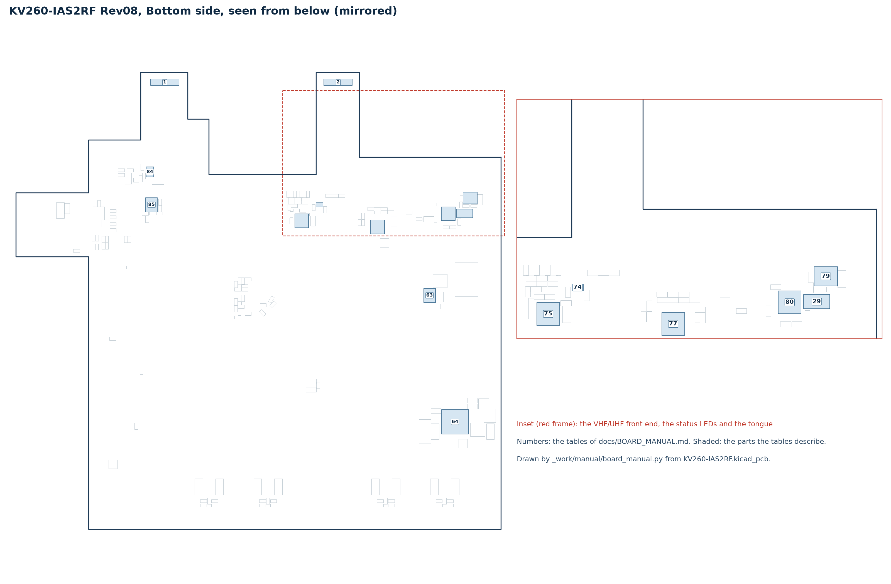
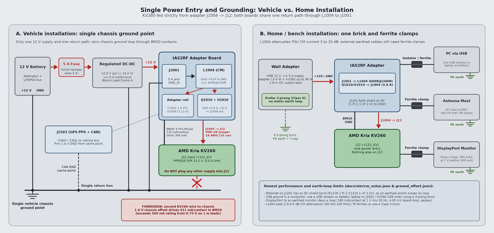
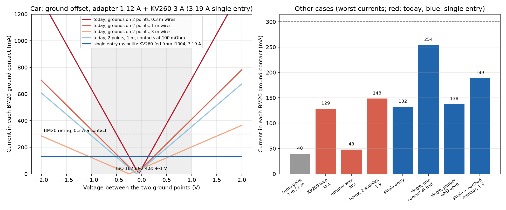

# Board manual

What every connector, LED, switch and chip on the KV260-IAS2RF Rev08 board is for, so that the board can be used without the schematic. The drawings and the tables are generated together from the board file by `_work/manual/board_manual.py`, which also checks that every connector, LED and IC on the board is listed and that every listed part is on the board.

For orientation, the rendered board: [top](img/board_top.png), [bottom](img/board_bottom.png), [iso](img/board_iso.png). Vector drawings: [top](img/manual/board_top.svg), [bottom](img/manual/board_bottom.svg).

## 1. Connectors

The thirteen SMAs are on the front edge (`J401`-`J952`) and the back wall (`J961`). Every RF port is DC-blocked except `J961` when its bias tee is on.

| No. | Ref | Side | Name | What it is for |
|---|---|---|---|---|
| 1 | `J101` | bottom | BM20B(0.8)-34DP | IAS1 to the KV260 (its `J8`), underneath: five LVDS pairs at up to 1 Gb/s each (three data lanes, two clocks), the housekeeping I2C (temperature sensor, ID EEPROM) and the FPGA's interrupt. The board's only data link to the Kria |
| 2 | `J102` | bottom | BM20B(0.8)-34DP | IAS0 to the KV260 (its `J7`), underneath. Every pin is passed through to `J103`; the board uses none |
| 3 | `J103` | top | BM20B(0.8)-34DS-0.4V(51) | IAS0 pass-through receptacle on the tongue's top face, pin for pin with `J102`: an IAS camera module plugs in here as it would on the carrier |
| 4 | `J401` | top | CLK_REF_IN | Reference clock input (SMA) to the ADCLK948, 0.4-3.4 V p-p differential range, 50 ohm on chip. Leave open to run from the on-board Si549 |
| 5 | `J402` | top | CLK_OUT | Clock output (SMA), ADCLK948 Q3, LVPECL: to share the master clock with an instrument |
| 6 | `J911` | top | SDR_RX_A | SDR receive A (SMA): through SW1's default throw to the AD9253 channel A. Full scale about -2.4 dBm; DC-blocked |
| 7 | `J912` | top | AERIS_IF_A | Radar IF into the 14-bit AD9253 (SMA), through SW1's second throw |
| 8 | `J921` | top | AERIS_IF | Radar IF from AERIS-10 (SMA): through SW2's default throw to the 500 MSPS AD9484. Full scale about -17.6 dBm |
| 9 | `J922` | top | SDR_RX_WB | Wideband SDR receive (SMA), SW2's second throw. Not connected as built: `C926` is not fitted and the VHF/UHF front end takes the throw (`C927`); swap the two 0402s to use this port |
| 10 | `J931` | top | SDR_TX_A | SDR transmit A (SMA): AD9767 DAC1 through SW3's default throw, 10 mA full scale |
| 11 | `J932` | top | AERIS_TX_A | Radar chirp from the 14-bit AD9767 DAC1 (SMA), SW3's second throw |
| 12 | `J941` | top | AERIS_TX | Radar chirp to AERIS-10 (SMA): the AD9708 through SW4's default throw, 20 mA full scale into a 2:1 balun |
| 13 | `J942` | top | SDR_TX_WB | Wideband SDR transmit from the AD9708 (SMA), SW4's second throw |
| 14 | `J951` | top | SDR_RX_C | HF receive (SMA), no switch: a 30 MHz 7th-order elliptic low-pass, then the AD9253 channel B. Full scale about -3.0 dBm. The default HF input |
| 15 | `J952` | top | SDR_TX_C | HF transmit (SMA), no switch: AD9767 DAC2. The default HF output |
| 16 | `J961` | top | VU_ANT | VHF/UHF antenna (SMA, back wall): the Rev08 front end, direct 30-170 MHz and converted from 300 MHz to 3 GHz (170-300 MHz not covered: the converter's 300 MHz high-pass, AUDIT_Rev08 R1), into the AD9484 through SW2. Bias tee for an active antenna (off at power-up, 5 V or 3.3 V by `JP1301`, 125 mA limit; prefer 3.3 V where the antenna accepts it). Full scale -52 dBm at maximum gain, up to about +2 dBm with the attenuator and the LNA bypassed. No limiter: keep it away from a transmitter on the same vehicle (+25 dBm destroys the LNA) |
| 17 | `J1001` | top | 12V IN | 12 V input, barrel jack (CUI PJ-102AH, 5 A). Single power entry for both boards (`L1004` on both lines): feeds the adapter (11.7 W typical, 13.4 W / 1.12 A worst; `F1001` 2 A PTC, 18.3 V OVP) and the KV260 via `U1010`/`J1004` (3.0 A / 3.19 A max limit; 1.89 A typical, 4.12 A rated, 4.31 A worst combined). See POWER_SPEC section 1.4 and section 6 |
| 18 | `J1002` | top | FAN 5V | Enclosure fan, JST PH 2-pin: pin 1 +5 V (0.5 A PTC `F1002`), pin 2 GND |
| 19 | `J1004` | top | B2PS-VH | 12 V output to the KV260's `J12` (JST VH 2-pin right-angle, 10 A: pin 1 `+12V_KV`, pin 2 `GND`): protected by `U1010` (8.0 V UVLO, 14.4 V OVP, 3.0 A limit via `R1043` 6.04 kohm, -60 V reverse); see section 6 |
| 20 | `J1101` | top | JTAG 2x7 2mm | Xilinx JTAG for the XC7A50T and its flash (Platform Cable or any 2 mm 14-pin JTAG adapter) |
| 21 | `J1102` | top | Pmod | Pmod from the KV260's `J2` (cable): SPI to the FPGA's register file, beam strobe, PPS and the debug UART. Pin by pin below |
| 22 | `J1103` | top | AERIS ADAR | AERIS-10 beam-steering ribbon (2x20 IDC): the ADAR1000 SPI and its control lines |
| 23 | `J1201` | top | HR911130C | Gigabit Ethernet (RJ45, magnetics and LEDs inside), from the RTL8211FS over SGMII to the FPGA: the board standalone |
| 24 | `J1501` | top | TYPE-C-31-E-17 | Debug USB-C (vertical, on the tongue): the FPGA's console through a CH340X, 115,200 baud 8N1, powered from the cable. Lid off |
| 25 | `J1502` | top | FPC-1.0FX-15PWCR-H20 | GPS PPS and the vehicle CAN to the KV260's `J9` (Raspberry Pi camera connector) by a 100 mm 15-way 1 mm FFC, either cable type: the pulse reaches `J9` pin 12, a PL pin (`kria_pps`); CAN TX leaves on `J9` pin 6 and RX comes back on pin 8 (PS `CAN1`, R5F core 1) |
| 26 | `J1503` | top | BM06B-SRSS-TB | GPS receiver and vehicle CAN, JST-SH 6-pin, vertical, the plug from above: 1 GND, 2 CANL, 3 CANH, 4 GND, 5 PPS in (3.3 V), 6 +3.3 V out (0.2 A PTC) (no termination: it taps the car's bus) |

### 1.1 Pmod `J1102`

A Pmod cable from the KV260's `J2`. 3.3 V signals into the FPGA's bank 15, ESD-protected by `U1108`/`U1109`.

| Pin | Net | Direction | Use |
|---|---|---|---|
| 1 | `PMOD_CS` | in | SPI chip select of the FPGA's register file |
| 2 | `BEAM_STROBE` | in | Applies the loaded beam on every ADAR1000 at once (R5F core 1 drives it in scan mode) |
| 3 | `PMOD_MOSI` | in | SPI data to the FPGA |
| 4 | `PPS_SYNC` | in | GPS PPS, to time-stamp detections |
| 5 | `PMOD_MISO` | out | SPI data from the FPGA |
| 6 | `PMOD_SPARE1` | in | Debug UART, Kria to FPGA (PS UART1 TX); the USB bridge also drives it through 1 kohm |
| 7 | `PMOD_SCLK` | in | SPI clock |
| 8 | `PMOD_SPARE2` | out | Debug UART, FPGA to Kria (PS UART1 RX); also lights the heartbeat LED |
| 9, 10 | `GND` |  |  |
| 11, 12 | `not connected` |  | The board takes no power from the Pmod |

### 1.2 Test points

| Ref | Net | Ref | Net | Ref | Net |
|---|---|---|---|---|---|
| `TP1` | `+5V0` | `TP2` | `+3V3_D` | `TP3` | `+3V3_A` |
| `TP4` | `+2V5` | `TP5` | `+1V8_D` | `TP6` | `+1V8_A` |
| `TP7` | `+1V2` | `TP8` | `+1V0` | `TP9` | `-3V3` |
| `TP10` | `+3V3_CLK` | `TP11` | `DONE` | `TP12` | `GND` |
| `TP13` | `GND` | `TP14` | `MDC` | `TP15` | `MDIO` |

## 2. Switches and jumpers

| No. | Ref | Side | Name | What it does |
|---|---|---|---|---|
| 27 | `SW1101` | top | PROG | Pulls the FPGA's PROG_B: reloads the bitstream from the flash |
| 28 | `JP1101` | top | WC | Solder jumper, open as built: close it to allow writing the board-ID EEPROM `U1105` |
| 29 | `JP1301` | bottom | BIAS 5V0 | 3V3 | Solder jumper, bias-tee voltage for `J961`: 1-2 (as built) +5 V, 2-3 +3.3 V. The bias itself is off until the gateware turns it on |

**Assembly options.** `C926`/`C927` choose what SW2's second throw reaches: as built `C927` is fitted (the VHF/UHF front end) and `C926` is not (`J922`). The Ethernet parts (`U1201`, `J1201`, `Y1201`) can be left off the BOM for a board that only runs with the Kria. The master clock mode (400 or 500 MHz) has no jumper: the FPGA programs the Si549 over I2C.

**The RF switches**, set by the FPGA's register file (`SW_CTRL0-3`); pulled to the default while the FPGA is unconfigured:

| Switch | Default (RF1) | Second throw (RF2) |
|---|---|---|
| SW1 `U901`, AD9253 channel A | `J911` SDR_RX_A | `J912` AERIS_IF_A |
| SW2 `U902`, AD9484 | `J921` AERIS_IF | The VHF/UHF front end (`J922` with `C926` fitted) |
| SW3 `U903`, AD9767 DAC1 | `J931` SDR_TX_A | `J932` AERIS_TX_A |
| SW4 `U904`, AD9708 | `J941` AERIS_TX | `J942` SDR_TX_WB |

## 3. LEDs

The nine status LEDs stand in a column beside `J961`, seen through a window in the lid. The rail LEDs are on the tongue: each one is lit by its rail, so a dead rail shows without a meter.

| No. | Ref | Side | Colour | Meaning when lit |
|---|---|---|---|---|
| 30 | `D1501` | top | CFG green | FPGA configured and the clock sequencer finished |
| 30 | `D1502` | top | CLK yellow | Master clock mode: on 500 MHz, off 400 MHz |
| 30 | `D1503` | top | LINK green | IAS1 link to the Kria trained |
| 30 | `D1504` | top | ADCR red | The radar ADC (AD9484) clipped since the last read (sticky) |
| 30 | `D1505` | top | ADCS red | The SDR ADC (AD9253) clipped since the last read (sticky) |
| 30 | `D1506` | top | LO green | The RFFC5072 synthesiser is locked |
| 30 | `D1507` | top | TX red | A DAC is driving an SMA |
| 30 | `D1508` | top | ERR red | Any sticky error: CRC, FIFO overflow, I2C no-acknowledge, over-temperature |
| 30 | `D1509` | top | HB blue | Heartbeat: flickers with every line the FPGA prints on the debug UART, once a second |
| 31 | `D1520` | top | +12V green | +12V present (after the input protection) |
| 31 | `D1521` | top | +5V0 green | +5V0 present |
| 31 | `D1522` | top | +3V3_D green | +3V3_D present |
| 31 | `D1523` | top | +1V8_D green | +1V8_D present (switched from +3V3_D by `Q1520`) |
| 31 | `D1524` | top | +1V0 green | +1V0 (FPGA core) present (switched from +3V3_D by `Q1521`) |
| 32 | `D1101` | top | green | DONE: the FPGA has loaded a bitstream |

**At power-up**, in order: the five rail LEDs; DONE when the FPGA has loaded its bitstream; CFG when the clocks are running; HB flickering once a second; LINK when the Kria has trained IAS1. The RJ45's own two LEDs show the Ethernet link and activity.

| What you see | What it means, what to check |
|---|---|
| No LED at all | No 12 V, or the input protection is off: input below about 6 V, above 18.3 V, or reversed. Check `J1001`, `F1001` |
| `+12V` on, `+5V0` off | `U1001` or its load: measure `TP1`; a short on +5V0 holds the buck in hiccup |
| `+5V0` on, `+3V3_D` off | `U1002`; every other rail after it stays off too |
| `+1V8_D` or `+1V0` off, `+3V3_D` on | `U1006` (+1V8_D) or `U1004` (+1V0); `TP5`, `TP8` |
| Rails on, DONE off | No bitstream: the flash is empty or the load failed. Program it through `J1101`, or press `SW1101` |
| DONE on, CFG off | The clock sequencer did not finish: the Si549 did not answer on I2C, or `J401`'s reference is out of range |
| CFG on, LINK off | The Kria has not trained IAS1: its bitstream or `kria_pl_link` is not running, or `J101` is not seated |
| HB not flickering | The FPGA's status task has stopped, or the debug UART is held by the Kria (`PMOD_SPARE2`) |
| LO off | The RFFC5072 is unlocked: only the converted VHF/UHF modes are affected |
| ADCR or ADCS on | A converter clipped: lower the input (or the front end's gain); the LED clears when read |
| ERR on | Read the error register over the console (`r` command) to see which: CRC, FIFO, I2C or temperature |

## 4. Chips

| No. | Ref | Side | Part | Sheet | Function |
|---|---|---|---|---|---|
| 33 | `U1101` | top | XC7A50T-2FTG256I | CONTROL | The front-end FPGA: converters, RF switches, link to the Kria, Ethernet, housekeeping |
| 34 | `U1102` | top | MT25QL128ABA1ESE | CONTROL | 128 Mbit SPI flash: the FPGA's bitstream |
| 35 | `U1103` | top | 74LVC1G07 | CONTROL | Open-drain buffer on the FPGA's PROG_B |
| 36 | `U1104` | top | TMP1075DR | CONTROL | Board temperature sensor, I2C 0x48 |
| 37 | `U1105` | top | M24C02-FMN6TP | CONTROL | Board-ID EEPROM (revision, serial), I2C 0x50, write-protected unless `JP1101` is closed |
| 38 | `U1108` | top | TPD4E05U06DQAR | CONTROL | ESD array on the Pmod lines |
| 39 | `U1109` | top | TPD4E05U06DQAR | CONTROL | ESD array on the Pmod lines |
| 40 | `U1110` | top | TPD4E05U06DQAR | CONTROL | ESD array on the JTAG lines |
| 41 | `U1201` | top | RTL8211FSI-CG | CONTROL | Gigabit Ethernet PHY, SGMII to the FPGA |
| 42 | `U401` | top | ADCLK948BCPZ | CLOCK | Clock fan-out: the converters' and the FPGA's clocks from the Si549 or `J401` |
| 43 | `U501` | top | AD9484BCPZ-500 | ADC_RADAR | 8-bit 500 MSPS ADC: the radar IF, the wideband SDR and the VHF/UHF front end |
| 44 | `U502` | top | AD8352ACPZ | ADC_RADAR | Differential driver for the AD9484, first stage |
| 45 | `U503` | top | AD8352ACPZ | ADC_RADAR | Differential driver for the AD9484, second stage |
| 46 | `U601` | top | AD9253BCPZ-125 | ADC_SDR | 14-bit quad ADC, two channels used: SDR receive A and HF (C) |
| 47 | `U602` | top | AD8352ACPZ | ADC_SDR | Driver for the AD9253 channel A |
| 48 | `U603` | top | AD8352ACPZ | ADC_SDR | Driver for the AD9253 channel B (HF) |
| 49 | `U701` | top | AD9708AR | DAC_RADAR | 8-bit 125 MSPS DAC: the radar chirp |
| 50 | `U801` | top | AD9767ASTZ | DAC_SDR | Dual 14-bit 125 MSPS DAC: SDR transmit A and HF |
| 51 | `U901` | top | M3SWA2-34DR+ | ROUTING | SW1: SDR_RX_A or AERIS_IF_A to the AD9253 channel A |
| 52 | `U902` | top | M3SWA2-34DR+ | ROUTING | SW2: AERIS_IF or the VHF/UHF front end to the AD9484 |
| 53 | `U903` | top | M3SWA2-34DR+ | ROUTING | SW3: the AD9767 DAC1 to SDR_TX_A or AERIS_TX_A |
| 54 | `U904` | top | M3SWA2-34DR+ | ROUTING | SW4: the AD9708 to AERIS_TX or SDR_TX_WB |
| 55 | `U1001` | top | LMR33630ADDA | POWER | +12V to +5V0 buck, 3 A |
| 56 | `U1002` | top | TPS563201 | POWER | +5V0 to +3V3_D buck, 3 A (Rev08 audit, P5) |
| 57 | `U1003` | top | TPS562201 | POWER | +5V0 to +2V5 buck (FPGA LVDS banks, feeds +1V8_A) |
| 58 | `U1004` | top | TPS562201 | POWER | +5V0 to +1V0 buck (FPGA core) |
| 59 | `U1005` | top | TPS7A8300RGR | POWER | +2V5 to +1V8_A LDO (the ADCs' analogue supply) |
| 60 | `U1006` | top | TPS7A8300RGR | POWER | +3V3_D to +1V8_D LDO (FPGA VCCAUX, the ADCs' outputs) |
| 61 | `U1007` | top | TPS7A8300RGR | POWER | +5V0 to +3V3_A LDO (the DACs' analogue supply) |
| 62 | `U1008` | top | LM2663M | POWER | -3V3 charge pump (the RF switches' negative supply) |
| 63 | `U1009` | bottom | LM74502-Q1 | POWER | Input protection controller: reverse battery and over-voltage cut-off, with `Q1001`/`Q1003` |
| 64 | `U1010` | bottom | TPS26631PWPR | KVPWR | KV260 12 V output eFuse: 8.0 V UVLO, 14.4 V OVP, 3.0 A limit (`R1043` 6.04 kohm, 2.77 to 3.19 A), auto-retry, with `Q1010`/`Q1011` reverse protection |
| 65 | `U1301` | top | SPF5043Z | RX_VU | VHF/UHF low-noise amplifier |
| 66 | `U1302` | top | PE4259 | RX_VU | LNA bypass switch, input side |
| 67 | `U1303` | top | PE4259 | RX_VU | LNA bypass switch, output side |
| 68 | `U1304` | top | PE42442 | RX_VU | Preselector A: band selection, input side |
| 69 | `U1305` | top | PE42442 | RX_VU | Preselector A: band selection, output side |
| 70 | `U1306` | top | SKY13418-485LF | RX_VU | Preselector B, input side (straight, UHF low-pass, ADS-B) |
| 71 | `U1307` | top | SKY13418-485LF | RX_VU | Preselector B, output side |
| 72 | `U1308` | top | PE4259 | RX_VU | Direct or converted path |
| 73 | `U1309` | top | PE4259 | RX_VU | Direct or converted path, after the converter |
| 74 | `U1310` | bottom | SPF5043Z | RX_VU | IF amplifier |
| 75 | `U1311` | bottom | PE4312 | RX_VU | Digital attenuator, 0-31.5 dB |
| 76 | `U1312` | top | RFFC5072 | RX_VU | Synthesiser and mixer: converts 300 MHz-3 GHz down to the IF (170-300 MHz not covered) |
| 77 | `U1313` | bottom | TCA6416ARTWR | RX_VU | I/O expander 0x20: the front end's switches, bias tee and converter control |
| 78 | `U1314` | top | AP22652W6-7 | RX_VU | Bias-tee current limiter for `J961` (125 mA) |
| 79 | `U1315` | bottom | LP5907MFX-2.8 | RX_VU | +2V8_RF LDO for the front end (Rev08 audit, P8) |
| 80 | `U1501` | bottom | TCA6416ARTWR | STATUS | I/O expander 0x21: the status LEDs |
| 81 | `U1502` | top | CH340X | STATUS | USB to UART bridge for the debug console |
| 82 | `U1503` | top | USBLC6-2SC6 | STATUS | ESD on the USB data lines |
| 83 | `U1504` | top | LP5907MFX-3.3 | STATUS | 3.3 V LDO for the USB bridge, from the cable |
| 84 | `U1505` | bottom | SN74LVC1G17DCKR | STATUS | GPS PPS Schmitt buffer, drives `J1502` pins 12 and 4 |
| 85 | `U1506` | bottom | TCAN3403DDFRQ1 | STATUS | Vehicle CAN transceiver on `J1503` pins 3 and 2, listen-only by default; TXD from the NOR pair `Q1530`/`Q1531`, RXD divided to 1.2 V for `J9` pin 8 |
| 86 | `Y401` | top | Si549 LVPECL 3V3 pinout C | CLOCK | Programmable master oscillator, 400 or 500 MHz |
| 87 | `Y1201` | top | 25MHz | CONTROL | Crystal for the Ethernet PHY |
| 88 | `Y1301` | top | 26MHz 1XXD26000MAA | RX_VU | TCXO, the RFFC5072's reference |
| 89 | `FL1301` | top | TA1090EC | RX_VU | 1090 MHz SAW filter (ADS-B path) |
| 90 | `FL1302` | top | HFCN-1000+ | RX_VU | High-pass after the mixer |
| 91 | `FL1303` | top | LFCN-1000+ | RX_VU | Low-pass, UHF preselector |
| 92 | `T701` | top | ADT2-1T+ | DAC_RADAR | AD9708 output balun |
| 93 | `T801` | top | ADT2-1T+ | DAC_SDR | AD9767 DAC1 output balun |
| 94 | `T802` | top | ADT2-1T+ | DAC_SDR | AD9767 DAC2 output balun |
| 95 | `T1301` | top | TC1-1-13M+ | RX_VU | Mixer input balun |
| 96 | `T1302` | top | TC4-1W+ | RX_VU | Mixer output balun |

## 5. Typical uses

| Use | Connect | Set |
|---|---|---|
| Radar with AERIS-10 | Ribbon on `J1103`; chirp `J941` to AERIS's transmit input, AERIS's IF to `J921`; IAS1 on the KV260; 12 V on `J1001` | Default switch positions. The Kria runs the radar pipeline; R5F core 1 scans the beams |
| HF SDR | Antenna or HF front end on `J951`; transmit from `J952` | No switch in either path; 0-30 MHz, the 30 MHz low-pass on receive |
| VHF/UHF reception | Antenna on `J961` (active antenna: set `JP1301`, then the bias on in software) | SW2 to its second throw (the front end); band and gain from the Kria |
| SDR on the 14-bit converters | `J911` receive, `J931` transmit | Default positions of SW1 and SW3 |
| Wideband SDR | `J942` transmit; `J922` receive only after swapping `C926`/`C927` | SW4 to its second throw |
| Camera on the KV260 | IAS camera module on `J103`, as on the carrier's `J7` | Nothing on this board; the camera talks to the SOM as before |
| Standalone over Ethernet | RJ45 `J1201` to a PC; 12 V on `J1001` | The FPGA streams over UDP without the Kria |
| Debug | USB-C `J1501` (lid off), 115,200 8N1; JTAG `J1101` | Boot banner, one status line a second, `r`/`w` register commands |
| GPS time | GPS receiver on `J1503`; FFC from `J1502` to the KV260's `J9` | `kria_pps` timestamps the pulse; R5F core 0 disciplines the converters' clock to it |

## 6. Powering the KV260 together with the board

The two boards share their ground through the BM20 connectors (22 contacts rated 0.3 A each), so they must be fed from **one supply and one ground point**; two unrelated supplies (two earthed bricks, two car ground points) drive current through those contacts (AUDIT_Rev08 section 6). There are two ways to do it:

| | Adapter's `J1001` | KV260's `J12` | Adapter's `J1004` |
|---|---|---|---|
| **A. The PSU board** (vehicle or bench; recommended) | from the PSU's `J2` | from the PSU's `J3` | unused (its branch can be left unfitted) |
| **B. One 12 V / 5 A brick** (bench) | the brick | jumper from `J1004` | to `J12` |

Never plug a second brick into `J12`. Option B in detail: feed the entire two-board module through `J1001` alone. Connect `J1004` (right-angle JST VH at the back edge; pin 1 `+12V_KV`, pin 2 `GND`) to the KV260's barrel jack `J12` with the short 18 AWG jumper (VHR-2N, 15 cm to a 5.5 x 2.5 mm centre-positive plug) and **plug nothing else into `J12`**. Combined draw at `J1001` (5 A rating) and `L1004` (6 A rating) is 1.89 A typical, 4.12 A at the KV260's 3.0 A brick rating (1.12 A adapter plus 3.0 A KV260), and 4.31 A worst case at `U1010`'s +7 % limit (3.19 A from `R1043` 6.04 kohm).

With this single entry, **the KV260's own DC return runs through the BM20 ground contacts (`J101`/`J102`) by design**: the 22 parallel BM20 ground contacts plus the FFC and Pmod conductors present 1.3 mOhm (1.29 mOhm) against the jumper's 33 mOhm (33.1 mOhm), so 96 % of the KV260's return crosses the BM20 link. That is why `U1010` limits the KV260 to its brick's 3 A rating (2.98 A nominal, 2.77 to 3.19 A).

**The recommended way, in a vehicle and on a bench: the PSU board** ([PSU_SPEC](PSU_SPEC.md)). It takes the battery (or a 6 to 36 V bench supply) and feeds the adapter's `J1001` through its `J2` and the KV260's `J12` through its `J3`, each by its own 18 AWG cable from one ground. That carries the KV260's return in its own cable: 38 mA a BM20 contact at the worst load (66 mA with unequal cables, 178 mA with one contact at a third of the others' resistance), against 132 mA through the adapter's own single entry. With it, the adapter's KV260 branch (`U1010` to `J1004`) can stay unfitted. It runs through ISO 16750-2 Load Dump A and B, jump start and cranking Levels I, II and IV; only disconnecting the battery, a reverse battery and Level III cranking reset the module.

- In a vehicle:
  - **The PSU board on the battery** (16 AWG, a 20 A fuse at the battery), or, without it, a 4.3 to 36 V buck-boost converter (12.0 V, under 13.2 V, 60 W) with a 36 V surge limiter ahead of it on `J1001`: never a 13.6 V stabiliser, which trips the KV260's `MP5016H` OVP (`POWER_SPEC` §1.4).
  - **Never run a second chassis ground wire to the KV260** (by wire, mounting strap or shield): its only ground is its supply cable, from the PSU board's `J3` or the adapter's `J1004`. Return the CAN/GPS cable ground (`J1503` pins 1 and 4) from the same chassis ground point as the supply's negative lead.
- At home / on a bench:
  - Use one 12 V / 5 A wall adapter on `J1001`, preferably a two-prong (Class II, double-insulated) brick with no mains earth pin.
  - Ethernet on `J1201` to an earthed PC or switch no longer closes a DC or 50 Hz earth loop (`J1201`'s shield goes to ground through `R1218` 1 Mohm in parallel with `C1223` 1 nF 2 kV).
  - **USB does close a ground loop** (its ground is a cable conductor): when connecting the debug USB-C `J1501` or the KV260's USB to an earthed PC while running an earthed supply, use a USB isolator or a laptop on battery.
  - DisplayPort to an earthed monitor stays a loop (189 mA per BM20 contact with 1 V rms 50 Hz between earths, inside the 300 mA rating); fit clip-on ferrites on earthed cables.

Inter-board BM20 ground currents (`_work/power/ground_offset.py`, `docs/sim/ground_offset.json`, 0.30 A per-contact rating):

| Installation / Fault case | Inter-board link current | Per BM20 contact | Against 0.30 A rating |
|---|---|---|---|
| Separate grounds, same point (1.0 m / 1.0 m) | -0.93 A | 40 mA | Pass |
| Separate grounds, same point (0.3 m / 2.0 m) | -1.96 A | 84 mA | Pass |
| Separate grounds, 1.0 V chassis offset (1 m typ) | 10.2 A | 411 mA | Fail (exceeds 0.30 A from 0.75 V) |
| Separate grounds, 1.0 V offset (1 m, max contact R) | 9.9 A | 355 mA | Fail (exceeds 0.30 A from 0.85 V) |
| Separate grounds, 1.0 V offset (0.3 m leads, typ) | 17.7 A | 714 mA | Fail (exceeds 0.30 A from 0.40 V) |
| Separate grounds, 1.0 V offset (3.0 m leads, typ) | 5.0 A | 203 mA | Pass (0.30 A at 1.60 V) |
| Separate grounds, KV260 ground wire lost | 3.00 A | 129 mA | Pass (surviving jack 4.12 A) |
| Single entry, typical KV260 load (0.92 A) | -0.89 A | 38 mA | Pass |
| Single entry, at `U1010` limit (3.19 A) | -3.09 A | 132 mA | Pass (independent of chassis offset) |
| Single entry, contacts at 100 mOhm max | -2.88 A | 109 mA | Pass |
| Single entry, one contact at half resistance (3.19 A / 0.92 A) | -3.09 A / -0.89 A | 254 mA / 73 mA | Pass |
| Single entry, one contact at a third of the others' resistance (2 A) | | 219 mA | Pass |
| Single entry, one contact at a third (3.19 A; the other 21 typical / at 100 mOhm max) | -3.09 A | 352 mA / 306 mA | Over 0.30 A, pass on heat: 1.86 mW / 3.13 mW in that contact |
| Single entry, jumper ground contact open (typ / max R) | -3.21 A | 138 mA / 122 mA | Pass |
| Home, single entry, earthed monitor 50 Hz (1.0 V / 0.1 V) | 3.27 A / 0.33 A loop | 189 mA / 133 mA | Pass (4.05 mV / 405 uV adapter drop) |

The 0.30 A rating is a heating limit (Hirose derives it from the temperature rise under current). When one contact takes more than its share it is because its resistance is low, so its heat stays small: 3.13 mW at worst, against 9.0 mW for a contact at its 100 mOhm maximum at 0.30 A, and 25 mW in all 22 against 59 mW (docs/AUDIT_Rev08.md section 6.3).

Levels, bands and the register map: [ROUTING_SPEC](ROUTING_SPEC.md), [RX_VU_SPEC](RX_VU_SPEC.md), [SIGNAL_INTEGRITY](SIGNAL_INTEGRITY.md), [FPGA_GATEWARE](FPGA_GATEWARE.md), [LINK_PROTOCOL](../fpga/link/LINK_PROTOCOL.md).
