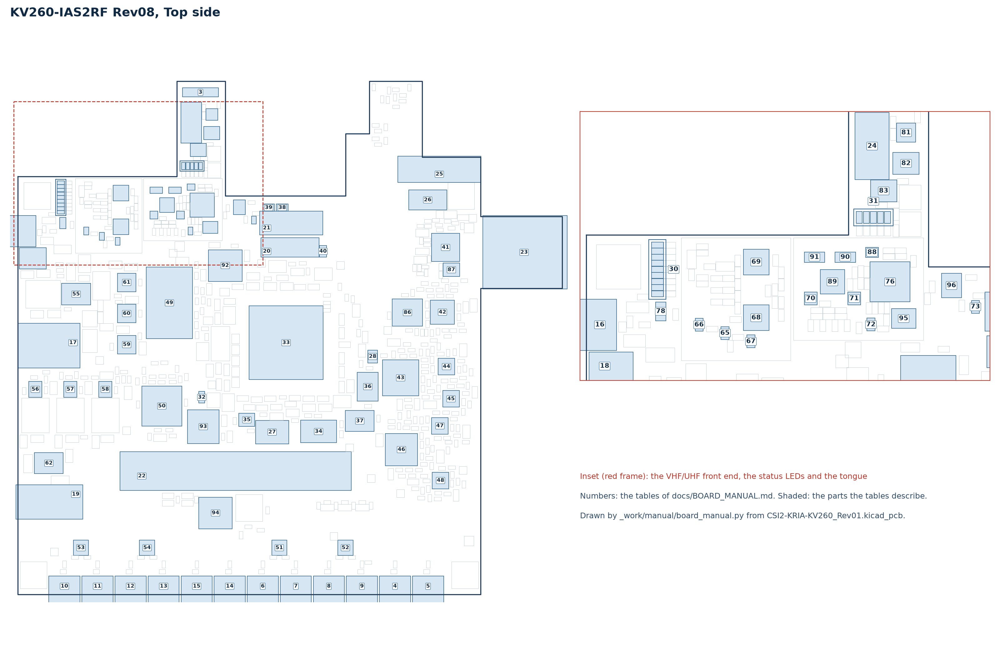

# Board manual

What every connector, LED, switch and chip on the KV260-IAS2RF Rev08 board is for, so that the board can be used without the schematic. The drawings and the tables are generated together from the board file by `_work/manual/board_manual.py`, which also checks that every connector, LED and IC on the board is listed and that every listed part is on the board.

For orientation, the rendered board: [top](img/board_top.png), [bottom](img/board_bottom.png), [iso](img/board_iso.png). Vector drawings: [top](img/manual/board_top.svg), [bottom](img/manual/board_bottom.svg).

## 1. Connectors

The thirteen SMAs are on the front edge (`J401`-`J952`) and the back wall (`J961`). Every RF port is DC-blocked except `J961` when its bias tee is on.

| No. | Ref | Side | Name | What it is for |
|---|---|---|---|---|
| 1 | `J101` | bottom | BM20B(0.8)-34DP | IAS1 to the KV260 (its `J8`), underneath: five LVDS pairs at up to 1 Gb/s each (three data lanes, two clocks), the housekeeping I2C (temperature sensor, ID EEPROM) and the FPGA's interrupt. The board's only data link to the Kria |
| 2 | `J102` | bottom | BM20B(0.8)-34DP | IAS0 to the KV260 (its `J7`), underneath. Every pin is passed through to `J103`; the board uses none |
| 3 | `J103` | top | BM20B(0.8)-34DS-0.4V(51) | IAS0 pass-through receptacle on the tongue's top face, pin for pin with `J102`: an IAS camera module plugs in here as it would on the carrier |
| 4 | `J401` | top | CLK_REF_IN | Reference clock input (SMA) to the ADCLK948, 0.4-3.4 V p-p differential range, 50 ohm on chip. Leave open to run from the on-board Si549 |
| 5 | `J402` | top | CLK_OUT | Clock output (SMA), ADCLK948 Q3, LVPECL: to share the master clock with an instrument |
| 6 | `J911` | top | SDR_RX_A | SDR receive A (SMA): through SW1's default throw to the AD9253 channel A. Full scale about -2.4 dBm; DC-blocked |
| 7 | `J912` | top | AERIS_IF_A | Radar IF into the 14-bit AD9253 (SMA), through SW1's second throw |
| 8 | `J921` | top | AERIS_IF | Radar IF from AERIS-10 (SMA): through SW2's default throw to the 500 MSPS AD9484. Full scale about -17.6 dBm |
| 9 | `J922` | top | SDR_RX_WB | Wideband SDR receive (SMA), SW2's second throw. Not connected as built: `C926` is not fitted and the VHF/UHF front end takes the throw (`C927`); swap the two 0402s to use this port |
| 10 | `J931` | top | SDR_TX_A | SDR transmit A (SMA): AD9767 DAC1 through SW3's default throw, 10 mA full scale |
| 11 | `J932` | top | AERIS_TX_A | Radar chirp from the 14-bit AD9767 DAC1 (SMA), SW3's second throw |
| 12 | `J941` | top | AERIS_TX | Radar chirp to AERIS-10 (SMA): the AD9708 through SW4's default throw, 20 mA full scale into a 2:1 balun |
| 13 | `J942` | top | SDR_TX_WB | Wideband SDR transmit from the AD9708 (SMA), SW4's second throw |
| 14 | `J951` | top | SDR_RX_C | HF receive (SMA), no switch: a 30 MHz 7th-order elliptic low-pass, then the AD9253 channel B. Full scale about -3.0 dBm. The default HF input |
| 15 | `J952` | top | SDR_TX_C | HF transmit (SMA), no switch: AD9767 DAC2. The default HF output |
| 16 | `J961` | top | VU_ANT | VHF/UHF antenna (SMA, back wall): the Rev08 front end, direct 30-170 MHz and converted from 300 MHz to 3 GHz (170-300 MHz not covered: the converter's 300 MHz high-pass, AUDIT_Rev08 R1), into the AD9484 through SW2. Bias tee for an active antenna (off at power-up, 5 V or 3.3 V by `JP1301`, 125 mA limit; prefer 3.3 V where the antenna accepts it). Full scale -52 dBm at maximum gain, up to about +2 dBm with the attenuator and the LNA bypassed. No limiter: keep it away from a transmitter on the same vehicle (+25 dBm destroys the LNA) |
| 17 | `J1001` | top | 12V IN | 12 V input, barrel jack (CUI PJ-102AH). Protected to 36.7 V transients, reverse battery and an 18.3 V over-voltage cut-off (POWER_SPEC section 1.1). About 11.7 W typical, 13.4 W worst case (docs/AUDIT_Rev08.md section 2.1) |
| 18 | `J1002` | top | FAN 5V | Enclosure fan, JST PH 2-pin: pin 1 +5 V (0.5 A PTC `F1002`), pin 2 GND |
| 19 | `J1101` | top | JTAG 2x7 2mm | Xilinx JTAG for the XC7A50T and its flash (Platform Cable or any 2 mm 14-pin JTAG adapter) |
| 20 | `J1102` | top | Pmod | Pmod from the KV260's `J2` (cable): SPI to the FPGA's register file, beam strobe, PPS and the debug UART. Pin by pin below |
| 21 | `J1103` | top | AERIS ADAR | AERIS-10 beam-steering ribbon (2x20 IDC): the ADAR1000 SPI and its control lines |
| 22 | `J1201` | top | HR911130C | Gigabit Ethernet (RJ45, magnetics and LEDs inside), from the RTL8211FS over SGMII to the FPGA: the board standalone |
| 23 | `J1501` | top | TYPE-C-31-E-17 | Debug USB-C (vertical, on the tongue): the FPGA's console through a CH340X, 115,200 baud 8N1, powered from the cable. Lid off |
| 24 | `J1502` | top | FPC-1.0FX-15PWCR-H20 | GPS PPS and the vehicle CAN to the KV260's `J9` (Raspberry Pi camera connector) by a 100 mm 15-way 1 mm FFC, either cable type: the pulse reaches `J9` pin 12, a PL pin (`kria_pps`); CAN TX leaves on `J9` pin 6 and RX comes back on pin 8 (PS `CAN1`, R5F core 1) |
| 25 | `J1503` | top | BM06B-SRSS-TB | GPS receiver and vehicle CAN, JST-SH 6-pin, vertical, the plug from above: 1 GND, 2 CANL, 3 CANH, 4 GND, 5 PPS in (3.3 V), 6 +3.3 V out (0.2 A PTC) (no termination: it taps the car's bus) |

### 1.1 Pmod `J1102`

A Pmod cable from the KV260's `J2`. 3.3 V signals into the FPGA's bank 15, ESD-protected by `U1108`/`U1109`.

| Pin | Net | Direction | Use |
|---|---|---|---|
| 1 | `PMOD_CS` | in | SPI chip select of the FPGA's register file |
| 2 | `BEAM_STROBE` | in | Applies the loaded beam on every ADAR1000 at once (R5F core 1 drives it in scan mode) |
| 3 | `PMOD_MOSI` | in | SPI data to the FPGA |
| 4 | `PPS_SYNC` | in | GPS PPS, to time-stamp detections |
| 5 | `PMOD_MISO` | out | SPI data from the FPGA |
| 6 | `PMOD_SPARE1` | in | Debug UART, Kria to FPGA (PS UART1 TX); the USB bridge also drives it through 1 kohm |
| 7 | `PMOD_SCLK` | in | SPI clock |
| 8 | `PMOD_SPARE2` | out | Debug UART, FPGA to Kria (PS UART1 RX); also lights the heartbeat LED |
| 9, 10 | `GND` |  |  |
| 11, 12 | `not connected` |  | The board takes no power from the Pmod |

### 1.2 Test points

| Ref | Net | Ref | Net | Ref | Net |
|---|---|---|---|---|---|
| `TP1` | `+5V0` | `TP2` | `+3V3_D` | `TP3` | `+3V3_A` |
| `TP4` | `+2V5` | `TP5` | `+1V8_D` | `TP6` | `+1V8_A` |
| `TP7` | `+1V2` | `TP8` | `+1V0` | `TP9` | `-3V3` |
| `TP10` | `+3V3_CLK` | `TP11` | `DONE` | `TP12` | `GND` |
| `TP13` | `GND` | `TP14` | `MDC` | `TP15` | `MDIO` |

## 2. Switches and jumpers

| No. | Ref | Side | Name | What it does |
|---|---|---|---|---|
| 26 | `SW1101` | top | PROG | Pulls the FPGA's PROG_B: reloads the bitstream from the flash |
| 27 | `JP1101` | top | WC | Solder jumper, open as built: close it to allow writing the board-ID EEPROM `U1105` |
| 28 | `JP1301` | bottom | BIAS 5V0 | 3V3 | Solder jumper, bias-tee voltage for `J961`: 1-2 (as built) +5 V, 2-3 +3.3 V. The bias itself is off until the gateware turns it on |

**Assembly options.** `C926`/`C927` choose what SW2's second throw reaches: as built `C927` is fitted (the VHF/UHF front end) and `C926` is not (`J922`). The Ethernet parts (`U1201`, `J1201`, `Y1201`) can be left off the BOM for a board that only runs with the Kria. The master clock mode (400 or 500 MHz) has no jumper: the FPGA programs the Si549 over I2C.

**The RF switches**, set by the FPGA's register file (`SW_CTRL0-3`); pulled to the default while the FPGA is unconfigured:

| Switch | Default (RF1) | Second throw (RF2) |
|---|---|---|
| SW1 `U901`, AD9253 channel A | `J911` SDR_RX_A | `J912` AERIS_IF_A |
| SW2 `U902`, AD9484 | `J921` AERIS_IF | The VHF/UHF front end (`J922` with `C926` fitted) |
| SW3 `U903`, AD9767 DAC1 | `J931` SDR_TX_A | `J932` AERIS_TX_A |
| SW4 `U904`, AD9708 | `J941` AERIS_TX | `J942` SDR_TX_WB |

## 3. LEDs

The nine status LEDs stand in a column beside `J961`, seen through a window in the lid. The rail LEDs are on the tongue: each one is lit by its rail, so a dead rail shows without a meter.

| No. | Ref | Side | Colour | Meaning when lit |
|---|---|---|---|---|
| 29 | `D1501` | top | CFG green | FPGA configured and the clock sequencer finished |
| 29 | `D1502` | top | CLK yellow | Master clock mode: on 500 MHz, off 400 MHz |
| 29 | `D1503` | top | LINK green | IAS1 link to the Kria trained |
| 29 | `D1504` | top | ADCR red | The radar ADC (AD9484) clipped since the last read (sticky) |
| 29 | `D1505` | top | ADCS red | The SDR ADC (AD9253) clipped since the last read (sticky) |
| 29 | `D1506` | top | LO green | The RFFC5072 synthesiser is locked |
| 29 | `D1507` | top | TX red | A DAC is driving an SMA |
| 29 | `D1508` | top | ERR red | Any sticky error: CRC, FIFO overflow, I2C no-acknowledge, over-temperature |
| 29 | `D1509` | top | HB blue | Heartbeat: flickers with every line the FPGA prints on the debug UART, once a second |
| 30 | `D1520` | top | +12V green | +12V present (after the input protection) |
| 30 | `D1521` | top | +5V0 green | +5V0 present |
| 30 | `D1522` | top | +3V3_D green | +3V3_D present |
| 30 | `D1523` | top | +1V8_D green | +1V8_D present (switched from +3V3_D by `Q1520`) |
| 30 | `D1524` | top | +1V0 green | +1V0 (FPGA core) present (switched from +3V3_D by `Q1521`) |
| 31 | `D1101` | top | green | DONE: the FPGA has loaded a bitstream |

**At power-up**, in order: the five rail LEDs; DONE when the FPGA has loaded its bitstream; CFG when the clocks are running; HB flickering once a second; LINK when the Kria has trained IAS1. The RJ45's own two LEDs show the Ethernet link and activity.

| What you see | What it means, what to check |
|---|---|
| No LED at all | No 12 V, or the input protection is off: input below about 6 V, above 18.3 V, or reversed. Check `J1001`, `F1001` |
| `+12V` on, `+5V0` off | `U1001` or its load: measure `TP1`; a short on +5V0 holds the buck in hiccup |
| `+5V0` on, `+3V3_D` off | `U1002`; every other rail after it stays off too |
| `+1V8_D` or `+1V0` off, `+3V3_D` on | `U1006` (+1V8_D) or `U1004` (+1V0); `TP5`, `TP8` |
| Rails on, DONE off | No bitstream: the flash is empty or the load failed. Program it through `J1101`, or press `SW1101` |
| DONE on, CFG off | The clock sequencer did not finish: the Si549 did not answer on I2C, or `J401`'s reference is out of range |
| CFG on, LINK off | The Kria has not trained IAS1: its bitstream or `kria_pl_link` is not running, or `J101` is not seated |
| HB not flickering | The FPGA's status task has stopped, or the debug UART is held by the Kria (`PMOD_SPARE2`) |
| LO off | The RFFC5072 is unlocked: only the converted VHF/UHF modes are affected |
| ADCR or ADCS on | A converter clipped: lower the input (or the front end's gain); the LED clears when read |
| ERR on | Read the error register over the console (`r` command) to see which: CRC, FIFO, I2C or temperature |

## 4. Chips

| No. | Ref | Side | Part | Sheet | Function |
|---|---|---|---|---|---|
| 32 | `U1101` | top | XC7A50T-2FTG256I | CONTROL | The front-end FPGA: converters, RF switches, link to the Kria, Ethernet, housekeeping |
| 33 | `U1102` | top | MT25QL128ABA1ESE | CONTROL | 128 Mbit SPI flash: the FPGA's bitstream |
| 34 | `U1103` | top | 74LVC1G07 | CONTROL | Open-drain buffer on the FPGA's PROG_B |
| 35 | `U1104` | top | TMP1075DR | CONTROL | Board temperature sensor, I2C 0x48 |
| 36 | `U1105` | top | M24C02-FMN6TP | CONTROL | Board-ID EEPROM (revision, serial), I2C 0x50, write-protected unless `JP1101` is closed |
| 37 | `U1108` | top | TPD4E05U06DQAR | CONTROL | ESD array on the Pmod lines |
| 38 | `U1109` | top | TPD4E05U06DQAR | CONTROL | ESD array on the Pmod lines |
| 39 | `U1110` | top | TPD4E05U06DQAR | CONTROL | ESD array on the JTAG lines |
| 40 | `U1201` | top | RTL8211FSI-CG | CONTROL | Gigabit Ethernet PHY, SGMII to the FPGA |
| 41 | `U401` | top | ADCLK948BCPZ | CLOCK | Clock fan-out: the converters' and the FPGA's clocks from the Si549 or `J401` |
| 42 | `U501` | top | AD9484BCPZ-500 | ADC_RADAR | 8-bit 500 MSPS ADC: the radar IF, the wideband SDR and the VHF/UHF front end |
| 43 | `U502` | top | AD8352ACPZ | ADC_RADAR | Differential driver for the AD9484, first stage |
| 44 | `U503` | top | AD8352ACPZ | ADC_RADAR | Differential driver for the AD9484, second stage |
| 45 | `U601` | top | AD9253BCPZ-125 | ADC_SDR | 14-bit quad ADC, two channels used: SDR receive A and HF (C) |
| 46 | `U602` | top | AD8352ACPZ | ADC_SDR | Driver for the AD9253 channel A |
| 47 | `U603` | top | AD8352ACPZ | ADC_SDR | Driver for the AD9253 channel B (HF) |
| 48 | `U701` | top | AD9708AR | DAC_RADAR | 8-bit 125 MSPS DAC: the radar chirp |
| 49 | `U801` | top | AD9767ASTZ | DAC_SDR | Dual 14-bit 125 MSPS DAC: SDR transmit A and HF |
| 50 | `U901` | top | M3SWA2-34DR+ | ROUTING | SW1: SDR_RX_A or AERIS_IF_A to the AD9253 channel A |
| 51 | `U902` | top | M3SWA2-34DR+ | ROUTING | SW2: AERIS_IF or the VHF/UHF front end to the AD9484 |
| 52 | `U903` | top | M3SWA2-34DR+ | ROUTING | SW3: the AD9767 DAC1 to SDR_TX_A or AERIS_TX_A |
| 53 | `U904` | top | M3SWA2-34DR+ | ROUTING | SW4: the AD9708 to AERIS_TX or SDR_TX_WB |
| 54 | `U1001` | top | LMR33630ADDA | POWER | +12V to +5V0 buck, 3 A |
| 55 | `U1002` | top | TPS563201 | POWER | +5V0 to +3V3_D buck, 3 A (Rev08 audit, P5) |
| 56 | `U1003` | top | TPS562201 | POWER | +5V0 to +2V5 buck (FPGA LVDS banks, feeds +1V8_A) |
| 57 | `U1004` | top | TPS562201 | POWER | +5V0 to +1V0 buck (FPGA core) |
| 58 | `U1005` | top | TPS7A8300RGR | POWER | +2V5 to +1V8_A LDO (the ADCs' analogue supply) |
| 59 | `U1006` | top | TPS7A8300RGR | POWER | +3V3_D to +1V8_D LDO (FPGA VCCAUX, the ADCs' outputs) |
| 60 | `U1007` | top | TPS7A8300RGR | POWER | +5V0 to +3V3_A LDO (the DACs' analogue supply) |
| 61 | `U1008` | top | LM2663M | POWER | -3V3 charge pump (the RF switches' negative supply) |
| 62 | `U1009` | bottom | LM74502-Q1 | POWER | Input protection controller: reverse battery and over-voltage cut-off, with `Q1001`/`Q1003` |
| 63 | `U1301` | top | SPF5043Z | RX_VU | VHF/UHF low-noise amplifier |
| 64 | `U1302` | top | PE4259 | RX_VU | LNA bypass switch, input side |
| 65 | `U1303` | top | PE4259 | RX_VU | LNA bypass switch, output side |
| 66 | `U1304` | top | PE42442 | RX_VU | Preselector A: band selection, input side |
| 67 | `U1305` | top | PE42442 | RX_VU | Preselector A: band selection, output side |
| 68 | `U1306` | top | SKY13418-485LF | RX_VU | Preselector B, input side (straight, UHF low-pass, ADS-B) |
| 69 | `U1307` | top | SKY13418-485LF | RX_VU | Preselector B, output side |
| 70 | `U1308` | top | PE4259 | RX_VU | Direct or converted path |
| 71 | `U1309` | top | PE4259 | RX_VU | Direct or converted path, after the converter |
| 72 | `U1310` | bottom | SPF5043Z | RX_VU | IF amplifier |
| 73 | `U1311` | bottom | PE4312 | RX_VU | Digital attenuator, 0-31.5 dB |
| 74 | `U1312` | top | RFFC5072 | RX_VU | Synthesiser and mixer: converts 300 MHz-3 GHz down to the IF (170-300 MHz not covered) |
| 75 | `U1313` | bottom | TCA6416ARTWR | RX_VU | I/O expander 0x20: the front end's switches, bias tee and converter control |
| 76 | `U1314` | top | AP22652W6-7 | RX_VU | Bias-tee current limiter for `J961` (125 mA) |
| 77 | `U1315` | bottom | LP5907MFX-2.8 | RX_VU | +2V8_RF LDO for the front end (Rev08 audit, P8) |
| 78 | `U1501` | bottom | TCA6416ARTWR | STATUS | I/O expander 0x21: the status LEDs |
| 79 | `U1502` | top | CH340X | STATUS | USB to UART bridge for the debug console |
| 80 | `U1503` | top | USBLC6-2SC6 | STATUS | ESD on the USB data lines |
| 81 | `U1504` | top | LP5907MFX-3.3 | STATUS | 3.3 V LDO for the USB bridge, from the cable |
| 82 | `U1505` | bottom | SN74LVC1G17DCKR | STATUS | GPS PPS Schmitt buffer, drives `J1502` pins 12 and 4 |
| 83 | `U1506` | bottom | TCAN3403DDFRQ1 | STATUS | Vehicle CAN transceiver on `J1503` pins 3 and 2, listen-only by default; TXD from the NOR pair `Q1530`/`Q1531`, RXD divided to 1.2 V for `J9` pin 8 |
| 84 | `Y401` | top | Si549 LVPECL 3V3 pinout C | CLOCK | Programmable master oscillator, 400 or 500 MHz |
| 85 | `Y1201` | top | 25MHz | CONTROL | Crystal for the Ethernet PHY |
| 86 | `Y1301` | top | 26MHz 1XXD26000MAA | RX_VU | TCXO, the RFFC5072's reference |
| 87 | `FL1301` | top | TA1090EC | RX_VU | 1090 MHz SAW filter (ADS-B path) |
| 88 | `FL1302` | top | HFCN-1000+ | RX_VU | High-pass after the mixer |
| 89 | `FL1303` | top | LFCN-1000+ | RX_VU | Low-pass, UHF preselector |
| 90 | `T701` | top | ADT2-1T+ | DAC_RADAR | AD9708 output balun |
| 91 | `T801` | top | ADT2-1T+ | DAC_SDR | AD9767 DAC1 output balun |
| 92 | `T802` | top | ADT2-1T+ | DAC_SDR | AD9767 DAC2 output balun |
| 93 | `T1301` | top | TC1-1-13M+ | RX_VU | Mixer input balun |
| 94 | `T1302` | top | TC4-1W+ | RX_VU | Mixer output balun |

## 5. Typical uses

| Use | Connect | Set |
|---|---|---|
| Radar with AERIS-10 | Ribbon on `J1103`; chirp `J941` to AERIS's transmit input, AERIS's IF to `J921`; IAS1 on the KV260; 12 V on `J1001` | Default switch positions. The Kria runs the radar pipeline; R5F core 1 scans the beams |
| HF SDR | Antenna or HF front end on `J951`; transmit from `J952` | No switch in either path; 0-30 MHz, the 30 MHz low-pass on receive |
| VHF/UHF reception | Antenna on `J961` (active antenna: set `JP1301`, then the bias on in software) | SW2 to its second throw (the front end); band and gain from the Kria |
| SDR on the 14-bit converters | `J911` receive, `J931` transmit | Default positions of SW1 and SW3 |
| Wideband SDR | `J942` transmit; `J922` receive only after swapping `C926`/`C927` | SW4 to its second throw |
| Camera on the KV260 | IAS camera module on `J103`, as on the carrier's `J7` | Nothing on this board; the camera talks to the SOM as before |
| Standalone over Ethernet | RJ45 `J1201` to a PC; 12 V on `J1001` | The FPGA streams over UDP without the Kria |
| Debug | USB-C `J1501` (lid off), 115,200 8N1; JTAG `J1101` | Boot banner, one status line a second, `r`/`w` register commands |
| GPS time | GPS receiver on `J1503`; FFC from `J1502` to the KV260's `J9` | `kria_pps` timestamps the pulse; R5F core 0 disciplines the converters' clock to it |

Levels, bands and the register map: [ROUTING_SPEC](ROUTING_SPEC.md), [RX_VU_SPEC](RX_VU_SPEC.md), [SIGNAL_INTEGRITY](SIGNAL_INTEGRITY.md), [FPGA_GATEWARE](FPGA_GATEWARE.md), [LINK_PROTOCOL](../fpga/link/LINK_PROTOCOL.md).
