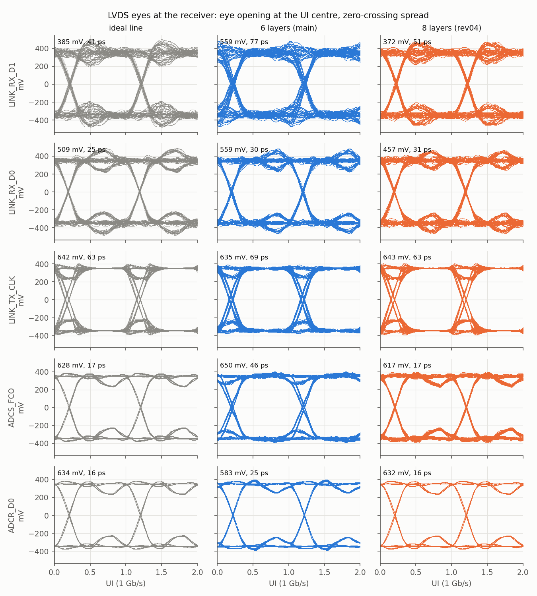
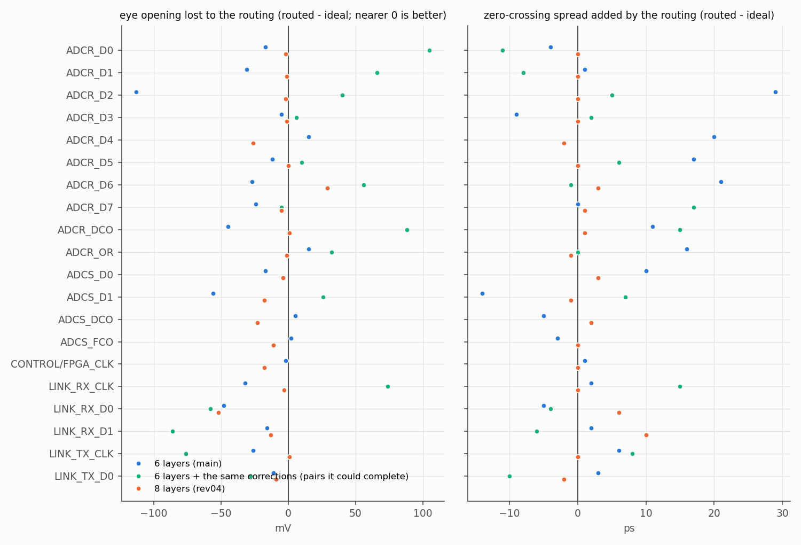
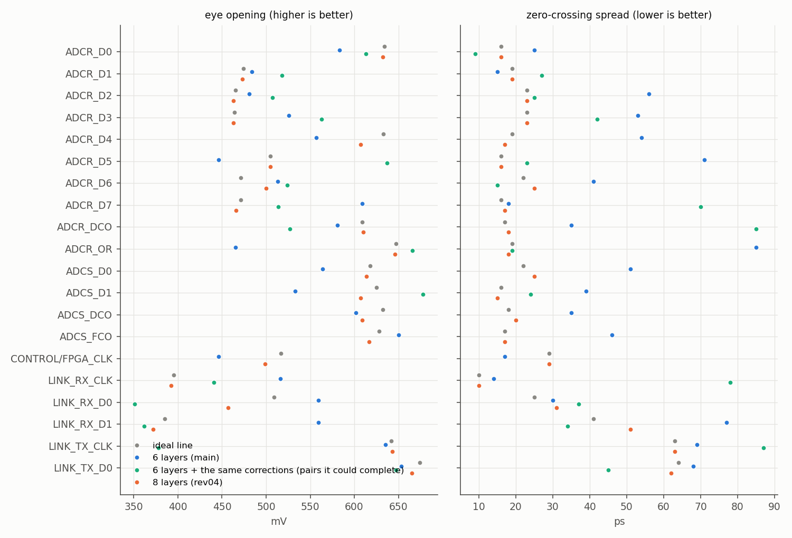
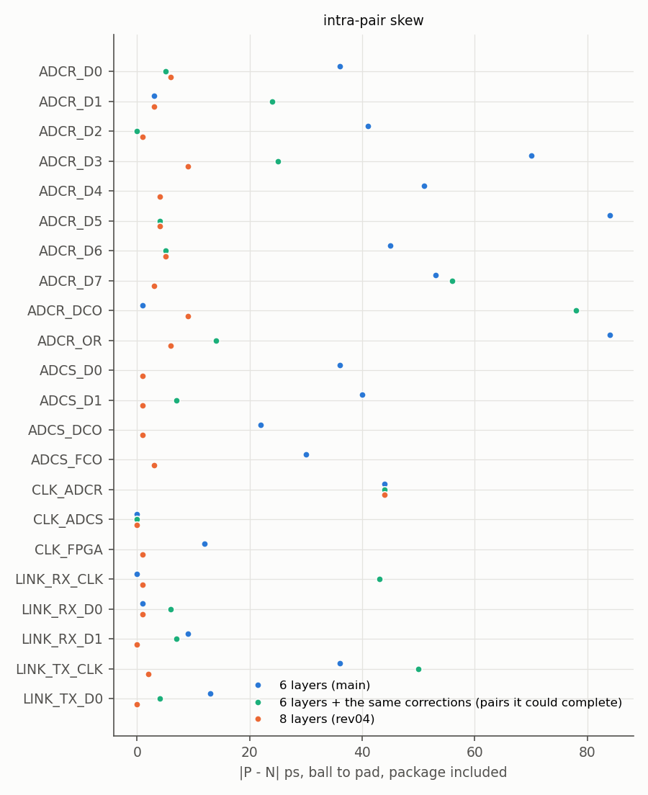
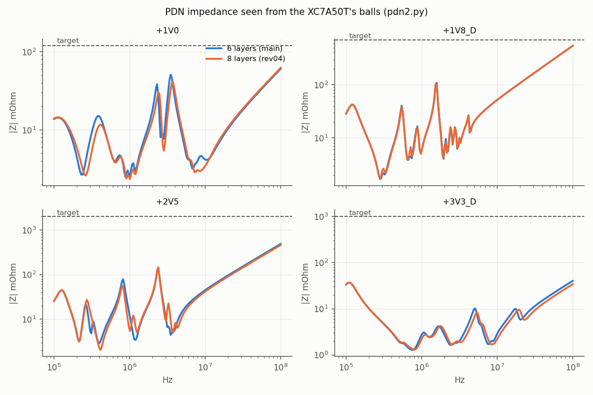
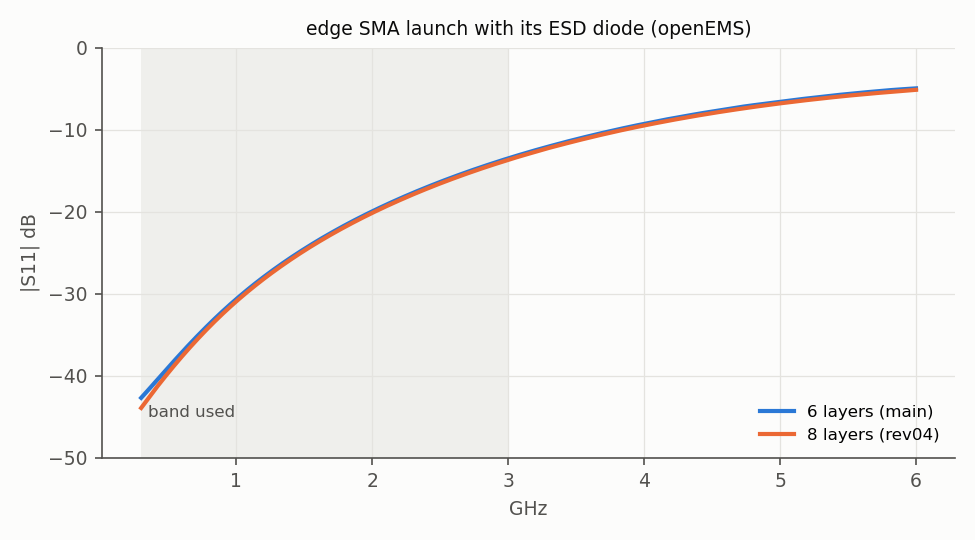

# 8 layers against the 6-layer board

*12 November 2026.*

This compares the board as it was on 11 November (6 layers, JLC06161H-2116A) with the same board on
JLC08161H-2116C. On 8 layers the LVDS pairs are re-routed, their terminations sit under the FPGA's
balls, and LINK_TX is terminated at its receiver. Both boards were measured and simulated with the
same scripts. The plots add two more cases: an ideal line, and the 6-layer board with the same
corrections applied.

The method behind each number is in [SIGNAL_INTEGRITY.md](SIGNAL_INTEGRITY.md) (§1–7 for the
6-layer review, §8 for this comparison). How the board changed is in [LAYOUT.md §6.5](LAYOUT.md).

## The two stacks

| Layer | 6 layers · JLC06161H-2116A | 8 layers · JLC08161H-2116C |
|---|---|---|
| L1 | signal: RF, fan-outs | signal: RF, fan-outs |
| L2 | **GND** | **GND** |
| L3 | signal: the only clean inner layer | signal: LVDS pairs |
| L4 | **power**, plus signal tracks between the islands | **power only** |
| L5 | **GND** | **GND** (new) |
| L6 | signal: slow nets (the bottom face) | signal: LVDS pairs, between two GND planes |
| L7 | — | **GND** |
| L8 | — | signal: terminations under the BGA (the bottom face) |

The outer prepreg is the same on both stacks, so the 183 µm RF lines stay at 50 Ω (50.4 Ω on
2116C). A coupled pair of 0.10 mm tracks 0.15 mm apart is 100.2 Ω on L3 or L6. Under the FPGA the
pair necks to 0.09 mm tracks 0.12 mm apart, which is 98.5 Ω.

## Verification, side by side

| Check | 6 layers (main) | 8 layers (rev04) | 8 vs 6 |
|---|---|---|---|
| DRC | 0 errors, 0 unconnected; silkscreen warnings | 0 violations of any kind, 0 unconnected, parity 0 | better |
| Pairs routed coupled | 0 of 19 | 9 of 19 (+ ADCR_D4 for 41 % of its length) | better |
| Worst intra-pair \|P−N\| | 84 ps | 9 ps | better |
| LINK_RX data − clock | D0 +41, D1 +190 ps | D0 +95, D1 +39 ps | same |
| ADCS data − clock | −81 … +26 ps | −34 … −8 ps | better |
| ADCR data − DCO | −88 … −23 ps | −177 … −28 ps | **worse** |
| Layer changes with no GND via within 3 mm | 1 of 186 | 0 of 89 | better |
| Track over a plane void | 10 runs, 11 mm | 5 runs, 5 mm | better |
| Other pairs' legs within 0.25 mm | 97.6 mm | 69.3 mm | better |
| … within 0.55 mm | 328.4 mm | 213.5 mm | better |
| Signal tracks on L4 under the BGA | 64 segments | 3 (supply stubs) | better |
| Eye lost to routing (routed − ideal) | mean −22 mV, worst −113 mV | mean −8 mV, worst −52 mV | better |
| Zero-crossing spread added | mean 5 ps, worst 29 ps | mean 1 ps, worst 10 ps | better |
| PDN +1V0, max in band / at 100 MHz | 51 / 61 mΩ | 41 / 63 mΩ | same |
| PDN +1V8_D / +2V5 / +3V3_D at 100 MHz | 545 / 488 / 40 mΩ | 545 / 460 / 37 mΩ | same |
| DC drop +2V5 at 601 mA | 173–185 mV | 122–129 mV | better |
| SMA launch S11 at 1 / 3 GHz | −30.6 / −13.5 dB | −30.9 / −13.7 dB | same |

## LVDS eyes

*Folded eyes at 1 Gb/s for five key pairs: the ideal line, the 6-layer board and the 8-layer
board. Each label gives the eye opening at the centre of the unit interval and the zero-crossing
spread.*

> The model drives each leg from a current source into the routed sections, ending at a 100 Ω,
> 2 pF receiver. The receiver's capacitance reflects and the driver reflects it back, so even the
> ideal line has some intersymbol interference, and how much depends on the line's length. The same
> pair's "ideal" eye therefore differs between the two boards, and the fair comparison is each board
> against its own ideal, shown below. For LINK_RX the model ends at the AC capacitors, not at the
> Kria's receiver, so those eyes are indicative only.

*Eye opening lost and zero-crossing spread added by the routing, for every pair. In green: the
6-layer board with the same corrections, showing only the pairs it could complete.*

*Absolute eye opening and zero-crossing spread for every pair, with the ideal line.*

## Skew, power and the RF launch

*Intra-pair skew \|P − N\| from ball to pad, including the FPGA's package delay.*

*PDN impedance seen from the XC7A50T's balls. The L4/L5 plane pair is still 0.13 mm apart, so the
impedance barely moves.*

*Edge SMA launch with its ESD diode, simulated in openEMS. The outer prepreg is the same on both
stacks, and so is the launch.*

## Still open on the 8-layer board

- **ADCR data to DCO, −28 to −177 ps** (6 layers: −23 to −88 ps). DCO leaves the AD9484 on its
  north side and runs 51 mm, against 27–44 mm for the data. That is 7 % of the 2.5 ns bit at
  400 MSPS. It is within IDELAYE2's 2.4 ns range, and each bit is calibrated as before.
- **Ten pairs are not coupled.** LINK_RX leaves the FPGA's south rows and must cross every ADC pair
  to reach its capacitors, and the AD9253's 0.5 mm pins leave no room for a coupled fan-out. These
  ten are routed as two 50 Ω legs matched to ±5 ps. Each comes within 1–26 mV of its ideal eye,
  except LINK_RX_D0 (−52 mV). A pin swap putting LINK_RX on north-side balls would let them couple.
- **No price yet for the 8-layer bare board.** The 6-layer stack was $236.88 for 5 boards
  ([JLCPCB_QUOTE.md](JLCPCB_QUOTE.md)).

## The same corrections on 6 layers

| Correction | On 6 layers | On 8 layers |
|---|---|---|
| LINK_TX terminated at the receiver | Same schematic change, same benefit | Done |
| Terminations at the balls, no stub | Possible, since L6 is the bottom face, but the ball vias take up the room on the only clean inner layer | Done |
| Coupled 100 Ω pairs | 8 of 19 at best, and the board could not be completed: 7 nets left unconnected | 9 of 19, complete |
| Return vias at every layer change | Possible | 0 of 89 layer changes beyond 3 mm |
| +2V5 trunk widened | Possible as is | Done |
| L4 free of signal tracks | Not possible: L4 is the second routing layer | Done |

On six layers, three corrections carry over unchanged: the schematic fix, the wider +2V5 trunk and
the return vias. The stub-free terminations and the coupled pairs need a second clean inner signal
layer, and that is what the 8-layer stack adds.
