# Enclosure — design, printing and simulation

*13 November 2026 · `_work/mech/build_case.py` (Blender, exact booleans) · STLs in [`mech/`](../mech/)*

A closed, printed enclosure for the KV260 with the adapter on top. It is meant for a vehicle on expedition
roads: vibration, heat in a parked car, and knocks. It has a tray and a lid that close on six lugs, either
with printed snap pins (to try the fit without tools) or with stainless M4 screws. Optional TPU bumpers
protect the corners. Every board rests on a honeycomb or on a clamp post with a TPU pad, so nothing rattles.

| | |
|---|---|
|  |  |
|  |  |
|  |  |

| | |
|---|---|
| 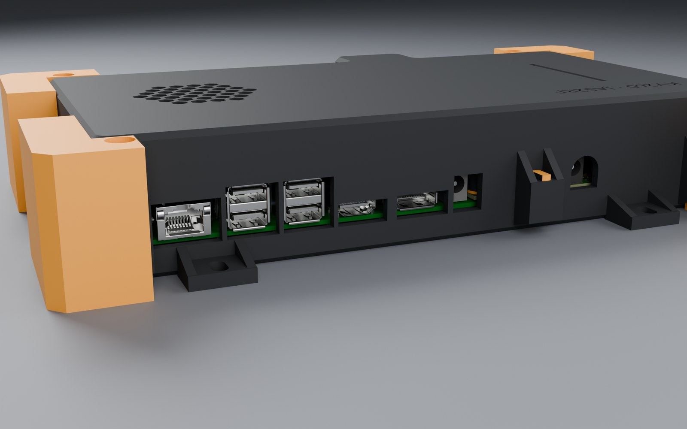 |  |
| 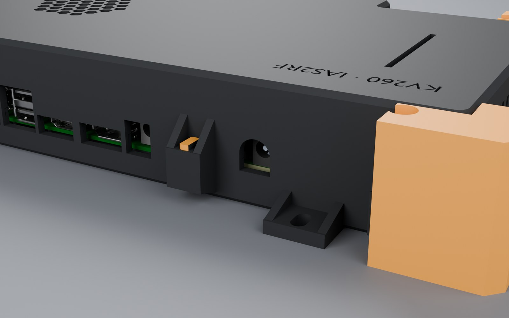 | |

---

## 1. Parts

| STL | Qty | Material | Printer | Orientation |
|---|---|---|---|---|
| `case_bottom.stl` (tray, 248.1 × 166.3 × 16.8 mm) | 1 | PETG-CF (or ASA, PAHT-CF; §4) | Bambu A1 (256 mm bed) | Floor on the bed |
| `case_lid.stl` (248.1 × 161.3 × 34.8 mm) | 1 | same as the tray | Bambu A1 | Exported upside down: the top on the bed. The lugs have 45° ribs above them, so no supports |
| `case_pin.stl` | 6 | PETG or PA (not PLA: it creeps) | A1, or the Saturn 4 Ultra in a tough resin for a fit test | Exported on its flat side, so the split prongs bend across the layers |
| `case_pad_ring.stl`, `case_pad_rj45.stl` | 7 + 1 | TPU 95A | A1, from the external spool (TPU does not go through the AMS Lite) | Flat |
| `case_bumper_l/rfront/back.stl` | 4 (optional) | TPU 95A, gyroid 20 % | A1, external spool | As exported |
| Stainless M4 × 16 (M4 × 20 where a bumper is), DIN 934 nuts, Loctite 243 | 6 | A2/A4 | — | The nuts drop into the hex traps under the tray's lugs |
| M5 screws for the vehicle ears | 4 | A2/A4 | — | Through rubber isolators (§3.3) |

The Saturn 4 Ultra cannot print the shells: its build volume (about 218 × 123 mm) is smaller than either part,
and the resins it prints lose most of their stiffness at 70 °C (§4).

---

## 2. Geometry

- **Outline.** Orthogonal, with a nose around the adapter's RJ45 tab. Walls are 3.5 mm thick; the SMA wall is
  4 mm, because twelve SMA bodies are clamped in it.
- **Split plane** at the SMA centre line (Z = 2.84 mm above the carrier's top face). Each SMA's square body sits
  half in the tray, half in the lid, so closing the lid clamps them.
  - A 1 mm recess band along the SMA row lets the plugs' coupling nuts seat on the connectors, not on the wall.
  - A 1.6 × 3 mm tongue with a 0.2 mm gap seals the split line against dust and splashes.
- **Openings.**
  - **KV260 rear I/O.** One cut-out per connector: the DC jack, DisplayPort, HDMI, the two USB stacks and the RJ45.
    Each is 1 mm larger than its connector's face, for the plugs' moulded bodies. Between neighbours the wall stays
    closed with a rib of at least 1.6 mm (14 Nov; the first version left one long window).
  - **Front:** J4, J11 and J2.
  - **Adapter's RJ45:** its window.
  - **Adapter's 12 V jack J1001:** a 12 mm round-topped U up from the shells' joint, centred on the barrel.
    The jack sits 3.5 mm inside the wall, so a 5.5/2.1 plug's moulded body has to go into the wall for the
    barrel to seat.
  - **Ribbon to AERIS-10's ADAR1000 boards:** a 54 × 2.6 mm slot in the lid right above the IDC header J1103, for
    the 40-way ribbon. The plug is fitted before the lid goes on.
  - **The twelve SMA notches.**
  - **Left inside:** JTAG, Pmod and the fan header, which are reached with the lid off.
  - The rear lug beside J1001 moved from X −40 to −20 to clear it.
- **Cooling.**
  - A hex grille over the KV260's fan (r 27 mm).
  - 9 vent slots in the right wall beside the fan-sink.
  - 14 slots above the SMAs, so air also crosses the adapter.
- **Board support, no play.**
  - The tray's floor is a honeycomb (10 mm cells, 1.6 mm walls) that touches the underside of both boards.
  - The honeycomb is pocketed 0.8 mm clear of every part that hangs below a board, 0.6 mm deeper than the part.
  - That includes the adapter's Rev05 input protection on its underside ([POWER_SPEC.md](POWER_SPEC.md) §1.1).
  - In the lid, clamp posts press each board down through 1 mm TPU 95A pads, compressed about 0.2 mm. They sit
    over the mounting holes H1–H5, the carrier's corners and the RJ45.
  - Each clamp is notched around taller parts. `_work/mech/check_case.py` checks the shells against every
    board mesh: the only contacts left are the intended honeycomb-to-board ones.
- **Label.** "KV260 · IAS2RF" debossed 0.6 mm in the lid, behind the ribbon slot (Y 96).

---

## 3. Closing and mounting

### 3.1 Two ways to close it

- **Without tools, to try the fit.** Six printed snap pins go through both lugs. Their split barbs catch on the
  ceiling of the nut trap. Pull them out with pliers.
- **For the vehicle.**
  - Six stainless M4 screws, with DIN 934 nuts in the hex traps and threadlocker.
  - M4 × 16 normally; M4 × 20 where a bumper is fitted, since it adds 3 mm under the head.

### 3.2 Bumpers (optional, recommended for handling)

- **Shape.** An L-shaped TPU 95A block on each corner, 18 mm thick outside the walls, from the floor to the lid
  top. It wraps over the corner lug and its ribs, which sit in a pocket inside it.
- **Fitting.** Slide it on from the front or back. The lug's own M4 screw goes through it, so it cannot come
  off.
- **Why.** §5 shows they are what makes a 1 m drop survivable.
- **Clearance.** They stay clear of the SMA band, the side vents and every connector opening: each arm along the
  front or rear wall stops 4 mm short of that wall's openings. The right-rear one is therefore shorter (11.3 mm
  instead of 22 mm), so the KV260's RJ45 plug goes in freely (13 Nov, found in the KV260-side render).

### 3.3 In the vehicle

- **Mounting.** Four ears at the floor have M5 slots.
- **Isolators.** Mount the case on rubber isolators (for example M5 cylindrical, about 40 Shore A). Their
  resonance, a few tens of Hz, sits far below the case's first mode (§5). Above about 1.4 times that resonance,
  vibration reaching the case is attenuated rather than amplified. This is the cheapest margin against
  off-road vibration.

---

## 4. Materials

| Material | Printer notes | Heat (HDT) | Verdict |
|---|---|---|---|
| **PETG-CF** | A1 with a hardened nozzle; dry it | 74 °C | **Default.** Stiff, easy, good to 70 °C with margin in shock |
| ASA | A1 possible; the open frame warps large ASA parts (brim, draft shield, warm room) | 100 °C | Best for UV and heat on a dashboard |
| PAHT-CF | A1 with a hardened nozzle, dried; an enclosed printer is better | 194 °C | Strongest; the choice if it prints flat |
| PETG | A1 | ~70 °C | Fine indoors, marginal in a hot car |
| PLA | A1 | ~55 °C | Not for a vehicle: it softens below 70 °C (§5) |
| Resin ABS-like | Saturn 4 Ultra (small parts only) | ~50–60 °C | Fit-test pins and small parts only |

The FEA in §5 assumes **solid walls**: print the shells with walls enough to be solid, because the walls are
3.5 mm, about 8 perimeters at 0.42 mm. Use 0.2 mm layers and 100 % infill where anything remains. Loads that
pull layers apart are checked against the across-layer strength.

---

## 5. Simulation (CalculiX)


`_work/mech/fea_case.py` and `post_fea.py`; raw results in [`sim/case_fea.json`](sim/case_fea.json).

**Model.**
- The tray, lid, pads and the three boards are meshed conformally (gmsh, 10-node tetrahedra).
- Printed plastic is orthotropic: in-layer E and strength, plus across-layer values.
- The honeycomb is homogenised as ρ* = 0.29 of solid: E₃ = ρ*E along the cells and 2.3ρ*³E across them.
- The boards are elastic plates carrying their masses. The masses (KV260 90 g, adapter 110 g, SOM 120 g) are
  inferred.
- Each material is run at 23 °C and at 70 °C (a parked vehicle in the sun), with the strength kept at 70 °C
  inferred per material.
- Mesh convergence: the first mode of the PETG-CF case is 262.8 / 260.8 / 261.0 Hz with 5 / 4 / 3 mm elements.

**Load cases.** Each is an engineering estimate, with its assumption stated:

| Case | Method |
|---|---|
| First mode | Modal analysis, 10 modes |
| 50 g shock | Static 1 g in each axis, scaled ×50, against the across-layer strength |
| 1 m corner drop, bare | Held at the struck corner and pushed towards it by g; the drop energy stored elastically gives the peak g. The 15 mm crushed around the corner are left out. **Deliberately pessimistic** (rigid floor, no local yielding) |
| 1 m drop, bumpers | 18 mm of gyroid TPU crushing over 60 % of its thickness at near-constant force (efficiency 0.8) stops the case at about 116 g; the stress per g from the bare case |
| Vibration fatigue | Miles' equation at the first mode, Q = 10, on an assumed off-road envelope of 0.04 g²/Hz from 10 to 500 Hz (about 4.4 g rms). The 3σ stress is checked against 0.3 × the across-layer strength |

**Results (safety factors; ≥ 1 passes, ≥ 2 is comfortable):**

| Material | T | Mass | f₁ | 50 g shock | Drop, bare | Drop, bumpers | Vibration |
|---|---|---|---|---|---|---|---|
| PETG-CF | 23 °C | 0.85 kg | 261 Hz | 2.8 | 0.2 | 1.5 | 1.5 |
| PETG-CF | 70 °C | | 177 Hz | 1.7 | 0.2 | 0.9 | 1.1 |
| ASA | 23 °C | 0.76 kg | 281 Hz | 2.7 | 0.2 | 1.3 | 1.4 |
| ASA | 70 °C | | 252 Hz | 2.2 | 0.2 | 1.1 | 1.1 |
| PAHT-CF | 23 °C | 0.77 kg | 345 Hz | 4.8 | 0.3 | 2.4 | 2.2 |
| PAHT-CF | 70 °C | | 291 Hz | 3.4 | 0.2 | 1.7 | 1.7 |
| PETG | 70 °C | 0.86 kg | 149 Hz | 1.2 | 0.1 | 0.5 | 0.9 |
| PLA | 70 °C | 0.84 kg | 67 Hz | 0.2 | 0.03 | 0.05 | 0.2 |
| Resin ABS-like | 70 °C | 0.81 kg | 78 Hz | 0.8 | 0.1 | 0.2 | 0.7 |

What this says:
- **Shock and vibration.** PETG-CF, ASA and PAHT-CF pass at both temperatures. PETG passes cold only. PLA and
  the resin fail hot.
- **First mode.** Above 170 Hz for the good materials, so rubber isolators (§3.3) decouple it cleanly.
- **Drop.** A bare corner hitting concrete from 1 m exceeds every material by this pessimistic method. With the
  TPU bumpers:
  - PAHT-CF and ASA pass at both temperatures;
  - PETG-CF passes cold and falls just short (0.9) hot.
  - A drop is a handling event, normally not at 70 °C.

### 5.3 3-D model of the case as built, with both boards in it (14 Nov)

The model above simplifies the shells to check every material. This one meshes the printed geometry, with every
rib, honeycomb, lug, clamp post, vent and cut-out, together with the boards themselves.

**Model.**
- **Boards:** the adapter's FR-4 body (from KiCad's 3-D export of the Rev06 board) and the KV260 carrier's PCB.
- **Joints between the boards:** the two 0.8 mm spacers at H1/H2 and the mated Hirose pair.
- **Bonding:** everything is united into one bonded body (fTetWild).
  - Each board is bonded where it rests on the honeycomb and the posts.
  - The TPU-padded clamp posts above the boards are left out, which is conservative for the boards.
- **Mesh:** CalculiX, 10-node tetrahedra, about 205 k tets and 376 k nodes.
- **Masses** ride on the boards: adapter 110 g, carrier 90 g plus the K26 SOM with its fan-sink 120 g.
- **Loads:** 50 g quasi-static shocks down, sideways and fore-aft.
- **Supports:** the four ears held at their M5 washers.
- **Case:** von Mises stress, against PETG-CF's across-layer strength: 29 MPa at 23 °C, 17.4 MPa at 70 °C.
- **Boards:** the largest principal strain, against the usual 500 µε guide for BGA solder joints under shock.

| Load case | Case, 99.7th pct / peak | Safety factor 23 °C / 70 °C | Adapter / carrier strain, 99.7th pct | At the BGAs (U1101, U501, U601) | Max displacement |
|---|---|---|---|---|---|
| v2, 50 g down | 3.6 / 9.3 MPa | 8.1 / 4.9 | 402 / 360 µε | 158 / 158 / 130 µε | 0.24 mm |
| v2, 50 g sideways (X) | 2.3 / 5.9 MPa | 12.8 / 7.7 | 76 / 209 µε | 16 / 16 / 15 µε | 0.09 mm |
| v2, 50 g fore-aft (Y) | 1.9 / 3.7 MPa | 15.3 / 9.2 | 83 / 120 µε | 8 / 7 / 9 µε | 0.08 mm |
| v1, 50 g down | 3.6 / 9.1 MPa | 8.1 / 4.9 | 389 / 295 µε | 159 / 161 / 127 µε | 0.22 mm |

The two maps rendered on the parts themselves (Cycles; colours are the solver's, scale as in the plots below):

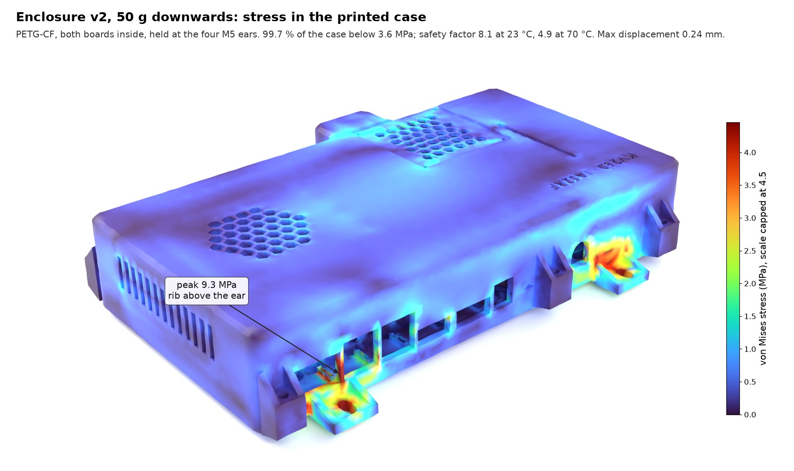

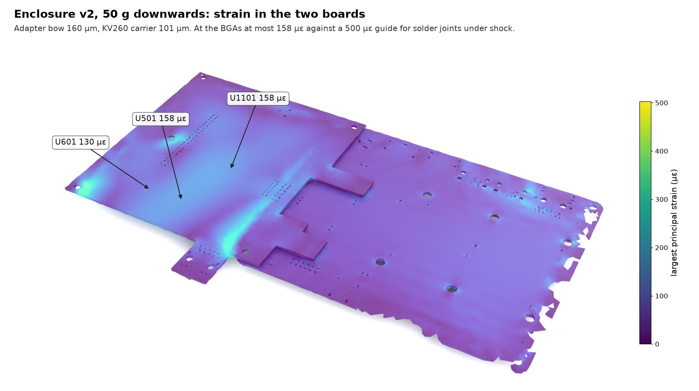

Every load case, from six angles each:

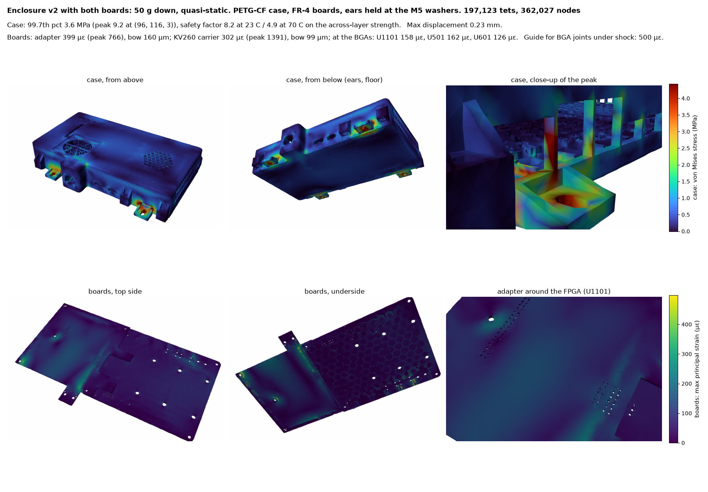
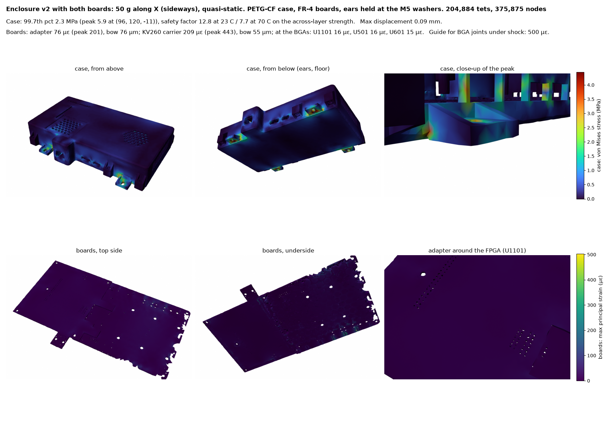
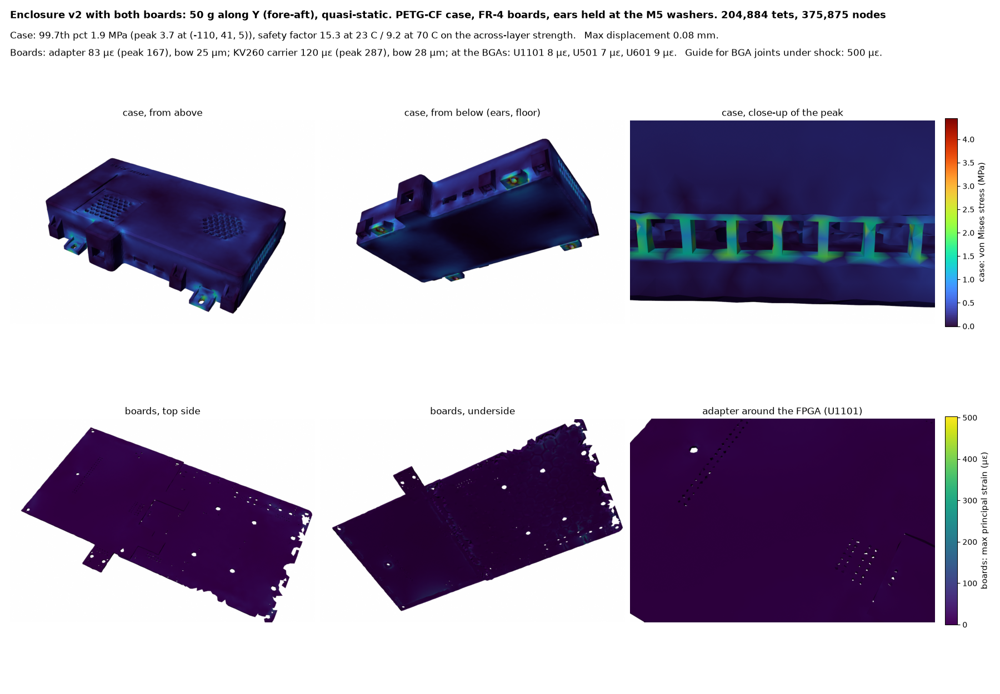

v1 for comparison: [down](sim/case3d_v1_Zm.png), [sideways](sim/case3d_v1_Xp.png),
[fore-aft](sim/case3d_v1_Yp.png). Raw numbers: [`sim/case3d_v2.json`](sim/case3d_v2.json),
[`sim/case3d_v1.json`](sim/case3d_v1.json).

**What it shows.**
- **The case.**
  - The load goes into the vehicle through the four ears.
  - The part that works hardest is the rear wall above the right-rear ear: the ribs between the KV260's RJ45 and
    USB cut-outs carry the load into the ear.
  - Its peak, about 9 MPa, is a sharp inside corner: the real corners are rounded and the value is
    mesh-dependent.
  - Even that peak leaves a safety factor of 3.2 at 23 °C and 1.9 at 70 °C. The 99.7th percentile leaves 8 and 5.
  - The fan duct and grille of v2 change nothing measurable.
- **The boards.**
  - Down is the worst direction.
  - Both boards bend over the honeycomb by 0.1–0.16 mm.
  - The strain stays under 160 µε at every BGA, a third of the guide.
  - Higher values, up to 720–980 µε, sit only where a board's bonded edge meets a honeycomb wall or a post (the
    adapter's SMA corner, the carrier's rear edge). That is a modelling singularity of the bonded contact, away
    from any part. The real TPU-padded contact spreads it.
- **The mesh.** fTetWild's 0.45 mm envelope smooths features finer than that, and the boards are one or two
  elements thick. This model ranks and locates; §5's material table remains the reference for fatigue and drop.

**What is not established.**
- **Material data.** Every value marked [I] in `fea_case.py` (for example the 70 °C strengths and the resin
  data) is inferred, not measured.
- **Inputs.** The vibration envelope and Q are assumptions. The board masses are inferred.
- **The bumper case** is analytical, not a contact simulation.
- **What would settle it.** A printed tray in PETG-CF, a drop test with and without bumpers, and a shaker or
  drive test.

---

## 6. Version 2: a fan for the adapter, for dusty roads

v1 stays as it is (above). **v2** is the same tray, lid and bumpers with active cooling for the adapter, from the
CFD study in [ENCLOSURE_V2_THERMAL.md](ENCLOSURE_V2_THERMAL.md). It needs the Rev06 adapter, whose J1002 header gives
the fan 5 V.

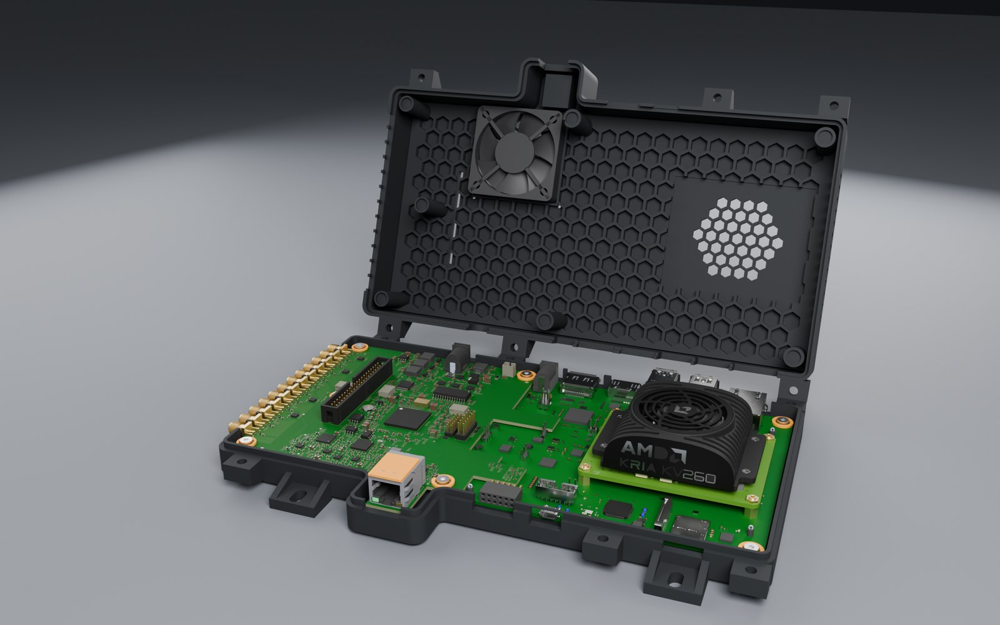

| | |
|---|---|
| 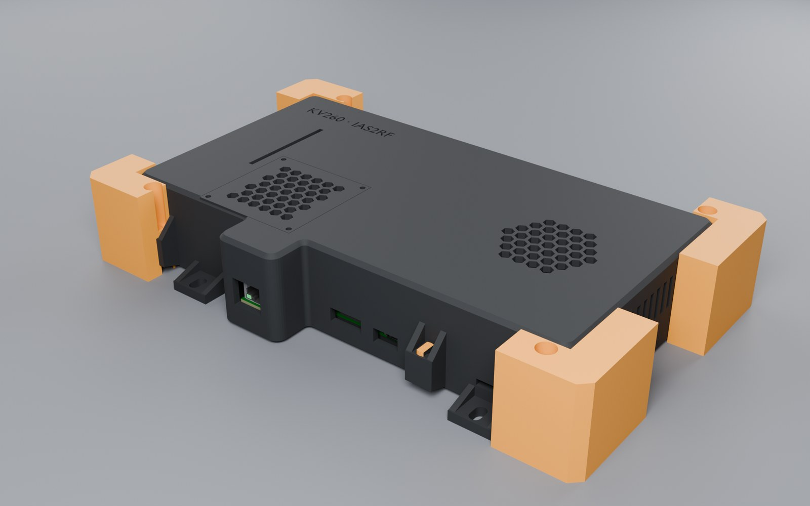 | 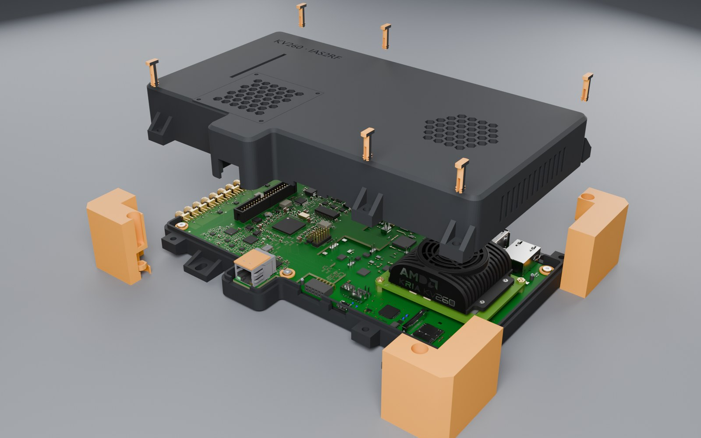 |
| 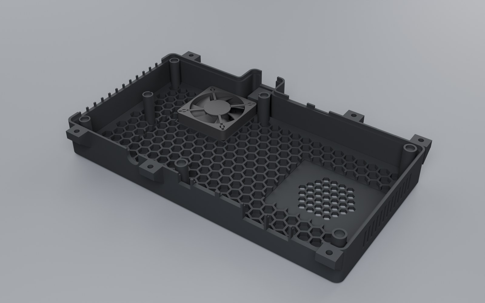 | 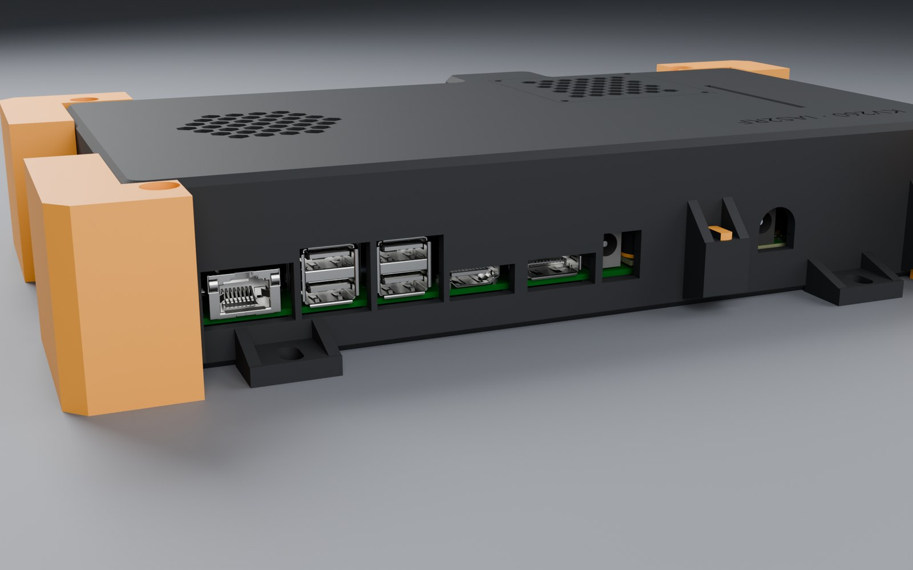 |
| 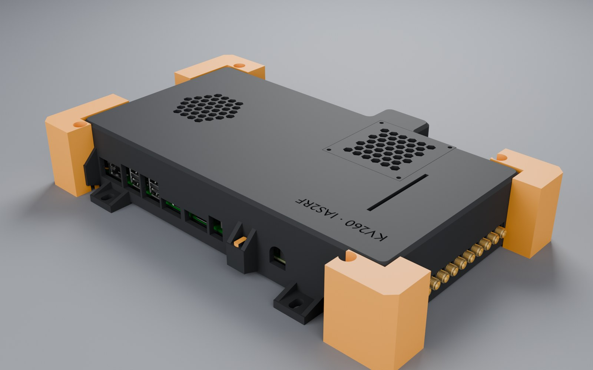 | 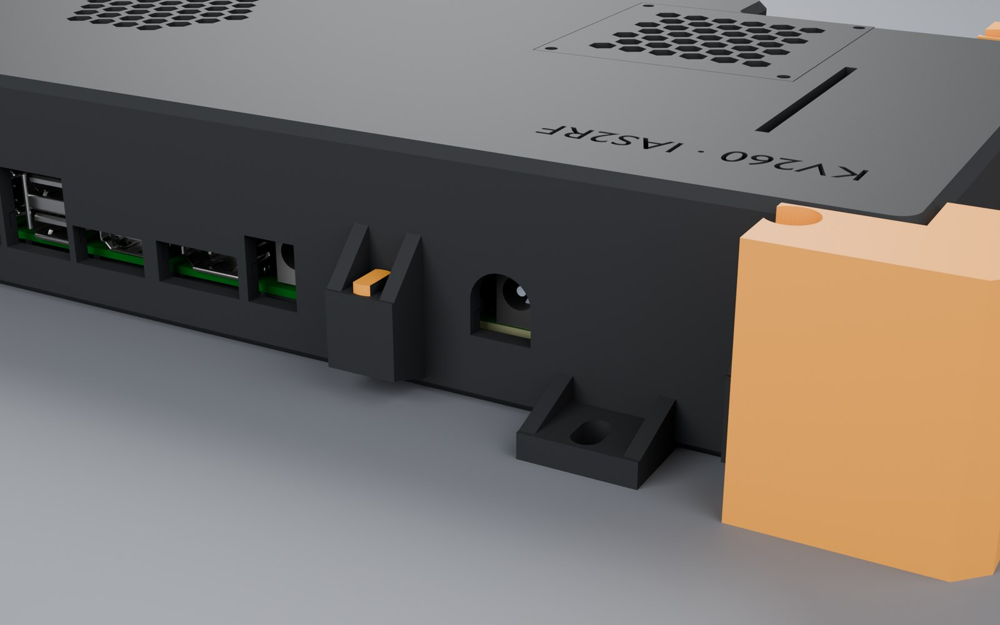 |
| 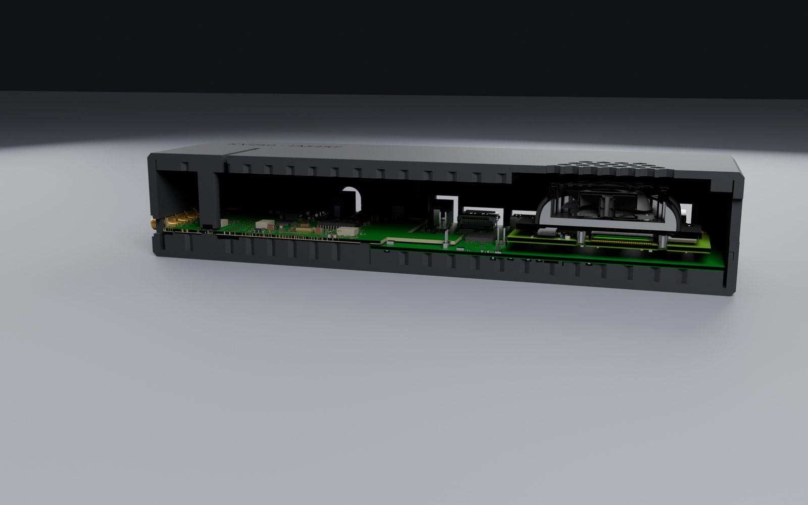 | 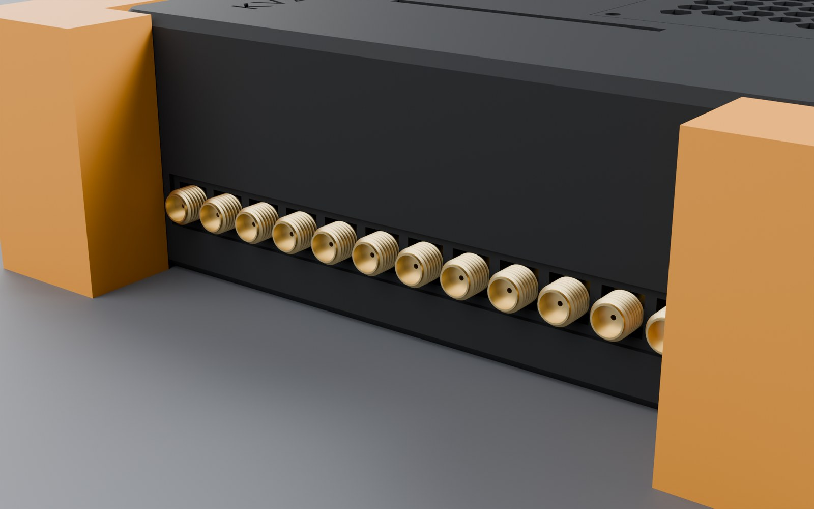 |

**What changes from v1.**
- **A 50 × 50 × 10 mm 5 V fan** blowing down onto the adapter's hot strip along its front edge: U401 (ADCLK948),
  Y401 (Si549), U501 (AD9484), U502/U503 (AD8352) and U1201 (the Ethernet PHY). It hangs from the lid in a 1.2 mm
  square duct whose top stands 4 mm below the ceiling, a plenum under the grille, so the fan can only draw through
  the grille. Four M3 self-tapping fan screws go from below into bosses in the duct's corners.
- **A second hex grille** over the fan, the same 7 mm cells as the KV260's. Outside it, a 58 × 58 × 1.2 mm recess
  holds a **100-mesh stainless filter**, under a printed frame with the same grille (`case_v2_filter_frame.stl`)
  and four M2.5 × 6 screws: the filter comes out for cleaning without opening the case.
- **The SMA wall has no slots**: with the fan blowing in, the box runs at a slight overpressure (CFD: about
  +11 Pa), so air leaves through the vents and dust does not come in at the seams.
- **Right-wall exhaust widened**: 13 slots of 3 × 16 mm instead of 9 of 3 × 14 mm.
- **The "KV260 · IAS2RF" label** is kept, at its new place behind the ribbon slot (as v1).
- **Stick-on aluminium heatsinks** in the fan's jet (bought parts, thermally conductive epoxy rather than tape for
  vibration): 9 × 9 × 5 mm on U401 and on Y401, 14 × 14 × 6 mm on U501. They sit about 9 mm below the fan.

**Parts to buy.** A 50 × 50 × 10 mm 5 V fan with a 2-pin JST PH plug (the CFD used the Sunon MF50100V1-1000U-A99
curve: 8.5 CFM free air, 22 Pa); a 100-mesh stainless sheet cut to 56 × 56 mm; the three heatsinks; 4 × M3 × 14
self-tapping fan screws and 4 × M2.5 × 6.

**Thermal result (CFD, task 21; the built geometry is being re-simulated).** At 25 °C and 45 °C ambient the fan
keeps every IC at least 18 °C under its limit. At 70 °C (a vehicle parked in the sun) the study's fan position left
the Si549 and the K26 SOM 2-3 °C over; v2 moves the fan right over the Si549's strip and adds the heatsinks, which
the verification run will quantify.

---

## 7. Rebuilding

```
blender -b _work/mech/cache/assembly.blend --python _work/mech/build_case.py -- --stl mech           # v1
blender -b _work/mech/cache/assembly.blend --python _work/mech/build_case.py -- --v2 --stl mech      # v2
blender -b _work/mech/cache/case.blend --python _work/mech/check_case.py
blender -b _work/mech/cache/case.blend --python _work/mech/render_case.py -- closed,closed_back,open,tray,lid,section,sma,kria,power
blender -b _work/mech/cache/case_v2.blend --python _work/mech/render_case.py -- closed,closed_back,open,tray,lid,section,sma,kria,power,fan --prefix case_v2_
blender -b _work/mech/cache/case_v2.blend --python _work/mech/fea3d_export.py -- v2                  # 3-D FEA, §5.3
micromamba run -n fea python _work/mech/fea3d_case.py v2 --h 4 --eps 0.0015                         # WSL
blender -b --python _work/mech/render_fea3d.py -- v2
micromamba run -n fea python _work/mech/compose_fea3d.py v2
blender -b --python _work/mech/render_fea3d_hero.py -- v2 Zm                                          # the two renders
micromamba run -n fea python _work/mech/compose_fea3d_hero.py v2 Zm
FEA_OUT=$HOME/fea micromamba run -n fea python _work/mech/fea_case.py --h 4      # WSL, about 3 min per material
micromamba run -n fea python _work/mech/post_fea.py $HOME/fea
```

`assembly.blend` holds the KV260 from AMD's STEP model, which is proprietary and not in this repository
(`_work/mech/cache` is git-ignored). The STLs are this project's own geometry.
