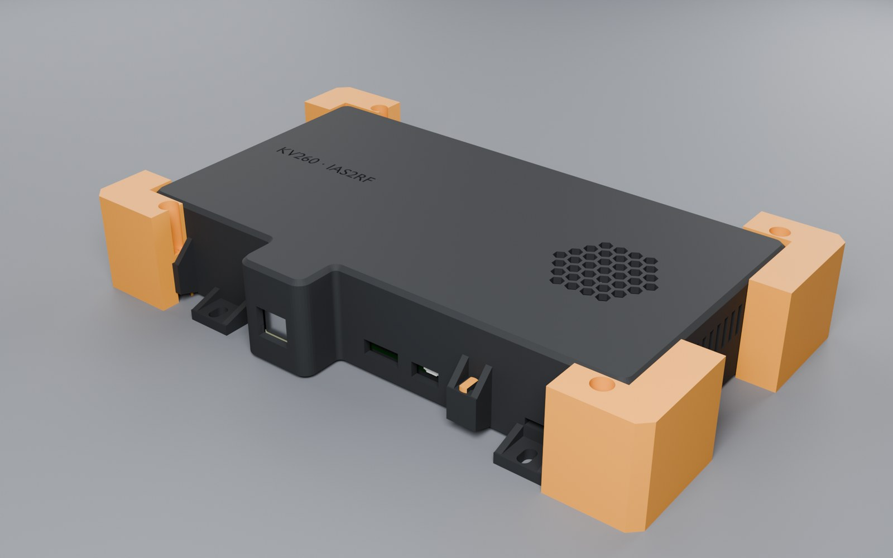
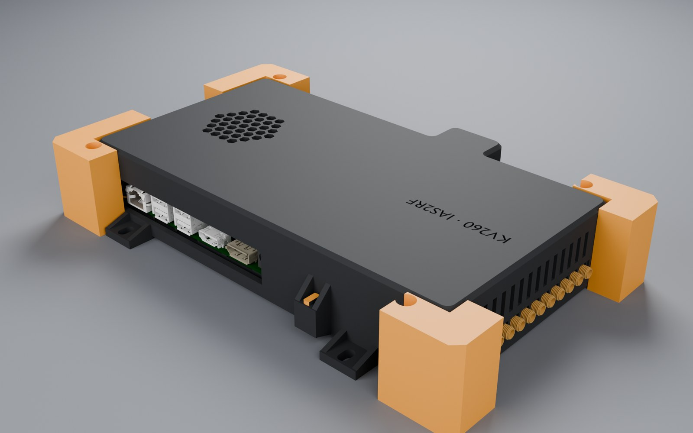
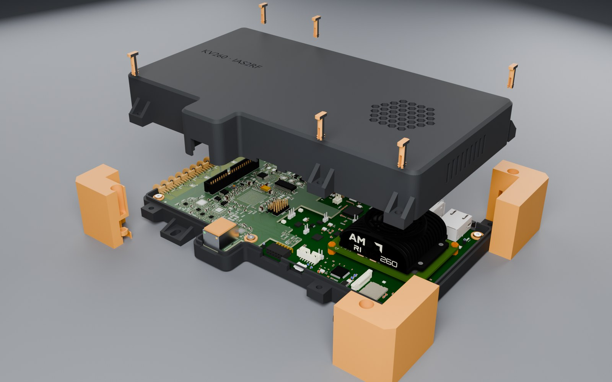
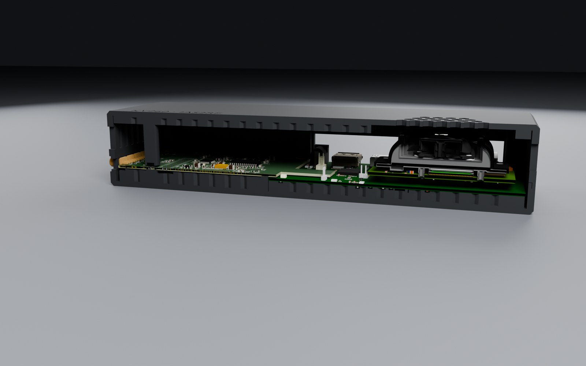
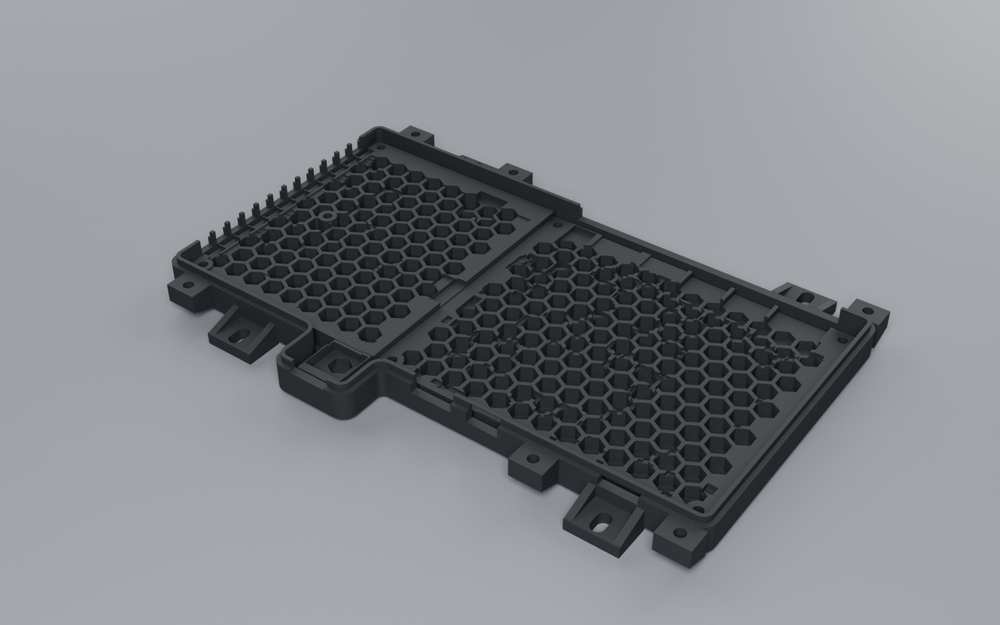
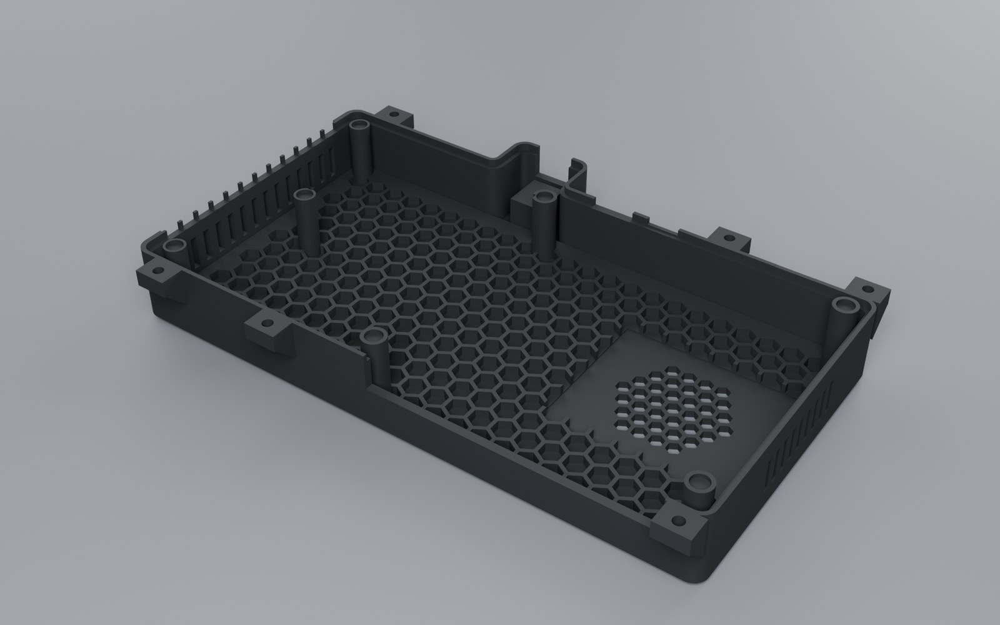
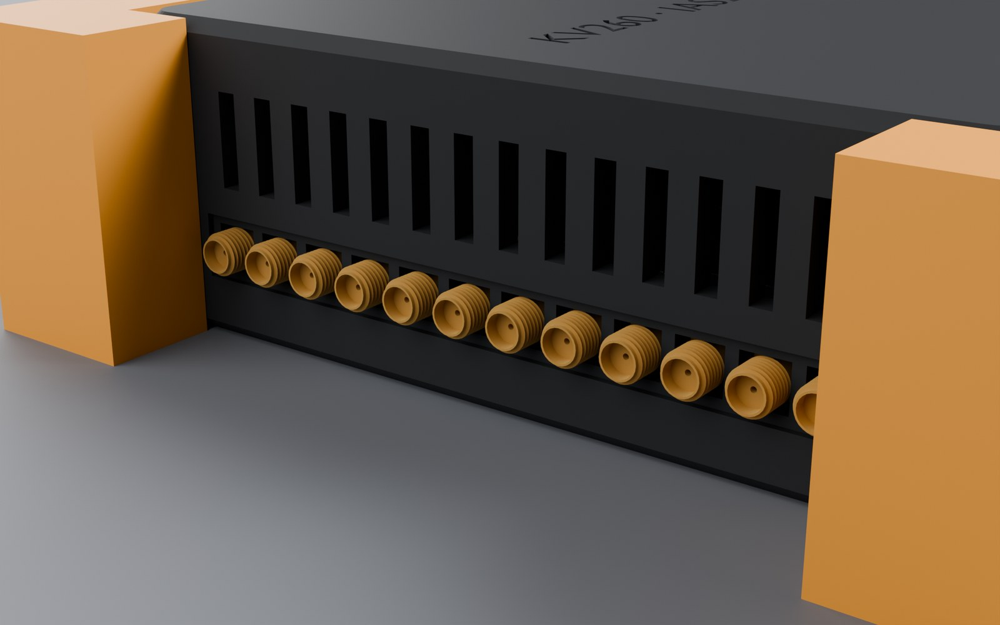
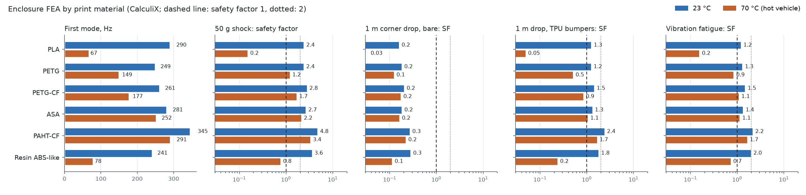

# Enclosure — design, printing and simulation

*13 November 2026 · `_work/mech/build_case.py` (Blender, exact booleans) · STLs in [`mech/`](../mech/)*

A closed, printed enclosure for the KV260 with the adapter on top. It is meant for a vehicle on expedition
roads: vibration, heat in a parked car, and knocks. It has a tray and a lid that close on six lugs, either
with printed snap pins (to try the fit without tools) or with stainless M4 screws. Optional TPU bumpers
protect the corners. Every board rests on a honeycomb or on a clamp post with a TPU pad, so nothing rattles.

| | |
|---|---|
|  |  |
|  |  |
|  |  |



---

## 1. Parts

| STL | Qty | Material | Printer | Orientation |
|---|---|---|---|---|
| `case_bottom.stl` (tray, 248.1 × 166.3 × 16.8 mm) | 1 | PETG-CF (or ASA, PAHT-CF; §4) | Bambu A1 (256 mm bed) | Floor on the bed |
| `case_lid.stl` (248.1 × 161.3 × 34.8 mm) | 1 | same as the tray | Bambu A1 | Exported upside down: the top on the bed. The lugs have 45° ribs above them, so no supports |
| `case_pin.stl` | 6 | PETG or PA (not PLA: it creeps) | A1, or the Saturn 4 Ultra in a tough resin for a fit test | Exported on its flat side, so the split prongs bend across the layers |
| `case_pad_ring.stl`, `case_pad_rj45.stl` | 7 + 1 | TPU 95A | A1, from the external spool (TPU does not go through the AMS Lite) | Flat |
| `case_bumper_l/rfront/back.stl` | 4 (optional) | TPU 95A, gyroid 20 % | A1, external spool | As exported |
| Stainless M4 × 16 (M4 × 20 where a bumper is), DIN 934 nuts, Loctite 243 | 6 | A2/A4 | — | The nuts drop into the hex traps under the tray's lugs |
| M5 screws for the vehicle ears | 4 | A2/A4 | — | Through rubber isolators (§3.3) |

The Saturn 4 Ultra cannot print the shells: its build volume (about 218 × 123 mm) is smaller than either part,
and the resins it prints lose most of their stiffness at 70 °C (§4).

---

## 2. Geometry

- **Outline.** Orthogonal, with a nose around the adapter's RJ45 tab. Walls are 3.5 mm thick; the SMA wall is
  4 mm, because twelve SMA bodies are clamped in it.
- **Split plane** at the SMA centre line (Z = 2.84 mm above the carrier's top face). Each SMA's square body sits
  half in the tray, half in the lid, so closing the lid clamps them.
  - A 1 mm recess band along the SMA row lets the plugs' coupling nuts seat on the connectors, not on the wall.
  - A 1.6 × 3 mm tongue with a 0.2 mm gap seals the split line against dust and splashes.
- **Openings.** The rear I/O band, J4 / J11 / J2 on the front, the RJ45 window, and the twelve SMA notches.
  Openings closer than 4 mm along a wall are merged, so no thin slivers are left between connectors.
- **Cooling.**
  - A hex grille over the KV260's fan (r 27 mm).
  - 9 vent slots in the right wall beside the fan-sink.
  - 14 slots above the SMAs, so air also crosses the adapter.
- **Board support, no play.**
  - The tray's floor is a honeycomb (10 mm cells, 1.6 mm walls) that touches the underside of both boards.
  - The honeycomb is pocketed 0.8 mm clear of every part that hangs below a board, 0.6 mm deeper than the part.
  - That includes the adapter's Rev05 input protection on its underside ([POWER_SPEC.md](POWER_SPEC.md) §1.1).
  - In the lid, clamp posts press each board down through 1 mm TPU 95A pads, compressed about 0.2 mm. They sit
    over the mounting holes H1–H5, the carrier's corners and the RJ45.
  - Each clamp is notched around taller parts. `_work/mech/check_case.py` checks the shells against every
    board mesh: the only contacts left are the intended honeycomb-to-board ones.
- **Label.** "KV260 · IAS2RF" debossed 0.6 mm in the lid.

---

## 3. Closing and mounting

### 3.1 Two ways to close it

- **Without tools, to try the fit.** Six printed snap pins go through both lugs. Their split barbs catch on the
  ceiling of the nut trap. Pull them out with pliers.
- **For the vehicle.**
  - Six stainless M4 screws, with DIN 934 nuts in the hex traps and threadlocker.
  - M4 × 16 normally; M4 × 20 where a bumper is fitted, since it adds 3 mm under the head.

### 3.2 Bumpers (optional, recommended for handling)

- **Shape.** An L-shaped TPU 95A block on each corner, 18 mm thick outside the walls, from the floor to the lid
  top. It wraps over the corner lug and its ribs, which sit in a pocket inside it.
- **Fitting.** Slide it on from the front or back. The lug's own M4 screw goes through it, so it cannot come
  off.
- **Why.** §5 shows they are what makes a 1 m drop survivable.
- **Clearance.** They stay clear of the SMA band and the side vents.

### 3.3 In the vehicle

- **Mounting.** Four ears at the floor have M5 slots.
- **Isolators.** Mount the case on rubber isolators (for example M5 cylindrical, about 40 Shore A). Their
  resonance, a few tens of Hz, sits far below the case's first mode (§5). Above about 1.4 times that resonance,
  vibration reaching the case is attenuated rather than amplified. This is the cheapest margin against
  off-road vibration.

---

## 4. Materials

| Material | Printer notes | Heat (HDT) | Verdict |
|---|---|---|---|
| **PETG-CF** | A1 with a hardened nozzle; dry it | 74 °C | **Default.** Stiff, easy, good to 70 °C with margin in shock |
| ASA | A1 possible; the open frame warps large ASA parts (brim, draft shield, warm room) | 100 °C | Best for UV and heat on a dashboard |
| PAHT-CF | A1 with a hardened nozzle, dried; an enclosed printer is better | 194 °C | Strongest; the choice if it prints flat |
| PETG | A1 | ~70 °C | Fine indoors, marginal in a hot car |
| PLA | A1 | ~55 °C | Not for a vehicle: it softens below 70 °C (§5) |
| Resin ABS-like | Saturn 4 Ultra (small parts only) | ~50–60 °C | Fit-test pins and small parts only |

The FEA in §5 assumes **solid walls**: print the shells with walls enough to be solid, because the walls are
3.5 mm, about 8 perimeters at 0.42 mm. Use 0.2 mm layers and 100 % infill where anything remains. Loads that
pull layers apart are checked against the across-layer strength.

---

## 5. Simulation (CalculiX)



`_work/mech/fea_case.py` and `post_fea.py`; raw results in [`sim/case_fea.json`](sim/case_fea.json).

**Model.**
- The tray, lid, pads and the three boards are meshed conformally (gmsh, 10-node tetrahedra).
- Printed plastic is orthotropic: in-layer E and strength, plus across-layer values.
- The honeycomb is homogenised as ρ* = 0.29 of solid: E₃ = ρ*E along the cells and 2.3ρ*³E across them.
- The boards are elastic plates carrying their masses. The masses (KV260 90 g, adapter 110 g, SOM 120 g) are
  inferred.
- Each material is run at 23 °C and at 70 °C (a parked vehicle in the sun), with the strength kept at 70 °C
  inferred per material.
- Mesh convergence: the first mode of the PETG-CF case is 262.8 / 260.8 / 261.0 Hz with 5 / 4 / 3 mm elements.

**Load cases.** Each is an engineering estimate, with its assumption stated:

| Case | Method |
|---|---|
| First mode | Modal analysis, 10 modes |
| 50 g shock | Static 1 g in each axis, scaled ×50, against the across-layer strength |
| 1 m corner drop, bare | Held at the struck corner and pushed towards it by g; the drop energy stored elastically gives the peak g. The 15 mm crushed around the corner are left out. **Deliberately pessimistic** (rigid floor, no local yielding) |
| 1 m drop, bumpers | 18 mm of gyroid TPU crushing over 60 % of its thickness at near-constant force (efficiency 0.8) stops the case at about 116 g; the stress per g from the bare case |
| Vibration fatigue | Miles' equation at the first mode, Q = 10, on an assumed off-road envelope of 0.04 g²/Hz from 10 to 500 Hz (about 4.4 g rms). The 3σ stress is checked against 0.3 × the across-layer strength |

**Results (safety factors; ≥ 1 passes, ≥ 2 is comfortable):**

| Material | T | Mass | f₁ | 50 g shock | Drop, bare | Drop, bumpers | Vibration |
|---|---|---|---|---|---|---|---|
| PETG-CF | 23 °C | 0.85 kg | 261 Hz | 2.8 | 0.2 | 1.5 | 1.5 |
| PETG-CF | 70 °C | | 177 Hz | 1.7 | 0.2 | 0.9 | 1.1 |
| ASA | 23 °C | 0.76 kg | 281 Hz | 2.7 | 0.2 | 1.3 | 1.4 |
| ASA | 70 °C | | 252 Hz | 2.2 | 0.2 | 1.1 | 1.1 |
| PAHT-CF | 23 °C | 0.77 kg | 345 Hz | 4.8 | 0.3 | 2.4 | 2.2 |
| PAHT-CF | 70 °C | | 291 Hz | 3.4 | 0.2 | 1.7 | 1.7 |
| PETG | 70 °C | 0.86 kg | 149 Hz | 1.2 | 0.1 | 0.5 | 0.9 |
| PLA | 70 °C | 0.84 kg | 67 Hz | 0.2 | 0.03 | 0.05 | 0.2 |
| Resin ABS-like | 70 °C | 0.81 kg | 78 Hz | 0.8 | 0.1 | 0.2 | 0.7 |

What this says:
- **Shock and vibration.** PETG-CF, ASA and PAHT-CF pass at both temperatures. PETG passes cold only. PLA and
  the resin fail hot.
- **First mode.** Above 170 Hz for the good materials, so rubber isolators (§3.3) decouple it cleanly.
- **Drop.** A bare corner hitting concrete from 1 m exceeds every material by this pessimistic method. With the
  TPU bumpers:
  - PAHT-CF and ASA pass at both temperatures;
  - PETG-CF passes cold and falls just short (0.9) hot.
  - A drop is a handling event, normally not at 70 °C.

**What is not established.**
- **Material data.** Every value marked [I] in `fea_case.py` (for example the 70 °C strengths and the resin
  data) is inferred, not measured.
- **Inputs.** The vibration envelope and Q are assumptions. The board masses are inferred.
- **The bumper case** is analytical, not a contact simulation.
- **What would settle it.** A printed tray in PETG-CF, a drop test with and without bumpers, and a shaker or
  drive test.

---

## 6. Rebuilding

```
blender -b _work/mech/cache/assembly.blend --python _work/mech/build_case.py -- --stl mech
blender -b _work/mech/cache/case.blend --python _work/mech/check_case.py
blender -b _work/mech/cache/case.blend --python _work/mech/render_case.py -- closed,closed_back,open,tray,lid,section,sma
FEA_OUT=$HOME/fea micromamba run -n fea python _work/mech/fea_case.py --h 4      # WSL, about 3 min per material
micromamba run -n fea python _work/mech/post_fea.py $HOME/fea
```

`assembly.blend` holds the KV260 from AMD's STEP model, which is proprietary and not in this repository
(`_work/mech/cache` is git-ignored). The STLs are this project's own geometry.
