# Enclosure: design, printing and simulation

*13 November 2026 · `_work/mech/build_case.py` (Blender, exact booleans) · STLs in [`mech/`](../mech/)*

A closed, printed enclosure for the KV260 with the adapter on top. It is meant for a vehicle on expedition
roads: vibration, heat in a parked car, and knocks. It has a tray and a lid that close on six lugs, either
with printed snap pins (to try the fit without tools) or with stainless M4 screws. Optional TPU bumpers
protect the corners. Every board rests on a honeycomb or on a clamp post with a TPU pad, so nothing rattles.

| | |
|---|---|
| 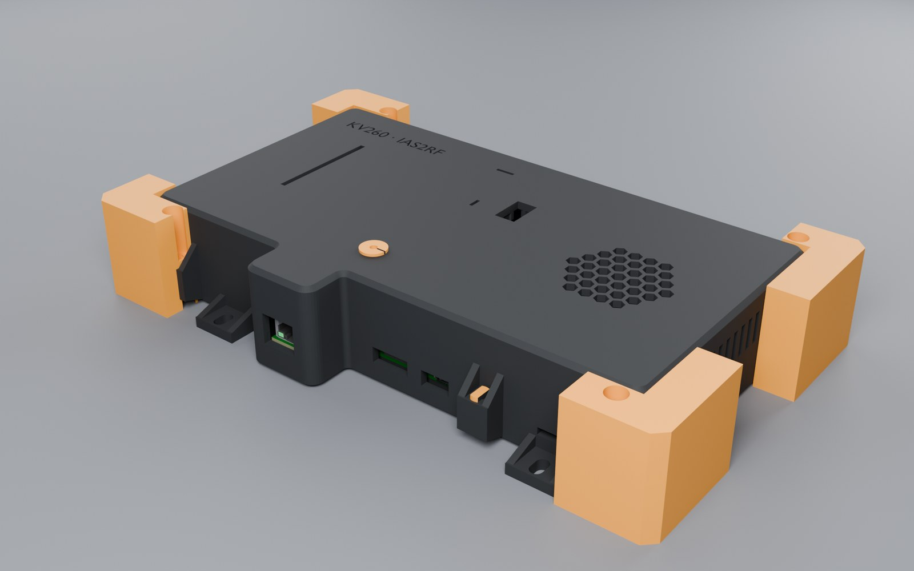 | 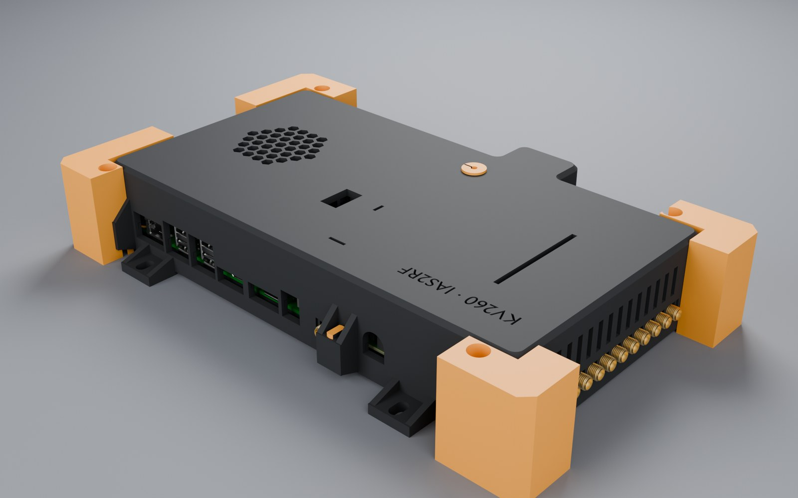 |
| 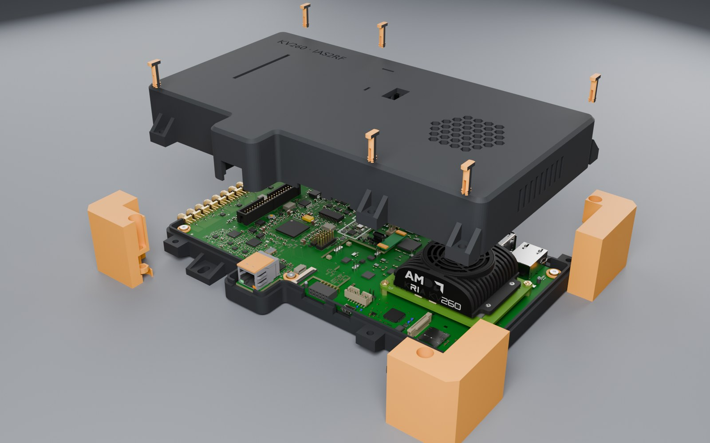 | 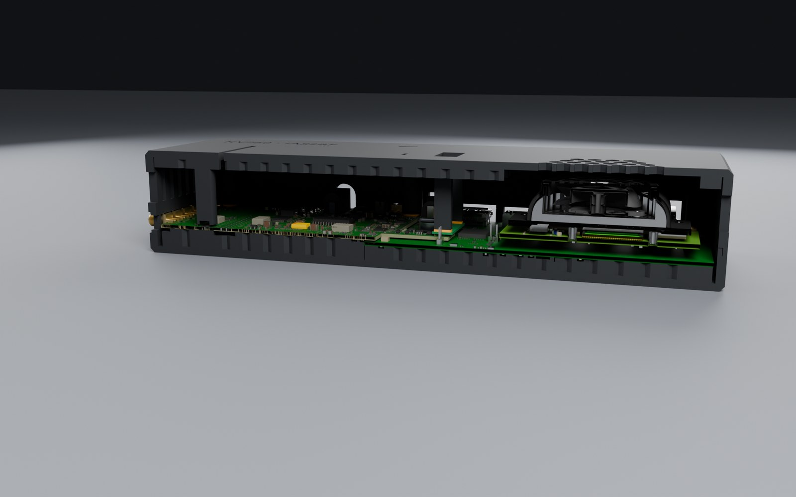 |
| 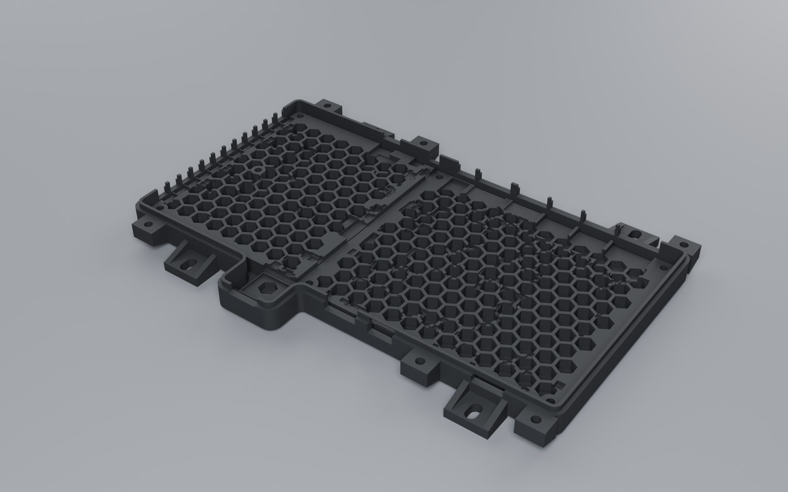 | 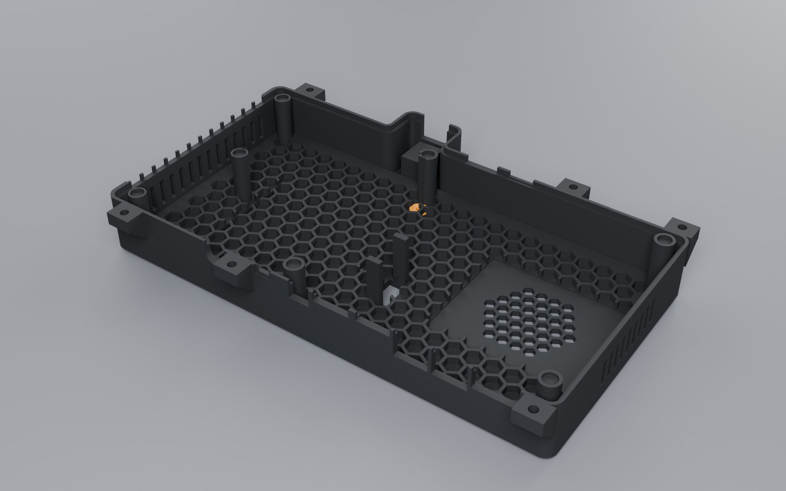 |

| | |
|---|---|
| 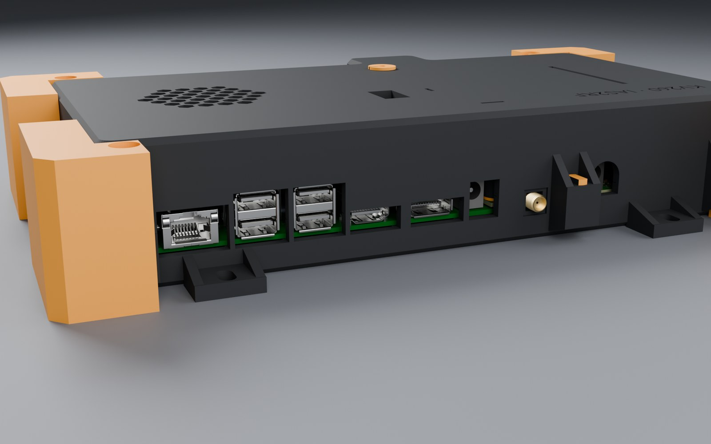 | 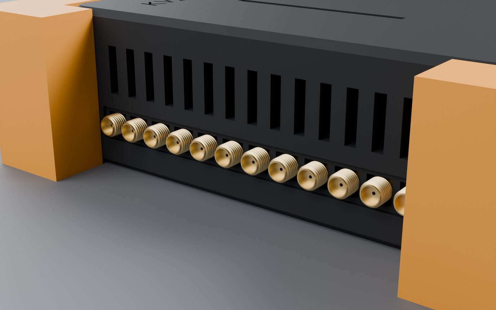 |
| 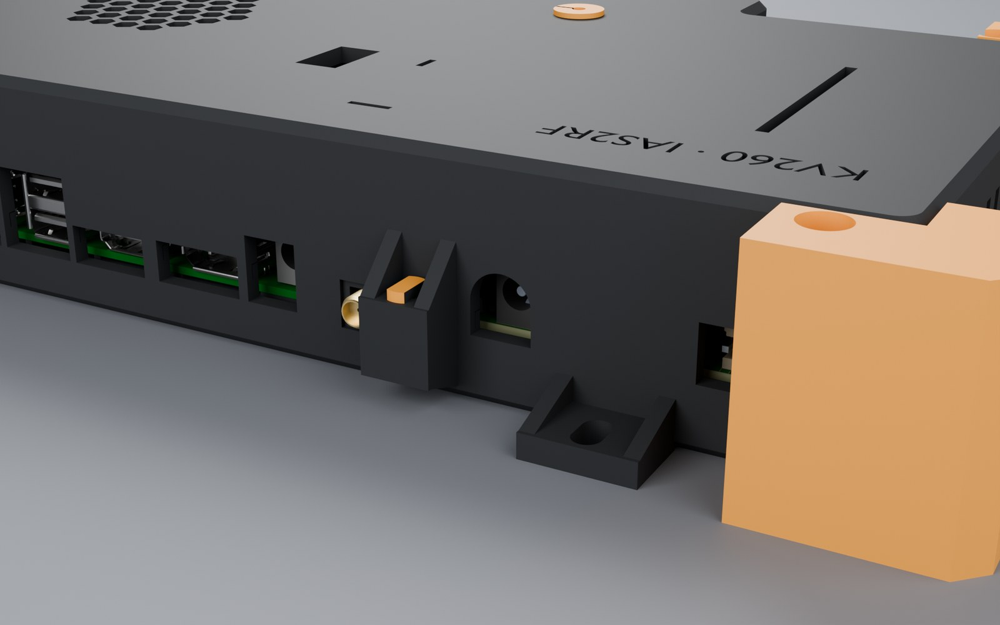 | |

---

## 1. Parts

| STL | Qty | Material | Printer | Orientation |
|---|---|---|---|---|
| `case_bottom.stl` (tray, 248.1 × 166.3 × 16.8 mm) | 1 | PETG-CF (or ASA, PAHT-CF; §4) | Bambu A1 (256 mm bed) | Floor on the bed |
| `case_lid.stl` (248.1 × 161.3 × 34.8 mm) | 1 | same as the tray | Bambu A1 | Exported upside down: the top on the bed. The lugs have 45° ribs above them, so no supports |
| `case_pin.stl` | 6 | PETG or PA (not PLA: it creeps) | A1, or the Saturn 4 Ultra in a tough resin for a fit test | Exported on its flat side, so the split prongs bend across the layers |
| `case_pad_ring.stl`, `case_pad_rj45.stl` | 7 + 1 | TPU 95A | A1, from the external spool (TPU does not go through the AMS Lite) | Flat |
| `case_grommet.stl` | 1 | TPU 95A | A1, external spool | Flange down. Split, so the crimped cable from `J1503` slips in sideways |
| `case_bumper_l/rfront/back.stl` | 4 (optional) | TPU 95A, gyroid 20 % | A1, external spool | As exported |
| Stainless M4 × 16 (M4 × 20 where a bumper is), DIN 934 nuts, Loctite 243 | 6 | A2/A4 | — | The nuts drop into the hex traps under the tray's lugs |
| M5 screws for the vehicle ears | 4 | A2/A4 | — | Through rubber isolators (§3.3) |

The Saturn 4 Ultra cannot print the shells: its build volume (about 218 × 123 mm) is smaller than either part,
and the resins it prints lose most of their stiffness at 70 °C (§4).

---

## 2. Geometry

- **Outline.** Orthogonal, with a nose around the adapter's RJ45 tab. Walls are 3.5 mm thick; the SMA wall is
  4 mm, because twelve SMA bodies are clamped in it.
- **Split plane** at the SMA centre line (Z = 2.84 mm above the carrier's top face). Each SMA's square body sits
  half in the tray, half in the lid, so closing the lid clamps them.
  - A 1 mm recess band along the SMA row lets the plugs' coupling nuts seat on the connectors, not on the wall.
  - A 1.6 × 3 mm tongue with a 0.2 mm gap seals the split line against dust and splashes.
- **Openings.**
  - **KV260 rear I/O.** One cut-out per connector: the DC jack, DisplayPort, HDMI, the two USB stacks and the RJ45.
    Each is 1 mm larger than its connector's face, for the plugs' moulded bodies. Between neighbours the wall stays
    closed with a rib of at least 1.6 mm (14 Nov; the first version left one long window).
  - **Front:** J4, J11 and J2.
  - **Adapter's RJ45:** its window.
  - **Adapter's 12 V jack J1001:** a 12 mm round-topped U up from the shells' joint, centred on the barrel.
    The jack sits 3.5 mm inside the wall, so a 5.5/2.1 plug's moulded body has to go into the wall for the
    barrel to seat.
  - **Ribbon to AERIS-10's ADAR1000 boards:** a 54 × 2.6 mm slot in the lid right above the IDC header J1103, for
    the 40-way ribbon. The plug is fitted before the lid goes on.
  - **The twelve SMA notches** in the front wall; the thirteenth SMA, `J961`, has its own notch in the back wall (Rev08, below).
  - **Left inside:** JTAG, Pmod and the fan header, which are reached with the lid off.
  - The rear lug beside J1001 moved from X −40 to −20 to clear it, and in Rev08 to −27 (below).
- **Rev08 (17 Nov, [REV08_PLAN](REV08_PLAN.md) §9).**
  - **`J961`**, the thirteenth SMA (VHF/UHF antenna), comes out of the back wall at X −14.05. Its notch is split
    at the SMA's centre line like the other twelve, so the two shells clamp its body.
  - **The back-wall lug** moves from X −20, where the notch now is, to −27: 2.6 mm of wall to the notch on one
    side and to the 12 V jack's opening on the other. East of the notch the gap to the KV260's opening is 11.5 mm,
    too narrow for a 14 mm lug. The lug's face is 6 mm from `J961`'s axis: the plug's coupling nut turns by hand,
    and a spanner goes on from the east side. The nine back-wall slots stay where they were, above the notch.
  - **Two LED slots in the lid**, 1.6 mm wide: one over the nine status LEDs north of `J961`, one over the five
    rail LEDs on the tongue.
  - **The camera on the tongue.** An IAS camera module plugs into `J103`. The lid has a 10 × 17 mm window for its
    lens and two clamps on the module's ends, each with a TPU pad (`case_pad_camera.stl`, 2 off). The module's
    outline is the catalogue's 8.74 × 24.18 mm, taken from the connector at one end towards +Y, clear of the
    carrier's `J18`; check it against a module in hand before printing the lid.
  - **The GPS and vehicle CAN cable (18 Nov).** `J1503` is now a vertical JST-SH, so its plug goes in from above
    and the cable rises straight to the lid, about 23 mm. It leaves through an 8.2 mm hole in the lid top, 2.9 mm
    from the plug's axis (X −3.5, Y 5.0), with a split TPU grommet (`case_grommet.stl`: 8 mm body, 12 mm flange
    outside, 10 mm lip inside, 3.2 mm bore for the six 28 AWG wires, a 0.8 mm slit to slip the crimped cable in
    from the side). The hole clears the corner clamp at (−5, −5) and v2's filter recess (X −69 to −11). The clamp
    gives way above the receptacle, where the plug stands. Fit the plug before the lid goes on, as the ribbon.

| | |
|---|---|
| 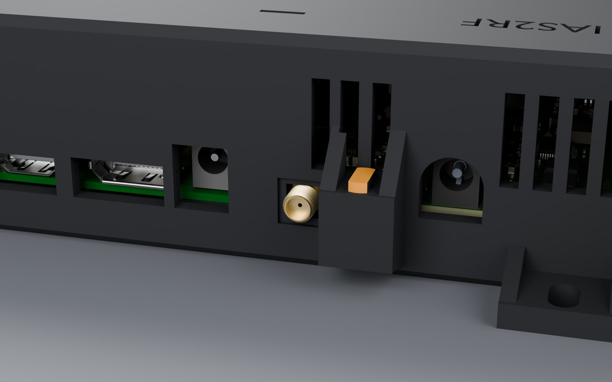 | 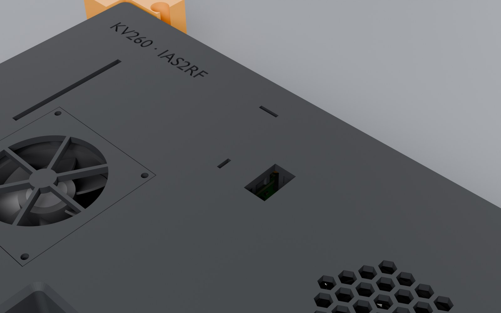 |
| 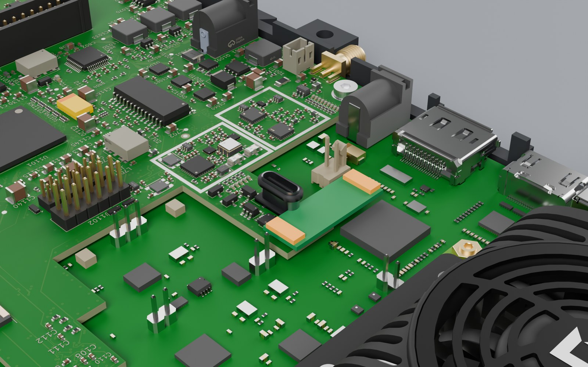 | |
- **Cooling.**
  - A hex grille over the KV260's fan (r 27 mm).
  - 9 vent slots in the right wall beside the fan-sink.
  - 14 slots above the SMAs, so air also crosses the adapter.
- **Board support, no play.**
  - The tray's floor is a honeycomb (10 mm cells, 1.6 mm walls) that touches the underside of both boards.
  - The honeycomb is pocketed 0.8 mm clear of every part that hangs below a board, 0.6 mm deeper than the part.
  - Until Rev08 the adapter's own back layers were taken for one more such part, and the honeycomb under the
    whole adapter sat 0.67 mm low: the adapter rested on the slab's rims only. Found by the 3-D FEA (§5.3), fixed
    on 17 Nov: the adapter now rests on 3,950 mm² of honeycomb, four times the area it had.
  - That includes the adapter's Rev05 input protection on its underside ([POWER_SPEC.md](POWER_SPEC.md) §1.1).
  - In the lid, clamp posts press each board down through 1 mm TPU 95A pads, compressed about 0.2 mm. They sit
    over the mounting holes H1–H5, the carrier's corners and the RJ45.
  - Each clamp is notched around taller parts. `_work/mech/check_case.py` checks the shells against every
    board mesh. Re-run on the Rev08 build (17 Nov): 15 contacts for v1, 16 for v2, all intended. They are the
    honeycomb under both boards (five board-layer meshes), the lid clamp on the RJ45 `J1201`, the four TPU
    bumpers over the corners (tray and lid each), the v2 lid's fan, and `Z4`, a 0.6 × 0.3 mm feature 30 µm thick
    on the carrier's underside that touches the tray floor. None involves a Rev08 part (camera module, `J961`,
    the LEDs).
- **Label.** "KV260 · IAS2RF" debossed 0.6 mm in the lid, behind the ribbon slot (Y 96).

---

## 3. Closing and mounting

### 3.1 Two ways to close it

- **Without tools, to try the fit.** Six printed snap pins go through both lugs. Their split barbs catch on the
  ceiling of the nut trap. Pull them out with pliers.
- **For the vehicle.**
  - Six stainless M4 screws, with DIN 934 nuts in the hex traps and threadlocker.
  - M4 × 16 normally; M4 × 20 where a bumper is fitted, since it adds 3 mm under the head.

### 3.2 Bumpers (optional, recommended for handling)

- **Shape.** An L-shaped TPU 95A block on each corner, 18 mm thick outside the walls, from the floor to the lid
  top. It wraps over the corner lug and its ribs, which sit in a pocket inside it.
- **Fitting.** Slide it on from the front or back. The lug's own M4 screw goes through it, so it cannot come
  off.
- **Why.** §5 shows they are what makes a 1 m drop survivable.
- **Clearance.** They stay clear of the SMA band, the side vents and every connector opening: each arm along the
  front or rear wall stops 4 mm short of that wall's openings. The right-rear one is therefore shorter (11.3 mm
  instead of 22 mm), so the KV260's RJ45 plug goes in freely (13 Nov, found in the KV260-side render).

### 3.3 In the vehicle

- **Mounting.** Four ears at the floor have M5 slots.
- **Isolators.** Mount the case on rubber isolators (for example M5 cylindrical, about 40 Shore A). Their
  resonance, a few tens of Hz, sits far below the case's first mode (§5). Above about 1.4 times that resonance,
  vibration reaching the case is attenuated rather than amplified. This is the cheapest margin against
  off-road vibration.

---

## 4. Materials

| Material | Printer notes | Heat (HDT) | Verdict |
|---|---|---|---|
| **PETG-CF** | A1 with a hardened nozzle; dry it | 74 °C | **Default.** Stiff, easy, good to 70 °C with margin in shock |
| ASA | A1 possible; the open frame warps large ASA parts (brim, draft shield, warm room) | 100 °C | Best for UV and heat on a dashboard |
| PAHT-CF | A1 with a hardened nozzle, dried; an enclosed printer is better | 194 °C | Strongest; the choice if it prints flat |
| PETG | A1 | ~70 °C | Fine indoors, marginal in a hot car |
| PLA | A1 | ~55 °C | Not for a vehicle: it softens below 70 °C (§5) |
| Resin ABS-like | Saturn 4 Ultra (small parts only) | ~50–60 °C | Fit-test pins and small parts only |

The FEA in §5 assumes **solid walls**: print the shells with walls enough to be solid, because the walls are
3.5 mm, about 8 perimeters at 0.42 mm. Use 0.2 mm layers and 100 % infill where anything remains. Loads that
pull layers apart are checked against the across-layer strength.

---

## 5. Simulation (CalculiX)

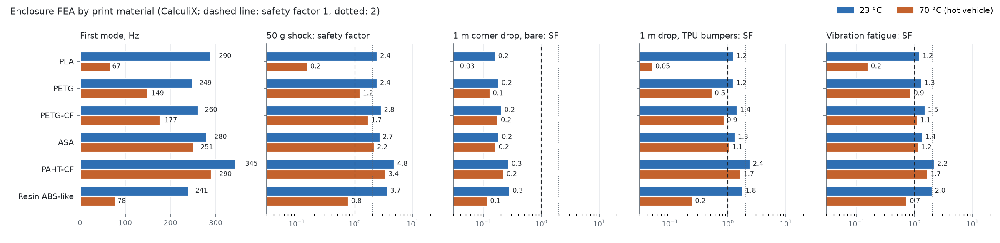

`_work/mech/fea_case.py` and `post_fea.py`; raw results in [`sim/case_fea.json`](sim/case_fea.json).

**Model.**
- The tray, lid, pads and the three boards are meshed conformally (gmsh, 10-node tetrahedra).
- Printed plastic is orthotropic: in-layer E and strength, plus across-layer values.
- The honeycomb is homogenised as ρ* = 0.29 of solid: E₃ = ρ*E along the cells and 2.3ρ*³E across them.
- The boards are elastic plates carrying their masses. The masses (KV260 90 g, adapter 110 g, SOM 120 g) are
  inferred.
- Each material is run at 23 °C and at 70 °C (a parked vehicle in the sun), with the strength kept at 70 °C
  inferred per material.
- Mesh convergence: the first mode of the PETG-CF case is 262.8 / 260.8 / 261.0 Hz with 5 / 4 / 3 mm elements.

**Load cases.** Each is an engineering estimate, with its assumption stated:

| Case | Method |
|---|---|
| First mode | Modal analysis, 10 modes |
| 50 g shock | Static 1 g in each axis, scaled ×50, against the across-layer strength |
| 1 m corner drop, bare | Held at the struck corner and pushed towards it by g; the drop energy stored elastically gives the peak g. The 15 mm crushed around the corner are left out. **Deliberately pessimistic** (rigid floor, no local yielding) |
| 1 m drop, bumpers | 18 mm of gyroid TPU crushing over 60 % of its thickness at near-constant force (efficiency 0.8) stops the case at about 116 g; the stress per g from the bare case |
| Vibration fatigue | Miles' equation at the first mode, Q = 10, on an assumed off-road envelope of 0.04 g²/Hz from 10 to 500 Hz (about 4.4 g rms). The 3σ stress is checked against 0.3 × the across-layer strength |

**Results (safety factors; ≥ 1 passes, ≥ 2 is comfortable):**

| Material | T | Mass | f₁ | 50 g shock | Drop, bare | Drop, bumpers | Vibration |
|---|---|---|---|---|---|---|---|
| PETG-CF | 23 °C | 0.85 kg | 261 Hz | 2.8 | 0.2 | 1.5 | 1.5 |
| PETG-CF | 70 °C | | 177 Hz | 1.7 | 0.2 | 0.9 | 1.1 |
| ASA | 23 °C | 0.76 kg | 281 Hz | 2.7 | 0.2 | 1.3 | 1.4 |
| ASA | 70 °C | | 252 Hz | 2.2 | 0.2 | 1.1 | 1.1 |
| PAHT-CF | 23 °C | 0.77 kg | 345 Hz | 4.8 | 0.3 | 2.4 | 2.2 |
| PAHT-CF | 70 °C | | 291 Hz | 3.4 | 0.2 | 1.7 | 1.7 |
| PETG | 70 °C | 0.86 kg | 149 Hz | 1.2 | 0.1 | 0.5 | 0.9 |
| PLA | 70 °C | 0.84 kg | 67 Hz | 0.2 | 0.03 | 0.05 | 0.2 |
| Resin ABS-like | 70 °C | 0.81 kg | 78 Hz | 0.8 | 0.1 | 0.2 | 0.7 |

What this says:
- **Shock and vibration.** PETG-CF, ASA and PAHT-CF pass at both temperatures. PETG passes cold only. PLA and
  the resin fail hot.
- **First mode.** Above 170 Hz for the good materials, so rubber isolators (§3.3) decouple it cleanly.
- **Drop.** A bare corner hitting concrete from 1 m exceeds every material by this pessimistic method. With the
  TPU bumpers:
  - PAHT-CF and ASA pass at both temperatures;
  - PETG-CF passes cold and falls just short (0.9) hot.
  - A drop is a handling event, normally not at 70 °C.

### 5.3 3-D model of the case as built, with both boards in it (14 Nov, Rev08 17 Nov)

The model above simplifies the shells to check every material. This one meshes the printed geometry, with every
rib, honeycomb, lug, clamp post, vent and cut-out, together with the boards themselves.

**Model.**
- **Boards:** the adapter's FR-4 body (from KiCad's 3-D export of the final 8-layer board) and the KV260 carrier's PCB.
- **Joints between the boards:** the two 0.8 mm spacers at H1/H2 and the mated Hirose pair.
- **Bonding:** everything is united into one bonded body (fTetWild).
  - Each board is bonded where it rests on the honeycomb and the posts.
  - The TPU-padded clamp posts above the boards are left out, which is conservative for the boards.
- **Mesh:** CalculiX, 10-node tetrahedra, about 197 k tets and 362 k nodes (v2).
- **Masses** ride on the boards: adapter 110 g, carrier 90 g plus the K26 SOM with its fan-sink 120 g.
- **Loads:** 50 g quasi-static shocks down, sideways and fore-aft.
- **Supports:** the four ears held at their M5 washers.
- **Case:** von Mises stress, against PETG-CF's across-layer strength: 29 MPa at 23 °C, 17.4 MPa at 70 °C.
- **Boards:** the largest principal strain, against the usual 500 µε guide for BGA solder joints under shock.

| Load case | Case, 99.7th pct / peak | Safety factor 23 °C / 70 °C | Adapter / carrier strain, 99.7th pct | At the BGAs (U1101, U501, U601) | Max displacement |
|---|---|---|---|---|---|
| v2 Rev08, 50 g down | 3.5 / 9.6 MPa | 8.3 / 5.0 | 168 / 394 µε | 80 / 96 / 69 µε | 0.25 mm |
| v2 Rev08, 50 g sideways (X) | 2.2 / 5.2 MPa | 13.2 / 7.9 | 81 / 199 µε | 38 / 63 / 27 µε | 0.08 mm |
| v2 Rev08, 50 g fore-aft (Y) | 1.9 / 3.5 MPa | 15.5 / 9.3 | 95 / 101 µε | 48 / 50 / 52 µε | 0.12 mm |
| v2 Rev07, 50 g down (adapter on the rims only) | 3.5 / 9.3 MPa | 8.3 / 5.0 | 431 / 344 µε | 162 / 162 / 127 µε | 0.25 mm |
| v1, 50 g down | 3.5 / 9.2 MPa | 8.3 / 5.0 | 417 / 326 µε | 159 / 159 / 130 µε | 0.22 mm |

The two maps rendered on the parts themselves (Cycles; colours are the solver's, scale as in the plots below):

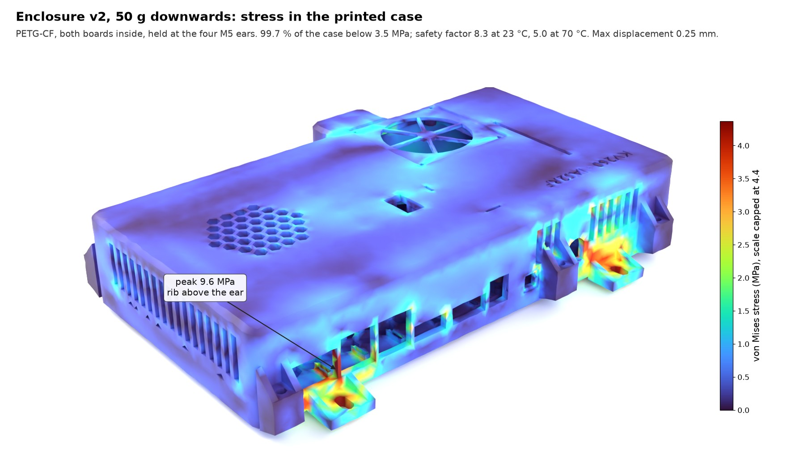

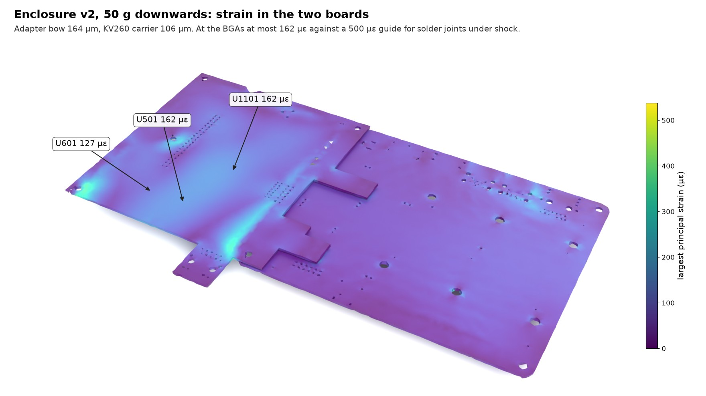

Every load case, from six angles each:

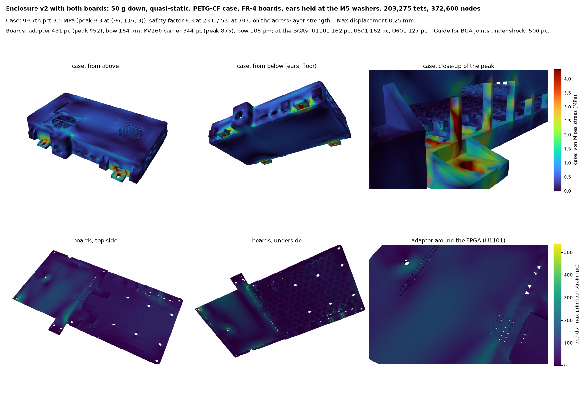
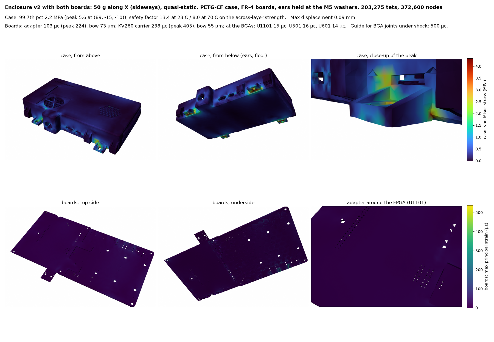
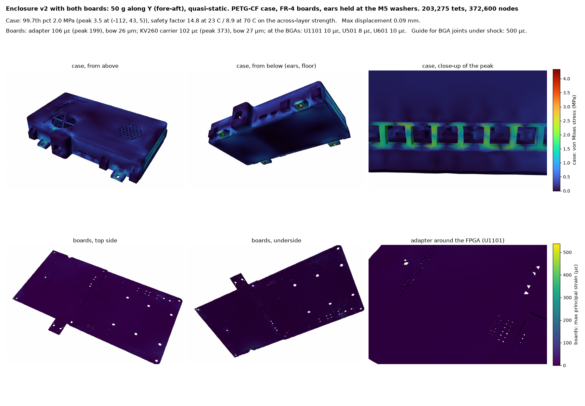

v1 for comparison: [down](sim/case3d_v1_Zm.png), [sideways](sim/case3d_v1_Xp.png),
[fore-aft](sim/case3d_v1_Yp.png). Raw numbers: [`sim/case3d_v2.json`](sim/case3d_v2.json),
[`sim/case3d_v1.json`](sim/case3d_v1.json).

**What it shows.**
- **The case.**
  - The load goes into the vehicle through the four ears.
  - The part that works hardest is the rear wall above the right-rear ear: the ribs between the KV260's RJ45 and
    USB cut-outs carry the load into the ear.
  - Its peak, about 9.6 MPa, is a sharp inside corner: the real corners are rounded and the value is
    mesh-dependent.
  - Even that peak leaves a safety factor of 3.0 at 23 °C and 1.8 at 70 °C. The 99.7th percentile leaves 8 and 5.
  - Rev08's notch, moved lug, LED slots, lens window and camera clamps change nothing measurable either.
  - The fan duct, the open spoke intake, the 17 right-wall and (since 15 Nov, re-run) 9 back-wall exhaust slots
    of v2 change nothing measurable.
- **The boards.**
  - Down is the worst direction.
  - Both boards bend over the honeycomb by about 0.1 mm (adapter 0.11, carrier 0.09 mm).
  - The strain stays at or under 96 µε at every BGA, a fifth of the guide. Before the Rev08 honeycomb fix (§2)
    the adapter rested on its rims only: 162 µε at the BGAs and 431 µε across the adapter, now 168 µε.
  - Higher values, up to about 1000 µε, sit only where a board's bonded edge meets a honeycomb wall or a post (the
    carrier's rear edge). That is a modelling singularity of the bonded contact, away
    from any part. The real TPU-padded contact spreads it.
- **The mesh.** fTetWild's 0.45 mm envelope smooths features finer than that, and the boards are one or two
  elements thick. This model ranks and locates; §5's material table remains the reference for fatigue and drop.

**What is not established.**
- **Material data.** Every value marked [I] in `fea_case.py` (for example the 70 °C strengths and the resin
  data) is inferred, not measured.
- **Inputs.** The vibration envelope and Q are assumptions. The board masses are inferred.
- **The bumper case** is analytical, not a contact simulation.
- **What would settle it.** A printed tray in PETG-CF, a drop test with and without bumpers, and a shaker or
  drive test.

---

### Heatsink Placement & Mechanical Sizing (`HS1`–`HS5`)

Five heatsinks are specified across the assembly, clear of the lid-mounted `50 × 50 × 15 mm` intake fan (`fan2_vis` at `z = 13.75–28.75 mm`); the three under the fan were made taller on 15 Nov:

| Heatsink | Target Component | Dimensions (`L × W × H`) | Assembly centre (`X, Y`, case frame) | Vertical Envelope & Clearance |
|---|---|---|---|---|
| **`HS1`** | `U501` (`AD9484` 400 MSPS ADC) | **`14 × 14 × 8.5 mm`** (black anodized Al, `0.18 mm` TIM) | `(-51.8, +10.55) mm` | Fin top `11.8 mm` (`1.9 mm` below the fan at `z = 13.75 mm`) |
| **`HS2`** | `U401` (`ADCLK948` LVPECL fan-out) | **`9 × 7 × 8 mm`** (blue anodized Al, `-1.0 mm` Y shift) | `(-34.9, -1.20) mm` | Fin top `11.2 mm` (`y_max = +2.3 mm`) |
| **`HS3`** | `Y401` (`Si549` Programmable XO) | **`9 × 7 × 8 mm`** (blue anodized Al, `+1.0 mm` Y shift) | `(-35.0, +9.80) mm` | Fin top `12.0 mm`, `1.8 mm` under the fan (`y_min = +6.3 mm` -> **`4.0 mm` thermal gap** to `HS2`) |
| **`HS4`** | `U1101` (`XC7A50T` Artix-7, optional) | **`14 × 14 × 5 mm`** (low-profile Cu/Al) | `(-42.75, +40.0) mm` | Fin top `~9.0 mm` |
| **`HS5`** | `K26 SOM` (`XCK26` OEM cooler) | **`68 × 58 × 18 mm` + `54 mm` fan** | `(+86.1, +47.0) mm` | Fin top `~25.1 mm` (`7.6 mm` to Enclosure v2 roof) |

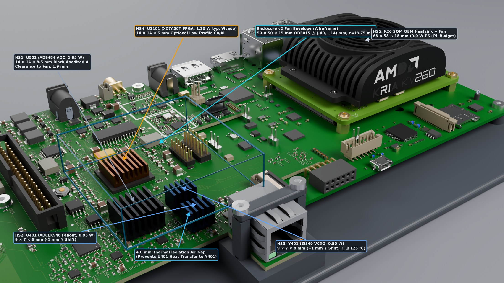

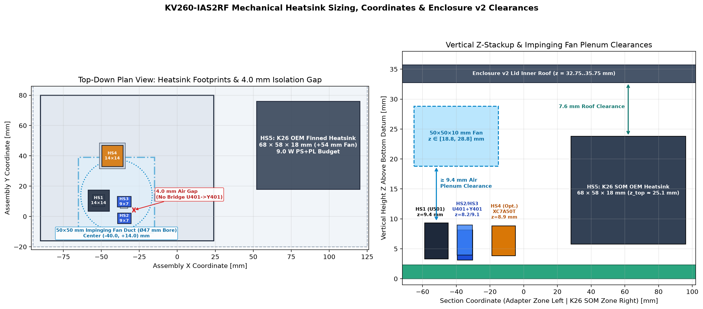

High-resolution 4K views (`board_heatsinks_4k.jpg`, `board_heatsinks_closeup_4k.jpg`, `case_v2_closed_4k.jpg`, `case_v2_open_4k.jpg`, `case_v2_section_4k.jpg`) are stored in [`docs/img/highres/renders/`](img/highres/README.md#4-hardware-heatsink--enclosure-4k-renders-renders).

---

## 6. Version 2: a fan for the adapter, for dusty roads

v1 stays as it is (above). **v2** is the same tray, lid and bumpers with active cooling for the adapter, from the
CFD study in [ENCLOSURE_V2_THERMAL.md](ENCLOSURE_V2_THERMAL.md). It uses the adapter's `J1002` header to give
the fan 5 V.

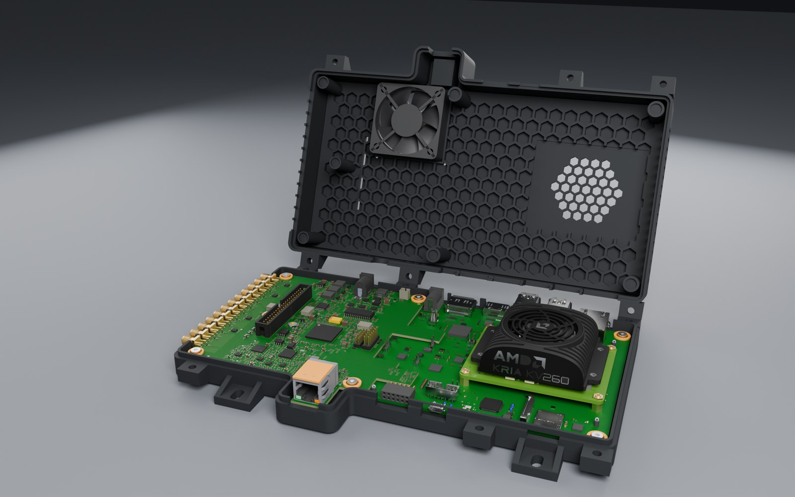

| | |
|---|---|
| 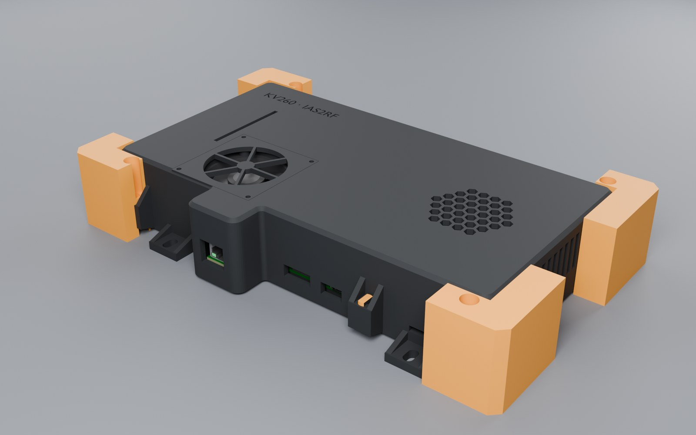 |  |
| 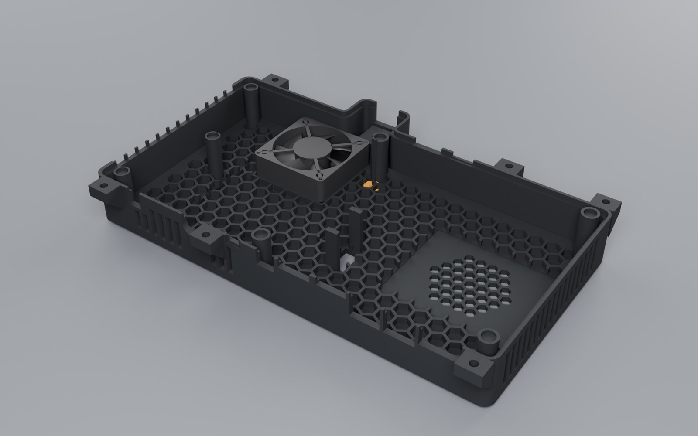 | 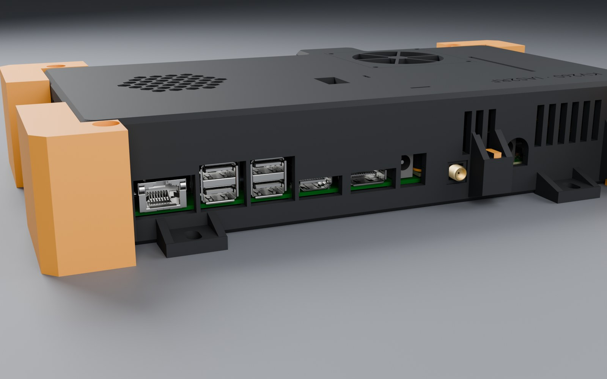 |
| 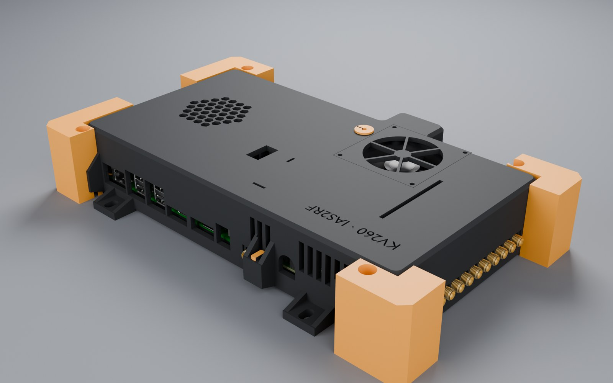 | 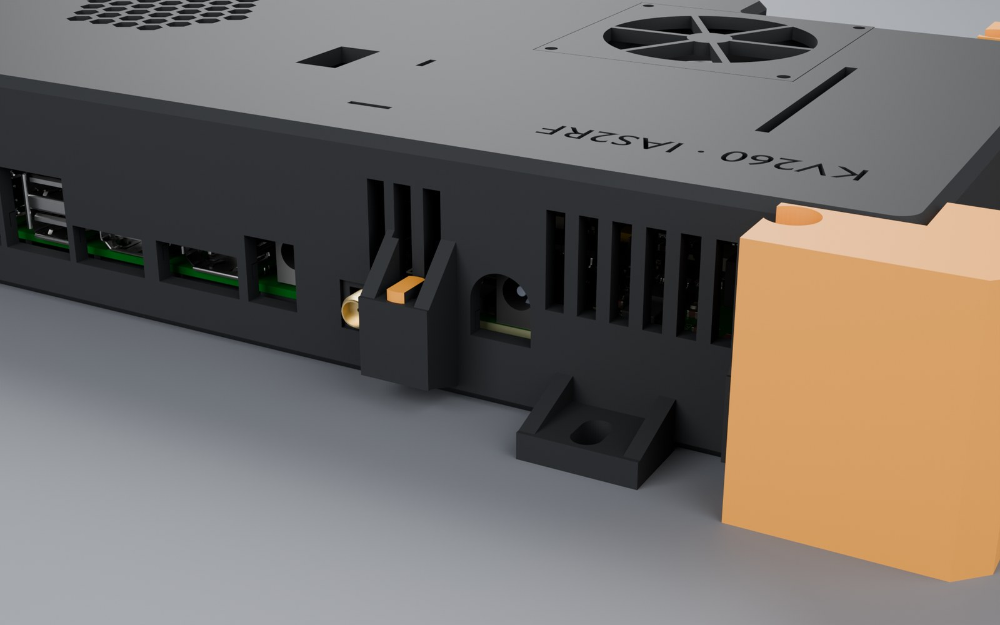 |
| 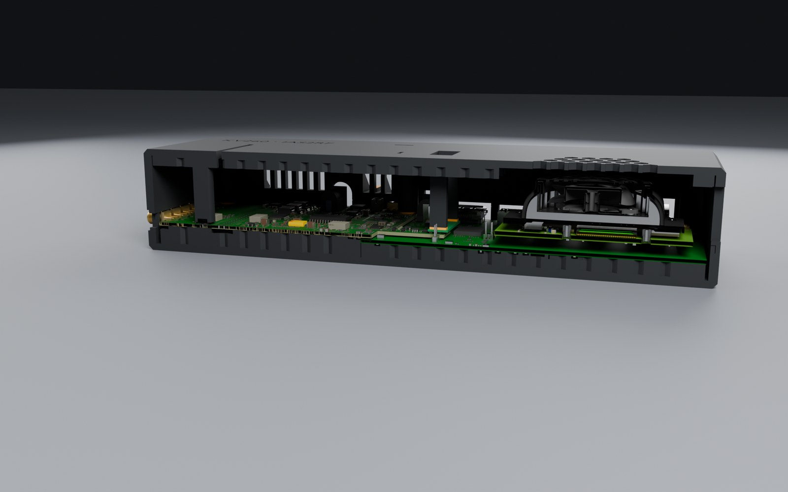 | 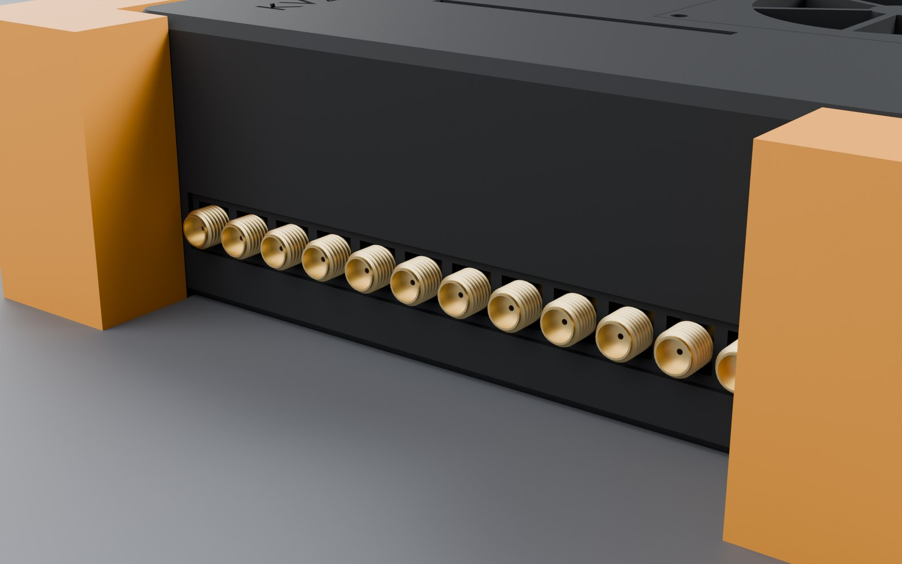 |

**What changes from v1.**
- **A 50 × 50 × 15 mm 5 V fan** (Orion OD5015-05HB: 14 CFM, 50 Pa, 0.13 A; a 5010 until 15 Nov) blowing down onto the adapter's hot strip along its front edge: U401 (ADCLK948),
  Y401 (Si549), U501 (AD9484), U502/U503 (AD8352) and U1201 (the Ethernet PHY). It hangs from the lid in a 1.2 mm
  square duct whose top stands 4 mm below the ceiling, a plenum under the grille, so the fan can only draw through
  the grille. Four M3 self-tapping fan screws go from below into bosses in the duct's corners.
- **An open intake** over the fan: its whole 47 mm bore, crossed only by six 1.6 mm spokes and a 10 mm hub
  (86 % open). Outside it, a 58 × 58 × 1.2 mm recess holds a **100-mesh stainless filter**, clamped between the
  lid's spokes and those of a printed frame (`case_v2_filter_frame.stl`) with four M2.5 × 6 screws: the filter
  comes out for cleaning without opening the case. (The first build used a 7 mm honeycomb here, as over the
  KV260's fan; the CFD of the built v2 found it choked the fan, below.)
- **The SMA wall has no slots**: with the fan blowing in, the box runs at a slight overpressure (CFD: about
  +11 Pa), so air leaves through the vents and dust does not come in at the seams.
- **Right-wall exhaust along the whole wall**: 17 slots of 3.5 × 21 mm (y 4 to 103.5 mm, z 7.5 to 28.5 mm, 1.5 mm
  above the tongue's groove) instead of v1's 9 of 3 × 14 mm, and **9 back-wall slots** of 3.5 × 18 mm (z 10 to 28 mm)
  over the adapter's regulators, none between x −51.5 and −31 mm where the J1001 jack's opening is (15 Nov). In the
  CFD they carry 5.2 of the 7.5 CFM the fan blows in.
- **The "KV260 · IAS2RF" label** is kept, at its new place behind the ribbon slot (as v1).
- **Stick-on aluminium heatsinks** in the fan's jet (bought parts, thermally conductive epoxy rather than tape for
  vibration): 14 × 14 × 8.5 mm on U501, and on U401 and Y401 an 8 mm tall 9 × 9 mm sink **cut down to 9 × 7 mm**. U401 and
  Y401 sit only 9 mm apart: two full 9 × 9 sinks touch, and U401's (0.95 W) then heats the Si549's instead of
  cooling it. Fit each cut sink with its cut edge towards the other and 1 mm off its package's centre, away from
  the other, for a 4 mm air gap between them. Their tops sit 1.8–1.9 mm below the fan: no taller sinks.

**Parts to buy.** An Orion OD5015-05HB fan (50 × 50 × 15 mm, 5 V, 0.13 A, well inside F1002's 0.5 A) with a 2-pin JST
PH plug fitted; a 100-mesh stainless sheet cut to 56 × 56 mm; the three heatsinks; 4 × M3 × 20 self-tapping fan
screws and 4 × M2.5 × 6.

**Thermal result (3-D CFD of v2 as built, [ENCLOSURE_V2_THERMAL.md](ENCLOSURE_V2_THERMAL.md#verification-of-the-built-v2)).**

- **25 °C and 45 °C ambient:** every adapter IC and the K26 stay safely under their limits, even with
  the filter half clogged. As first built, the honest continuous ambient rating is **~50 °C** on the stock
  commercial `KV260` (`XCK26-C` hits `Tj = 85 °C` at `51.27 °C` ambient; board-surface `TA = 85 °C` ICs
  cross `85 °C` PCB temperature starting at `54.2 °C` for `U401`, `57.3 °C` for `Y401`, and `60.3 °C` for
  `U501`), or **`~66–70 °C`** on adapter silicon `Tj` (`U1101` `75.8 °C`, `U1001` `80.5 °C`, `Y401` `125 °C`
  grade up to `87.2 °C` with `0.44 W` Si549 + `0.06 W` `R402/R403`).
- **70 °C ambient (a vehicle parked in the sun), as first built (clean fine mesh):**
  - `XCK26` reaches `100.21 °C` (over commercial `85 °C` and `0.21 °C` over industrial `100 °C` `K26I`);
  - `LMR33630` reaches `114.89 °C` (`10.11 °C` margin to `125 °C`), `XC7A50T` `92.91 °C`, `PHY` `99.51 °C`,
    and `Y401` `105.97 °C` (under `125 °C` silicon `Tj_max`, though board-surface `TA = 85 °C` parts `U401`
    `106.67 °C` and `U501` `99.20 °C` exceed `85 °C` local PCB/board temperature);
  - Cause: the 39-cell intake honeycomb (`23.6%` open area) and 13 narrow exhaust slots hold the stock
    5010 blower to `2.72 CFM` (`15.42 Pa`).
- **70 °C, with the combined upgrade (`v2_opt_combined_fine_70C`):** `Orion OD5015` 50×15 mm blower + wide
  `66%`-open intake grille + widened rear/right exhaust slots + tall sinks + thermal pads to lid:
  - the fan reaches **`7.50 CFM` at `24.25 Pa`** and **`+5.13 Pa`** cavity overpressure (positive dust seal);
  - **`K26I` drops to `97.96 °C`** (`+2.04 °C` margin to the `100 °C` industrial limit; commercial `XCK26-C`
    `85 °C` still requires shading or throttling above `~51 °C`);
  - `Y401` drops to `94.72 °C`, `U401` to `97.80 °C`, `U501` to `90.26 °C`, `LMR33630` to `104.35 °C`,
    `XC7A50T` to `87.15 °C`, and `PHY` to `91.53 °C`.

- **The upgrade as built (15 Nov, printed lid, no aluminium, no pads; [ENCLOSURE_V2_THERMAL §7](ENCLOSURE_V2_THERMAL.md)):**
  the OD5015 fan, the spoke intake, the 17 right-wall and 9 back-wall slots and the taller sinks give 7.5 CFM and
  +5.3 Pa. **Rated ambient: 56 °C with the stock KV260** (its commercial K26 reaches its 85 °C junction limit there;
  UG1090), 63 °C by the adapter's own parts on their board temperature, **70.9 °C with an industrial K26I SOM**
  (99.1 °C at 70 °C, also with the filter clogged twice over). At 70 °C the adapter's hottest junctions are the
  LMR33630 at 109.8 °C (of 125), the ADCLK948 at 98.0 °C, the Si549 at 95.1 °C (of 125) and the XC7A50T at
  87.8 °C (of 100). The aluminium-lid study (pads from U1001 and the K26 to a metal top) is in the report, not built.
- **Rev08 (17 Nov, [ENCLOSURE_V2_THERMAL §8](ENCLOSURE_V2_THERMAL.md)):** re-run with the front end's 0.8 W, the
  camera module (0.35 W, estimated), the adapter's real outline and the lens window and LED slots. **The rating does
  not move: 56.1 °C with the stock KV260, 64.1 °C by the adapter's own parts, 71.1 °C with a K26I.** At 70 °C the
  LMR33630 rises to 113.4 °C (of 125) and the RFFC5072 runs at 89.7 °C junction. The camera module sits about
  17 °C above ambient, so a sensor rated 70 °C sets its own, lower limit.

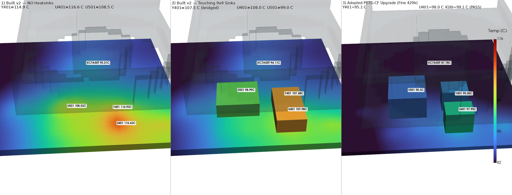

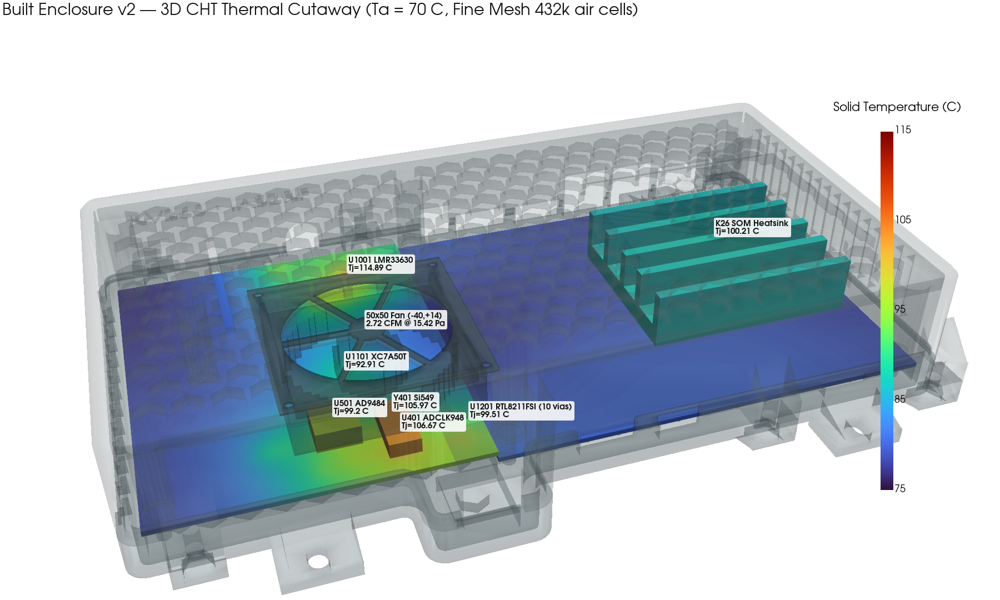

---

## 7. Rebuilding

```
blender -b _work/mech/cache/assembly.blend --python _work/mech/build_case.py -- --stl mech           # v1
blender -b _work/mech/cache/assembly.blend --python _work/mech/build_case.py -- --v2 --stl mech      # v2
blender -b _work/mech/cache/case.blend --python _work/mech/check_case.py
blender -b _work/mech/cache/case.blend --python _work/mech/render_case.py -- closed,closed_back,open,tray,lid,section,sma,kria,power
blender -b _work/mech/cache/case_v2.blend --python _work/mech/render_case.py -- closed,closed_back,open,tray,lid,section,sma,kria,power,fan --prefix case_v2_
blender -b _work/mech/cache/case_v2.blend --python _work/mech/fea3d_export.py -- v2                  # 3-D FEA, §5.3
micromamba run -n fea python _work/mech/fea3d_case.py v2 --h 4 --eps 0.0015                         # WSL
blender -b --python _work/mech/render_fea3d.py -- v2
micromamba run -n fea python _work/mech/compose_fea3d.py v2
blender -b --python _work/mech/render_fea3d_hero.py -- v2 Zm                                          # the two renders
micromamba run -n fea python _work/mech/compose_fea3d_hero.py v2 Zm
FEA_OUT=$HOME/fea micromamba run -n fea python _work/mech/fea_case.py --h 4      # WSL, about 3 min per material
micromamba run -n fea python _work/mech/post_fea.py $HOME/fea
```

`assembly.blend` holds the KV260 from AMD's STEP model, which is proprietary and not in this repository
(`_work/mech/cache` is git-ignored). The STLs are this project's own geometry.
