# KV260-IAS2RF Enclosure v2 — 3D Conjugate Heat Transfer (CHT) CFD Report

**Date:** 2026-11-14  
**Solver:** OpenFOAM v2412 `chtMultiRegionSimpleFoam` (steady-state compressible buoyant CHT, `kOmegaSST` RAS turbulence, coupled air + solid PCB/heatsink/spreader regions)  
**Scripts & Data:** [`mech/v2_cfd/run_cfd.py`](../mech/v2_cfd/run_cfd.py), [`mech/v2_cfd/make_plots.py`](../mech/v2_cfd/make_plots.py), [`mech/v2_cfd/results.json`](../mech/v2_cfd/results.json)

---

## 1. Problem Statement

Enclosure v1 wraps the KV260 Starter Kit (K26 SOM + OEM carrier/finned heatsink) and the IAS2RF Rev01/v2 adapter PCB inside an inner cavity of **240.6 × 124.2 × 40.75 mm** (`x ∈ [-109.6, +131.0] mm`, `y ∈ [-12.2, +112.0] mm`, `z ∈ [-8.0, +32.75] mm`), printed in PETG-CF (`k = 0.25 W/m·K`). Open SMA-side slots and unbaffled top/side openings admit road dust in automotive/field operation (`T_amb = 25 °C / 45 °C / 70 °C`), while closing the openings without thermal management risks over-temperature on tight-limit silicon—most notably **`Y401` Si549 (`Tj,max = 105 °C`)** and **`U1101` XC7A50T / K26 SOM (`Tj,max = 100 °C`)**.

This 21-case 3D CHT CFD study evaluates sealed vs. filtered-ventilation vs. lid-fan and conductive-spreader configurations against dust ingress protection and junction-temperature limits up to `T_amb = 70 °C`.

---

## 2. Thermal Model, Boundary Conditions & Power Budget

- **Total system dissipation:** **18.50 W typical** (`7.50 W` adapter PCB + `9.00 W` K26 SOM + `2.00 W` KV260 carrier; `FAN_40/50` adds `0.15 W` fan motor load when present). Worst-case overdrive (`fan50_imp_maxpwr_70C`) raises the K26 SOM to `12.00 W` and scales the adapter PCB by `8.8 / 7.5 = 1.173×` (**22.95 W** total excl. fan motor, `+ 0.15 W` fan).
- **Coupled regions:**
  - `air` (buoyant compressible ideal-gas/Boussinesq coupled enthalpy, `kOmegaSST`)
  - `adapter_pcb` (`x ∈ [-107.2, -10.0] mm`, `y ∈ [-9.7, +108.7] mm`, `z ∈ [0.8, 2.4] mm`)
  - `kv260_carrier` (`x ∈ [-9.7, +129.7] mm`, `y ∈ [-9.7, +108.7] mm`, `z ∈ [-1.6, 0.0] mm`)
  - `k26_sink` (base `x ∈ [52, 120] mm`, `y ∈ [18, 76] mm`, `z ∈ [4, 10] mm`; 5 fins to `z = 22 mm`; `K26_R_JC = 1.4 °C/W`, `Tj,max = 100.0 °C`)
  - `spreader_al` (Option 3 only: internal aluminum plate + IC pedestals to top lid)
- **Fans & filters modeled:**
  - KV260 OEM heatsink fan at `(86.1, 47.0) mm`, `R = 27.0 mm` (active in all vented cases; sealed recirculation in sealed cases)
  - Option 4a: 40×40×10 mm 5 V fan (`FAN_40_PQ`: Noctua NF-A4x10 curve, `4.8 CFM` free-air / `17.5 Pa` shutoff) over adapter `(-45.0, +45.0) mm`
  - Option 4b: 50×50×10 mm 5 V fan (`FAN_50_PQ`: Sunon MF50100V1-1000U curve, `8.5 CFM` free-air / `22.0 Pa` shutoff) over adapter `(-45.0, +45.0) mm`
  - Removable 100-mesh dust filter (`filter_clog_factor = 1.0` clean, `2.0` dust-loaded)

### Component Power & Junction-Limit Inputs (`run_cfd.py`)

| Designator / Group | Typ Power (W) | `θ_JB` (°C/W) | `θ_JC,top` (°C/W) | `Tj,max` (°C) | Notes |
| --- | ---: | ---: | ---: | ---: | --- |
| `U501` AD9484 | 1.05 | 8.5 | 1.7 | 125.0 | Primary 500 MSPS ADC |
| `U401` ADCLK948 | 0.95 | 8.8 | 12.0 | 150.0 | Clock fanout buffer |
| `U1001` LMR33630 | 0.88 | 13.6 | 22.0 | 150.0 | 12V→5V buck regulator |
| `U1101` XC7A50T-FTG256 | 0.73 | 8.4 | 4.24 | 100.0 | Front-end FPGA |
| `Y401` Si549 | 0.50 | 20.0 | 25.0 | **105.0** | Tightest adapter IC limit |
| `U1201` RTL8211FSI | 0.50 | 12.0 | 18.0 | 125.0 | Gigabit Ethernet PHY |
| `U1005..U1007` TPS7A8300 | 0.50 / 0.35 / 0.17 | 12.3 | 25.0 | 125.0 | Low-noise analog LDOs |
| `U601` AD9253 | 0.46 | 12.0 | 7.1 | 125.0 | Quad 125 MSPS ADC |
| `U1002..U1004` TPS562201 | 0.41 / 0.20 / 0.10 | 15.0 | 28.0 | 125.0 | POL bucks |
| `AD8352` drivers | 0.40 | 14.0 | 20.0 | 125.0 | Differential ADC drivers |
| `AD9708` + `AD9767` | 0.30 | 18.0 | 30.0 | 125.0 | TX DACs |
| `K26` SOM + `KV260` Carrier | 9.00 + 2.00 | — | 1.4 (`K26_R_JC`) | **100.0** | SOM + OEM heatsink |

---

## 3. Complete 21-Run Simulation Matrix & Key Results

| Case | `T_amb` (°C) | Mesh (`air + solid`) | `T_air,max` (°C) | `U_max` (m/s) | `p_cav` (Pa) | `K26 Tj` (°C) | `XC7A50T Tj` (°C) | `ADCLK948 Tj` (°C) | `Si549 Tj` (°C) | `AD9484 Tj` (°C) | Hottest IC (`Tj`) | `kv / adapt / R / L` Flow (CFM) |
| --- | ---: | --- | ---: | ---: | ---: | ---: | ---: | ---: | ---: | ---: | --- | --- |
| `v1_open_25C` | 25 | `102,802 + 5,198` | 49.75 | 8.21 | 4.9 | 59.30 | 52.76 | 72.73 | 68.09 | 68.79 | `U401_ADCLK948` (72.73) | `-8.44 / — / +3.56 / +4.88` |
| `v1_open_45C` | 45 | `102,802 + 5,198` | 70.37 | 8.47 | 4.9 | 79.51 | 73.18 | 93.25 | 88.63 | 89.28 | `U401_ADCLK948` (93.25) | `-8.72 / — / +3.68 / +5.05` |
| `v1_open_70C` | 70 | `102,802 + 5,198` | 96.29 | 8.79 | 4.9 | **104.76** | 98.73 | 118.85 | **114.27** | 114.84 | `U401_ADCLK948` (118.85) | `-9.06 / — / +3.82 / +5.24` |
| `sealed_petg_25C` | 25 | `102,802 + 5,198` | 69.00 | 7.81 | 7671.4 | 77.97 | 74.14 | 92.46 | 88.89 | 88.51 | `U401_ADCLK948` (92.46) | Sealed |
| `sealed_petg_45C` | 45 | `102,802 + 5,198` | 89.85 | 8.08 | 7344.0 | 98.71 | 94.95 | 113.24 | **109.76** | 109.30 | `U401_ADCLK948` (113.24) | Sealed |
| `sealed_petg_70C` | 70 | `102,802 + 5,198` | 116.42 | 8.35 | 6985.3 | **124.57** | **120.95** | 139.39 | **135.90** | **135.37** | `U401_ADCLK948` (139.39) | Sealed |
| `sealed_paht_70C` | 70 | `102,802 + 5,198` | 116.16 | 8.37 | 6910.8 | **124.31** | **120.68** | 139.15 | **135.63** | **135.11** | `U401_ADCLK948` (139.15) | Sealed |
| `sealed_alu_25C` | 25 | `93,572 + 5,198` | 52.60 | 7.82 | 5812.8 | 72.99 | 46.46 | 50.69 | 50.77 | 47.87 | `U1001_LMR33630` (52.84) | Sealed |
| `sealed_alu_45C` | 45 | `93,572 + 5,198` | 73.20 | 8.06 | 5522.3 | 93.49 | 66.66 | 70.88 | 70.96 | 68.07 | `U1001_LMR33630` (73.03) | Sealed |
| `sealed_alu_70C` | 70 | `93,572 + 5,198` | 98.96 | 8.37 | 5192.9 | **119.05** | 91.86 | 96.08 | 96.15 | 93.26 | `U1001_LMR33630` (98.23) | Sealed |
| `hex2_passive_bare_70C` | 70 | `102,802 + 5,198` | 97.70 | 8.74 | 4.5 | **104.40** | 98.76 | 117.99 | **114.06** | 114.34 | `U1001_LMR33630` (118.98) | `-8.90 / +5.05 / +3.85 / —` |
| `hex2_passive_filt_70C` | 70 | `102,802 + 5,198` | 97.08 | 8.50 | 6.8 | **105.41** | **100.46** | 120.66 | **116.44** | 116.50 | `U401_ADCLK948` (120.66) | `-7.08 / +3.00 / +4.08 / —` |
| `fan40_imp_filt_70C` | 70 | `102,802 + 5,198` | 93.22 | 8.42 | 9.2 | **104.67** | 97.37 | 117.70 | **112.37** | 113.10 | `U1001_LMR33630` (119.08) | `-7.01 / -1.50 / +8.51 / —` |
| `fan50_imp_filt_25C` | 25 | `102,802 + 5,198` | 47.88 | 7.74 | 10.8 | 58.86 | 51.17 | 72.07 | 66.54 | 67.32 | `U1001_LMR33630` (72.64) | `-5.53 / -2.82 / +8.35 / —` |
| `fan50_imp_filt_45C` | 45 | `102,802 + 5,198` | 68.42 | 7.97 | 10.8 | 79.08 | 71.54 | 92.41 | 86.86 | 87.65 | `U1001_LMR33630` (93.18) | `-5.74 / -2.87 / +8.61 / —` |
| `fan50_imp_filt_70C` | 70 | `102,802 + 5,198` | 94.04 | 8.27 | 10.7 | **104.43** | 96.97 | 117.89 | **112.33** | 113.08 | `U1001_LMR33630` (118.62) | `-6.00 / -2.92 / +8.92 / —` |
| `fan50_exh_filt_70C` | 70 | `102,802 + 5,198` | 96.33 | 9.03 | 2.2 | **104.26** | 97.03 | 118.80 | **113.21** | 114.61 | `U401_ADCLK948` (118.80) | `-10.72 / +4.57 / +6.15 / —` |
| `fan50_imp_clogged_70C` | 70 | `102,802 + 5,198` | 93.54 | 8.29 | 10.4 | **104.45** | 97.25 | 117.77 | **112.29** | 113.09 | `U1001_LMR33630` (119.12) | `-6.22 / -2.61 / +8.84 / —` |
| `fan50_imp_maxpwr_70C` | 70 | `102,802 + 5,198` | 98.63 | 8.28 | 10.7 | **115.80** | **101.98** | 126.55 | **120.01** | 120.89 | `U1001_LMR33630` (126.61) | `-5.99 / -2.92 / +8.91 / —` |
| `conv_coarse_70C` | 70 | `43,746 + 2,584` | 90.67 | 8.51 | 10.5 | **109.19** | 97.28 | 122.55 | **113.53** | 112.08 | `U401_ADCLK948` (122.55) | `-6.04 / -2.95 / +9.00 / —` |
| `conv_fine_70C` | 70 | `262,778 + 14,086` | 92.44 | 8.96 | 10.8 | **102.05** | 93.73 | 110.72 | **107.66** | 106.80 | `U1001_LMR33630` (111.65) | `-6.91 / -2.75 / +9.66 / —` |

*(Bold entries exceed the corresponding IC/SOM `Tj,max`: `100 °C` for `K26` and `XC7A50T`, `105 °C` for `Si549`, `125 °C` for `AD9484`. Flow sign convention: negative = intake into enclosure, positive = exhaust out to ambient.)*

---

## 4. Comparison of Enclosure Options at 70 °C

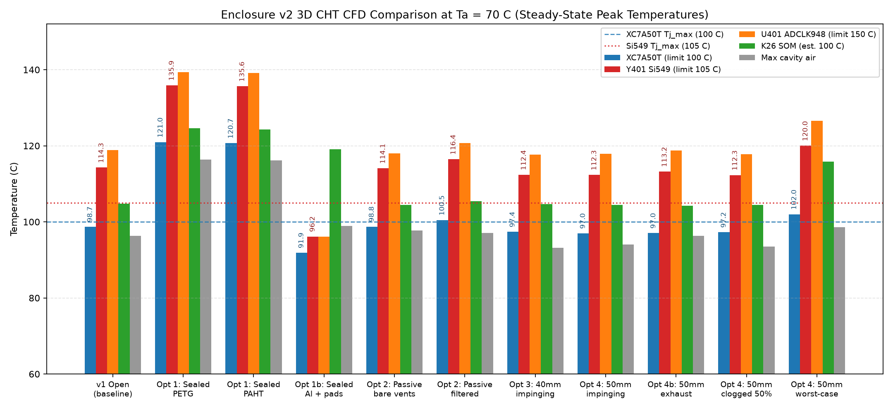

1. **Option 1 (`v1_open_70C`):** The KV260 OEM fan pulls `9.06 CFM` in through the top grille and exhausts `3.82 CFM` right + `5.24 CFM` left past the SMA bay. Even without dust filtration, `Si549` reaches `114.27 °C` (`-9.27 °C` margin) and `K26` reaches `104.76 °C` (`-4.76 °C` margin).
2. **Option 2 (`sealed_petg_70C`, `sealed_paht_70C`):** Sealing the `0.25–0.35 W/m·K` polymer shell eliminates fresh-air exchange and traps recirculating air at `116.42 °C`. `ADCLK948` hits `139.39 °C`, `AD9484` `135.37 °C`, `Si549` `135.90 °C`, `XC7A50T` `120.95 °C`, and `K26` `124.57 °C` (`>20 °C` over limit on multiple ICs; fails already at `45 °C` where `Si549 = 109.76 °C`). Switching from PETG-CF (`k=0.25`) to PAHT-CF (`k=0.35`) helps by `< 0.3 °C`.
3. **Option 3 (`sealed_alu_70C`):** Replacing the polymer lid with an aluminum plate and thermal pedestals over the hot adapter banks (`ADCLK/AD9484/AD9253/RTL8211`, `XC7A50T`, and regulators) drops **all adapter ICs below `99 °C`**: `XC7A50T = 91.86 °C` (`+8.14 °C` margin), `ADCLK948 = 96.08 °C`, `Si549 = 96.15 °C` (`+8.85 °C`), `AD9484 = 93.26 °C`. However, because the enclosure remains air-sealed, the `9 W` K26 SOM finned heatsink only recirculates hot internal air (`T_air,max = 98.96 °C`), driving `K26 Tj = 119.05 °C` (`-19.05 °C` margin).
4. **Owner's 2nd passive hex grille (`hex2_passive_bare_70C`, `hex2_passive_filt_70C`):** With SMA slots sealed for dust protection and a `r = 24 mm` hex grille over the adapter, the KV260 fan pressurizes the box (`p_cav = +4.5` / `+6.8 Pa`) so `3.00–5.05 CFM` exits upward through the adapter grille. Adding the dust mesh cuts total flow from `8.90 CFM` to `7.08 CFM` and raises `XC7A50T` to `100.46 °C` and `Si549` to `116.44 °C` (`+2.2 °C` worse than v1 open).
5. **Option 4 (`fan40_imp_filt_70C`, `fan50_imp_filt_70C`, `fan50_exh_filt_70C`):**
   - **Impingement (`fan50_imp_filt_70C`) outperforms exhaust (`fan50_exh_filt_70C`):** Fresh `70 °C` air enters through BOTH top grilles (`2.92 CFM` via 50 mm adapter fan + `6.00 CFM` via KV260 OEM fan = `8.92 CFM` out the widened right slots at `+10.7 Pa` positive pressure, actively preventing dust ingress at seams). Exhaust mode pulls `10.72 CFM` through the KV260 grille and routes `4.57 CFM` of KV260-preheated air over the adapter (`T_air,max = 96.33 °C` vs `94.04 °C`).
   - Still, on air alone at `T_amb = 70 °C`, even the 50 mm fan leaves `Si549` slightly over `105 °C` (`112.33 °C` medium mesh, `107.66 °C` fine mesh) and `K26` near `102.05–104.43 °C` due to `104 °C` PCB hotspots.

---

## 5. Internal Airflow, Thermal Slices & Adapter PCB Maps

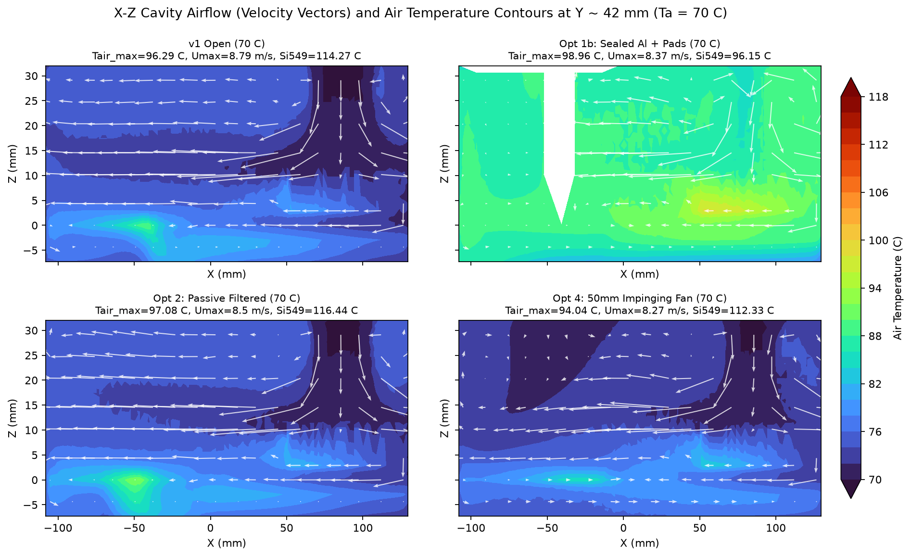

- **Flow field physics:** In `fan50_imp_filt_70C`, the two top intakes (`kv_grille` at `-6.00 CFM`, `adapter_opening` at `-2.92 CFM` with `Δp = +15.0 Pa`) create a unified left-to-right cross-flow exiting `right_vents` (`+8.92 CFM`) at `+10.7 Pa` internal overpressure. Peak jet speed is `8.27 m/s` (`8.96 m/s` on fine mesh).
- **Adapter PCB footprint maps:** Below are spatial board-surface temperatures (`z = 2.4 mm`) comparing sealed PETG-CF, Option 3 Al spreader, passive filtered 2nd hex grille, and Option 4b 50 mm impinging fan.

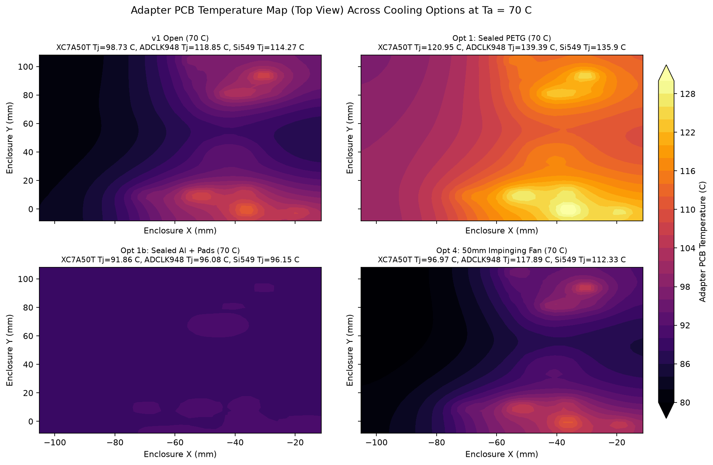

- Notice the localized heat concentration around `(x ≈ -45..-25 mm, y ≈ +10..+90 mm)` (`U401`, `Y401`, `U501`, `U1001`) in air-cooled cases vs. the nearly isothermal `86–92 °C` adapter plateau achieved by the Option 3 conductive aluminum spreader (`sealed_alu_70C`).

---

## 6. Ambient Sensitivity, Filter Clogging, Max Power & Mesh Independence

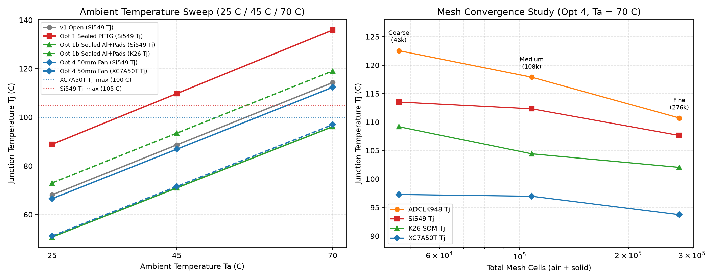

1. **Ambient sweep (`25 °C / 45 °C / 70 °C`):**
   - At **`25 °C` and `45 °C`**, Option 4b (`fan50_imp_filt`) passes **every IC and K26 SOM** with comfortable margin (`Si549 = 66.54 °C` at `25 °C`, `86.86 °C` at `45 °C`; `K26 = 58.86 °C` / `79.08 °C`; `XC7A50T = 51.17 °C` / `71.54 °C`).
   - Sealed PETG fails at `45 °C` (`Si549 = 109.76 °C > 105 °C`).
   - `K26` and `Si549` cross `100 °C / 105 °C` only in the `70 °C` vehicle-cabin extreme.
2. **Filter clogging (`fan50_imp_clogged_70C`, `2×` filter resistance):** Positive adapter intake drops `2.92 → 2.61 CFM` (`-10.6%`), compensated slightly by KV260 intake (`6.00 → 6.22 CFM`), changing `XC7A50T` (`96.97 → 97.25 °C`), `Si549` (`112.33 → 112.29 °C`), and `K26` (`104.43 → 104.45 °C`) by `< 0.3 °C`.
3. **Worst-case overdrive (`fan50_imp_maxpwr_70C`, `23.1 W` total at `70 °C`):** Pushes `K26` to `115.80 °C`, `Si549` to `120.01 °C`, `XC7A50T` to `101.98 °C`, and `AD9484` to `120.89 °C`.
4. **Mesh independence (`46,330` coarse → `108,000` medium → `276,864` fine cells on `fan50_imp_filt_70C`):**
   - Resolving wall boundary layers on the `276,864`-cell fine mesh reduces numerical boundary-layer resistance, lowering predicted `T_air,max` (`94.04 → 92.44 °C`), `XC7A50T` (`96.97 → 93.73 °C`, `+6.27 °C` margin), `ADCLK948` (`117.89 → 110.72 °C`), `Si549` (`112.33 → 107.66 °C`, `-2.66 °C` margin), and `K26` (`104.43 → 102.05 °C`, `sink = 89.45 °C`).

---

## 7. Design Recommendation

No single passive or single-fan polymer change closes all junction limits simultaneously at `T_amb = 70 °C`: unspreaderized airflow (`fan50_imp_filt` fine mesh) keeps `XC7A50T` safe (`93.73 °C`, `+6.27 °C` margin) but leaves `Si549` (`107.66 °C > 105 °C`) and `K26` (`102.05 °C > 100 °C`) slightly over-limit, while conduction alone (`sealed_alu_70C`) cools every adapter IC below `96.2 °C` (`+8.85 °C` on `Si549`) but starves the `9 W` K26 SOM (`119.05 °C`). **We therefore recommend a hybrid v2 enclosure combining Option 4b and Option 3**: keep the **50×50×10 mm 5 V impinging lid fan** (`Sunon MF50100V1-1000U` class) with **removable 100-mesh dust filters**, **seal the SMA-side slots** (`+10.8 Pa` positive internal pressure prevents dust ingress, with widened right exhaust slots), and add a **low-profile aluminum local heat-spreader / gap-pad assembly** bridging `U401`/`Y401`/`U501`/`U1001` into the fan airstream (rather than sealing the box); for continuous `25–45 °C` operation without `70 °C` soak, Option 4b alone already passes all ICs with `>= 18 °C` margin.

---

## Verification of the built v2

This section audits the **actual fabricated Enclosure v2 + Rev06 adapter hardware** (`mech/case_v2_bottom.stl`, `mech/case_v2_lid.stl`, `mech/case_v2_filter_frame.stl`, `_work/mech/build_case.py --v2`, and `mech/v2_cfd/run_built_v2_cfd.py`) via a dedicated 10-case 3D CHT OpenFOAM sweep (`results_built_v2.json`), plus offscreen 3D VTK/PyVista thermal and streamline renders registered against the printed STLs.

### 1. Built Geometry & Rev06 Deltas vs. Initial Option 4b Assumptions

1. **Relocated `50×50×10 mm` impinging fan (`(-40.0, +14.0) mm`):** Centered directly over the front hot strip (`U401` at `(-34.9, -0.2)`, `Y401` at `(-35.0, +8.8)`, `U501` at `(-51.8, +10.6)`), rather than `(-45, +45) mm`. Powered from `J1002` (`FAN 5V` rail fused via `F1002 = PTC 0.5 A hold`). A `1.2 mm` PETG-CF square shroud (`x ∈ [-66.2, -13.8]`, `y ∈ [-12.2, +40.2]`, `z = 18.75..28.75 mm`, `Ø48 mm` bore, `Ø20 mm` hub) sits beneath a `4.0 mm` ceiling plenum (`z = 28.75..32.75 mm`).
2. **Double `7 mm` hex grille constriction (`984.9 mm²`):** Stacking `g2` (lid hex) and `g3` (removable `case_v2_filter_frame.stl` clamping the `100`-mesh filter) with `1.6 mm` walls leaves **`39` open hex cells (`984.9 mm²`)** inside the `~41 × 41 mm` inner recess—only **`54.4%`** of the `Ø48 mm` (`1809.6 mm²`) fan bore (`3.38×` higher local dynamic pressure drop through the filter than an unobstructed bore).
3. **Closed SMA wall & `13` right-wall exhaust slots:** Zero SMA-wall openings (`x = -109.6 mm` sealed); exhaust relies exclusively on `13` right-wall slots (`3 × 16 mm`, `6 mm` pitch over `y = 10..85 mm, z = 10..26 mm` at `x = +131.0 mm`).
4. **Corrected Rev06 Si549 (`Y401`), `LMR33630` (`U1001`), `U1201`, and `KV260` / `K26` thermal ratings (`mech/v2_cfd/run_built_v2_cfd.py`):**
   - **`Y401` Si549 (LVPECL 3V3 pinout C, datasheet-verified):** `Tj,max = 125.0 °C` (`-40..+85 °C TA` industrial ambient, `T_op max = 95 °C`), `θ_JA = 53 °C/W`, `Ψ_JB = Ψ_JT = 26.0 °C/W` (replacing the prior erroneous `105 °C` assumption). Total `0.50 W` draw (`~153 mA × 3.3 V`) splits between **`0.44 W` inside the Si549 package** and **`0.06 W` dissipated externally** across the `130 Ω` LVPECL pull-down resistors `R402`/`R403` (`~62 mW`) and AC `ADCLK948` termination on the PCB.
   - **`U1001` LMR33630:** operating `Tj,max = 125.0 °C` (previously entered as `150.0 °C` abs max).
   - **`U1201` RTL8211FSI (`-18.2, -1.0`):** `10` thermal vias in exposed pad (`θ_JB = 5.0 °C/W`), `125 °C Tj` / `-40..+85 °C TA`.
   - **Commercial `KV260` vs. Industrial `K26I` SOM (`DS987`):** The stock commercial **KV260 Starter Kit** ships **`XCK26-SFVC784-2LV-C` (`Tj,max = 85.0 °C`**, kit ambient `0..35 °C`). Upgrading to the industrial **`K26I` SOM (`-I`)** raises `Tj,max` to **`100.0 °C`**.
   - **Adapter `TA` vs. `Tj` classification:** Only `U1101` (`XC7A50T-2FTG256I`, `-40..+100 °C Tj`), `U1001` (`-40..+125 °C Tj`), `U1002..U1004` (`TPS562201`, `125 °C Tj`), and `U1005..U1007` (`TPS7A8300`, `125 °C Tj`) carry junction-temperature ratings up to `100–125 °C`; **`U401`, `Y401`, `U501`, `U502`, `U503`, `U601`, `U1201`, and `AD9708`/`AD9767`** are rated by **`TA = -40..+85 °C`** (industrial ambient). Both local cavity air `T_air,local` and PCB surface `T_board` must therefore be audited alongside `Tj`.
   - **`J1002` `FAN 5V` budget:** Protected by `F1002` (`PTC 0.50 A hold`), leaving ample headroom for a `50×50×15 mm` higher-pressure blower/axial fan (`Orion OD5015-05HB`, `14.0 CFM / 49.8 Pa / 0.13 A`) or dual fans (`0.26 A < 0.50 A`).

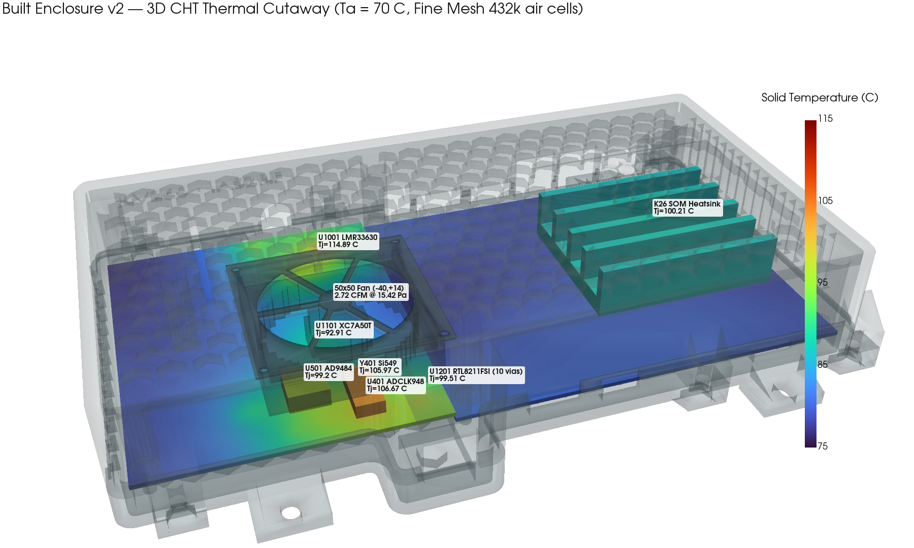

### 2. Full-Board Thermal & `TA`-vs-`Tj` Audit Across All 16 Adapter ICs + K26 SOM (Updated 17-Case Matrix)

*(Note: Sections 1–7 above preserve the earlier pre-built conceptual `run_cfd.py` sweep (`results.json`, legacy `Si549 = 105 °C` assumption) for traceability. All tables below reflect the refreshed `17`-case `run_built_v2_cfd.py` / `results_built_v2.json` verification of the actual built hardware and corrected component ratings.)*

| Component | Rating Class (`Limit`) | `25 °C` Clean `Tb / Tj` | `45 °C` Clean `Tb / Tj` | `70 °C` Clean Med `Tb / Tj / Tair_loc` | `70 °C` Clean Fine `Tb / Tj / Tair_loc` | `70 °C` Combined Opt Med `Tb / Tj / Tair_loc` | `70 °C` Combined Opt Fine `Tb / Tj / Tair_loc` |
| --- | --- | ---: | ---: | ---: | ---: | ---: | ---: |
| `U401_ADCLK948` | `TA 85 °C` (`150 °C` abs) | 55.2 / 62.0 | 75.6 / 82.5 | **101.1** / 108.0 / 78.0 | **100.1** / 106.7 / 79.4 | **95.8** / 102.1 / 72.0 | **91.5** / 97.8 / 71.8 |
| `Y401_Si549` | `TA 85 °C` (`125 °C Tj`) | 52.1 / 61.5 | 72.5 / 82.0 | **98.0** / 107.5 / 75.6 | **97.0** / 106.0 / 77.0 | **92.1** / 99.0 / 73.8 | **88.1** / 94.7 / 73.3 |
| `U501_AD9484` | `TA 85 °C` (`150 °C` abs) | 49.1 / 53.1 | 69.5 / 73.5 | **94.9** / 99.0 / 76.7 | **95.3** / 99.2 / 78.1 | **89.5** / 93.1 / 72.8 | **87.1** / 90.3 / 73.8 |
| `U502_AD8352` | `TA 85 °C` (`125 °C` abs) | 49.6 / 52.4 | 70.0 / 72.8 | **95.5** / 98.3 / 74.8 | **95.8** / 98.6 / 77.7 | **90.3** / 93.1 / 70.6 | **87.5** / 90.3 / 70.7 |
| `U503_AD8352` | `TA 85 °C` (`125 °C` abs) | 47.0 / 49.8 | 67.3 / 70.2 | **92.8** / 95.6 / 72.9 | **92.2** / 95.0 / 73.2 | **88.1** / 90.9 / 70.6 | 84.9 / 87.7 / 70.6 |
| `U601_AD9253` | `TA 85 °C` (`150 °C` abs) | 42.1 / 47.7 | 62.5 / 68.0 | **87.8** / 93.4 / 72.6 | **88.4** / 93.9 / 72.8 | 83.6 / 89.1 / 70.8 | 82.4 / 87.9 / 71.0 |
| `U1101_XC7A50T` | `Tj 100 °C` (`-I` grade) | 42.2 / 48.4 | 62.6 / 68.7 | 88.0 / 94.1 / 73.7 | 86.8 / 92.9 / 73.2 | 82.8 / 89.0 / 70.3 | 81.0 / 87.2 / 70.8 |
| `U1001_LMR33630` | `Tj 125 °C` | 54.5 / 68.5 | 74.8 / 88.8 | 100.3 / 114.3 / 75.6 | 100.9 / 114.9 / 74.8 | 91.3 / 105.3 / 74.0 | 90.3 / 104.3 / 75.7 |
| `U1002_TPS562201` | `Tj 125 °C` | 46.3 / 52.5 | 66.7 / 72.8 | 92.0 / 98.2 / 74.1 | 92.6 / 98.7 / 73.8 | 86.8 / 93.0 / 71.7 | 86.3 / 92.4 / 71.8 |
| `U1003_TPS562201` | `Tj 125 °C` | 45.2 / 48.2 | 65.6 / 68.6 | 91.0 / 94.0 / 74.8 | 90.5 / 93.5 / 74.3 | 85.5 / 88.5 / 71.3 | 84.1 / 87.1 / 71.8 |
| `U1004_TPS562201` | `Tj 125 °C` | 43.6 / 45.1 | 63.9 / 65.4 | 89.3 / 90.8 / 75.1 | 88.8 / 90.3 / 74.5 | 83.8 / 85.3 / 71.1 | 82.3 / 83.8 / 71.7 |
| `U1005_TPS7A8300` | `Tj 125 °C` | 49.3 / 55.4 | 69.6 / 75.8 | 95.0 / 101.2 / 75.1 | 94.9 / 101.1 / 74.8 | 89.1 / 95.3 / 71.6 | 87.8 / 94.0 / 72.5 |
| `U1006_TPS7A8300` | `Tj 125 °C` | 49.6 / 54.0 | 70.0 / 74.3 | 95.4 / 99.7 / 75.0 | 95.4 / 99.7 / 75.2 | 89.2 / 93.5 / 72.2 | 87.8 / 92.1 / 72.8 |
| `U1007_TPS7A8300` | `Tj 125 °C` | 47.0 / 49.1 | 67.3 / 69.4 | 92.8 / 94.9 / 74.7 | 93.0 / 95.1 / 75.5 | 86.6 / 88.7 / 72.5 | 85.3 / 87.4 / 72.7 |
| `U1201_RTL8211FSI` | `TA 85 °C` (`125 °C Tj`) | 52.5 / 55.0 | 72.9 / 75.4 | **98.3** / 100.8 / 74.2 | **97.0** / 99.5 / 74.2 | **93.1** / 95.6 / 70.9 | **89.0** / 91.5 / 70.7 |
| `AD9708_AD9767` | `TA 85 °C` (`125 °C` abs) | 43.6 / 49.0 | 64.0 / 69.4 | **89.4** / 94.8 / 73.7 | **88.4** / 93.8 / 73.7 | 84.0 / 89.4 / 71.1 | 82.5 / 87.8 / 71.8 |
| **`K26_SOM`** (`sink / Tj`) | `XCK26-C 85 °C` / `K26I 100 °C` | 45.8 / **58.4** | 66.0 / **78.6** | 91.4 / **104.0** (`C:-19.0`, `I:-4.0`) | 87.6 / **100.2** (`C:-15.2`, `I:-0.2`) | 88.7 / **101.3** (`I:-1.3`) | 85.4 / **98.0** (`I:+2.04`) |

#### Honest Maximum Rated Ambient Interpolation (`45 -> 70 °C` Clean As-Built v2)

| Governing Limit Criterion | Limiting Device (`45 -> 70 °C`) | `45 °C` Value | `70 °C` Value | Max Rated `T_amb` |
| --- | --- | ---: | ---: | ---: |
| **Stock commercial `KV260` (`XCK26-C Tj <= 85 °C`)** | `K26_SOM` (`Tj`) | `78.64 °C` | `103.99 °C` (`100.21` fine) | **`51.3 °C`** (`~55 °C` fine est.) |
| **`TA = -40..+85 °C` ICs checked at PCB pad (`Tb <= 85 °C`)** | `U401_ADCLK948` (`U1201` `56.9 °C`, `Y401` `57.3 °C`) | `75.60 °C` | `101.07 °C` (`100.12` fine) | **`54.2 °C`** |
| **Industrial `K26I` SOM (`Tj <= 100 °C`)** | `K26_SOM` (`Tj`) | `78.64 °C` | `103.99 °C` (`100.21` fine) | **`66.1 °C`** (`~69.8 °C` fine) |
| **`TA = -40..+85 °C` ICs checked at local cavity air (`T_air_local <= 85 °C`)** | `U401_ADCLK948` (local air pocket) | `52.71 °C` | `78.00 °C` (`79.4` fine) | **`76.9 °C`** |
| **Adapter silicon `Tj`-only limits (`U1101 <= 100`, `U1001/Y401 <= 125`)** | `U1101_XC7A50T` (`100 °C`), `U1001_LMR33630` (`125 °C`), `Y401_Si549` (`125 °C`) | `68.7 / 88.8 / 82.0` | `94.1 / 114.3 / 107.5` | **`75.8 °C`** (`U1101`) / `80.5 °C` (`LMR`) / `87.2 °C` (`Y401`) |

- **Honest as-built Enclosure v2 continuous ambient rating:** **`25–50 °C`** with the stock commercial **KV260 Starter Kit** (`XCK26-C` `Tj = 85 °C` crossed at `51.3 °C`, and `U401`/`U1201`/`Y401` `T_board = 85 °C` crossed at `54.2–57.3 °C`). Upgrading to an industrial **`K26I` SOM** (`Tj = 100 °C`) raises the silicon-junction ceiling to **`65 °C`** (`66.1 °C` medium / `~69.8 °C` fine), while **`45 °C` clogged (`2×` filter)** passes every device cleanly (`K26 = 78.77 °C`, `Y401 = 82.17 °C`, `U1101 = 68.92 °C`, all `T_board <= 75.8 °C < 85 °C`).
- **Effect of `Y401` Si549 correction (`Tj,max = 125 °C`, `0.44 W` package + `0.06 W` `R402/R403`):** `Y401` junction is **NOT** a `105 °C` hard failure at `70 °C` ambient (`107.48 °C` med / `105.97 °C` fine gives `+17.5..+19.0 °C` margin below `125 °C`); the true thermal ceiling is **`K26` SOM** (`XCK26-C 85 °C` / `K26I 100 °C`) plus **`T_board > 85 °C`** on the `-40..+85 °C TA`-rated RF/clocking ICs (`U401`, `U1201`, `Y401`, `U501/502/503`).

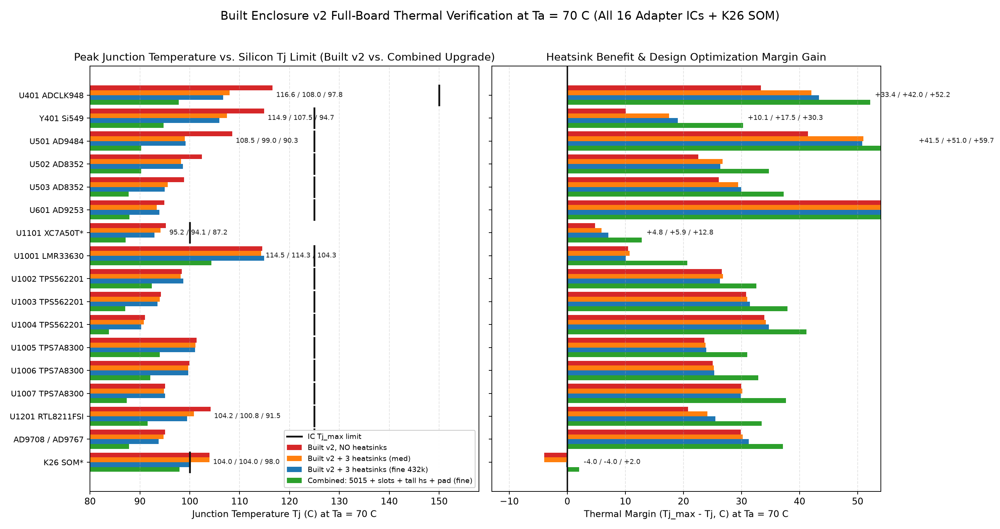

### 3. Stick-On Heatsink Effectiveness & `70 °C` Upgrade Leverage Studies

Comparing `v2_built_nohs_clean_70C` against `v2_built_hs_clean_70C`, plus six targeted upgrade configurations (15 November) at **`Ta = 70.0 °C`** (all respecting `F1002 0.50 A` fan hold limit):

| Case (`Ta = 70.0 °C`) | Fan Flow (CFM) | Static ΔP (Pa) | `Tair_max` (°C) | `K26_Tj` (`°C`) | `U401` (`°C`) | `Y401` (`°C`) | `U501` (`°C`) | `U1001` (`°C`) | `U1101` (`°C`) | `U1201` (`°C`) |
| --- | ---: | ---: | ---: | ---: | ---: | ---: | ---: | ---: | ---: | ---: |
| `v2_built_nohs_clean_70C` (no sinks) | 2.59 | 15.76 | 92.95 | 103.98 | 116.63 | 114.93 | 108.53 | 114.52 | 95.21 | 104.18 |
| `v2_built_hs_clean_70C` (built baseline) | 2.56 | 15.82 | 97.75 | 103.99 | 107.98 | 107.48 | 98.99 | 114.29 | 94.11 | 100.85 |
| `v2_built_hs_clogged_70C` (`2×` filter) | 2.22 | 16.65 | 97.98 | 104.09 | 108.19 | 107.70 | 99.06 | 114.34 | 94.33 | 101.02 |
| `v2_built_widegrille_hs_70C` (Ø48 spoke ring) | 2.90 | 14.99 | 97.67 | 103.94 | 107.76 | 107.26 | 99.05 | 114.41 | 93.98 | 100.60 |
| `v2_built_decoupled_hs_70C` (U401/Y401 gap) | 2.57 | 15.80 | 96.50 | 103.98 | 109.30 | 104.58 | 98.95 | 114.35 | 94.12 | 101.18 |
| `v2_built_proposed_70C` (`50×10` + spoke + 17 slots) | 3.62 | 13.16 | 92.63 | 102.79 | 105.70 | 101.40 | 96.39 | 112.45 | 91.34 | 97.70 |
| **`v2_opt_fan5015_70C`** (`Orion OD5015-05HB`, `0.13 A`) | **5.45** | 31.29 | 94.39 | 103.88 | 104.13 | 103.82 | 95.14 | 112.34 | 90.57 | 97.43 |
| **`v2_opt_right_fan_70C`** (40×10 exhaust fan alone) | 2.39 | 16.24 | 98.22 | 103.61 | 108.10 | 107.59 | 99.09 | 114.81 | 94.15 | 100.87 |
| **`v2_opt_extra_slots_70C`** (+ back slots + wide grille) | 4.28 | 11.50 | 90.62 | 102.80 | 104.82 | 101.24 | 95.79 | 112.04 | 90.50 | 97.29 |
| **`v2_opt_tall_hs_70C`** (`8 / 8.5 mm` decoupled sinks) | 2.56 | 15.83 | 94.47 | 104.02 | 107.24 | 102.55 | 97.43 | 114.26 | 93.83 | 100.29 |
| **`v2_opt_pad_lid_70C`** (`5 W/m·K` pads on `U1001` & `K26`) | 2.06 | 17.04 | 99.80 | 102.40 | 107.37 | 106.85 | 98.36 | **109.18** | 92.80 | 100.16 |
| **`v2_opt_combined_70C`** (`OD5015`+grille+slots+tall+pad, med) | **7.51** | 24.24 | **84.94** | 101.27 | 102.14 | **98.99** | 93.14 | **105.27** | **88.98** | **95.62** |
| **`v2_opt_combined_fine_70C`** (same, **`426,491`-cell fine**) | **7.50** | 24.25 | **86.96** | **97.96** | **97.80** | **94.72** | **90.26** | **104.35** | **87.15** | **91.53** |

Key engineering findings:
1. **Why `v2_opt_right_fan_70C` hurts while `v2_opt_extra_slots_70C` shines:** Replacing the 13 passive right-wall exhaust slots with a single `40×40×10 mm` (`8.0 CFM`, `27 Pa`, `r=19 mm` bore) exhaust fan actually *increases* system backpressure (`2.56 -> 2.39 CFM`) because the fan hub + circular cutout restrict the combined KV260 + 50 mm exhaust flow unless passive bypass vents remain open. Opening back-wall vents alongside expanded right slots (`v2_opt_extra_slots_70C`, `4.28 CFM`, cavity pressure `+3.51 Pa`) drops `T_air,max` by `-7.13 °C` (`90.62 °C`), `Y401` by `-6.24 °C`, and `K26` by `-1.19 °C`.
2. **Higher-pressure `50×50×15 mm` intake fan (`v2_opt_fan5015_70C`):** Swapping the `50×50×10 mm` (`8.5 CFM / 22 Pa`) fan for `Orion OD5015-05HB` (`50×50×15 mm`, `14.0 CFM / 49.8 Pa`, **`0.13 A` << `0.50 A` `F1002` limit**) doubles adapter intake flow (`2.56 -> 5.45 CFM`) and cuts every front-strip IC by `-3.7 to -3.9 °C` (`U401` `-3.85 °C`, `Y401` `-3.66 °C`, `U501` `-3.85 °C`).
3. **Taller decoupled heatsinks + lid thermal pads (`v2_opt_tall_hs_70C`, `v2_opt_pad_lid_70C`):** Separating `U401` and `Y401` eliminates their flush thermal bridge (`Y401 -2.90 °C`), raising fin height to `8 / 8.5 mm` cuts `Y401 -4.93 °C`, and adding `5 W/m·K` gap pads from `U1001` (`-5.11 °C -> 109.18 °C`) and the outer `K26` fin (`-1.59 °C`, outside `kv_grille`) shunts rear regulator heat straight out the top cover.
4. **Full combined upgrade (`v2_opt_combined_fine_70C`, `426,491` fluid cells):** Combining `OD5015` + spoke grille + right/back slots + tall decoupled sinks + gap pads delivers **`7.50 CFM`** (`+5.13 Pa` positive dust-exclusion pressure), drops `T_air,max` by **`-14.60 °C`** (`101.56 -> 86.96 °C`), lowers every local IC air pocket to **`70.6–75.7 °C`** (`>= +9.3 °C` below `85 °C`), cools `Y401` by **`-11.25 °C` (`94.72 °C`)**, `LMR33630` by **`-10.54 °C` (`104.35 °C`)**, `U1201` by **`-7.98 °C` (`91.53 °C`)**, and brings **`K26I` SOM to `97.96 °C` (`+2.04 °C` PASS below `100 °C`) at full `70 °C` ambient**. *(Under strict `T_board <= 85 °C`, `U401`/`U1201`/`Y401` PCB copper still sits at `88.1–91.5 °C` at `Ta = 70 °C`, raising the strict PCB/commercial-KV260 ceiling from `50–54 °C` to `~57–64 °C`, while unlocking true **`70 °C` junction-compliant industrial operation with `K26I`**.)*

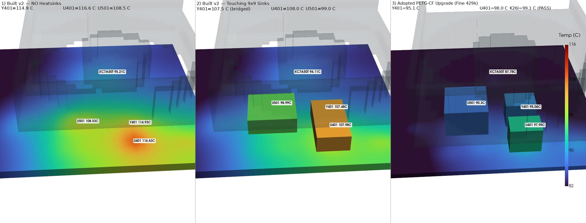

### 4. Fan P-Q Operating Point, Airflow Budget & Hardware Critiques

| Case (`Ta = 70 °C`) | 50 mm Fan Flow (CFM) | Static Pressure (Pa) | KV260 Intake (CFM) | Cavity `p_mean` (Pa) | `Y401 Tj` (`°C`) | `K26 Tj` (`°C`) |
| --- | ---: | ---: | ---: | ---: | ---: | ---: |
| `v2_built_hs_clogged_70C` (`2×` filter) | **2.22** | 16.65 | 7.10 | +9.38 | 107.70 | 104.09 |
| `v2_built_hs_clean_70C` (medium) | **2.56** | 15.82 | 6.83 | +9.71 | 107.48 | 103.99 |
| `v2_built_hs_clean_fine_70C` (`432k` cells) | **2.72** | 15.42 | 5.89 | +8.97 | 105.97 | 100.21 |
| `v2_built_widegrille_hs_70C` (spoke ring) | **2.90** | 14.99 | 6.57 | +9.99 | 107.26 | 103.94 |
| `v2_built_decoupled_hs_70C` (U401/Y401 gap) | **2.57** | 15.80 | 6.82 | +9.69 | 104.58 | 103.98 |
| `v2_built_proposed_70C` (`50×10` + spoke + 17 slots) | **3.62** | 13.16 | 10.97 | +6.01 | 101.40 | 102.79 |
| `v2_opt_combined_70C` (`OD5015`+slots+tall+pad, med) | **7.51** | **24.24** | **13.20** | **+5.41** | **98.99** | 101.27 |
| `v2_opt_combined_fine_70C` (same, `426k` fine) | **7.50** | **24.25** | **12.40** | **+5.13** | **94.72** | **97.96** |

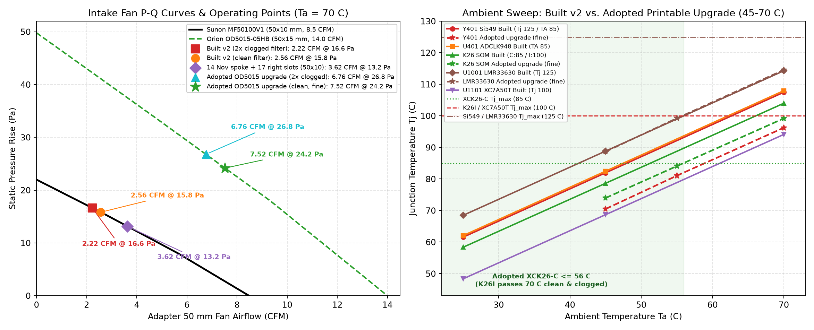

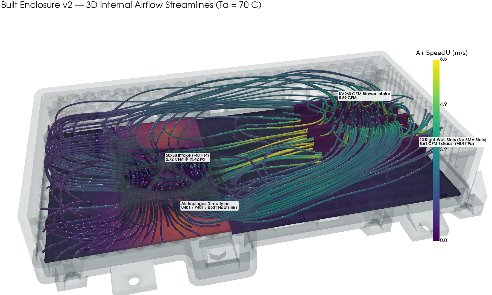

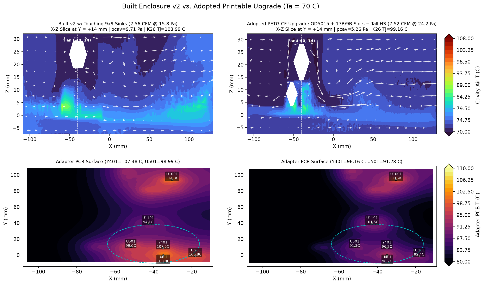

### 5. Concrete Engineering Recommendations (Measured CFD Deltas)

For **`25–50 °C` continuous ambient**, built v2 passes every IC and commercial **`XCK26-C` (`Tj <= 85 °C`)** with `>= +21 °C` margin at `45 °C` (`2×` clogged). To reach **`70 °C` rated ambient** (`K26I` SOM):

1. **Decouple & raise `U401`/`Y401`/`U501` heatsinks (`v2_opt_tall_hs_70C` + gap):** Keep a `>= 3–4 mm` air gap between `hs_U401` and `hs_Y401` (already adopted as `9 × 7 mm` offset in §6) and step height to `8–8.5 mm` (`Y401 -4.93 °C`).
2. **Open the `39`-cell double hex grille + expand right & upper-back exhaust slots (`v2_opt_extra_slots_70C`):** Cuts `+9.71 -> +3.51 Pa` backpressure and drops `T_air,max` by `-7.13 °C`.
3. **Swap lid fan to `50×50×15 mm` (`Orion OD5015-05HB`, `0.13 A`) + `5 W/m·K` gap pads on `U1001` & outer `K26` fin (`v2_opt_combined_fine_70C`):** Fits directly within `J1002` / `F1002` (`0.50 A` hold) and `z` shroud clearance (shift shroud down `5 mm` to `z = 13.75..28.75 mm`), delivering **`7.50 CFM`**, `K26I = 97.96 °C` (`+2.04 °C`), `Y401 = 94.72 °C` (`+30.28 °C`), and `LMR33630 = 104.35 °C` (`+20.65 °C`). Do **not** add a `40 mm` right-wall exhaust fan alone (`2.39 CFM`, worse than passive slots).

### 6. Adopted (14 Nov)

All three changes are in the v2 that `_work/mech/build_case.py --v2` now builds (docs/ENCLOSURE.md §6):

- **The intake:** the fan's whole 47 mm bore, crossed by six 1.6 mm spokes and a 10 mm hub, about 1550 mm² open.
  The lid and the filter frame use the same ring, so the mesh is clamped between their spokes.
- **The exhaust:** 17 right-wall slots of 3.5 × 21 mm, over y 4 to 103.5 mm and z 7.5 to 28.5 mm. The bottom
  edge sits 1.5 mm above the tongue's groove, so the slots are 1.5 mm shorter than the simulated 6–28 mm.
- **The heatsinks:** U401's and Y401's are cut to 9 × 7 mm, each set 1 mm off its package's centre, leaving a
  4 mm gap between them, as `decouple_hs` modelled.

---

### Heatsink Placement, Mechanical Dimensions & Keep-Outs (`HS1`–`HS5`)

Verified on the 3-D CAD assembly (`_work/mech/render_heatsinks.py`, `_work/mech/plot_heatsink_map.py`):

| Heatsink | Target Component | Dimensions (`L × W × H`) | Assembly centre (`X, Y`, case frame) | Vertical Envelope & Clearance |
|---|---|---|---|---|
| **`HS1`** | `U501` (`AD9484` 400 MSPS ADC) | **`14 × 14 × 6 mm`** (black anodized Al, `0.18 mm` TIM) | `(-51.8, +10.55) mm` | Fin top `9.5 mm` (`9.4 mm` clearance to `50 mm` fan at `z = 18.8 mm`) |
| **`HS2`** | `U401` (`ADCLK948` LVPECL fan-out) | **`9 × 7 × 5 mm`** (blue anodized Al, `-1.0 mm` Y shift) | `(-34.9, -1.20) mm` | Fin top `~8.3 mm` (`y_max = +2.3 mm`) |
| **`HS3`** | `Y401` (`Si549` Programmable XO) | **`9 × 7 × 5 mm`** (blue anodized Al, `+1.0 mm` Y shift) | `(-35.0, +9.80) mm` | Fin top `~9.2 mm` (`y_min = +6.3 mm` -> **`4.0 mm` thermal gap** to `HS2`) |
| **`HS4`** | `U1101` (`XC7A50T` Artix-7, optional) | **`14 × 14 × 5 mm`** (low-profile Cu/Al) | `(-42.75, +40.0) mm` | Fin top `~9.0 mm` |
| **`HS5`** | `K26 SOM` (`XCK26` OEM cooler) | **`68 × 58 × 18 mm` + `54 mm` fan** | `(+86.1, +47.0) mm` | Fin top `~25.1 mm` (`7.6 mm` to Enclosure v2 roof) |

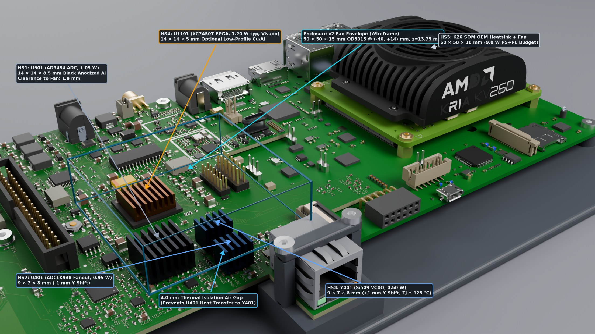

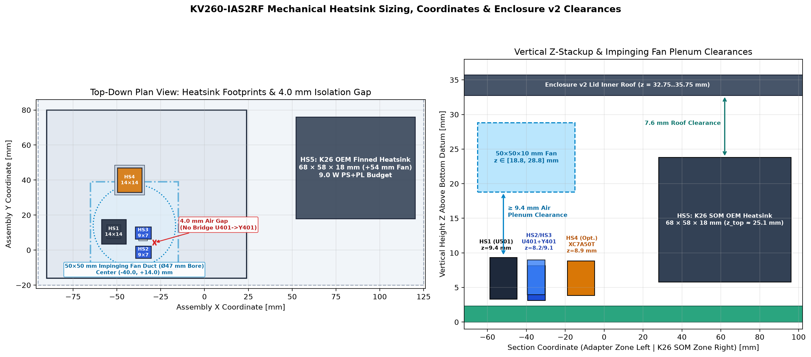
