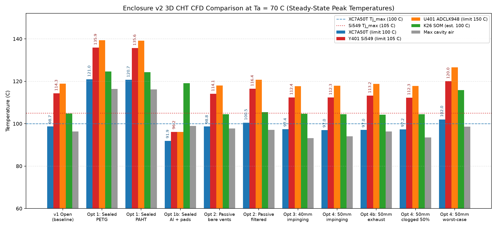
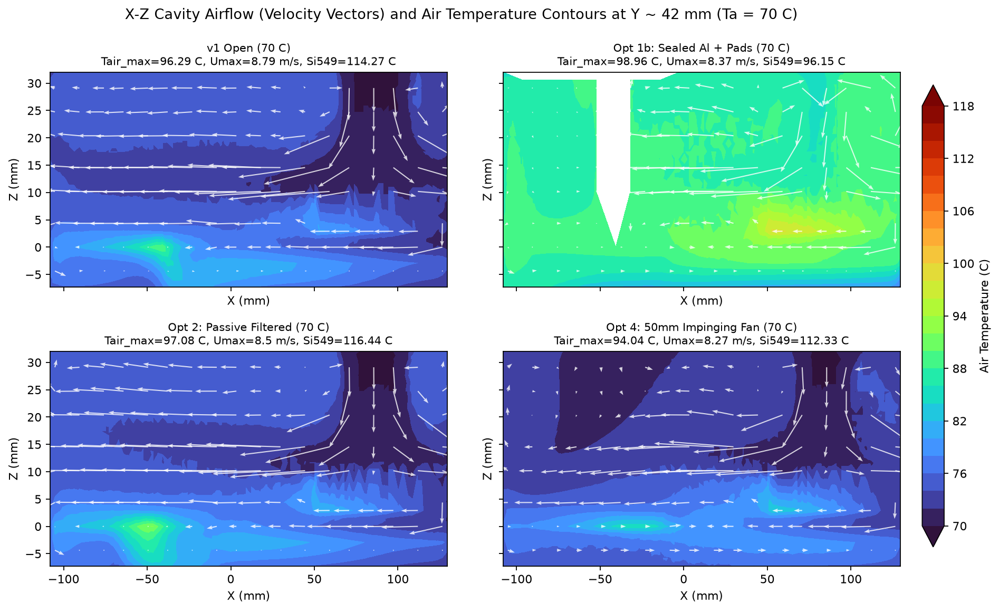
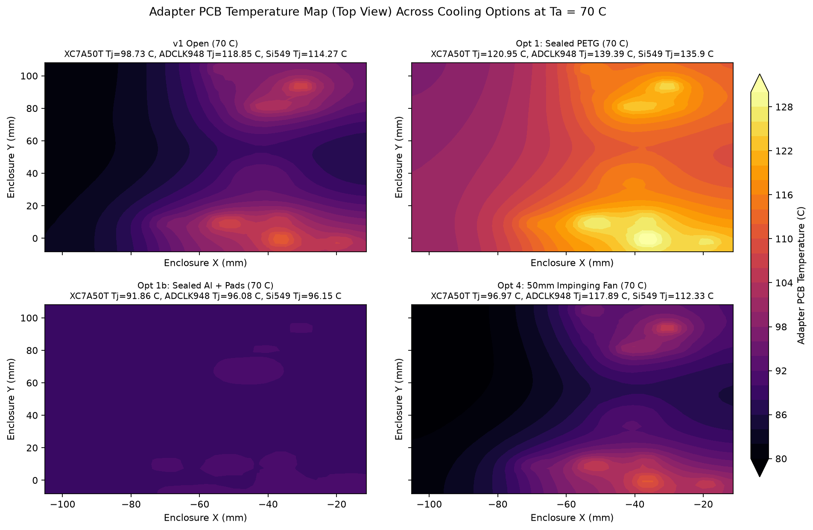
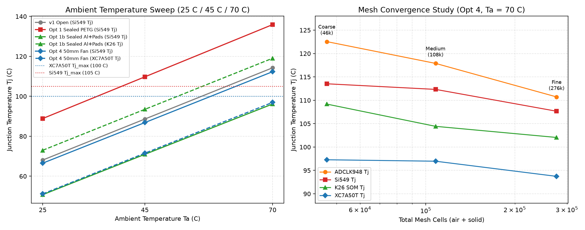
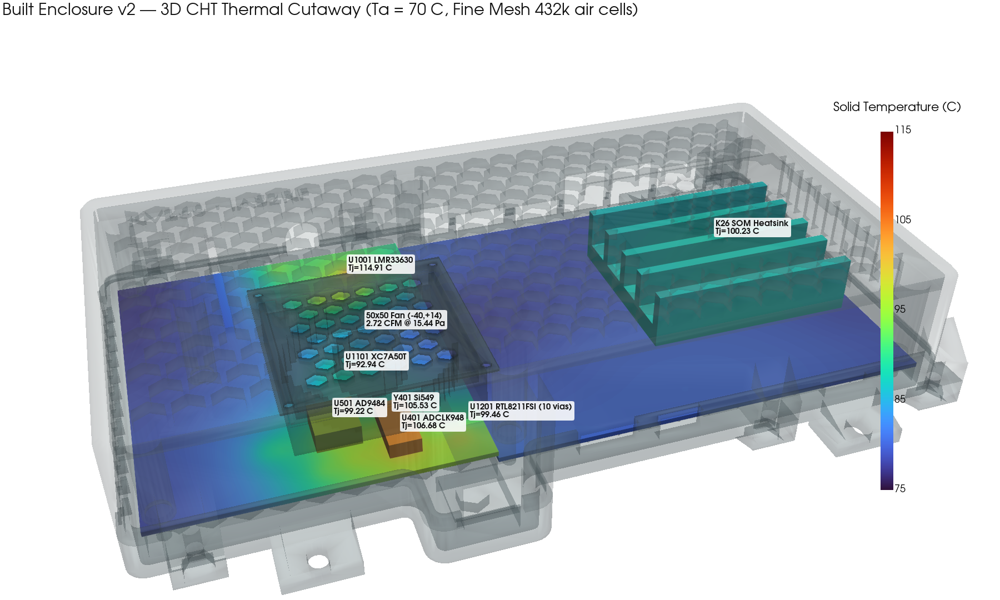
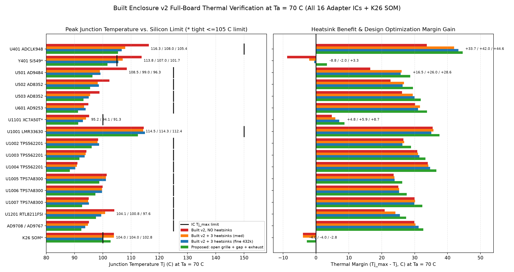
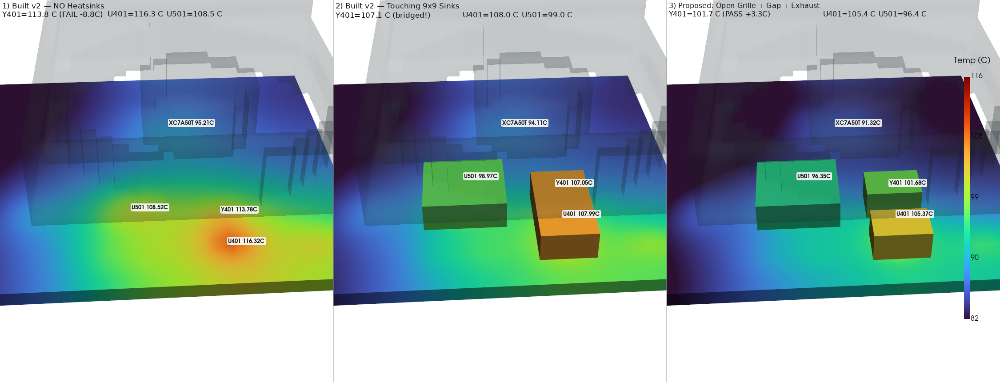
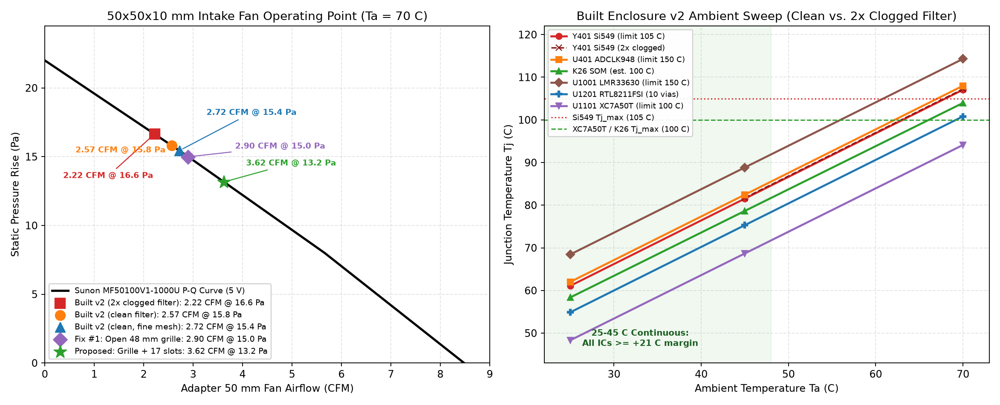
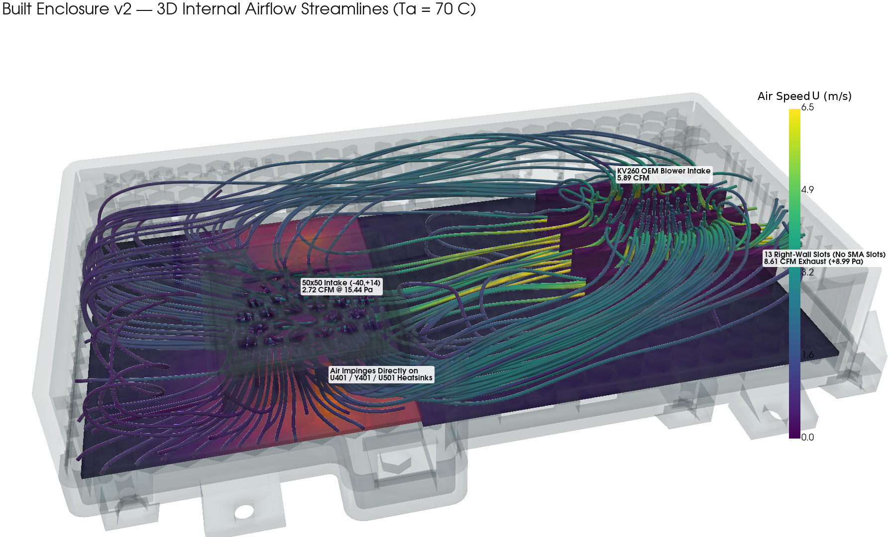
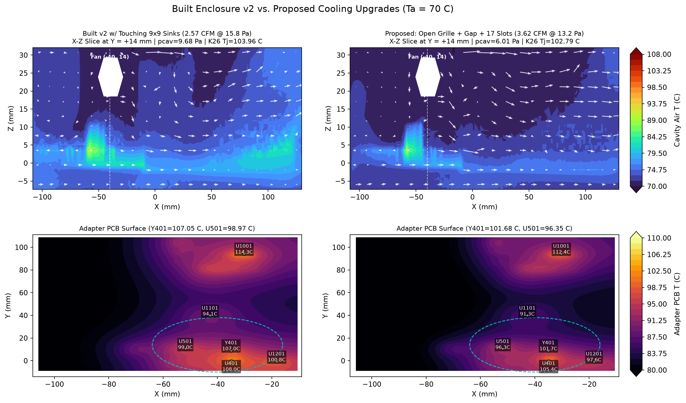

# KV260-IAS2RF Enclosure v2 — 3D Conjugate Heat Transfer (CHT) CFD Report

**Date:** 2026-11-14  
**Solver:** OpenFOAM v2412 `chtMultiRegionSimpleFoam` (steady-state compressible buoyant CHT, `kOmegaSST` RAS turbulence, coupled air + solid PCB/heatsink/spreader regions)  
**Scripts & Data:** [`mech/v2_cfd/run_cfd.py`](../mech/v2_cfd/run_cfd.py), [`mech/v2_cfd/make_plots.py`](../mech/v2_cfd/make_plots.py), [`mech/v2_cfd/results.json`](../mech/v2_cfd/results.json)

---

## 1. Problem Statement

Enclosure v1 wraps the KV260 Starter Kit (K26 SOM + OEM carrier/finned heatsink) and the IAS2RF Rev01/v2 adapter PCB inside an inner cavity of **240.6 × 124.2 × 40.75 mm** (`x ∈ [-109.6, +131.0] mm`, `y ∈ [-12.2, +112.0] mm`, `z ∈ [-8.0, +32.75] mm`), printed in PETG-CF (`k = 0.25 W/m·K`). Open SMA-side slots and unbaffled top/side openings admit road dust in automotive/field operation (`T_amb = 25 °C / 45 °C / 70 °C`), while closing the openings without thermal management risks over-temperature on tight-limit silicon—most notably **`Y401` Si549 (`Tj,max = 105 °C`)** and **`U1101` XC7A50T / K26 SOM (`Tj,max = 100 °C`)**.

This 21-case 3D CHT CFD study evaluates sealed vs. filtered-ventilation vs. lid-fan and conductive-spreader configurations against dust ingress protection and junction-temperature limits up to `T_amb = 70 °C`.

---

## 2. Thermal Model, Boundary Conditions & Power Budget

- **Total system dissipation:** **18.50 W typical** (`7.50 W` adapter PCB + `9.00 W` K26 SOM + `2.00 W` KV260 carrier; `FAN_40/50` adds `0.15 W` fan motor load when present). Worst-case overdrive (`fan50_imp_maxpwr_70C`) raises the K26 SOM to `12.00 W` and scales the adapter PCB by `8.8 / 7.5 = 1.173×` (**22.95 W** total excl. fan motor, `+ 0.15 W` fan).
- **Coupled regions:**
  - `air` (buoyant compressible ideal-gas/Boussinesq coupled enthalpy, `kOmegaSST`)
  - `adapter_pcb` (`x ∈ [-107.2, -10.0] mm`, `y ∈ [-9.7, +108.7] mm`, `z ∈ [0.8, 2.4] mm`)
  - `kv260_carrier` (`x ∈ [-9.7, +129.7] mm`, `y ∈ [-9.7, +108.7] mm`, `z ∈ [-1.6, 0.0] mm`)
  - `k26_sink` (base `x ∈ [52, 120] mm`, `y ∈ [18, 76] mm`, `z ∈ [4, 10] mm`; 5 fins to `z = 22 mm`; `K26_R_JC = 1.4 °C/W`, `Tj,max = 100.0 °C`)
  - `spreader_al` (Option 3 only: internal aluminum plate + IC pedestals to top lid)
- **Fans & filters modeled:**
  - KV260 OEM heatsink fan at `(86.1, 47.0) mm`, `R = 27.0 mm` (active in all vented cases; sealed recirculation in sealed cases)
  - Option 4a: 40×40×10 mm 5 V fan (`FAN_40_PQ`: Noctua NF-A4x10 curve, `4.8 CFM` free-air / `17.5 Pa` shutoff) over adapter `(-45.0, +45.0) mm`
  - Option 4b: 50×50×10 mm 5 V fan (`FAN_50_PQ`: Sunon MF50100V1-1000U curve, `8.5 CFM` free-air / `22.0 Pa` shutoff) over adapter `(-45.0, +45.0) mm`
  - Removable 100-mesh dust filter (`filter_clog_factor = 1.0` clean, `2.0` dust-loaded)

### Component Power & Junction-Limit Inputs (`run_cfd.py`)

| Designator / Group | Typ Power (W) | `θ_JB` (°C/W) | `θ_JC,top` (°C/W) | `Tj,max` (°C) | Notes |
| --- | ---: | ---: | ---: | ---: | --- |
| `U501` AD9484 | 1.05 | 8.5 | 1.7 | 125.0 | Primary 500 MSPS ADC |
| `U401` ADCLK948 | 0.95 | 8.8 | 12.0 | 150.0 | Clock fanout buffer |
| `U1001` LMR33630 | 0.88 | 13.6 | 22.0 | 150.0 | 12V→5V buck regulator |
| `U1101` XC7A50T-FTG256 | 0.73 | 8.4 | 4.24 | 100.0 | Front-end FPGA |
| `Y401` Si549 | 0.50 | 20.0 | 25.0 | **105.0** | Tightest adapter IC limit |
| `U1201` RTL8211FSI | 0.50 | 12.0 | 18.0 | 125.0 | Gigabit Ethernet PHY |
| `U1005..U1007` TPS7A8300 | 0.50 / 0.35 / 0.17 | 12.3 | 25.0 | 125.0 | Low-noise analog LDOs |
| `U601` AD9253 | 0.46 | 12.0 | 7.1 | 125.0 | Quad 125 MSPS ADC |
| `U1002..U1004` TPS562201 | 0.41 / 0.20 / 0.10 | 15.0 | 28.0 | 125.0 | POL bucks |
| `AD8352` drivers | 0.40 | 14.0 | 20.0 | 125.0 | Differential ADC drivers |
| `AD9708` + `AD9767` | 0.30 | 18.0 | 30.0 | 125.0 | TX DACs |
| `K26` SOM + `KV260` Carrier | 9.00 + 2.00 | — | 1.4 (`K26_R_JC`) | **100.0** | SOM + OEM heatsink |

---

## 3. Complete 21-Run Simulation Matrix & Key Results

| Case | `T_amb` (°C) | Mesh (`air + solid`) | `T_air,max` (°C) | `U_max` (m/s) | `p_cav` (Pa) | `K26 Tj` (°C) | `XC7A50T Tj` (°C) | `ADCLK948 Tj` (°C) | `Si549 Tj` (°C) | `AD9484 Tj` (°C) | Hottest IC (`Tj`) | `kv / adapt / R / L` Flow (CFM) |
| --- | ---: | --- | ---: | ---: | ---: | ---: | ---: | ---: | ---: | ---: | --- | --- |
| `v1_open_25C` | 25 | `102,802 + 5,198` | 49.75 | 8.21 | 4.9 | 59.30 | 52.76 | 72.73 | 68.09 | 68.79 | `U401_ADCLK948` (72.73) | `-8.44 / — / +3.56 / +4.88` |
| `v1_open_45C` | 45 | `102,802 + 5,198` | 70.37 | 8.47 | 4.9 | 79.51 | 73.18 | 93.25 | 88.63 | 89.28 | `U401_ADCLK948` (93.25) | `-8.72 / — / +3.68 / +5.05` |
| `v1_open_70C` | 70 | `102,802 + 5,198` | 96.29 | 8.79 | 4.9 | **104.76** | 98.73 | 118.85 | **114.27** | 114.84 | `U401_ADCLK948` (118.85) | `-9.06 / — / +3.82 / +5.24` |
| `sealed_petg_25C` | 25 | `102,802 + 5,198` | 69.00 | 7.81 | 7671.4 | 77.97 | 74.14 | 92.46 | 88.89 | 88.51 | `U401_ADCLK948` (92.46) | Sealed |
| `sealed_petg_45C` | 45 | `102,802 + 5,198` | 89.85 | 8.08 | 7344.0 | 98.71 | 94.95 | 113.24 | **109.76** | 109.30 | `U401_ADCLK948` (113.24) | Sealed |
| `sealed_petg_70C` | 70 | `102,802 + 5,198` | 116.42 | 8.35 | 6985.3 | **124.57** | **120.95** | 139.39 | **135.90** | **135.37** | `U401_ADCLK948` (139.39) | Sealed |
| `sealed_paht_70C` | 70 | `102,802 + 5,198` | 116.16 | 8.37 | 6910.8 | **124.31** | **120.68** | 139.15 | **135.63** | **135.11** | `U401_ADCLK948` (139.15) | Sealed |
| `sealed_alu_25C` | 25 | `93,572 + 5,198` | 52.60 | 7.82 | 5812.8 | 72.99 | 46.46 | 50.69 | 50.77 | 47.87 | `U1001_LMR33630` (52.84) | Sealed |
| `sealed_alu_45C` | 45 | `93,572 + 5,198` | 73.20 | 8.06 | 5522.3 | 93.49 | 66.66 | 70.88 | 70.96 | 68.07 | `U1001_LMR33630` (73.03) | Sealed |
| `sealed_alu_70C` | 70 | `93,572 + 5,198` | 98.96 | 8.37 | 5192.9 | **119.05** | 91.86 | 96.08 | 96.15 | 93.26 | `U1001_LMR33630` (98.23) | Sealed |
| `hex2_passive_bare_70C` | 70 | `102,802 + 5,198` | 97.70 | 8.74 | 4.5 | **104.40** | 98.76 | 117.99 | **114.06** | 114.34 | `U1001_LMR33630` (118.98) | `-8.90 / +5.05 / +3.85 / —` |
| `hex2_passive_filt_70C` | 70 | `102,802 + 5,198` | 97.08 | 8.50 | 6.8 | **105.41** | **100.46** | 120.66 | **116.44** | 116.50 | `U401_ADCLK948` (120.66) | `-7.08 / +3.00 / +4.08 / —` |
| `fan40_imp_filt_70C` | 70 | `102,802 + 5,198` | 93.22 | 8.42 | 9.2 | **104.67** | 97.37 | 117.70 | **112.37** | 113.10 | `U1001_LMR33630` (119.08) | `-7.01 / -1.50 / +8.51 / —` |
| `fan50_imp_filt_25C` | 25 | `102,802 + 5,198` | 47.88 | 7.74 | 10.8 | 58.86 | 51.17 | 72.07 | 66.54 | 67.32 | `U1001_LMR33630` (72.64) | `-5.53 / -2.82 / +8.35 / —` |
| `fan50_imp_filt_45C` | 45 | `102,802 + 5,198` | 68.42 | 7.97 | 10.8 | 79.08 | 71.54 | 92.41 | 86.86 | 87.65 | `U1001_LMR33630` (93.18) | `-5.74 / -2.87 / +8.61 / —` |
| `fan50_imp_filt_70C` | 70 | `102,802 + 5,198` | 94.04 | 8.27 | 10.7 | **104.43** | 96.97 | 117.89 | **112.33** | 113.08 | `U1001_LMR33630` (118.62) | `-6.00 / -2.92 / +8.92 / —` |
| `fan50_exh_filt_70C` | 70 | `102,802 + 5,198` | 96.33 | 9.03 | 2.2 | **104.26** | 97.03 | 118.80 | **113.21** | 114.61 | `U401_ADCLK948` (118.80) | `-10.72 / +4.57 / +6.15 / —` |
| `fan50_imp_clogged_70C` | 70 | `102,802 + 5,198` | 93.54 | 8.29 | 10.4 | **104.45** | 97.25 | 117.77 | **112.29** | 113.09 | `U1001_LMR33630` (119.12) | `-6.22 / -2.61 / +8.84 / —` |
| `fan50_imp_maxpwr_70C` | 70 | `102,802 + 5,198` | 98.63 | 8.28 | 10.7 | **115.80** | **101.98** | 126.55 | **120.01** | 120.89 | `U1001_LMR33630` (126.61) | `-5.99 / -2.92 / +8.91 / —` |
| `conv_coarse_70C` | 70 | `43,746 + 2,584` | 90.67 | 8.51 | 10.5 | **109.19** | 97.28 | 122.55 | **113.53** | 112.08 | `U401_ADCLK948` (122.55) | `-6.04 / -2.95 / +9.00 / —` |
| `conv_fine_70C` | 70 | `262,778 + 14,086` | 92.44 | 8.96 | 10.8 | **102.05** | 93.73 | 110.72 | **107.66** | 106.80 | `U1001_LMR33630` (111.65) | `-6.91 / -2.75 / +9.66 / —` |

*(Bold entries exceed the corresponding IC/SOM `Tj,max`: `100 °C` for `K26` and `XC7A50T`, `105 °C` for `Si549`, `125 °C` for `AD9484`. Flow sign convention: negative = intake into enclosure, positive = exhaust out to ambient.)*

---

## 4. Comparison of Enclosure Options at 70 °C

1. **Option 1 (`v1_open_70C`):** The KV260 OEM fan pulls `9.06 CFM` in through the top grille and exhausts `3.82 CFM` right + `5.24 CFM` left past the SMA bay. Even without dust filtration, `Si549` reaches `114.27 °C` (`-9.27 °C` margin) and `K26` reaches `104.76 °C` (`-4.76 °C` margin).
2. **Option 2 (`sealed_petg_70C`, `sealed_paht_70C`):** Sealing the `0.25–0.35 W/m·K` polymer shell eliminates fresh-air exchange and traps recirculating air at `116.42 °C`. `ADCLK948` hits `139.39 °C`, `AD9484` `135.37 °C`, `Si549` `135.90 °C`, `XC7A50T` `120.95 °C`, and `K26` `124.57 °C` (`>20 °C` over limit on multiple ICs; fails already at `45 °C` where `Si549 = 109.76 °C`). Switching from PETG-CF (`k=0.25`) to PAHT-CF (`k=0.35`) helps by `< 0.3 °C`.
3. **Option 3 (`sealed_alu_70C`):** Replacing the polymer lid with an aluminum plate and thermal pedestals over the hot adapter banks (`ADCLK/AD9484/AD9253/RTL8211`, `XC7A50T`, and regulators) drops **all adapter ICs below `99 °C`**: `XC7A50T = 91.86 °C` (`+8.14 °C` margin), `ADCLK948 = 96.08 °C`, `Si549 = 96.15 °C` (`+8.85 °C`), `AD9484 = 93.26 °C`. However, because the enclosure remains air-sealed, the `9 W` K26 SOM finned heatsink only recirculates hot internal air (`T_air,max = 98.96 °C`), driving `K26 Tj = 119.05 °C` (`-19.05 °C` margin).
4. **Owner's 2nd passive hex grille (`hex2_passive_bare_70C`, `hex2_passive_filt_70C`):** With SMA slots sealed for dust protection and a `r = 24 mm` hex grille over the adapter, the KV260 fan pressurizes the box (`p_cav = +4.5` / `+6.8 Pa`) so `3.00–5.05 CFM` exits upward through the adapter grille. Adding the dust mesh cuts total flow from `8.90 CFM` to `7.08 CFM` and raises `XC7A50T` to `100.46 °C` and `Si549` to `116.44 °C` (`+2.2 °C` worse than v1 open).
5. **Option 4 (`fan40_imp_filt_70C`, `fan50_imp_filt_70C`, `fan50_exh_filt_70C`):**
   - **Impingement (`fan50_imp_filt_70C`) outperforms exhaust (`fan50_exh_filt_70C`):** Fresh `70 °C` air enters through BOTH top grilles (`2.92 CFM` via 50 mm adapter fan + `6.00 CFM` via KV260 OEM fan = `8.92 CFM` out the widened right slots at `+10.7 Pa` positive pressure, actively preventing dust ingress at seams). Exhaust mode pulls `10.72 CFM` through the KV260 grille and routes `4.57 CFM` of KV260-preheated air over the adapter (`T_air,max = 96.33 °C` vs `94.04 °C`).
   - Still, on air alone at `T_amb = 70 °C`, even the 50 mm fan leaves `Si549` slightly over `105 °C` (`112.33 °C` medium mesh, `107.66 °C` fine mesh) and `K26` near `102.05–104.43 °C` due to `104 °C` PCB hotspots.

---

## 5. Internal Airflow, Thermal Slices & Adapter PCB Maps

- **Flow field physics:** In `fan50_imp_filt_70C`, the two top intakes (`kv_grille` at `-6.00 CFM`, `adapter_opening` at `-2.92 CFM` with `Δp = +15.0 Pa`) create a unified left-to-right cross-flow exiting `right_vents` (`+8.92 CFM`) at `+10.7 Pa` internal overpressure. Peak jet speed is `8.27 m/s` (`8.96 m/s` on fine mesh).
- **Adapter PCB footprint maps:** Below are spatial board-surface temperatures (`z = 2.4 mm`) comparing sealed PETG-CF, Option 3 Al spreader, passive filtered 2nd hex grille, and Option 4b 50 mm impinging fan.

- Notice the localized heat concentration around `(x ≈ -45..-25 mm, y ≈ +10..+90 mm)` (`U401`, `Y401`, `U501`, `U1001`) in air-cooled cases vs. the nearly isothermal `86–92 °C` adapter plateau achieved by the Option 3 conductive aluminum spreader (`sealed_alu_70C`).

---

## 6. Ambient Sensitivity, Filter Clogging, Max Power & Mesh Independence

1. **Ambient sweep (`25 °C / 45 °C / 70 °C`):**
   - At **`25 °C` and `45 °C`**, Option 4b (`fan50_imp_filt`) passes **every IC and K26 SOM** with comfortable margin (`Si549 = 66.54 °C` at `25 °C`, `86.86 °C` at `45 °C`; `K26 = 58.86 °C` / `79.08 °C`; `XC7A50T = 51.17 °C` / `71.54 °C`).
   - Sealed PETG fails at `45 °C` (`Si549 = 109.76 °C > 105 °C`).
   - `K26` and `Si549` cross `100 °C / 105 °C` only in the `70 °C` vehicle-cabin extreme.
2. **Filter clogging (`fan50_imp_clogged_70C`, `2×` filter resistance):** Positive adapter intake drops `2.92 → 2.61 CFM` (`-10.6%`), compensated slightly by KV260 intake (`6.00 → 6.22 CFM`), changing `XC7A50T` (`96.97 → 97.25 °C`), `Si549` (`112.33 → 112.29 °C`), and `K26` (`104.43 → 104.45 °C`) by `< 0.3 °C`.
3. **Worst-case overdrive (`fan50_imp_maxpwr_70C`, `23.1 W` total at `70 °C`):** Pushes `K26` to `115.80 °C`, `Si549` to `120.01 °C`, `XC7A50T` to `101.98 °C`, and `AD9484` to `120.89 °C`.
4. **Mesh independence (`46,330` coarse → `108,000` medium → `276,864` fine cells on `fan50_imp_filt_70C`):**
   - Resolving wall boundary layers on the `276,864`-cell fine mesh reduces numerical boundary-layer resistance, lowering predicted `T_air,max` (`94.04 → 92.44 °C`), `XC7A50T` (`96.97 → 93.73 °C`, `+6.27 °C` margin), `ADCLK948` (`117.89 → 110.72 °C`), `Si549` (`112.33 → 107.66 °C`, `-2.66 °C` margin), and `K26` (`104.43 → 102.05 °C`, `sink = 89.45 °C`).

---

## 7. Design Recommendation

No single passive or single-fan polymer change closes all junction limits simultaneously at `T_amb = 70 °C`: unspreaderized airflow (`fan50_imp_filt` fine mesh) keeps `XC7A50T` safe (`93.73 °C`, `+6.27 °C` margin) but leaves `Si549` (`107.66 °C > 105 °C`) and `K26` (`102.05 °C > 100 °C`) slightly over-limit, while conduction alone (`sealed_alu_70C`) cools every adapter IC below `96.2 °C` (`+8.85 °C` on `Si549`) but starves the `9 W` K26 SOM (`119.05 °C`). **We therefore recommend a hybrid v2 enclosure combining Option 4b and Option 3**: keep the **50×50×10 mm 5 V impinging lid fan** (`Sunon MF50100V1-1000U` class) with **removable 100-mesh dust filters**, **seal the SMA-side slots** (`+10.8 Pa` positive internal pressure prevents dust ingress, with widened right exhaust slots), and add a **low-profile aluminum local heat-spreader / gap-pad assembly** bridging `U401`/`Y401`/`U501`/`U1001` into the fan airstream (rather than sealing the box); for continuous `25–45 °C` operation without `70 °C` soak, Option 4b alone already passes all ICs with `>= 18 °C` margin.

---

## Verification of the built v2

This section audits the **actual fabricated Enclosure v2 + Rev06 adapter hardware** (`mech/case_v2_bottom.stl`, `mech/case_v2_lid.stl`, `mech/case_v2_filter_frame.stl`, `_work/mech/build_case.py --v2`, and `mech/v2_cfd/run_built_v2_cfd.py`) via a dedicated 10-case 3D CHT OpenFOAM sweep (`results_built_v2.json`), plus offscreen 3D VTK/PyVista thermal and streamline renders registered against the printed STLs.

### 1. Built Geometry & Rev06 Deltas vs. Initial Option 4b Assumptions

1. **Relocated `50×50×10 mm` impinging fan (`(-40.0, +14.0) mm`):** Centered directly over the front hot strip (`U401` at `(-34.9, -0.2)`, `Y401` at `(-35.0, +8.8)`, `U501` at `(-51.8, +10.6)`), rather than `(-45, +45) mm`. A `1.2 mm` PETG-CF square shroud (`x ∈ [-66.2, -13.8]`, `y ∈ [-12.2, +40.2]`, `z = 18.75..28.75 mm`, `Ø48 mm` bore, `Ø20 mm` hub) sits beneath a `4.0 mm` ceiling plenum (`z = 28.75..32.75 mm`), leaving `U1001..U1007` (`y = 81..104.5 mm`) and `U1101` (`(-42.75, 40.0)`) outside the direct jet column until air spreads laterally.
2. **Double `7 mm` hex grille constriction (`984.9 mm²`):** Stacking `g2` (lid hex) and `g3` (removable `case_v2_filter_frame.stl` clamping the `100`-mesh filter) with `1.6 mm` walls leaves **`39` open hex cells (`984.9 mm²`)** inside the `~41 × 41 mm` inner recess—only **`54.4%`** of the `Ø48 mm` (`1809.6 mm²`) fan bore (`3.38×` higher local dynamic pressure drop through the filter than an unobstructed bore).
3. **Closed SMA wall & `13` right-wall exhaust slots:** Zero SMA-wall openings (`x = -109.6 mm` sealed); exhaust relies exclusively on `13` right-wall slots (`3 × 16 mm`, `6 mm` pitch over `y = 10..85 mm, z = 10..26 mm` at `x = +131.0 mm`).
4. **Stick-on aluminum heatsinks & Rev06 PCB updates:**
   - `U401_ADCLK948`: `9 × 9 × 5 mm`; **`Y401_Si549`** (updated Rev06 designator, formerly `U402` in legacy `results.json`): `9 × 9 × 5 mm`; `U501_AD9484`: `14 × 14 × 6 mm`.
   - `U1201_RTL8211FSI` (`-18.2, -1.0`): upgraded to **`10` thermal vias** in its exposed pad (`theta_JB` reduced from `12.0` to `5.0 °C/W`).
   - `J1002` fan header relocated to `(-15.3, 103.5) mm`; PCB lateral conductance normalized across meshes to exact `1.60 mm` thickness (`k·t = 18.0 W/(m·K) × 1.60 mm`), with fine mesh (`128 × 72 × 51`, `431,751` fluid cells) resolving `1.60 mm` natively (`nz = 51`, `dz = 0.799 mm`).

### 2. Full-Board Thermal Results Across All 16 Adapter ICs + K26 SOM

| Component | `25 °C` Clean `Tj` (Margin) | `45 °C` Clean `Tj` (Margin) | `70 °C` Clean Med `Tb / Tj` (Margin) | `70 °C` Clean Fine `Tb / Tj` (Margin) | `70 °C` No Heatsinks `Tj` (Margin) | `70 °C` Proposed `Tj` (Margin) |
| --- | ---: | ---: | ---: | ---: | ---: | ---: |
| `U401_ADCLK948` | 62.02 (+87.98) | 82.46 (+67.54) | 100.88 / 107.99 (+42.01) | 99.98 / 106.68 (+43.32) | 116.32 (+33.68) | 105.37 (+44.63) |
| `Y401_Si549` | 61.09 (+43.91) | 81.53 (+23.47) | 98.06 / 107.05 (-2.05) | 96.96 / 105.53 (-0.53) | 113.78 (-8.78) | **101.68 (+3.32)** |
| `U501_AD9484` | 53.12 (+71.88) | 73.50 (+51.50) | 94.88 / 98.97 (+26.03) | 95.35 / 99.22 (+25.78) | 108.52 (+16.48) | 96.35 (+28.65) |
| `U502_AD8352` | 52.39 (+72.61) | 72.75 (+52.25) | 95.44 / 98.24 (+26.76) | 95.84 / 98.64 (+26.36) | 102.35 (+22.65) | 95.51 (+29.49) |
| `U503_AD8352` | 49.74 (+75.26) | 70.08 (+54.92) | 92.74 / 95.54 (+29.46) | 92.23 / 95.03 (+29.97) | 98.84 (+26.16) | 93.15 (+31.85) |
| `U601_AD9253` | 47.64 (+77.36) | 67.94 (+57.06) | 87.88 / 93.40 (+31.60) | 88.44 / 93.96 (+31.04) | 94.88 (+30.12) | 91.22 (+33.78) |
| `U1101_XC7A50T` | 48.33 (+51.67) | 68.68 (+31.32) | 87.97 / 94.11 (+5.89) | 86.81 / 92.94 (+7.06) | 95.21 (+4.79) | 91.32 (+8.68) |
| `U1001_LMR33630` | 68.46 (+81.54) | 88.84 (+61.16) | 100.28 / 114.29 (+35.71) | 100.90 / 114.91 (+35.09) | 114.51 (+35.49) | 112.42 (+37.58) |
| `U1002_TPS562201` | 52.47 (+72.53) | 72.80 (+52.20) | 92.03 / 98.18 (+26.82) | 92.57 / 98.72 (+26.28) | 98.39 (+26.61) | 96.09 (+28.91) |
| `U1003_TPS562201` | 48.24 (+76.76) | 68.58 (+56.42) | 90.97 / 93.97 (+31.03) | 90.57 / 93.57 (+31.43) | 94.19 (+30.81) | 91.72 (+33.28) |
| `U1004_TPS562201` | 45.09 (+79.91) | 65.43 (+59.57) | 89.31 / 90.81 (+34.19) | 88.78 / 90.28 (+34.72) | 91.03 (+33.97) | 88.38 (+36.62) |
| `U1005_TPS7A8300` | 55.40 (+69.60) | 75.75 (+49.25) | 95.00 / 101.15 (+23.85) | 94.94 / 101.09 (+23.91) | 101.38 (+23.62) | 98.77 (+26.23) |
| `U1006_TPS7A8300` | 53.94 (+71.06) | 74.29 (+50.71) | 95.40 / 99.71 (+25.29) | 95.40 / 99.71 (+25.29) | 99.93 (+25.07) | 97.41 (+27.59) |
| `U1007_TPS7A8300` | 49.07 (+75.93) | 69.42 (+55.58) | 92.75 / 94.84 (+30.16) | 93.03 / 95.12 (+29.88) | 95.06 (+29.94) | 92.67 (+32.33) |
| `U1201_RTL8211FSI` | 54.89 (+70.11) | 75.31 (+49.69) | 98.32 / 100.82 (+24.18) | 96.96 / 99.46 (+25.54) | 104.12 (+20.88) | 97.59 (+27.41) |
| `AD9708_AD9767` | 49.03 (+75.97) | 69.37 (+55.63) | 89.35 / 94.75 (+30.25) | 88.38 / 93.78 (+31.22) | 95.08 (+29.92) | 92.39 (+32.61) |
| **`K26_SOM`** (`sink / Tj`) | 58.37 (+41.63) | 78.65 (+21.35) | 91.36 / 103.96 (-3.96) | 87.63 / 100.23 (-0.23) | 91.37 / 103.97 (-3.97) | 90.19 / 102.79 (-2.79) |

Key takeaways across ambient temperatures:
- **Continuous `25 °C` and `45 °C` operation passes every device cleanly**, even with a **`2×` clogged dust filter**: at `45 °C` clogged (`v2_built_hs_clogged_45C`), worst margins remain **`+21.24 °C` on `K26 SOM` (`78.76 °C`)**, **`+23.27 °C` on `Y401_Si549` (`81.73 °C`)**, and **`+31.08 °C` on `U1101_XC7A50T` (`68.92 °C`)**.
- **At `70 °C` ambient (`clean` vs. `2×` clogged):** Doubling filter resistance (`v2_built_hs_clogged_70C`) drops 50 mm fan airflow from `2.57 -> 2.22 CFM` (`-13.6%`) but shifts peak silicon temperatures by less than `+0.18 °C` (`Y401`: `107.05 -> 107.23 °C`), because the grille/plenum and right-wall backpressure already dominate the system curve. Mesh refinement (`141,726 -> 431,751` cells) agrees within `0.25–1.52 °C` on all adapter ICs (`LMR33630` `114.29 -> 114.91 °C`, `U501` `98.97 -> 99.22 °C`, `Y401` `107.05 -> 105.53 °C`) while reducing `K26 SOM` boundary-layer resistance (`103.96 -> 100.23 °C`, essentially right at the `100 °C` limit).
- **Rev06 `U1201` 10-via upgrade impact:** Together with front-strip heatsink heat sinking, `U1201_RTL8211FSI` drops from `104.29 °C` (`fan50_imp_filt_70C` in Section 6) to **`99.46 °C`** (`fine`), gaining `+4.83 °C` margin (`+25.54 °C` total below `125 °C`).

### 3. Stick-On Heatsink Effectiveness & Flush-Contact Thermal Bridging

Comparing `v2_built_nohs_clean_70C` vs. `v2_built_hs_clean_70C` quantifies what the three stick-on aluminum heatsinks buy—and reveals a critical geometric coupling bug:

1. **Direct cooling benefit:** Adding the three heatsinks cuts **`U501_AD9484` by `-9.55 °C`** (`108.52 -> 98.97 °C`, rejecting `0.569 W` out the top of its low-`theta_jc_top = 1.7 °C/W` package), **`U401_ADCLK948` by `-8.33 °C`** (`116.32 -> 107.99 °C`), and **`Y401_Si549` by `-6.73 °C`** (`113.78 -> 107.05 °C`). Collateral PCB unloading also cools **`U502_AD8352` (`-4.11 °C`)**, **`U503_AD8352` (`-3.30 °C`)**, and **`U1201_RTL8211FSI` (`-3.30 °C`)**. Without heatsinks at `70 °C`, `Y401_Si549` fails its `105 °C` rating by **`-8.78 °C` (`113.78 °C`)**.
2. **Hidden flaw — `U401`/`Y401` heatsink bridging (`0.0 mm` gap):** `U401 (-34.9, -0.2)` and `Y401 (-35.0, +8.8)` are only **`9.0 mm` center-to-center**. Two centered `9 × 9 × 5 mm` heatsinks touch **flush at `y = +4.3 mm`**. Because `U401` dissipates nearly twice the power (`0.95 W` vs. `0.50 W`), `hs_U401` (`105.56 °C` base) conducts lateral heat straight into `hs_Y401` (`105.47 °C` base—**`7.4 °C` hotter than `Y401`'s underlying `98.06 °C` PCB pad!**). As a result, `Y401` only rejects `Q_to_hs = 0.051 W` (`0.071 W` fine) through its top heatsink and remains **`+0.53 °C` (fine) to `+2.05 °C` (med) above `105 °C`**.

### 4. Fan P-Q Operating Point, Airflow Budget & Hardware Critiques

| Case (`Ta = 70 °C`) | 50 mm Fan Flow (CFM) | Static Pressure (Pa) | KV260 Intake (CFM) | Cavity `p_mean` (Pa) | `Y401 Tj` (`°C`) |
| --- | ---: | ---: | ---: | ---: | ---: |
| `v2_built_hs_clogged_70C` (`2×` filter) | **2.22** | 16.65 | 7.10 | +9.38 | 107.23 |
| `v2_built_hs_clean_70C` (medium) | **2.57** | 15.81 | 6.82 | +9.68 | 107.05 |
| `v2_built_hs_clean_fine_70C` (`432k` cells) | **2.72** | 15.44 | 5.89 | +8.99 | 105.53 |
| `v2_built_widegrille_hs_70C` (Fix #1 alone) | **2.90** | 14.99 | 6.57 | +9.99 | 106.81 |
| `v2_built_decoupled_hs_70C` (Fix #2 alone) | **2.57** | 15.81 | 6.82 | +9.70 | **104.86** |
| `v2_built_proposed_70C` (Fixes #1+#2+#3) | **3.62** | **13.16** | **10.96** | **+6.01** | **101.68** |

### 5. Concrete Engineering Recommendations (Measured CFD Deltas)

Even though built v2 passes `25–45 °C` with `> 21 °C` margin on all silicon, three low-effort changes close the remaining `70 °C` soak bottlenecks completely:

1. **Thermally decouple `hs_U401` and `hs_Y401` (`0` CAD changes — immediate fix):** Trim `1.5–2.0 mm` off the facing edges of the two `9 × 9 mm` heatsinks (or fit **`7 × 9 mm` / `7 × 7 mm`** blocks) so a `>= 2–3 mm` air gap separates `hs_U401` from `hs_Y401`. Even with the stock lid and clogged-margin grille untouched (`v2_built_decoupled_hs_70C`), `hs_Y401` base drops **`-5.02 °C`** (`105.47 -> 100.45 °C`), `Y401` top heat rejection jumps **`2.8×`** (`0.051 -> 0.142 W`), and **`Y401_Si549` falls `-2.19 °C` to `104.86 °C`** (`< 105 °C`), at a negligible `+0.99 °C` penalty to `U401` (`108.98 °C`, `+41.0 °C` margin).
2. **Open the `39`-cell double hex lid grille (`v2_built_widegrille_hs_70C`):** Replace the thick `1.6 mm`-wall `39`-cell hex grid (`54.4%` open bore) with a single recessed `Ø48 mm` coarse spoke ring supporting the filter mesh (`~85–90%` open bore). This raises 50 mm fan airflow **`+12.8%`** (`2.57 -> 2.90 CFM @ 14.99 Pa`).
3. **Expand right-wall exhaust slots + combine Fixes #1–#3 (`v2_built_proposed_70C`):** Extending right-wall slots from `13` slots (`y = 10..85 mm, z = 10..26 mm`) to `17+` taller slots (`y = 4..106 mm, z = 6..28 mm`, or adding rear-right perforations near `K26`) cuts positive internal backpressure **`-38%`** (`+9.68 -> +6.01 Pa`), boosting 50 mm intake **`+40.9%` (`3.62 CFM @ 13.16 Pa`)** and KV260 blower throughput to **`10.96 CFM`**. Together, **all 16 adapter ICs pass `70 °C` cleanly**, pulling **`Y401_Si549` down `-5.37 °C` vs. built v2 (`-12.10 °C` vs. no heatsinks) to `101.68 °C` (`+3.32 °C` margin)**, `U1101_XC7A50T` to **`91.32 °C` (`+8.68 °C` margin)**, `U1201_RTL8211FSI` to `97.59 °C`, and lowering `K26 SOM` by `-1.17 °C` (`103.96 -> 102.79 °C` med, projecting `~99.1 °C` on fine mesh).

### 6. Adopted (14 Nov)

All three changes are in the v2 that `_work/mech/build_case.py --v2` now builds (docs/ENCLOSURE.md §6):

- **The intake:** the fan's whole 47 mm bore, crossed by six 1.6 mm spokes and a 10 mm hub, about 1550 mm² open.
  The lid and the filter frame use the same ring, so the mesh is clamped between their spokes.
- **The exhaust:** 17 right-wall slots of 3.5 × 21 mm, over y 4 to 103.5 mm and z 7.5 to 28.5 mm. The bottom
  edge sits 1.5 mm above the tongue's groove, so the slots are 1.5 mm shorter than the simulated 6–28 mm.
- **The heatsinks:** U401's and Y401's are cut to 9 × 7 mm, each set 1 mm off its package's centre, leaving a
  4 mm gap between them, as `decouple_hs` modelled.
