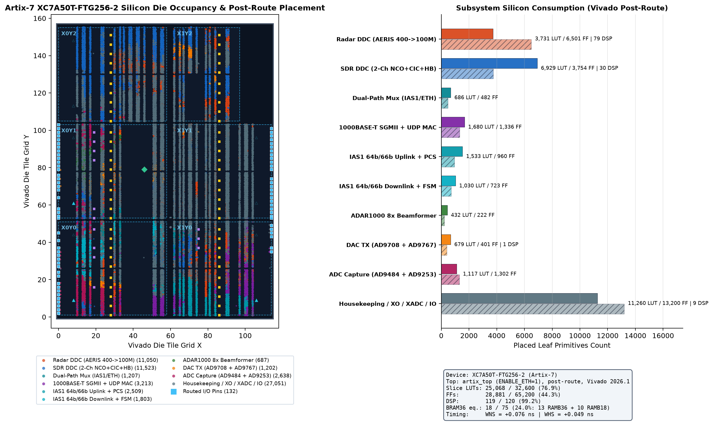
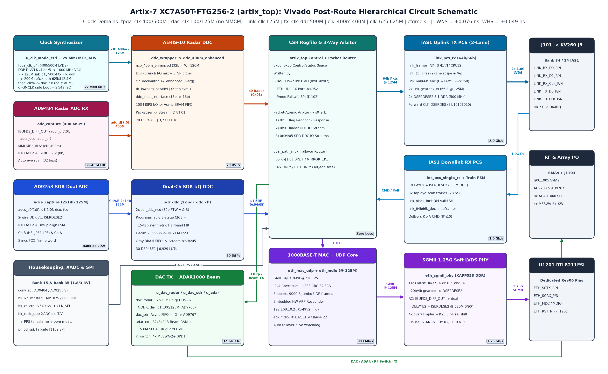
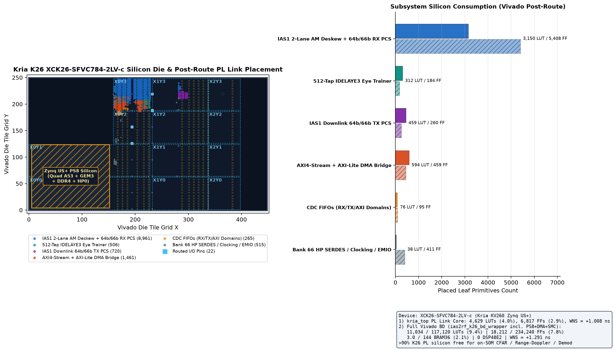
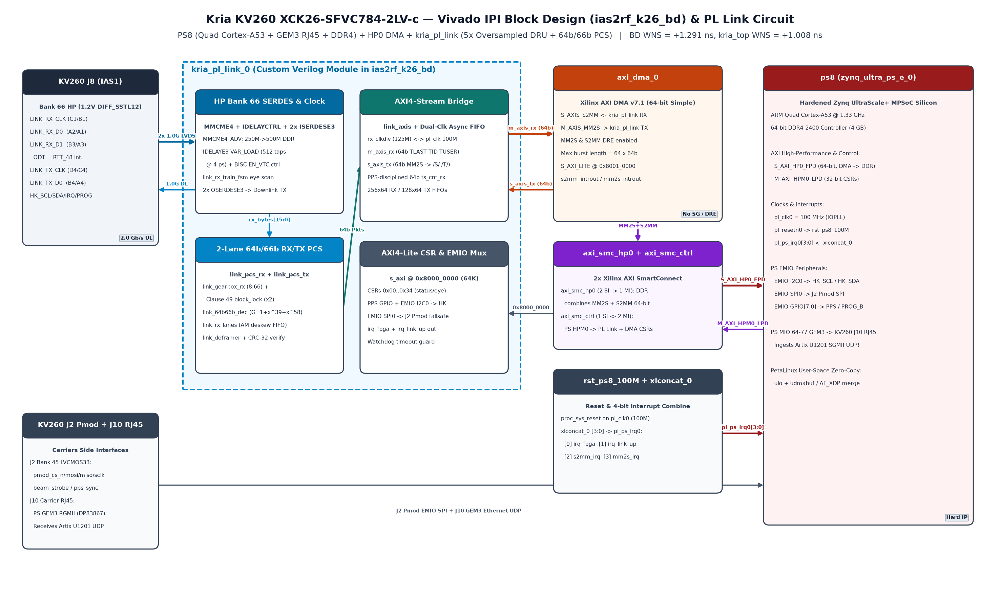
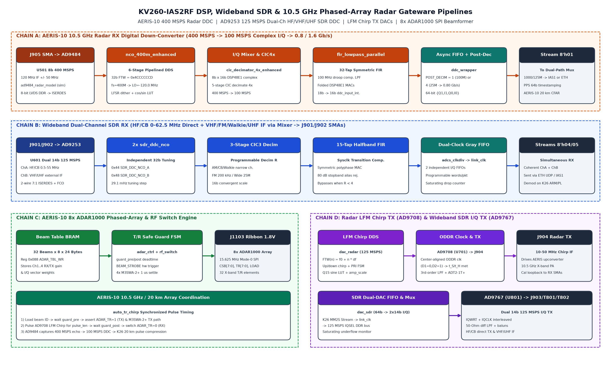

# FPGA gateware: Artix-7 front end and Kria KV260 Zynq UltraScale+ PL

Complete RTL, post-route Vivado 2026.1 implementation, and full-system XSim co-simulation documentation for the dual-FPGA **KV260-IAS2RF** platform (licensed under **Apache License 2.0**, with `fpga/third_party/aeris/` retained under MIT from `AERIS-10 / PLFM_RADAR`).

---

## 1. Dual-FPGA Hardware/Gateware Partition

```
+---------------------------------------------------+     IAS1 (J101 -> J8, 5 LVDS pairs + 4 SE 1.8V)     +----------------------------------------------------+
|     ADAPTER FRONT-END FPGA (U1101)                | ===================================================> |        AMD KRIA KV260 SOM (XCK26-SFVC784-2LV-c)    |
|     Xilinx Artix-7 XC7A50T-FTG256-2               |  2x 1.0 Gb/s 64b/66b Uplink  (LINK_RX_D0/D1 + CLK)   |                                                    |
|                                                   | <=================================================== |  PL (ia2rf_k26_bd):                                |
|  · AD9484 400 MSPS Radar ADC + AERIS-10 DDC (79DSP)|  1x 1.0 Gb/s 64b/66b Downlink (LINK_TX_D0 + CLK)    |   · kria_pl_link_0 (ISERDESE3+IDELAYE3+PCS+UART1)  |
|  · AD9253 2x 62.5/50 MSPS SDR ADC + Dual DDC (30DSP)|  + HK I2C (1.8V), FPGA_PROG_B, FPGA_IRQ              |   · axi_dma_0 (64-bit MM2S/S2MM -> HP0_FPD)        |
|  · AD9708 LFM Chirp TX + AD9767 Dual 14b SDR TX   |                                                      |   · axi_smc_hp0 + axi_smc_ctrl + EMIO SPI/I2C      |
|  · 8x ADAR1000 Beamformer + 4x M3SWA2-34DR+ SW    |     Dedicated 1000BASE-T Ethernet (U1201 -> J1201)   |                                                    |
|  · Dual-Path Mux + Debug UART (115.2k 8N1 Pmod)   | ---------------------------------------------------> |  PS8 (Quad Cortex-A53 @ 1.33 GHz + 4 GB DDR4):     |
|                                                   |  192.168.10.2 UDP Port 0x4952 -> KV260 J10 (GEM3)    |   · Pulse compression, Doppler FFT, CFAR, Tracking |
| Post-Route: 25,068 LUT (76.9%), 119 DSP, WNS +0.076ns|  + Pmod J1102<->J2 EMIO UART1 (/dev/ttyPS1)          |   · SDR demodulation & Linux host IO               |
+---------------------------------------------------+     Failsafe Pmod J1102 <-> Carrier J2 (EMIO SPI0)   +----------------------------------------------------+
```

High-resolution vector schematics & silicon die renders (`SVG` / `PDF` / `4K PNG`) live in [`img/highres/fpga/`](img/highres/fpga/).

---

## 2. Artix-7 XC7A50T-FTG256-2 (`artix_top`)

Top-level file: [`fpga/artix/top.v`](../fpga/artix/top.v), constrained by [`fpga/artix/xc7a50t.xdc`](../fpga/artix/xc7a50t.xdc) and built with [`fpga/artix/build_rev06.tcl`](../fpga/artix/build_rev06.tcl) (`ENABLE_ETH = 1'b1`).

### 2.1 Vivado Post-Route Silicon Die Floorplan

The post-route floorplan below is plotted directly from Vivado 2026.1 placed leaf cells across Clock Regions `X0Y0`..`X1Y2` (`_work/fpga_views/artix7_die_data.json`):



- **Vector / 4K Downloads:** [4K PNG](img/highres/fpga/artix7_silicon_floorplan_4k.png) · [Vector SVG](img/highres/fpga/artix7_silicon_floorplan.svg) · [Vector PDF](img/highres/fpga/artix7_silicon_floorplan.pdf)

### 2.2 Hierarchical Circuit Schematic



- **Vector / 4K Downloads:** [4K PNG](img/highres/fpga/artix7_vivado_schematic_4k.png) · [Vector SVG](img/highres/fpga/artix7_vivado_schematic.svg) · [Vector PDF](img/highres/fpga/artix7_vivado_schematic.pdf)

### 2.3 Complete Module Inventory (`fpga/artix/` & `fpga/link/`)

| Module | File(s) | Clock Domain(s) | Function & Key Implementation Details |
| :--- | :--- | :--- | :--- |
| **Top, Clocks & Mode Ctrl** | [`fpga/artix/top.v`](../fpga/artix/top.v) + [`clk_mode_ctrl.v`](../fpga/artix/clk_mode_ctrl.v) | `cfgmclk`, `fpga_clk` (`500M`/`400M`), `dac_clk` (`125M`/`100M`), `link_clk` (`125M`) | `STARTUPE2` `CFGMCLK` safe-boot sequencer, `MMCME2_ADV` DRP (`DIVCLK_DIVIDE` `5<->4` for `500<->400 MHz`), A-1 radar reset gate (`radar_dis_cfg` when `500 MHz`), non-MMCM 2-bit Johnson `÷4` `dac_clk`, Ethernet `MMCME2_ADV`, `0x00..0xFC` CSR regfile (4-master arbiter), 3-way uplink arbiter |
| **Radar ADC Capture** | [`fpga/artix/adc_capture.v`](../fpga/artix/adc_capture.v) | `adcr_dco` (`200M`) -> `clk_400m` (`400M`) / `clk_100m` (`100M`) | Private `MMCME2_ADV` (`1000 MHz` VCO), `DCO_INVERT=1` (`N14=DCO_N, P14=DCO_P`), `IBUFDS` + `IDELAYE2` + `IDDR` 8-bit DDR capture (`400 MSPS`, closed at 400 MSPS only; held in reset at 500 MHz per A-1) + 32-tap eye scanner |
| **AERIS-10 Radar DDC** | [`fpga/artix/ddc_wrapper.v`](../fpga/artix/ddc_wrapper.v) + [`fpga/third_party/aeris/`](../fpga/third_party/aeris/) | `clk_400m` (`400M`), `clk_100m` (`100M`), `link_clk` (`125M`) | Verbatim `PLFM_RADAR` (`62d4c55`, MIT) 400 MSPS -> 100 MSPS I/Q DDC (`nco_400m_enhanced`, `cic_decimator_4x_enhanced`, `fir_lowpass_parallel`, `ddc_input_interface`), `POST_DECIM` (by 4: two multiplierless anti-alias half-bands, `ddc_hb4.v`), CPI mark from `dac_radar`'s chirp starts, 128-word async FIFO (10 µs at 25 MSPS), packetizer (`stream_id = 8'h01`, 512-byte packets); controlled via `RADAR_CTRL[0]` (`0xE4`) |
| **SDR Dual ADC Capture** | [`fpga/artix/adcs_capture.v`](../fpga/artix/adcs_capture.v) | `adcs_dco` (`500 MHz` @ `500M` / `400 MHz` @ `400M` DDR) -> `adcs_clk_div` (`125` / `100 MHz`) | AD9253 **one-lane 16-bit DDR wordwise** (`0x21=0x40`, `0x0B=0x07`, `DCO = 8*f_S`): `ISERDESE2` `1:8` DDR `NETWORKING` + `IDELAYE2` + bitslip FSM locked to `FCO`, crosses via 16-entry Gray FIFO to `BUFG` `adcs_ddc_clk` (`83.333 MHz` MMCM `CLKOUT3`) |
| **Dual-Ch SDR DDC** | [`fpga/artix/sdr_ddc.v`](../fpga/artix/sdr_ddc.v) | `adcs_ddc_clk` (`83.333M`), `link_clk` (`125M`) | Two independent channels (`8'h04` Ch A on `J911`/`J912`, `8'h05` Ch B on `IF_RX_C J951` enabled at reset for switch-free HF) sampling at **`62.5 MSPS`** (`500M`) or **`50.0 MSPS`** (`400M`), each with 32-bit NCO + 3-stage CIC3 + 15-tap symmetric halfband FIR + programmable decimation `2..65535` + Gray async BRAM FIFO |
| **Radar Chirp DAC TX** | [`fpga/artix/dac_radar.v`](../fpga/artix/dac_radar.v) | `dac_clk` (`125M`/`100M`), `link_clk` (`125M`) | 32-bit LFM up/down chirp DDS (`FTW(n) = f0 + n*df`) + programmable `pulse_len` & `pri_len` + `ODDR` clock forward from non-MMCM `÷4` `dac_clk` (`D1=0, D2=1` center-aligned) to `AD9708` (`U701`) |
| **SDR Interleaved DAC TX** | [`fpga/artix/dac_sdr.v`](../fpga/artix/dac_sdr.v) | `dac_clk` (`125M`/`100M`), `link_clk` (`125M`) | Unpacks 64-bit downlink `8'h12` (or long `8'h10`) IQ frames across async FIFO -> 14-bit `IQWRT`/`IQSEL`/`IQCLK` interleaved bus on non-MMCM `dac_clk` to `AD9767` (`U801`); `hf_dac2_mode=1` default routes primary `I` to `DAC2 / IF_TX_C J952` (`dac1_mute` clamps `DAC1`) |
| **8x ADAR1000 Beamformer** | [`fpga/artix/adar_ctrl.v`](../fpga/artix/adar_ctrl.v) | `link_clk` (`125M`) -> `15.625 MHz` SPI | `32 beams x 8 chips x 24 bytes` BRAM table, broadcast/per-chip Mode-0 4-wire SPI (`J1103`), hardware `beam_strobe` loader, programmable `guard_pre` / `guard_post` T/R switching deadtime |
| **RF Switch Matrix** | [`fpga/artix/rf_switch.v`](../fpga/artix/rf_switch.v) | `link_clk` (`125M`) | Glitch-free control of the four `M3SWA2-34DR+` SPDT switches (`U901..U904`) with programmable `1 us` (`125 cyc`) settle lockout |
| **1000BASE-T SGMII PHY** | [`fpga/artix/eth_sgmii_phy.v`](../fpga/artix/eth_sgmii_phy.v) + [`fpga/artix/eth_8b10b.v`](../fpga/artix/eth_8b10b.v) | `625M` (`0°/90°`), `312.5M` (`0°/45°`), `125M` | XAPP523-style 4x `ISERDESE2` oversampling RX (`IDELAYE2` + `K28.5` barrel shifter), `10:1` `OSERDESE2` TX, IEEE 802.3 Clause 37 SGMII AN, `eth_mdio.v` Clause 22 open-drain management to `RTL8211FSI` (`U1201`) |
| **UDP/IPv4 MAC + Dual-Mux** | [`fpga/artix/eth_mac_udp.v`](../fpga/artix/eth_mac_udp.v) + [`fpga/artix/dual_path_mux.v`](../fpga/artix/dual_path_mux.v) + [`fpga/artix/eth_sdr_pkt_gen.v`](../fpga/artix/eth_sdr_pkt_gen.v) | `link_clk` (`125M`) | Full GMII MAC with HW ARP & ICMP echo responders, Jumbo UDP frames (`192.168.10.2:0x4952`), zero-loss packet-atomic `dual_path_mux` (`SPLIT`, `MIRROR_1P1`, `IAS_ONLY`, `ETH_ONLY`) |
| **IAS1 64b/66b PCS** | [`fpga/link/`](../fpga/link/) (`link_*.v`) | `link_clk` (`125M`), `tx_clk_ddr` (`500M`), `dl_rx_clk` (`125M`) | 2-lane `2.0 Gb/s` uplink TX (`OSERDESE2` 8:1 DDR + `16:66` scrambler + `CRC-32`) and 1-lane `1.0 Gb/s` downlink RX (`IDELAYE2` 32-tap eye trainer + `64b/66b` descrambler + deframer) |
| **Housekeeping & XADC/PPS** | [`fpga/artix/conv_spi.v`](../fpga/artix/conv_spi.v), [`hk_i2c_master.v`](../fpga/artix/hk_i2c_master.v), [`hk_xo_ctrl.v`](../fpga/artix/hk_xo_ctrl.v), [`hk_xadc_pps.v`](../fpga/artix/hk_xadc_pps.v), [`pmod_spi.v`](../fpga/artix/pmod_spi.v) | `cfgmclk`, `link_clk` (`125M`) | Auto-init 3-wire SPI for `AD9484`/`AD9253` (1-lane 16b DDR), open-drain `TMP1075`/`M24C02` I2C polling, `Si549` fractional N-delta I2C (`±50 ppm` `ENABLE_ETH` clamp) + `CLK_SEL`, 12-bit XADC temp/voltage monitor, 1-PPS period/ppm frequency counter & 64-bit ns timestamping, failsafe Pmod SPI slave |
| **Debug UART Monitor (G-1)** | [`fpga/artix/dbg_uart.v`](../fpga/artix/dbg_uart.v) | `link_clk` (`125M`, constant in `400` & `500 MHz` modes) | `115,200` baud 8N1 (`div=1085` -> `115,207.4` baud, `+0.0064%` err) on `pmod_spare1` RX (`G15`, `PULLUP`) / `pmod_spare2` TX (`G11`): boot banner, 1 Hz `key=value` `STAT` line, interactive `r`/`w`/`s`/`h` CLI as 4th lossless CSR master |

### 2.4 Artix-7 Post-Route Resource & Timing Closure (`reports_rev06/` & `reports/`)

| Hierarchy / Metric | Total LUTs | FFs | RAMB36 | RAMB18 | DSP48E1 | Role |
| :--- | :---: | :---: | :---: | :---: | :---: | :--- |
| **`artix_top` (Total, `XC7A50T-FTG256-2`)** | **`25,068` (`76.9%`)** | **`28,881` (`44.3%`)** | **`13`** | **`10`** (`24.0%` BRAM) | **`119` (`99.2%`)** | Full integrated RF/Radar/SDR + Ethernet + IAS1 + Debug UART + Rev08 front-end control and the G-7 500 MSPS path |
| `u_sdr_ddc` | `5,722` | `3,754` | `2` | `4` | `30` | Dual-channel wideband SDR DDC (`62.5`/`50.0 MSPS`) |
| `u_ddc` (`ddc_wrapper` + `PLFM_RADAR` + `ddc_hb4`) | `3,512` | `6,502` | `0` | `0` | `79` | 400 -> 100 -> 25 MSPS AERIS-10 radar DDC, tunable NCO (G-4), anti-alias half-bands and CPI mark (G-8) |
| `u_d2` + `u_d2_peak` | `4,224` | `6,663` | `0` | `4` | `8` | Rev08 G-7 D2: 500 MSPS AD9484 path (four-lane NCO, mixer, pruned CIC5, `ddc_hb4`) and its AGC peak detector |
| `u_dbg_uart` | `1,686` | `653` | `0` | `0` | `0` | G-1 8N1 debug UART monitor, banner, 1 Hz `STAT` & 4th CSR master |
| `u_ul_pcs_tx` | `1,263` | `959` | `0` | `0` | `0` | 2-lane `64b/66b` IAS1 uplink PCS |
| `u_fe_ctrl` + `u_fe_agc` + `u_adcr_peak` | `1,110` | `795` | `0` | `0` | `1` | Rev08 G-2 to G-6: expanders, RFFC5072/PE4312 sequencer, LEDs, AGC and its AD9484 peak detector |
| `gen_rev06_eth.*` (`mux`, `mac`, `mdio`, `phy`, `gen`) | `2,019` | `1,869` | `8` | `1` | `0` | `1000BASE-T` SGMII + UDP MAC + Dual-Path Failover |
| `u_dl_pcs_rx` + `u_dl_train_fsm` | `769` | `723` | `0` | `0` | `0` | 1-lane `1.0 Gb/s` IAS1 downlink + eye trainer |
| `u_xadc_pps` + `u_hk_i2c` + `u_clk_mode_ctrl` (`u_hk_xo`) + `u_pmod_spi` | `2,445` | `2,230` | `0` | `0` | `0` | Safe-boot MMCM DRP/Si549, XADC, 1-PPS, I2C, Pmod SPI |
| `u_adc_cap` + `u_adcs_cap` + `u_conv_spi` | `942` | `1,007` | `0` | `0` | `0` | High-speed LVDS ADC capture & 3-wire init |
| `u_dac_radar` + `u_dac_sdr` + `u_adar_ctrl` (`u_rf_switch` flattened into the top level in this build) | `883` | `602` | `3` | `1` | `1` | Non-MMCM DACs, `8x ADAR1000` beamformer, switches |

- **Timing (`fpga/artix/reports_rev06/timing_summary.rpt` & `pulse_width.rpt`, with post-route `phys_opt_design`):** Overall design worst slacks are `WNS = +0.076 ns` (`0 / 83,101` failing setup endpoints; the worst path is in the SGMII PHY's `312.5 MHz` transmit path, from the synchronised write pointer `tx_wr_g2` to the clock enable of `tx_pair_312`), `WHS = +0.049 ns` (`0 / 82,616` failing hold endpoints), and `WPWS = +0.008 ns` (`0 / 29,745` failing pulse-width endpoints). Build of 17 November with `adar_ctrl`'s beam scan mode. Its first placement missed by `0.021 ns` in that same transmit path and a later one closed at exactly `0.000 ns`, so `build_rev06.tcl` now runs further post-route `phys_opt_design` passes while the setup slack is below a `50 ps` margin (this build had the margin without them). Per-clock-group closure:
  - **Build flow (`build_rev06.tcl`):** the post-place `phys_opt_design` runs an explicit pass list, `-fanout_opt -placement_opt -rewire -critical_cell_opt -critical_pin_opt -retime -shift_register_opt -bram_register_opt -hold_fix`, that is the default set without `-dsp_register_opt`. That pass pulled the AERIS mixer's `AREG` out of the DSP48 into a slice and left a fabric-to-multiplier path at `-0.146 ns` in the `2.5 ns` cycle. The post-route `phys_opt_design` runs with `-directive AggressiveExplore`: the AERIS CIC's combs sit within about `0.05 ns` of the `400 MHz` cycle and moved by that much between placements. `adc_peak`'s 128-bit window registers take power-up values and sit outside the reset branch (inside it, the reset still reached all 384 flip-flops as a hold condition). In the AERIS DDC the FIR output CDCs have their own reset copies. With G-7 the device is at 77 % of its LUTs and three more paths needed structure rather than placement luck: the AERIS CIC's comb stages 1 to 4 are whole 28-bit subtracts under a 4-cycle multicycle path (each loads once per output sample, 4 cycles after its source; bit-exact, 7 `clk_400m` cycles more latency), the AERIS DDC takes the ADC data through one more `clk_400m` register, and `fe_ctrl`'s step table has two cycles (`S_PREP2`, a 2-cycle multicycle path). The AERIS input register keeps the ADC MSB inverted, so the offset to two's complement inversion folds into it and the flop drives the mixers' 26 DSP48 A pins without a LUT, and the AD9484 IDDR pipe flops have no reset (the FIFO write is gated by `q_pipe_valid`), so each sits next to its ILOGIC for the half-cycle path at `500 MSPS`. The AERIS NCO's phase dither (17 Nov) adds its carry into the 8 address bits one stage later than the byte add that produces it: as one 16-bit carry chain in one stage it missed `400 MHz` by `0.66 ns`. The eye-scan trainer's clock comes through a `BUFGCTRL` from `clk_200m` (400 MHz mode) or `refclk_200m` (500 MHz, D2), declared as two generated clocks `clk_trn_400` and `clk_trn_500`, physically exclusive.
  - **AD9484 Radar Domain (`clk_adcr_dco` `5.000 ns` = `400 MSPS` only, Rev08 A-1):** Held in hardware reset when master clock is `500 MHz` (`RADAR_STATUS[0]`), so it is closed at `400 MSPS` (`clk_400m_unbuf` `2.500 ns`: `WNS = +0.118 ns`, `WHS = +0.075 ns`, `WPWS = +0.396 ns`; the trainer's `clk_trn_400`: `WNS = +0.138 ns`; `clk_100m_unbuf`: `WNS = +0.157 ns`; `clk_adcr_dco`: `WNS = +0.356 ns`). At `500 MHz` the G-7 D2 path takes the AD9484 instead: `clk_adcr_dco_500` (`4.000 ns`) `WNS = +0.080 ns`, its trainer clock `clk_trn_500` `WNS = +0.132 ns`.
  - **AD9253 SDR Bit-Clock Domain (`clk_adcs_dco_500` `2.000 ns` & `clk_adcs_dco_400` `2.500 ns`, Rev08 A-2):** Constrained for both master modes as physically exclusive `500 MHz` (`62.5 MSPS`) and `400 MHz` (`50.0 MSPS`) DDR bit clocks: `clk_adcs_dco_500` `WPWS = +0.529 ns` (`adcs_clk_div_1` `8.000 ns`: `WNS = +2.635 ns`, `WHS = +0.085 ns`, `WPWS = +2.870 ns`); `clk_adcs_dco_400` `WPWS = +1.029 ns` (`adcs_clk_div` `10.000 ns`: `WNS = +4.635 ns`, `WHS = +0.085 ns`, `WPWS = +3.870 ns`).
  - **Master / Ethernet / IAS1 Domains:** `clk_fpga_500` (`WNS = +1.409 ns`), `link_clk_unbuf` (`125 MHz`, which also runs D2: `WNS = +0.193 ns`), `adcs_ddc_clk_unbuf` (`83.333 MHz`: `WNS = +1.033 ns`), `clk_dac_500` (`125 MHz`: `WNS = +0.484 ns`), `gen_rev06_eth.clk_312p5_u` (`WNS = +0.076 ns`), `gen_rev06_eth.clk_625_0_u`/`625_90_u` (`WPWS = +0.008 ns`), `clk_fpga_400` (`WNS = +1.909 ns`, `clk_dac_400` `WNS = +2.484 ns`), `dl_rx_clk` (`WNS = +0.392 ns`, `clk_link_tx` `WPWS = +0.529 ns`), `clk_cfgmclk` (`WNS = +0.668 ns`; constrained at the `100 MHz` worst case of `CFGMCLK`, where `fe_ctrl` sits). (`fpga/artix/reports/timing_summary.rpt` from `build.tcl` closes at `WNS = +0.119 ns`, `WHS = +0.036 ns`, `WPWS = +0.008 ns`.)
- **Non-MMCM `÷4` DAC Clock Jitter Reduction:** Driving `dac_clk` (`125 MHz @ 500M` / `100 MHz @ 400M`) from a glitch-free 2-bit Johnson divider on `fpga_clk_bufg -> BUFG` instead of an MMCM `CLKOUT` cuts Vivado `Clock Uncertainty` from `0.165 ns` down to **`0.035 ns`** (`4.7x` improvement) and eliminates MMCM `Discrete Jitter` (`0.124 ns -> 0.000 ns`) and `Phase Error` (`0.099 ns -> 0.000 ns`).
- **Safe-Boot & Live `400 <-> 500 MHz` Mode Switch (`clk_mode_ctrl`):** On POR, `STARTUPE2 CFGMCLK` holds `mmcm_rst = 1` while `Y401` (`Si549`) programs and settles (`>= 30.7 ms` FCAL wait), configures both MMCMs via DRP (`DIVCLK_DIVIDE = 5` for `500 MHz`, `4` for `400 MHz`), and releases `mmcm_rst` (`XO_CTRL[14] xo_boot_done`, `[12] xo_boot_err`). `clk_mode_ctrl` also drives `radar_dis_cfg` high whenever switching or operating at `500 MHz`, holding `u_adc_cap` and `u_ddc` safely in reset and automatically retraining AD9484 when returning to `400 MHz`; at `500 MHz` the G-7 path D2 (§4.3) takes the AD9484 instead. Writing `XO_CTRL[2] prog_start` switches live between `500 MHz` and `400 MHz`; during the switch, `mmcm_rst` drops `link_clk`, so IAS1 link training and SGMII MAC/PHY reset and retrain cleanly, and `dac_rst` applies a glitchless reset to `dac_radar`/`dac_sdr`. `ADPLL_DELTA_M` writes to `XO_DELTA_M` are clamped to `±50.0 ppm` (`±429553`, latched in `XO_CTRL[13] xo_delta_clamped`) when `ENABLE_ETH=1`. While the uplink retrains (`ul_tx_gate` low), `dual_path_mux` drops whole bulk packets meant for IAS1 (`ias_drain`: not written, or popped unsent if the PCS has not taken their first word) and keeps `0x11` read-backs, so the first register read after a switch returns in about `3.7 us` instead of waiting about `40 us` behind a full `1024`-word FIFO of stale data; the ETH FIFO, and so `MIRROR_1P1` and `SPLIT` failover traffic, is not affected (`tb_dual_path_drain`, `tb_clk_mode_switch` `rd_max`). The mux counts IAS1 healthy only while that uplink may send (`ul_tx_allow`: the downlink up and the Kria's receiver up, its `link_up` bit in the downlink's status word), so if the Kria's receiver alone drops, `SPLIT` moves IAS1 traffic onto ETH instead of draining it; before the uplink first opens after a reset, IAS1 counts as healthy (`tb_rev06` Phase 2b).
- **DRC & CDC (`drc.rpt` & `cdc.rpt`):** `0` DRC errors (`0` Critical/Error timing or methodology failures). `cdc.rpt` (`reports_rev06/`) reports `192` `CDC-1`, `12` `CDC-2`, `65` `CDC-3`, `2` `CDC-4`, `12` `CDC-5`, `40` `CDC-6`, `1` `CDC-7`, `2` `CDC-8`, `2` `CDC-9`, `61` `CDC-10`, `2` `CDC-11`, `156` `CDC-13`, `1` `CDC-14`, `759` `CDC-15` (covered by asynchronous clock groups & 2/3-stage Gray/toggle synchronizers across `link_clk`, `clk_cfgmclk`, `clk_adcr_dco`, `clk_adcs_dco_*`, and `clk_link_tx`). *(Top-level slice counts in `utilization.rpt` reflect Vivado cross-hierarchy LUT combining and `phys_opt_design` post-route optimization in `build.tcl` and `build_rev06.tcl`.)*

---

## 3. Kria KV260 Zynq UltraScale+ PL & Block Design (`XCK26-SFVC784-2LV-c`)

Sources: [`fpga/kria/top.v`](../fpga/kria/top.v), [`fpga/kria/kria_pl_link.v`](../fpga/kria/kria_pl_link.v), [`fpga/kria/kria_pps.v`](../fpga/kria/kria_pps.v), [`fpga/kria/link_axis.v`](../fpga/kria/link_axis.v), [`fpga/kria/bd.tcl`](../fpga/kria/bd.tcl), [`fpga/kria/xck26.xdc`](../fpga/kria/xck26.xdc).

### 3.1 Kria K26 Silicon Die Floorplan & Occupancy



- **Vector / 4K Downloads:** [4K PNG](img/highres/fpga/kria_k26_silicon_floorplan_4k.png) · [Vector SVG](img/highres/fpga/kria_k26_silicon_floorplan.svg) · [Vector PDF](img/highres/fpga/kria_k26_silicon_floorplan.pdf)

### 3.2 Vivado IPI Block Design (`ias2rf_k26_bd`) & PL Link Circuit



- **Vector / 4K Downloads (combined PS + PL `ias2rf_k26_bd` & `kria_pl_link` schematic):** [4K PNG](img/highres/fpga/kria_k26_vivado_bd_schematic_4k.png) · [Vector SVG](img/highres/fpga/kria_k26_vivado_bd_schematic.svg) · [Vector PDF](img/highres/fpga/kria_k26_vivado_bd_schematic.pdf)

### 3.3 K26 Block Design & Post-Route Resources (`fpga/kria/reports/`)

| Instance / Subsystem | Module | Slice LUTs | FFs | BRAM36 | BRAM18 | DSP48E2 | Purpose |
| :--- | :--- | :---: | :---: | :---: | :---: | :---: | :--- |
| **`ias2rf_k26_bd_wrapper` (Full BD)** | **`ias2rf_k26_bd`** | **`51,870` (`44.3%`)** | **`44,547` (`19.0%`)** | **`36`** | **`8`** (`40 eq, 27.8%`) | **`229` (`18.3%`)** | Full PS8 + four DMAs + SmartConnect + PL link + DSP suite + GPS PPS + fusion grid + KrakenSDR and HackRF blocks + EMIO `UART1` |
| `kria_pl_link_0` (link only) | `kria_pl_link` | `6,676` | `12,459` | `0` | `0` | `0` | Bank 66 HP SERDES + `512`-tap eye trainer + `64b/66b` PCS + `link_axis` |
| `u_dsp_suite` (in `kria_pl_link`) | `kria_dsp_suite` | `22,247` | `14,319` | `12` | `0` | `106` | Input queue (`1`), channel receiver (`6,656` LUT, `80` DSP), ADS-B (`4,157` LUT), radar (`10,577` LUT, `11` BRAM36, `14` DSP), transmit modulator (`493` LUT, `12` DSP) |
| `kria_pps_0` | `kria_pps` | `568` | `744` | `0` | `0` | `0` | GPS PPS capture, disciplined PPS generator, `PPS_SYNC` source (section 5.6) |
| `kria_bev_0` | `kria_bev_axi` | `782` | `623` | `16` | `0` | `0` | Fusion occupancy grid behind its AXI-Lite wrapper at `0x8003_0000` (INTEGRATIONS.md §6.1) |
| `axi_dma_1` | Xilinx IP | `1,043` | `1,590` | `1` | `1` | `0` | `S2MM` DMA at `0x8004_0000`: the grid's frames into DDR4, IRQ `In5` (SPI 94) |
| `kria_doa_0` | `kria_doa_axi` | `10,114` | `2,098` | `0` | `1` | `115` | KrakenSDR direction finding at `0x8005_0000` (section 5.8): weights, covariance, Bartlett scan. `3,200` of the LUTs are LUTRAM: Vivado keeps the ten steering-table memories (`512 × 32` each) in distributed RAM |
| `axi_dma_2` | Xilinx IP | `559` | `841` | `1` | `1` | `0` | `MM2S` DMA at `0x8006_0000`: the KrakenSDR's snapshots, IRQ `In6` (SPI 95) |
| `kria_sweep_0` | `kria_sweep_axi` | `1,586` | `638` | `2` | `1` | `8` | HackRF Pro sweep FFT at `0x8007_0000` (section 5.9): block tail and FFT memory in block RAM |
| `axi_dma_3` | Xilinx IP | `1,665` | `2,415` | `2` | `2` | `0` | `MM2S` + `S2MM` DMA at `0x8008_0000`: sweep blocks in, bins out, IRQ `In7` (SPI 96) |
| `axi_dma_0` + `axi_smc_*` + `rst` + `xlslice` | Xilinx IP | `6,630` | `8,820` | `2` | `2` | `0` | `64`-bit `MM2S`/`S2MM` DMA into `PS8 HP0_FPD` DDR4, and the interconnect for all four DMAs (9 slaves, 6 masters) |
| **Free K26 PL Silicon** | — | **`65,250` (`55.7%`)** | **`189,693` (`81.0%`)** | **`104` (`72.2%`)** | — | **`1,019` (`81.7%`)** | Available for on-SOM pulse compression, tracking and more channels |

- **Timing (`fpga/kria/reports/timing_summary.rpt` & `cdc.rpt`):** Full BD `WNS = +1.125 ns` (`0 / 178,165` failing setup; the worst path is again the asynchronous reset recovery check of the `IDELAYCTRL` reset inside `clk_300_u`; per clock `clk_pl_0` `+1.497 ns` (an ADS-B divider stage), `rx_clkdiv` `+1.703 ns`, `tx_clk_div` `+3.269 ns`, `clk_300_u` `+2.931 ns`), `WHS = +0.010 ns` (`0 / 178,165` failing hold; the worst hold path is a register-to-register hop inside the SmartConnect `axi_smc_hp0` (`s02_mmu` `aw_sreg` to its skid buffer, `clk_pl_0` to `clk_pl_0`), measured on the routed design with its post-route hold fixing, the same figure as the builds before), `WPWS = +0.000 ns`; `0` DRC errors (DSP pipelining advisories, more of them with `kria_doa`'s and `kria_sweep`'s multipliers, one clock-placer check, six RAMB18 and six RAMB36 collision advisories from the four DMAs). `cdc.rpt` reports `160` `CDC-1`, `7` `CDC-3`, `6` `CDC-6`, `1` `CDC-10`, `376` `CDC-13`, `1` `CDC-14`, `390` `CDC-15`: the crossings of the build before, two of them now classified differently, and none in `kria_doa`, `kria_sweep`, `axi_dma_2` or `axi_dma_3`, which all run on `clk_pl_0`, the clock of the HP0 and HPM0_LPD ports. Build of 18 November with the KrakenSDR and HackRF Pro blocks (INTEGRATIONS.md §9, §10). The build of 17 November without them gave `WNS = +0.874 ns` at `36,393` LUT, `clk_pl_0` `+2.125 ns`; the build before the grid and the DMA `WNS = +1.121 ns` at `33,876` LUT. Without the pipelining described in section 5.5 the same build missed `clk_pl_0` by `13.8 ns`.
- **UltraScale+ Bank 66 Training & PS `UART1` EMIO:** Uses component-mode `IDELAYE3` (`VAR_LOAD`, `512` taps @ ~`4 ps`, BISC `EN_VTC` handshaking) + `ISERDESE3` at `125 MHz` `CLKDIV` / `500 MHz` `CLK` (`MMCME4_ADV` from `250 MHz` forwarded `LINK_RX_CLK`) and `ODT = RTT_48` internal `DIFF_SSTL12` termination at `1.2 V`. `bd.tcl` enables PS `UART1` on EMIO so Linux exposes `/dev/ttyPS1` @ `115,200` baud directly across KV260 Pmod `J2` (`D11` -> `pmod_spare1`, `B11` <- `pmod_spare2` with `PULLUP TRUE`).

---

## 4. Wideband SDR & AERIS-10 10.5 GHz Radar DSP Pipelines



- **Vector / 4K Downloads:** [4K PNG](img/highres/fpga/dsp_radar_sdr_pipeline_schematic_4k.png) · [Vector SVG](img/highres/fpga/dsp_radar_sdr_pipeline_schematic.svg) · [Vector PDF](img/highres/fpga/dsp_radar_sdr_pipeline_schematic.pdf)

### 4.1 Wideband SDR Architecture (`AD9253` + `AD9767` + `sdr_ddc.v`)

The adapter supports dual-channel receive and transmit SDR operation through the dual `14`-bit `AD9253` ADC (`U601`, clocked at **`62.5 MSPS`** in `500 MHz` master mode or **`50.0 MSPS`** in `400 MHz` master mode via one-lane `16`-bit DDR wordwise LVDS, `0x21=0x40`, `0x0B=0x07`) and dual `14`-bit `AD9767` TX DAC (`U801`, `125 MSPS @ 500M` / `100 MSPS @ 400M`):

1. **Direct-Sampled HF Receive (`0–31.25 MHz` @ `62.5 MSPS` or `0–25.0 MHz` @ `50.0 MSPS` Nyquist Zone 1):**
   - **Filtered HF Input (`J951` `SDR_RX_C` / `IF_RX_C`, Ch B direct):** Feeds `AD9253` Ch B directly (no RF switch) through the Rev07 `30 MHz` 7th-order elliptic anti-alias low-pass filter (`>= 60 dB` stopband from `50 MHz`), covering **AM broadcast (`0.53–1.7 MHz`), SW/HF amateur bands (`160m`–`10m`), and Citizen Band (`27 MHz CB`)** cleanly without aliasing (note at `50.0 MSPS` (`400 MHz` master), `25–30 MHz` folds onto `20–25 MHz`).
   - **Unfiltered Channel A (`J911` `SDR_RX_A` -> `SW1` RF1 -> `IF_RX_A`, Ch A):** Unfiltered path into `AD9253` Ch A (`SW1` RF2 connects `J912` `AERIS_IF_A`); **6m (`50 MHz`)** lies in **Nyquist Zone 2** and can only be sampled on this unfiltered Ch A path (`J911`).
   - `sdr_ddc_ch` tunes any carrier via a `32`-bit NCO with LSB step **`f_S / 2^32 = 0.01455 Hz`** at `62.5 MSPS` (**`0.01164 Hz`** at `50.0 MSPS`; **an FTW computed assuming `125 MHz` tunes to half the intended frequency**), and decimates by `R = 2..65535` through a 3-stage `CIC3` + 15-tap symmetric halfband `FIR` (`80 dB` stopband alias rejection, automatically bypassed for `R < 4`).
2. **VHF/UHF receive: the Rev08 front end on `J961`, and external converters:**
   - Because `AD9253` Zone 1 ends at `31.25 MHz` (`25.0 MHz` at `400M`), **FM Broadcast (`88–108 MHz`), Airband AM (`118–137 MHz`), Walkie-Talkie / PMR446 (`446 MHz`), 70 cm (`433 MHz`) and ADS-B (`1090 MHz`)** do not reach this ADC. They come from the Rev08 front end on `J961` (30 MHz to 3 GHz: LNA, preselectors, RFFC5072 converter above `170 MHz`, IF chain), which `SW2` RF2 connects to the `AD9484` (§4.3, [RX_VU_SPEC](RX_VU_SPEC.md)). As built, `C927` is fitted and `C926` is not, so `J922` `SDR_RX_WB` is unconnected; swapping the two 0402s restores the bare `J922` (Zone 1 `0–200 MHz` at 8 bits, NF about 27 dB). An external converter into `J911`/`J951` remains possible.
   - Independent `NCO_B` (`0x48`) tunes Ch B simultaneously with Ch A, emitting dual coherent 64-bit I/Q packet streams (`8'h04` Ch A, `8'h05` Ch B) over `IAS1` / `1000BASE-T` to K26 `ps8` for FM/AM/SSB/NFM demodulation and spectrum waterfalling.
3. **Interleaved Dual-Channel SDR TX (`AD9767` via `J931` `SDR_TX_A` / `J932` `AERIS_TX_A` / `J952` `SDR_TX_C`):**
   - Downlink packets (`8'h12` or long `8'h10`) carry complex baseband IQ samples from K26 DDR4 to `dac_sdr.v`, driving `dacs_d[13:0]` interleaved (`IQWRT`/`IQSEL`) on the non-MMCM `÷4` `dac_clk` (`125 MSPS` at `500 MHz` mode, `100 MSPS` at `400 MHz` mode) into `ADT2-1T+` transformers (`T801`/`T802`) and low-pass filters (`DAC1` via `SW3` `J931`/`J932`, `DAC2` direct to `J952`).
   - **Switch-free HF defaults:** On power-on reset, `ADCS_CTRL` initializes to `0x0000_0009` (`Ch B / IF_RX_C J951` enabled) and `DACS_CTRL[1] = 0` enables `hf_dac2_mode = 1` so primary `I` routes directly to `DAC2 / IF_TX_C J952` (with optional `DACS_CTRL[2]` `dac1_mute` clamping `DAC1` to midscale `14'h2000`). Set `DACS_CTRL[1] = 1` (`hf_dac2_mode = 0`) for standard `DAC1/DAC2` quadrature `I/Q` TX.

### 4.2 `AERIS-10` 10.5 GHz / 20 km Phased-Array Radar Chain

All X-band front-end modules are sized and pin-mapped to drive the external `AERIS-10` antenna array (`8x ADAR1000` = `32` T/R elements for `20 km` instrumented range in `Extended` configuration), enabled when the master clock is **`400 MHz`** (held in hardware reset at `500 MHz` per Rev08 A-1 until G-7 adds a dedicated `500 MSPS` path):

- **TX Pulse Synthesis (`dac_radar.v`):** Generates 32-bit Linear Frequency Modulated (LFM) up/down chirps centered in the `120 MHz` IF window via `AD9708` (`J941` `AERIS_TX` / `J942` `SDR_TX_WB` -> external `AERIS-10` upconverter & `10.5 GHz` PA). When `ADAR_CTRL[12]` (`auto_tr_chirp`) is set, `adar_ctrl.v` sequences `guard_pre` deadtime -> T/R switch `TX` -> chirp transmission -> `guard_post` ring-down -> `RX` echo window.
- **Beamforming Control (`adar_ctrl.v` & `rf_switch.v`):** Stores `32` beam tables × `8` chips × `24` bytes in Artix BRAM (`0x88`) and blasts phase/gain weights over `15.625 MHz` 4-wire SPI across `J1103` (`1.8 V` IDC ribbon) with synchronous `LOAD` and hardware `beam_strobe` pulses while guarding the four `M3SWA2-34DR+` SPDT switches (`J911`/`J912`, `J921`/`J922`, `J931`/`J932`, `J941`/`J942`).
- **RX 400 MSPS Capture & DDC (`adc_capture.v` + `ddc_wrapper.v`):** Captures `8`-bit `400 MSPS` LVDS samples from `AD9484` (`J921` `AERIS_IF`, or through `SW2` RF2 the `J961` VHF/UHF front end), digitally down-converts the `120 MHz` IF to `100 MSPS` complex I/Q using `PLFM_RADAR` (`62d4c55`, MIT) DSP48E1 slices (`79` DSPs), decimates by 4 through the `ddc_hb4` anti-alias half-bands (`0.80 Gb/s` sustained), and streams stamped 512-byte `8'h01` packets to the Kria. The NCO defaults to `PHASE_INC_120MHZ = 32'h4CCCCCCD` (`0.3 * f_S`) in [`fpga/third_party/aeris/ddc_400m.v`](../fpga/third_party/aeris/ddc_400m.v); since G-4, `RADAR_CTRL[2]` and `[31:8]` override it. Two NCO fixes (17 Nov) set the image of the input around the LO: the quarter-wave table is sampled half a step off zero (`sin(2 pi (k + 0.5) / 256)`), because its fold reads `cos` as `LUT[63 - k]`, which with the upstream table put `cos` one step (`1/256` cycle) away from `sin`; and a random byte from a 23-bit LFSR (eight steps per clock) is added to the accumulator just below its 8 address bits. Upstream added its dither to the FTW's low byte, where it never reached the address. At `0.3 f_S` the accumulator visits 10 phases, so the plain truncation error repeats every 5 samples and has a component at the conjugate LO. Before the fixes the image sat at `-46` to `-61 dB`, depending on where the accumulator happened to be, which is why `tb_system`'s S3 read `48` to `61 dB` from one RTL change to the next. It is now `-81 dB` or lower in every window of `tb_nco_image`. The only side effect is a constant `pi/256` on the LO phase. The path is held in reset in the `500 MHz` mode (A-1).

### 4.3 D2: the 500 MSPS AD9484 path (Rev08 G-7)

At 500 MHz the AD9484 runs at 500 MSPS and its DCO at 250 MHz. The AERIS DDC stays as it is and keeps running only at 400 MSPS (A-1). D2 is a second path, selected by `D2_CTRL[0]`, that runs whenever the master clock has settled at 500 MHz. HF on the AD9253 (62.5 MSPS) and VHF/UHF on the AD9484 then run at the same time. D2 takes 4,124 LUT, 6,241 FF, 4 RAMB18 and 8 DSP48 (119 of 120 used), plus 259 LUT for its AGC peak detector; the Artix goes from 20,254 to 25,000 LUT (77 %).

**Capture (`adc_capture`, `mode_500`)**

- The DCO MMCM stays in reset, because its 400 MHz output would run at 500 MHz.
- The IDDRs keep their BUFIO, and the BUFR capture registers keep their BUFR, now at 250 MHz.
- The IDELAYs and the eye-scan trainer move to `refclk_200m`. They are fed through the `BUFGCTRL` that otherwise carries the MMCM's `clk_200m`. The select changes only while the capture is in reset, so both inputs are set to IGNORE.
- The trainer is unchanged. Because the training pattern is static, it samples the IDDR pairs through two flip-flops instead of the 400 MSPS FIFO.
- Each pair of DCO cycles makes one word of four samples, `4 x {OR, D[7:0]}` with the earliest sample in `[8:0]`. The words cross into `link_clk` through an 8-word Gray FIFO.
- `link_clk` is 500 MHz / 4. It is frequency-locked to the DCO because both come from the master clock. Once the reader starts at a fill of 4, the fill stays put. A drift trips `D2_STAT[3]` and the reader restarts at a fill of 4.
- In `top.v`, a change of mode holds the capture in reset for 16 `refclk_200m` cycles. `mode_500` changes in the middle of that window.
- Training starts about 65 us after D2 does (`ADC_AUTO_TRAIN`). It can be restarted with `D2_CTRL[2]` or the Pmod retrain.

**DDC (`ddc_500.v`, `link_clk`, four lanes per clock)**

| Stage | What it does | Result |
|---|---|---|
| NCO | 32-bit phase. Lane `i` runs at `acc + i * FTW`, and `acc` advances by `4 * FTW`. A 12-bit phase addresses a 1024 x 12-bit quarter-wave table (`ddc500_rom.v`, generated by `gen_ddc500_rom.py`): one dual-port RAMB18 per lane, one port for the sine's index and one for the cosine's | Worst phase-truncation spur -72 dBc |
| Mixer | The code as an odd 9-bit number, `2 * (code - 128) + 1`, so mid-scale carries no DC, times `e^-j theta`, in one DSP48 per product, rounded to 15 bits. `D2_CTRL[1]` conjugates the output; the AERIS DDC's output is the conjugate spectrum | |
| CIC | 5 stages, decimation by 5, 500 to 100 MSPS. Integrators in four-lane prefix form, with one adder in each accumulator loop, pruned (Hogenauer) from 28 bits to 27, 25, 23, 22 and 21 bits, and the combs to 21, 20, 19, 18 and 18. The truncations are plain shifts: a constant error entering after the first integrator leaves no DC, and the one before it is the mixer's rounding. Of every five words it keeps lanes 0, 1, 2, 3 and none (samples 0, 5, 10, 15 of 20). Gain 3125 / 4096 | What folds onto +/-10 MHz (100 MHz multiples +/- 10 MHz) at least 94 dB down, onto +/-12.5 MHz at least 83 dB; droop 0.69 dB at 10 MHz |
| `ddc_hb4` | The radar path's two half-bands, unchanged, 100 to 25 MSPS. Their input is valid 4 cycles in 5 | Flat to 0.07 dB up to 10 MHz; -49.6 dB from 15 to 25 MHz |
| Packets | 512-byte packets on stream `0x01`, as from `ddc_wrapper`, so the Kria sees the same stream in both clock modes. There is no CPI mark, because the X-band front end is off at 500 MHz. While D2 runs, `top.v` routes stream `0x01` from D2, and switches back only after D2's last packet has gone (`pkt_busy`), so the uplink arbiter never waits on a stopped source | |
| Gain | A real tone of `A` codes at `f_NCO + d` gives `|bb| = 97.63 * A * droop(d)` | -8.4 dBFS at full scale |
| AGC | The four lanes' largest-magnitude code goes to a second `adc_peak` (2^14 words, 131 us), which feeds `fe_agc` in place of the 400 MSPS peak. Over-range is a code of 0 or 255: the OR pin's IDDR is not timed at 250 MHz | |

**Constraints (`xc7a50t.xdc`)**

- `clk_adcr_dco_500` (4.000 ns, `-add`) is stopped at the DCO MMCM's `CLKIN1`. It is physically exclusive with `clk_adcr_dco` and with the 400 MHz clocks.
- Its crossings into `link_clk` and `refclk_200m` take `set_max_delay -datapath_only 4.000`.
- The `BUFGCTRL` select is a false path, and so is the OR pin's IDDR at 250 MHz.
- The trainer's results reach `link_clk` under an 8 ns datapath limit, and the D2 run condition reaches `refclk_200m` under 4 ns.

**Uplink (`top.v`, `ddc_wrapper.v`)**

- The radar DDC and D2 never offer a stream `0x01` packet at the same time, so `valid` and `eop` are ORed and both see `ready`.
- In both DDCs, `pkt_valid` comes from registers: `pkt_active`, or a registered `a packet is ready`. With store and forward the FIFO cannot run empty during a packet, and the pointer arithmetic leaves the uplink arbiter's path to the SDR FIFOs.

---

## 5. Complete Control, Stream & Register Map

### 5.1 Packet Stream IDs (64-bit Header Format in [`fpga/link/LINK_PROTOCOL.md`](../fpga/link/LINK_PROTOCOL.md))

| `stream_id` | Direction | Generator / Consumer | Payload Content |
| :---: | :---: | :--- | :--- |
| **`8'h01`** | Artix -> Kria | `ddc_wrapper` (`u_ddc`) | AERIS-10 400->100 MSPS Radar DDC Complex `I/Q` `{Q1, I1, Q0, I0}` + 64-bit PPS timestamp |
| **`8'h02`** | Artix -> Kria/ETH | `eth_sdr_pkt_gen` (`u_sdr_gen`) | Diagnostic / telemetry packet generator on SGMII UDP path |
| **`8'h04`** | Artix -> Kria | `sdr_ddc` Ch A (`u_ch_a`) | AD9253 Ch A (`J911`/`J912` unfiltered, `62.5`/`50.0 MSPS`) decimated `16`-bit `I/Q` stream |
| **`8'h05`** | Artix -> Kria | `sdr_ddc` Ch B (`u_ch_b`) | AD9253 Ch B (`IF_RX_C J951` `30 MHz` LPF, `62.5`/`50.0 MSPS`, default on) decimated `16`-bit `I/Q` stream |
| **`8'h10`** | Kria -> Artix | `kria_pl_link` -> `artix_top` | Short CMD packet (`len = 8B`, `{opcode[63:56], flags, addr[47:32], wdata[31:0]}`) or legacy IQ TX (`len >= 24B`) |
| **`8'h11`** | Artix -> Kria | `artix_top` Readback Engine | Register read response `{16'h0002, addr[47:32], rdata[31:0]}` |
| **`8'h12`** | Kria -> Artix | `kria_pl_link` -> `dac_sdr` | AD9767 dual `14`-bit `I/Q` TX sample stream |

### 5.2 Artix-7 Full CSR Space (`0x00..0xFC` and, since Rev08, `0x100..0x124` via IAS1 CMD `8'h10`, UDP Port `0x4952` or Debug UART; the Pmod SPI port reaches `0x00..0x7F` only)

| Offset | Register | Access | Fields & Function |
| :---: | :--- | :---: | :--- |
| `0x00`–`0x30` | IAS1 Link Control & Telemetry | R/W | Link reset, PRBS-7 TX/RX test, manual `IDELAY` tap control, block/deskew lock, SH/CRC/PRBS error counters, eye window edges ([`LINK_PROTOCOL.md`](../fpga/link/LINK_PROTOCOL.md) §7.1) |
| `0x34` | `ADCS_CTRL` | R/W | `[0]` AD9253 capture enable, `[1]` `start_init` (W1P), `[3:2]` SDR DDC Ch A/B enable (`0x0000_0009` reset: `Ch B / IF_RX_C J951` enabled for switch-free HF) |
| `0x38` | `ADCS_STAT` | R | `[31:24]` AD9253 Chip ID, `[17:16]` conv SPI init `err/done`, `[11:0]` `aligned`, `idelay_done/err`, `bitslip_err`, `best_tap` |
| `0x3C`–`0x40` | `CONV_SPI_CMD` / `STAT` | R/W | Raw 3-wire SPI access to `AD9484` & `AD9253` (`[22]` target, `[21]` rw, `[20:8]` addr, `[7:0]` wdata) |
| `0x44`–`0x50` | `SDR_DDC_NCO_A/B`, `DECIM`, `STAT` | R/W | Independent 32-bit NCO FTWs for Ch A (`0x44`) & Ch B (`0x48`), `[15:0]` CIC3 decim ratio & `[25:16]` words/pkt (`0x4C`), dropped sample counter (`0x50`) |
| `0x54`–`0x6C` | `DACR_*` (Radar LFM Chirp TX) | R/W | Enable/trigger & `amp_scale` (`0x54`), start FTW `f0` (`0x58`), chirp slope `df` (`0x5C`), `pulse_len` (`0x60`), `pri_len` (`0x64`), `chirp_active` (`0x68`), `pulse_cnt` (`0x6C`) |
| `0x70`–`0x78` | `DACS_*` (SDR IQ DAC TX) | R/W | `tx_enable` (`[0]`), `~hf_dac2_mode` (`[1]`, default `0` = primary `I` on `DAC2 / IF_TX_C J952`), `dac1_mute` (`[2]`) (`0x70`); underflow counter (`0x74`); async TX FIFO level (`0x78`) |
| `0x7C`–`0x90` | `ADAR_*` & RF Switches | R/W | `active_beam_id[4:0]`, soft T/R, `sw_req[11:8]`, `auto_tr_chirp[12]`, `soft_load`, scan mode `[13]` with its last beam `[20:16]` (each `BEAM_STROBE` loads the next of beams `0..scan_last`, from 0; Rev08) (`0x7C`); `guard_pre/post` (`0x80`); `sw_settle` (`0x84`); 32-beam RAM write (`0x88`); raw ADAR SPI (`0x8C`); status (`0x90`) |
| `0x94`–`0xA4` | `HK_I2C_*` & `HK_TEMP_ERR` | R/W | Open-drain I2C controller for `TMP1075` (`0x48`) & `CAT24C02` (`0x50`) temperature & EEPROM polling |
| `0xA8`–`0xB4` | `XO_CTRL`, `XO_DELTA_M`, `XO_RAW` | R/W | `Si549` fractional N-delta (`±50 ppm` `ENABLE_ETH` clamp, `0xAC`), raw I2C (`0xB0`/`0xB4`; `0xB0[23:17]` device address, `0` = the `Si549`, Rev08), `CLK_SEL` + safe-boot/`400<->500 MHz` DRP switch (`xo_boot_err[12]`, `xo_delta_clamped[13]`, `xo_boot_done[14]`) |
| `0xB8`–`0xBC` | `XADC_TEMP_VCCINT` / `VCCAUX` | R | On-die Artix-7 XADC 12-bit temperature, `VCCINT`, `VCCAUX`, and overtemp flag |
| `0xC0`–`0xE0` | `PPS_*` & `TS_SYS` / `PPS_LATCH` | R/W | 1-PPS loop gain/nom period/ppm frequency error & locked `64`-bit nanosecond wall-clock timestamp registers |
| `0xE4` | `RADAR_CTRL` | R/W | `[0]` `rad_ddc_en` (reset `1`, replaces legacy `~pmod_spare1`), `[1]` W1P clear sticky clip/ovf flags & `0xEC` counters, `[2]` radar NCO override, `[3]` CPI mark in `I[0]` of the stream (G-8), `[7:4]` the mark's delay in 25 MSPS samples, `[31:8]` the NCO's frequency word (Rev08 G-4) |
| `0xE8` | `RADAR_STATUS` | RO | `[0]` `radar_dis_by_clk_mode` (`1` at `500 MHz`), `[1]` `adcr_mmcm_locked`, `[2]` `adc_trained`, `[3]` `dco_phase_err`, `[4]` `dl_link_up`, `[5]` `dl_up & adc_trained` (replaces legacy `pmod_spare2`), `[6..9]` sticky `adcr_or`/`adcs_clip`/`ddc_sat`/`ddc_ovf`, `[10]` `reg_rad_ddc_en`, `[21:16]` `adc_eye_width_min`, `[23:22]` `ddc_status` |
| `0xEC` | `CLIP_OVF_CNT` | RO | `[15:0]` saturating `adcr_clip_cnt` (`AD9484`), `[31:16]` saturating `adcs_clip_cnt` (`AD9253`) |
| `0xF0` | `DBG_UART_CTRL` | R/W | `[15:0]` `baud_div` (default `1085` = `115,207.4` baud on `125 MHz` `link_clk`), `[16]` `stat_periodic_dis`, `[17]` W1P `force_stat_p`, `[24]` `rx_idle_high`, `[25]` `tx_busy`, `[26]` `banner_done`, `[31:27]` `rx_ferr_cnt` |
| `0xF4` | `DBG_UART_STAT_DIV` | R/W | `[31:0]` periodic `STAT` interval in `link_clk` cycles (default `125,000,000` = `1.000 s`) |
| `0xF8`–`0xFC` | `BUILD_GIT_HASH` / `BUILD_TIMESTAMP` | RO | Injected `synth_design -generic` 8-hex git commit prefix (`0xF8`) and `{BUILD_DATE[15:0], BUILD_TIME[23:8]}` (`0xFC`) |
| `0x100` | `D2_CTRL` | R/W | Rev08 G-7 500 MSPS path. `[0]` enable: D2 runs while the master clock is settled at 500 MHz. `[1]` conjugate the output. `[2]` restart AD9484 training (write 1; reads 0). `[3]` clear `D2_STAT[3]` (write 1; reads 0). Put the AD9484 in its `0xAA`/`0x55` test pattern before training, as at 400 MSPS |
| `0x104` | `D2_FTW` | R/W | D2's NCO: f = `FTW * 500 MHz / 2^32` |
| `0x108` | `D2_STAT` | R | `[0]` running, `[1]` trained, `[2]` training failed (eye under 4 taps or wrong pattern), `[3]` FIFO slip (sticky), `[4]` master clock at 500 MHz, `[13:8]` narrowest eye in IDELAY taps |
| `0x10C` | `D2_DROP` | R | `[23:0]` stream `0x01` words dropped at the packet FIFO (D2's while it runs, else the radar DDC's) |
| `0x110` | `FE_CMD` | R/W | Rev08 front-end command (`fe_ctrl.v`), `[31:28]` op: `1` INIT, `2` EXP_OUT `[15:0]` = `{port 1, port 0}` of `U1313` (software owns port 0, `RESETX` and `ENBL`; written on change), `3` POLL inputs, `4` RFFC5072 write `[22:16]` register `[15:0]` data, `5` RFFC5072 read, `6` PE4312 `[5:0]` in 0.5 dB steps, `7` LEDs `[7:0]` (written on change). Wait for `FE_STAT[28]` = 0 before the next write |
| `0x114` | `FE_STAT` | RO | `[31]` I2C error, `[30]` expanders initialised, `[29]` overrun (a command written while busy, dropped), `[28]` busy, `[23:16]` I2C transactions of the last command, `[15:0]` `U1313` inputs at the last POLL (`[12]` = `VU_LD` lock detect, `[8]` = `VU_BIAS_FLT_N`) |
| `0x118` | `FE_RFFC` | RO | `[15:0]` the last RFFC5072 register read |
| `0x11C` | `FE_LED_CTRL` | R/W | `[0]` LED auto-map on (reset `1`), `[1]` show `[15:8]` instead, `[31:24]` RO what was last written to `U1501` |
| `0x120` | `FE_AGC_CTRL` | R/W | Rev08 G-5 AGC (`fe_agc.v`), off at reset: `[0]` enable, `[1]` LNA bypass allowed, `[14:8]` high threshold (default `96` of `128`), `[22:16]` low threshold (default `24`), `[31:24]` hold-off in ms (default `50`) |
| `0x124` | `FE_AGC_STAT` | RO | `[31]` LNA in, `[29:24]` attenuation code, `[22:16]` last peak of the AD9484 codes, `[15:0]` changes made |
| others from `0x100` | (reserved) | — | Any address from `0x100` not listed reads `0` and ignores writes; page 0 no longer aliases into `0x1xx` |
| UDP `0x0000` / `0x0004` | `ETH_MUX_CTRL` / `ETH_MDIO` | R/W | Dual-path policy (`[1:0]`), SDR UDP gen enable (`[2]`), fault injection (`[4:3]`), AN restart (`[5]`), Clause 22 MDIO access to `RTL8211FSI` |

### 5.2a Front-end control (Rev08 G-2 to G-6)

The two `TCA6416A` expanders (`U1313` at `0x20` on `RX_VU`, `U1501` at `0x21` on `STATUS`) share the `XO_SCL`/`XO_SDA` bus with the `Si549`. `hk_xo_ctrl` (`cfgmclk`) gained a device address on its raw port and a second client port, and `fe_ctrl` drives the expanders through it; the `Si549` presets, its delta-M and raw accesses keep priority. The expanders' `INT` pins are not connected, so inputs are read on request (`POLL`). Nothing goes on the bus unless a command asks.

- **INIT** runs before the first command and after any I2C error: output registers first, then configuration, so no pin glitches when it turns into an output. It drives `VU_ATT_LE` low, which latches the `PE4312` at its power-up `31.5 dB`. `LE` must stay low whenever `SCLK` moves: with `LE` high the attenuator's latch is transparent, and `SCLK`/`SDATA` are shared with the `RFFC5072`.
- **RFFC5072** register write and read-back with HackRF's three-wire framing ([RFFC5072_PROGRAMMING.md](RFFC5072_PROGRAMMING.md) §2): every `SCLK` or `SDATA` edge is one write of `U1313`'s port 1, so a register write is `59` I2C transactions (about `26 ms` at the nominal `65 kHz` bus, `17` to `52 ms` over `CFGMCLK`'s ±50 % spread) and a read `82` (about `37 ms`). A gateware three-wire master would be the upgrade for fast hopping.
- **PE4312**: six bits MSB first (`C16` first), then an `LE` pulse; about `5 ms`.
- **LEDs (G-6)**: `D1501..D1508` = CFG (boot done), CLK (`500 MHz`), LINK (link up and ADC trained), ADC-R over-range, ADC-S clip (both sticky until `0xE4[1]`), LO lock (from the last `POLL`), TX (SDR DAC or radar chirp), ERR (I2C or ADC phase error). Written on change, at most once every `100 ms`; `FE_LED_CTRL[0]` = 0 stops them and the bus stays quiet.
- **AGC (G-5)**: `adc_peak` takes the largest `|code − 128|` of the AD9484 per `65,536`-sample window (over-range counts as full scale); `fe_agc` adds `3 dB` above the high threshold, removes `0.5 dB` after each quiet hold-off period, bypasses the LNA only at `31.5 dB`, and puts it back `18 dB` under the low threshold. Command priority: software, then AGC, then LEDs. With the AGC on, software must not send `ATT`. The AD9484 path runs in the `400 MHz` mode only (A-1), so the AGC does too.
- **G-4** (tunable DDC): the AERIS NCO is a register through `RADAR_CTRL[2]` and `[31:8]`, default unchanged; the second decimation stage down to channel bandwidths is in the Kria PL (`kria_channel_rx`, section 4), where DSP slices are plentiful, instead of in the Artix (one DSP48 left free since G-7).

Bus errors: a NACK on `fe_ctrl`'s transactions sets `FE_STAT[31]` (and so the ERR LED) and makes the next command start with INIT. It does not set `XO_CTRL[11]` `xo_ack_err` or count in `XO_CTRL[31:16]`, which stay for the `Si549` and raw accesses, so a missing or unpowered RX_VU board never marks the clock XO as faulty.

Benches: `tb_fe_ctrl` (models of the `TCA6416A`, the `RFFC5072` port and the `PE4312`, plus a second `hk_xo_ctrl` and `fe_ctrl` on a bus with no devices; 28 checks; mutations `le_high`, `no_shadow`, `lsb_first`, `gen_nack_to_xo`), `tb_fe_agc` (closed loop with a tone; mutation `no_holdoff`), and `tb_artix_top` (CSR page 1, no aliasing).

### 5.3 Kria `kria_pl_link` AXI4-Lite Slave (`s_axi` at `0x8000_0000`)

| Offset | Register | Function |
| :---: | :--- | :--- |
| `0x00` | `CTRL` | Soft reset, loopback enable, retrain trigger, manual IDELAY override, PRBS-7 TX/RX check |
| `0x04` | `STATUS` | `l0_lock`, `l1_lock`, `deskew_lock`, `link_up`, `idelayctrl_rdy`, `train_state`, `st_remote_status` |
| `0x08` / `0x0C` | `TAP_L0` / `TAP_L1` | Active & manual `512`-tap `IDELAYE3` tap values (`~4 ps/tap`) for `LINK_RX_D0/D1` |
| `0x10`–`0x28` | Error & Packet Telemetry | `sh_err_l0`, `sh_err_l1`, `crc_err_cnt`, `pkt_rx_cnt`, `{rx_drop, tx_drop}`, `{am_seq, skew_blocks}`, `prbs_err_cnt` |
| `0x2C` / `0x30` | `EYE_L0` / `EYE_L1` | Measured opening left/right tap boundaries from `link_rx_train_fsm` eye scan |

### 5.4 Debug UART Console (`dbg_uart` / Kria PS `UART1` EMIO, Rev08 G-1)

- **Physical & Clocking:** Runs on `link_clk` (`125.000 MHz` constant in both `400 MHz` and `500 MHz` master modes via MMCM DRP), with `DBG_UART_CTRL[15:0] = 1085` -> `115,207.4` baud 8N1 (`+0.0064%` error). Artix RX is `pmod_spare1` (`G15`, `PULLUP TRUE`); Artix TX is `pmod_spare2` (`G11`). On Kria (`bd.tcl`/`kria_pl_link.v`/`top.v`), PS `UART1` connects over EMIO (`D11` -> `pmod_spare1`, `B11` <- `pmod_spare2`, exposing `/dev/ttyPS1`).
- **Boot Banner & 1 Hz `STAT`:** Prints `KV260-IAS2RF build=<YYYYMMDD>-<HHMMSS> git=<8h> clk=<500M|400M> eth=<yes|no>` after reset, followed every `1.0 s` (`DBG_UART_STAT_DIV`, disable with `DBG_UART_CTRL[16]`) by `STAT xo=<0|1> clk=<500|400> mmcm=<sys><eth><adcr> dl=<st><l0><up> eth=<up><cu> adc=<tr_r><al_s> clip=<adcr4h><adcs4h> xadc=<3h> tmp=<4h> err=<2h> rdis=<0|1>`.
- **CLI & 4-Master CSR Arbitration:** Supports `r <addr>` -> `<8h>`, `w <addr> <val>` -> `ok`, `s` -> immediate `STAT`, `h` -> help (hex, case-insensitive, optional `0x`, backspace, echo, invalid/overflow -> `err`). Artix CSR writes/reads arbitrate atomically across all four masters (`dl_pend > eth_pend > spi_pend > uart_csr`) with single-slot registered pending latches for link/ETH/SPI and held `uart_csr_req` until `uart_csr_ack_r` so no concurrent write is lost or torn on collision.

### 5.5 Kria PL DSP suite (`kria_dsp_suite`, AXI-Lite `0x40..0x7C` of `kria_pl_link`, Rev08 G-8)

The suite sits in `kria_pl_link` on `pl_clk_100m` and takes the stream selected by `DSP_CTRL[3:2]` (`8'h01` AD9484 radar/VHF DDC, `8'h05` and `8'h04` the two AD9253 channels). Everything is off at reset (`DSP_CTRL[1:0] = 0`).

| Offset | Register | Fields |
| :---: | :--- | :--- |
| `0x40` | `DSP_CTRL` | `[0]` receive enable, `[1]` transmit enable, `[3:2]` source stream, `[6:4]` channel mode (`0` AM, `1` USB, `2` LSB, `3` NBFM, `4` WBFM), `[7]` ADS-B, `[8]` radar, `[9]` radar window, `[12:10]` TX mode (`0` CW, `1` AM, `2` NBFM, `3` USB, `4` LSB), `[13]` `radar_sync`: CPIs start at the Artix's mark |
| `0x44` | `CH_NCO` | Channel NCO frequency word, `2^32 · f / f_stream`; `0` bypasses the mixer |
| `0x48` | `CH_DECIM` | `[15:0]` CIC decimation `R`, `[21:16]` CIC shift (gain `R^N`), `[22]` five CIC stages instead of three, `[31:24]` FIR decimation |
| `0x4C` | `CH_DEMOD` | `[15:0]` de-emphasis coefficient, `[31:16]` CTCSS Goertzel coefficient (Q14 `2 cos ω`) |
| `0x50` | `CH_PILOT` | 19 kHz pilot frequency word at the channel rate |
| `0x54` | `CH_CTCSS` | `[15:0]` Goertzel block length, `[31:16]` RDS samples per bit, **Q8.8** (`250 kS/s`: `210.53` = `0xD287`) |
| `0x58` | `CH_CTCSS_THR` | CTCSS detection threshold (Goertzel power) |
| `0x5C`, `0x60` | status (RO) | Last audio pair; `{audio count [31:16], RDS bit count [15:8], input queue overflow [2] (sticky), CTCSS detect [1], pilot lock [0]}` |
| `0x64` | `ADSB_CFG` | `[7:0]` samples per 0.5 µs chip (`[7]` adds one on every other chip: `0x8C` = 12.5 at 25 MSPS), `[23:8]` floor on the four preamble pulses' summed chip averages |
| `0x68`, `0x6C` | ADS-B status (RO) | `{CRC errors, CRC good}` frame counters; low word of the last good frame |
| `0x70`–`0x78` | `TX_CAR`, `TX_TONE`, `TX_CFG` | Carrier and test-tone frequency words; `[15:0]` modulation parameter, `[31:16]` amplitude |
| `0x7C` | `RADAR_ALPHA` (W) / `RADAR_STAT` (R) | Write: `[15:0]` CFAR factor, Q8 (`1536` = 6.0), `[31:16]` absolute power floor in units of 16 (`0` keeps the former fixed `20000`); read: `[31:26]` CPIs completed modulo 64 (Rev08, for R5F core 1's scan), `[25:10]` detections in the last CPI, `[9:6]` peak Doppler bin, `[5:0]` peak range bin |

What G-8 changed, and why:

- **Input queue (`kria_dsp_suite`).** The suite taps the link's AXI-Stream, where a whole packet (up to 512 beats of two samples) arrives on consecutive clocks, and turns each 64-bit beat into two samples, one per clock. The old unpacker dropped any beat that arrived while the second sample of the previous one went out. The paced sweeps never showed it, but in the full chain it corrupted every radar CPI and every ADS-B frame. A 512-beat FIFO (one BRAM36) now sits in front of it; overflow is sticky in `0x60[2]`. Mutation `unpack_no_queue`.
- **RDS bit clock (`kria_channel_rx`).** The 57 kHz product is low-passed by two first-order sections and integrated over the four quarters of each bit. The bit clock is a Q8.8 accumulator against `CH_CTCSS[31:16]`, so a non-integer number of samples per bit (210.53 at 250 kS/s) does not slip. An early-late gate on the bi-phase mid-bit transition pulls it with a gear shift: 8 samples per bit for the first 16 bits, then 2, then half a sample, and from bit 112 a quarter sample. The loop starts anywhere in the bit (up to half a bit from lock), so a fixed one-sample pull could not converge in time, and a large step left jitter. Mutation `rds_no_timing` removes the loop.
- **Channel mixer NCO (`kria_channel_rx`).** The mixer's sine is the 512-point table linearly interpolated on the next 8 phase bits, as in `kria_tx_mod`. With the bare table (9 bits of phase), a small offset (the few hertz the Artix's 24-bit NCO leaves) made the table index step every few thousand samples. The resulting phase sawtooth put sidebands about 50 dB down on every strong signal in the stream, which cost 7 to 9 dB of SINAD next to a strong airband neighbour. The LO is registered one step ahead (`lo_c`, `lo_s`), so the interpolation's multiply is not in series with the mixer's. Mutation `mix_nco_9bit` restores the bare table.
- **Mixer rounding (`kria_channel_rx`).** The mixer's products were cut to 16 bits with a plain shift, a bias of -0.5 LSB on every input sample. The CIC's gain (`R^3 / 2^shift`, about 8 for NBFM) turned it into a DC offset as large as the channel's noise, and that offset, added to an FM carrier near 0 Hz, cost NBFM 6.5 dB of sensitivity whenever the channel NCO was on. The products are now rounded; the RTL's output then matches a bit-level model sample for sample. Mutation `mix_truncate`.
- **CIC with five stages (`kria_channel_rx`, `CH_DECIM[22]`).** A three-stage CIC barely attenuates the bands that fold next to each multiple of its output rate. An airband AM neighbour 25 kHz away, at a 24.04 kS/s CIC output, has sidebands within 3 kHz of the first null, where three stages give only -59 dB: a neighbour 35 dB up cost 5 dB of SINAD. Five stages give -98 dB there, for 0.4 dB more droop at the channel edge. The integrators are shared and 72 bits wide (`R^5 = 2^50` at `R = 1040`); the three-stage combs work modulo `2^48` on the third integrator, so the default is bit-identical to the former CIC. The shift for five stages is `5 log2 R` minus the wanted gain.
- **CORDIC guard bits (`kria_cordic`).** `FRAC = 8` fractional bits through the 1/K pre-scale and the shifts. Without them small vectors lost their low bits: a weak AM carrier lost 5 dB of SINAD against a floating-point demodulator, now 0.6 dB at most.
- **ADS-B (`kria_adsb_rx`).** The chip grid was free-running against the received frame, so half a chip off every chip average mixed two chips. Four decoders now run on grids a quarter chip apart, so one is always within an eighth of a chip. The first CRC-good copy is reported and the others (within 2 µs) are dropped. A frame no phase decodes is reported once, flagged bad. Mutation `one_phase` keeps a single grid. The preamble test was a set of per-chip ratios (each pulse twice its neighbouring gaps, every other gap under half the pulses' mean), which suit an envelope sampled a few times per chip. At 12.5 samples per chip a chip average of noise varies little, and a joint test is about 4 dB more sensitive: the weakest of the four pulses above the strongest of the twelve gaps, the pulses' mean at least 1.5 times the gaps' mean (`2 · hi4 > lo12`), and the summed pulses above `ADSB_CFG[23:8]`. Software sets that floor at twice the noise envelope's mean per pulse (`8 · 0.886 σ`). Mutation `strict_preamble` restores the old rules.
- **Radar CPI framing (`kria_radar_proc`, Artix `ddc_wrapper`).** The suite used to tie the CPI start to 0, so CPIs began wherever the stream was. The Artix now counts `dac_radar`'s chirp starts and, with `RADAR_CTRL[3]`, sets `I[0]` on the first sample of every 16th chirp, delayed by `RADAR_CTRL[7:4]` samples to cover the DDC's latency. With `DSP_CTRL[13]` the Kria captures only from the mark, keeps the marked sample as sample 0 and waits for the next mark after each CPI. Note that the AERIS DDC delivers the conjugate spectrum (`tb_e2e` checks it: a tone 1.5625 MHz above the IF lands at -1.5625 MHz), so a beat tone above the IF at range bin `r` and Doppler bin `d` appears in the map at `(64 - r, 16 - d)`. Software reads the map that way, or the RF chain puts the beat below the IF.
- **Radar stream packets (Artix `ddc_wrapper`, `top.v`).** The radar stream went out in 64-byte packets, so 3 of every 11 blocks on the uplink were header and CRC. With channel B of the AD9253 streaming as well, the two-lane uplink was full and the 32-word FIFO dropped a word every 8 µs, which cut ADS-B frames and radar CPIs. The stream now uses 512-byte packets (the size `LINK_PROTOCOL.md` already gave) and a 128-word FIFO.
- **Transmit SSB (`kria_tx_mod`).** The 31-tap Hilbert transformer ran at the 25 MSPS tick rate, where it is flat down to DC for any audio tone, so USB and LSB came out double-sideband (opposite sideband 0 dB down). The internal test tone now uses its own sine as the quadrature (opposite sideband 49.9 dB down). External audio keeps the Hilbert, which is correct at audio rates. The quarter-wave table is linearly interpolated on the next 8 phase bits: CW SFDR 59.9 to 66.7 dBc.

Timing on the K26. The G-8 suite was written as single-clock arithmetic and verified in simulation only; the first K26 build with it in place missed `clk_pl_0` (`100 MHz`) by 13.8 ns on about 15,700 endpoints, and the radar took 84,000 LUTs because its corner-turn memory, written from two places in the reset branch, was built from flip-flops and multiplexers. Every block is now pipelined as a pure time shift: each stage carries its own valid bit, the arithmetic is unchanged, and the outputs are the same values in the same order, a few clocks later. Each new module was checked against the former one from `main` in a two-instance bench fed with the G-8 input files plus random bursts, gaps and output backpressure, comparing every output event (ADS-B 48 frames; channel 8 configurations, AM, USB, LSB, air, NBFM with CTCSS and WBFM with RDS; transmit modes 0 to 4; radar with and without the window and with `radar_sync`, 96 CPIs, 98,304 cells, 2,142 detections): no difference. The G-8 campaign on the pipelined suite gives the same results in all eight cases and the same figures (the transmit case's fitted carrier moves in the eleventh digit).

- **ADS-B.** The envelope and the chip sums are registered, and the chip average (a 24/7-bit divide) is a 4-stage restoring divider, one result per clock. The frame arbiter sees each sample 5 clocks later.
- **Channel receiver.** The mixer (phase, table, interpolation, products and rounding), the CIC combs, the FIR (16 products, 4 partial sums, sum, saturation) and the SSB Hilbert are pipelined. The demodulator (CORDIC, discriminator, de-emphasis, pilot PLL, CTCSS Goertzel, RDS) runs as a 6-step sequence per channel sample and changes state only in the last step, so it needs at least 6 clocks between channel samples: `CH_DECIM` must give `R · FIR decimation ≥ 6` (the shipped settings decimate by 50 or more). A simulation-only counter (`demod_overrun`) reports any violation.
- **Transmit modulator.** Nine stages from the phase accumulators to the DAC word, with an 8-word output FIFO; a new sample is started only while fewer than 14 words are in flight, so backpressure on `m_axis` loses nothing. With the internal tone every mode is bit-exact against the former module, with or without backpressure. With external audio (`ext_aud`, tied to 0 in the system) and backpressure the two versions drop different audio samples.
- **Radar.** Loads, butterflies, the corner turn, the power map and CA-CFAR are pipelines issued one cell per clock; the state machine waits in `ST_WAIT` until a pipeline has drained before the next phase reads what it wrote. The corner-turn memory has one write port (the capture, else the range-FFT store) and one registered read port, outside the reset branch, so it maps to block RAM; the power map is nine block-RAM copies, one per CFAR read. The radar now takes about 10,700 LUTs and 11 RAMB36. A CPI takes about 1,500 clocks more, and `cpi_done_pulse` still comes on the clock the processor returns to loading.

---

### 5.6 Kria GPS PPS (`kria_pps`, AXI-Lite at `0x8002_0000`, Rev08)

[`fpga/kria/kria_pps.v`](../fpga/kria/kria_pps.v) takes a GPS receiver's 1-PPS on `gps_pps`, which is KV260 `J9` (Raspberry Pi camera connector) pin 12, `HDA10`, ball `J12`, LVCMOS33 with a pull-down. It runs on `clk_pl_0`, the same 100 MHz as the AXI port.

What it does:
- Timestamps each GPS edge on a free-running 64-bit counter, after a 1 µs high-time qualification.
- Generates a disciplined second from a fractional period.
- Chooses what drives `PPS_SYNC` on the Pmod and the seconds of the link time stamps (`kria_pl_link` input `pps_ref`).
- Raises `pl_ps_irq0[4]` (GIC SPI 93).

R5F core 0 owns it ([`sw/kria/r5f`](../sw/kria/r5f/src/main.rs)); the loop is described in [INTEGRATIONS.md §2.1](INTEGRATIONS.md). At reset it is in mode 0, so `PPS_SYNC` is the software GPIO (`EMIO GPIO[2]`) exactly as before the block existed.

| Offset | Register | Fields |
|---|---|---|
| `0x00` | `CTRL` | `[1:0]` source of `PPS_SYNC` (`0` software GPIO, `1` GPS pulse after qualification, `2` generated), `[2]` IRQ enable, `[3]` generator on, `[4]` restart (W1, self-clearing: next generated edge at `NOW + PERIOD`) |
| `0x04` | `STATUS` | `[0]` capture pending (W1C), `[1]` GPS missing (no edge for 1.25 s), `[2]` glitch seen (W1C), `[3]` generated edge pending (W1C), `[31:16]` GPS edge count. Clear only the bits that were read |
| `0x08`, `0x0C` | `CAP_LO`, `CAP_HI` | Tick count of the last accepted GPS edge |
| `0x10` | `CAP_PERIOD` | Ticks between the last two accepted edges |
| `0x14`, `0x18` | `GEN_PERIOD_INT`, `GEN_PERIOD_FRAC` | Generator period: whole ticks and a 32-bit fraction |
| `0x1C` | `GEN_ADJUST` | Signed ticks added once to the next generated period |
| `0x20`, `0x24` | `GEN_LO`, `GEN_HI` | Tick count of the last generated edge |
| `0x28` | `WIDTH` | Output pulse width in ticks (reset 100 ms) |
| `0x2C`, `0x30` | `NOW_LO`, `NOW_HI` | Free-running counter; reading `NOW_LO` latches `NOW_HI`. Linux and the R5F stamp the shared mailbox with it |
| `0x34` | `ID` | `0x50505331` (`"PPS1"`) |

Bench: `tb_kria_pps` (section 6), with the mutation `pps_no_filter`. Cost and timing: section 3.3.

### 5.7 Kria fusion grid (`kria_bev_axi`, AXI-Lite at `0x8003_0000`, and `axi_dma_1` at `0x8004_0000`, Rev08)

`kria_bev_axi` puts the bird's-eye-view grid core (`fpga/kria/integrations/kria_bev_grid.v`, [INTEGRATIONS.md §6](INTEGRATIONS.md)) on the K26's buses. It has three ports:
- **Registers** (below), including a command port. R5F core 1 is its only writer: a command is two writes, so two writers could pair one's position with the other's command.
- **`s_axis_det`:** a stream input, one 36-bit command in the low bits of each 64-bit beat, for a LiDAR DMA. It is unconnected for now, so Vivado ties its `tvalid` to 0. The register queue has priority over it.
- **`m_axis`:** the dump, eight cells per beat with `tlast` on the 8,192nd, into `axi_dma_1`. That DMA is S2MM only, its interrupt is on `pl_ps_irq0[5]` (GIC SPI 94), and it writes the 64 KiB frame into one of two buffers at `0x3EE1_0000`.

| Offset | Register | Fields |
| :---: | :--- | :--- |
| `0x00` | `ID` | `0x42455631` (`"BEV1"`) |
| `0x04` | `STATUS` | `[0]` core busy (ray, decay or dump), `[1]` queue full, `[2]` overflow (W1C: a `DET_CMD` write found the queue full and was dropped), `[3]` queue empty, `[25:16]` queue level (512 entries) |
| `0x08`, `0x0C` | `ORIGIN_X`, `ORIGIN_Y` | `[8k+7:8k]`: sensor `k`'s origin cell, `128` the centre (reset `0x80808080`) |
| `0x10`, `0x14` | `HIT`, `MISS` | `[7k+6:7k]`: sensor `k`'s detection increment and ray decrement (reset 0) |
| `0x18` | `RAY` | `[3:0]`: ray casting for sensor `k` (reset 0) |
| `0x1C` | `DET_XY` | `[15:0]` x, `[31:16]` y, signed Q8.8 cells from the centre; staged, read back |
| `0x20` | `DET_CMD` | Write: `[1:0]` sensor, `[3:2]` command (`0` detection, `1` decay pass, `2` dump); pushes `{DET_CMD[3:0], DET_XY}` |
| `0x24` | `COUNT` | Commands the core has accepted from both inputs (wraps) |

Change the configuration only while `STATUS` shows the queue empty and the core idle.

Bench: `tb_kria_bev_axi` (section 6), with the mutation `bev_axi_no_stage`. Cost and timing: section 3.3.


### 5.8 Kria KrakenSDR direction finding (`kria_doa`, AXI-Lite at `0x8005_0000`, and `axi_dma_2` at `0x8006_0000`, 18 Nov)

[`fpga/kria/integrations/kria_doa.v`](../fpga/kria/integrations/kria_doa.v) takes a KrakenSDR's five aligned channels from the A53s ([INTEGRATIONS.md §9](INTEGRATIONS.md)) through `axi_dma_2` (MM2S only, 64-bit), one snapshot of five signed 8-bit I/Q pairs per two beats, and:
- multiplies each channel by its calibration weight (complex Q2.14), `y = (w x) >>> 10`;
- accumulates the covariance `R = Σ y yᴴ` over `2^N_LOG2` snapshots (15 entries, 48 bits each);
- scans 360 bearings, one per clock, `P(θ) = Σ R_ii + 2 Σ Re(b_ij(θ) R_ij)`, from a table of steering cross-products in ten 512 × 32 block RAMs that the A53s write for the array and the frequency.

The A53s read R back for MUSIC. `kria-sdrd` reads R's diagonal after the CPI, sets `SHIFT` so the largest entry fits 25 bits, and asks for a scan of the held R (`CTRL[2]`). Registers: [INTEGRATIONS.md §9.1](INTEGRATIONS.md). `axi_dma_2`'s `mm2s_introut` is `pl_ps_irq0[6]` (GIC SPI 95).

Bench: `tb_kria_doa` (section 6) against the A53's bit-exact model, with the mutation `doa_no_conj`. Cost and timing: section 3.3.

### 5.9 Kria HackRF Pro sweep (`kria_sweep`, AXI-Lite at `0x8007_0000`, and `axi_dma_3` at `0x8008_0000`, 18 Nov)

[`fpga/kria/integrations/kria_sweep.v`](../fpga/kria/integrations/kria_sweep.v) takes a HackRF Pro's sweep transfers as libhackrf delivers them ([INTEGRATIONS.md §10](INTEGRATIONS.md)) through `axi_dma_3`'s MM2S, 2,048 beats per 16 KiB block, and per block:
- checks the header (`0x7F 0x7F`) and keeps the 64-bit frequency; a bad block is dropped and counted (`BAD`);
- keeps the block's last 1,024 beats in block RAM and transforms the last `2^NSEG_LOG2` segments of 256 samples (default 8): Hann window from a table, radix-2 FFT with 1/2 per stage (22-bit data, Q1.15 twiddles from a table), power summed bin by bin;
- sends the frequency and 128 powers (bins 161 to 224 and 33 to 96, the two quarter bands) back through `axi_dma_3`'s S2MM, 65 beats with `tlast`.

| Offset | Register |
|---|---|
| `0x000` | ID `SWP1` |
| `0x004` | STATUS: `[0]` busy |
| `0x008`, `0x00C` | BLOCKS, BAD |
| `0x010`, `0x014` | PSHIFT (output = sum >> PSHIFT, saturated to 32 bits), NSEG_LOG2 (0 to 4) |
| `0x400` + 4i | window, 256 entries, Q1.15 |
| `0x800` + 4k | twiddles `exp(-j 2π k / 256)`, 128 entries: `[15:0]` cos, `[31:16]` −sin |

One block takes about 54,500 clocks with 8 segments (1,024 butterflies of six clocks per segment, in one block RAM with one write and one read port), 0.545 ms at 100 MHz, against 0.82 ms between blocks of a sweep; `tready` is low while a block is processed. `axi_dma_3`'s `s2mm_introut` is `pl_ps_irq0[7]` (GIC SPI 96); its MM2S completion is polled, as the eight interrupt lines of `pl_ps_irq0` are all used.

Bench: `tb_kria_sweep` (section 6) against the A53's bit-exact model, with the mutation `sweep_twiddle_conj`. Cost and timing: section 3.3.

## 6. XSim & Full-System Verification Suite (`fpga/sim/`)

Every module and top-level integration is verified in AMD/Xilinx `xsim` (`Vivado 2026.1`) with unified primitive models (`unisims_ver`, `secureip`, `glbl`) and behavioral hardware board/IC models (`fpga/sim/models/`):

```powershell
# Run full dual-FPGA + PCB board + analog converter co-simulation (500 MHz & 400 MHz):
.\fpga\sim\run.ps1 tb_system
.\fpga\sim\run.ps1 tb_system -Define FPGA_CLK_400M

# Run SGMII, Clock Mode Switch, & Mutation Benches:
.\fpga\sim\run.ps1 tb_clk_mode_switch
.\fpga\sim\run.ps1 tb_clk_mode_switch -Mutate no_delta_clamp
.\fpga\sim\run.ps1 tb_rev06
.\fpga\sim\run.ps1 tb_rev06 -Mutate no_phase_select
.\fpga\sim\run.ps1 tb_rev06 -Define FPGA_CLK_400M
.\fpga\sim\run.ps1 tb_rev06 -Define FPGA_CLK_400M -Mutate ias_ok_dl_only
.\fpga\sim\run.ps1 tb_e2e
```

| Bench | Scope Verified |
| :--- | :--- |
| `tb_system.v` | Full end-to-end co-simulation at both `500 MHz` (`453.23 s`) and `400 MHz` (`516.44 s`), including A-1 `500 MHz` reset gating, `500->400 MHz` unlock & retrain, and PS `UART1` EMIO `0xE8` readback |
| `tb_kria_bev_axi.v` | `kria_bev_axi` against the bit-exact grid model: ID, reset values, configuration read-back; the fog run's 974 commands (or, with `+BEV_DIR=../radar_grid`, the 2,705 that R5F core 1's code produced in `examples/radar_grid.rs`) sent in blocks of 64 alternating between `DET_XY`/`DET_CMD` and `s_axis_det` with random gaps, the dump compared cell by cell under random backpressure; `COUNT`; with the sink stalled during a second dump, 513 pushes leave the queue full at 512 with `STATUS.overflow` set, cleared by W1C; mutation `bev_axi_no_stage` (exit `1`) |
| `tb_kria_pps.v` | `kria_pps` over AXI-Lite with 10,000-tick seconds: ID, mode 0 forwarding, captures and IRQ, capture period, mode 1 after qualification, a 5-tick glitch (flagged, not captured or forwarded), missing GPS, the fractional generator (8 s of 10,000.25 ticks = 80,002), one-shot adjust, a closed loop holding the generator within 1 tick of a 10,000.37-tick GPS second, and holdover; mutation `pps_no_filter` (exit `1`) |
| `tb_kria_doa.v` | `kria_doa_axi` from the A53's own files (`kria-sdrd kraken-pre`, `+DOA_DIR`): ID, the driver's 3,606 register writes (weights, steering table, `N_LOG2`), a CPI of 32,768 snapshots with gaps in `tvalid`, R's diagonal read back and `SHIFT` chosen from it as the driver does, the rescan; all 15 entries of R and all 360 bearings of P equal the bit-exact model; `DROPPED` = 0; writes `doa_rtl.txt` for `kraken-post`; mutation `doa_no_conj` (exit `1`) |
| `tb_kria_sweep.v` | `kria_sweep_axi` from the A53's own files (`kria-sdrd hackrf-pre`, `+SWEEP_DIR`): ID, window, twiddles, `PSHIFT` and `NSEG_LOG2`; one 720-block sweep from 0 to 7.2 GHz (1.47 M beats, random gaps in `tvalid`) with one corrupted header; every one of the 46,735 output beats and its `tlast` equals the bit-exact model under random back-pressure; `BLOCKS` = 719, `BAD` = 1; writes `sweep_rtl.hex` for `hackrf-post`; mutation `sweep_twiddle_conj` (exit `1`) |
| `tb_dbg_uart.v` | G-1 `dbg_uart` boot banner, periodic `STAT`, `r`/`w`/`s`/`h` CLI, 4-master CSR collision arbitration, `BREAK` recovery (`500 MHz` & `400 MHz`) + mutations `wrong_divisor` & `drop_monitor_write` (exit `1`) |
| `tb_clk_mode_switch.v` | Safe-boot Si549 `500 MHz` init, A-1 radar path reset/retrain on `500<->400 MHz` switch, and `±50 ppm` `ADPLL_DELTA_M` Ethernet clamp (`500 MHz` & `400 MHz`, `+` `-Mutate no_delta_clamp`) |
| `tb_dual_path_drain.v` | `dual_path_sf_fifo` drain while the IAS1 uplink is closed: bulk dropped whole on both sides, `0x11` kept and sent first, a started packet never cut, a started discard runs to its `eop` (`-Mutate drain_started_pkt`, `drain_all_sid`, `drain_release`, `drain_no_wskip`) |
| `tb_rev06.v` | `1.25 Gb/s` SGMII `XAPP523` oversampler across `+100/-100 ppm` crystal drift, UDP CSR write, ARP/ICMP, failover `SPLIT`/`MIRROR`/`IAS_ONLY`/`ETH_ONLY` with `0` lost packets (`500 MHz` & `400 MHz`); at `400 MHz`, Phase 2b drops the Kria's receiver with the downlink up and `0x01` must move onto ETH and back. Only what the IAS1 drain discards is excused: the `0x01` packets made before the uplink first opens, and those queued for IAS1 when it closes (at most the FIFO's 32 packet slots; `-Mutate ias_ok_dl_only` fails) |
| `tb_e2e.v`, `tb_artix_top.v` | End-to-end AD9484 400 MSPS -> AERIS DDC (`500 MHz` A-1 isolation & `400 MHz` CW FFT), `64b/66b` IAS1 -> `kria_pl_link` (`0` CRC/seq/proto errors; verified at both `500 MHz` and `400 MHz`) |
| `tb_ddc_500` | Gain within 0.25 dB of the model at +1, +5, +9 and -7 MHz (measured within 0.04 dB); image at least 60 dB down (79 to 93 measured); `CONJ`; alias rejection at +103 MHz (-88 dB) and +21 MHz (-59 dB); lane-order image at NCO 187.5 MHz (-96 dB); SNR at least 50 dB (55.2 measured for 0.4 LSB ADC noise); one output per 5 clocks; packet payload, sequence, no drops; mutations `d2_nco_lane0` (gain -12.5 dB), `d2_lane_swap` (lane-order image at -1.4 dB) |
| `tb_nco_image` | AERIS NCO alone: the conjugate-LO component of `cos + j sin` at least 70 dB below the wanted one in each of 12 windows of 40,000 samples (4 at the default FTW, 8 with the FTW 64 LSB higher, so the accumulator's position in its truncation cell drifts across the run); `-81.3 dB` worst measured. Mutations `nco_int_lut` (upstream table, `-52 dB`) and `nco_no_phase_dither` (`-52` to `-62 dB`) each fail |
| `tb_adc_cap500` | `adc_capture` in `mode_500` with a 250 MHz DCO (skew -90..+5 ps, +/-80 ps edges): training on `refclk_200m` with the MMCM in reset (eye 22 taps); a 4000-word ramp arrives in order with no gap or slip; then 400 MSPS training still works (eye 29 taps); mutations `d2_word_order` |
| `tb_artix_top` (500 MHz boot) | D2 CSR readback; D2 on at 250 MHz with the AD9484 model on the master clock: trained, stream `0x01` packets, first sample `I` = 8322 (8299 expected), `Q` = -6; D2 off mid-stream releases the uplink |
| `tb_adcs_capture.v`, `tb_adc_ddc.v` | AD9253 1-lane 16-bit DDR FCO bitslip alignment (`500`/`400 MHz` DCO -> `62.5`/`50.0 MSPS`) + Dual-Ch SDR DDC & AD9484 IDELAY auto-training (`500 MHz` & `400 MHz`) |
| `tb_dac_tx.v`, `tb_adar_ctrl.v`, `tb_hk.v`, `tb_pmod_spi.v`, `tb_link_*`, `tb_pcs_*`, `tb_serdes*` | Non-MMCM `÷4` `dac_clk` LFM chirp & `hf_dac2_mode` TX, 8-chip ADAR1000 SPI & guard bands, the Rev08 scan mode (five strobes load beams 0, 1, 2, 0, 1 with their own weights; mutation `scan_ignored`), TMP1075/Si549 I2C, XADC/PPS, Pmod SPI, 2-lane PCS deskew & `IDELAYE3` eye centering (all 19 benches pass at `500 MHz` & `400 MHz`) |

*(See [`SYSTEM_SIM.md`](../fpga/SYSTEM_SIM.md) for the complete recorded output logs of every testbench.)*

### 6.1 Signal-level verification (Rev08 G-8)

`fpga/sim/signals/g8_suite.py` (shared code in `g8_lib.py`) puts realistic signals for every use of the board through the real RTL and compares what comes out with a floating-point reference. Run it with `python fpga/sim/signals/g8_suite.py [case ...]`, cases `hf_am hf_ssb fm air nbfm adsb tx radar`. It writes `results.json` next to the script and the figures to `docs/img/sim/g8_*.png`. Parallel runs set `G8_SUFFIX` so that their snapshots, work files and results stay apart.

Each receive case runs in three steps, all on the RTL:

1. **Calibration, full chain.** A CW at a known antenna level, with the cascade's thermal noise for that input (noise figure from the RF budget), goes through the ADC model, the Artix DDC, the board's LVDS channel model, the IAS1 link and into the Kria (`tb_system_signals`). The stream the Kria receives gives the chain's gain (output code amplitude per antenna volt), the noise density at the Kria's input, the tuning error and, for the AD9484 path, the DDC's image rejection (tone and mirror fitted together by least squares).
2. **Scene, full chain.** The case's realistic scene (modulation, fading, adjacent channels, blockers, colliding replies, radar targets) goes the same way. Its spectra, waterfall and decoded output make the figures and check that the chain demodulates what was sent.
3. **Sweep, Kria RTL alone.** A full-chain run of a few milliseconds yields only a few audio samples, so the level sweeps feed the Kria blocks directly (`tb_dsp_sweeps`, paced at the stream's real sample rate on the 100 MHz clock) with the CSR values the scene used. The input is the baseband the Artix would deliver: the signal scaled by the measured gain, plus complex noise at the measured density. A floating-point reference demodulator gets the same input, and the RTL must stay within a stated margin of it.

Each case also runs at least one **mutation** (`run.ps1 -Mutate`): a deliberate fault in the RTL that its checks must catch. No result has a fallback value; an empty or missing output stops the run.

Results on the RTL of this revision (`fpga/sim/signals/results.json`, re-run on 18 November 2026 on the final Rev08 RTL; against the run of 17 November the figures moved by 0.9 dB at most (the PMR446 reference), all within their criteria). Levels are at the antenna connector; "reference" is the floating-point demodulator on the same input. In every receive case the noise density at the Kria's input is within 1.3 dB of the cascade's prediction and the tuning error is under 20 Hz; on the AD9484 path the DDC's mirror is 52 to 69 dB down. The AD9484 cases (FM, airband, VHF/UHF NBFM, ADS-B, radar) were run again on the NCO fix of 17 November (`results_nco.json`, figures regenerated), and all pass. That mirror figure is the capture's noise, not the NCO: in 300 us of capture, the least-squares fit of the mirror bottoms out at 56 to 60 dB below the tone for these carrier-to-noise ratios, and its spread is that of noise. The NCO's own image is `-81 dB` or lower (`tb_nco_image`).

| Case | Path | Result (RTL vs reference) | Scene, full chain | Mutations caught | Checks |
| :--- | :--- | :--- | :--- | :--- | :---: |
| HF AM, 7.2 MHz | AD9253 B, `sdr_ddc`, AM | 10 dB SINAD at -104.4 dBm (-104.3); a +40 dB signal 9 kHz away costs 2.0 dB | Fading AM with impulses demodulated | `cordic_no_frac` (10.0 to 5.5 dB) | 6 / 6 |
| HF SSB, 14.2 MHz USB | AD9253 B, `sdr_ddc`, USB | 10 dB SINAD at -118.5 dBm (-118.2); opposite sideband 56.4 dB down | Fading USB speech with QRN | `swap_usb_lsb` | 6 / 6 |
| FM broadcast, 98.1 MHz | AD9484, AERIS DDC, WBFM | 30 dB SINAD at -108.9 dBm (-110.2); stereo separation 32.6 dB; RDS BER 0 from -105 dBm up | Pilot locked with a +60 dB blocker 2.2 MHz away | `rds_no_timing` | 9 / 9 |
| Airband AM, 121.5 MHz | AD9484, AERIS DDC, AM, five-stage CIC | 10 dB SINAD at -114.3 dBm (-114.1); neighbours +25 dB at 8.33 kHz and +35 dB at 25 kHz cost 0.0 and 0.1 dB | 8.33 kHz channel plan | `mix_nco_9bit` (29.2 to 22.7 dB) | 7 / 7 |
| PMR446 NBFM, 446.00625 MHz | Converter, AD9484, AERIS DDC, NBFM | 12 dB SINAD at -122.5 dBm (-122.8); CTCSS detected there, no false detection 20 dB higher; EN 300 296 neighbour +40 dB at 12.5 kHz costs 0.1 dB (reference 0.0) | NBFM, CTCSS and a +40 dB neighbour | `mix_truncate` (11.3 to 2.1 dB), `wrong_atan_lut` | 9 / 9 |
| ADS-B, 1090 MHz | Converter, AD9484, AERIS DDC, `kria_adsb_rx` | 90 % decode at -86.4 dBm (timing-aware reference -89.0) | 3 of 3 overlapping replies CRC-good | `unpack_no_queue` (0 of 3), `one_phase`, `strict_preamble` | 8 / 8 |
| Radar, FMCW at 120 MHz IF | AD9484, AERIS DDC, CPI mark, `kria_radar_proc` | Pd 0.5 at -18.83 dB per sample (model -18.74); Pfa 1.99e-2 (model 2.00e-2) | Targets at 0, -10 and -30 dB all detected, none elsewhere; beam scan peaks at the target's -15 degrees | `wrong_twiddle_sign` | 7 / 7 |
| Transmit | `kria_tx_mod`, link, `dac_sdr` / `dac_radar` | AM and NBFM SINAD 83 and 58 dB, adjacent channel -80 and -66 dBc; USB opposite sideband 49.9 dB, carrier 81 dB down; CW SFDR 66.7 dBc | AM at the AD9767 pins on a 3.125 MHz carrier, depth 0.80; 24 radar chirps at the programmed start and slope | `flip_usb_q` | 10 / 10 |

Two properties of the chain show up in these numbers and matter to software. The AERIS DDC delivers the conjugate spectrum, so on the AD9484 path the channel NCO is set to minus the offset and the radar map is read at `(64 - r, 16 - d)`. The first radar CPI after the stimulus starts holds the DDC filters' start-up transient (Doppler sidelobes near -30 dBc even in floating point), so the first map after enabling the radar should be discarded.
