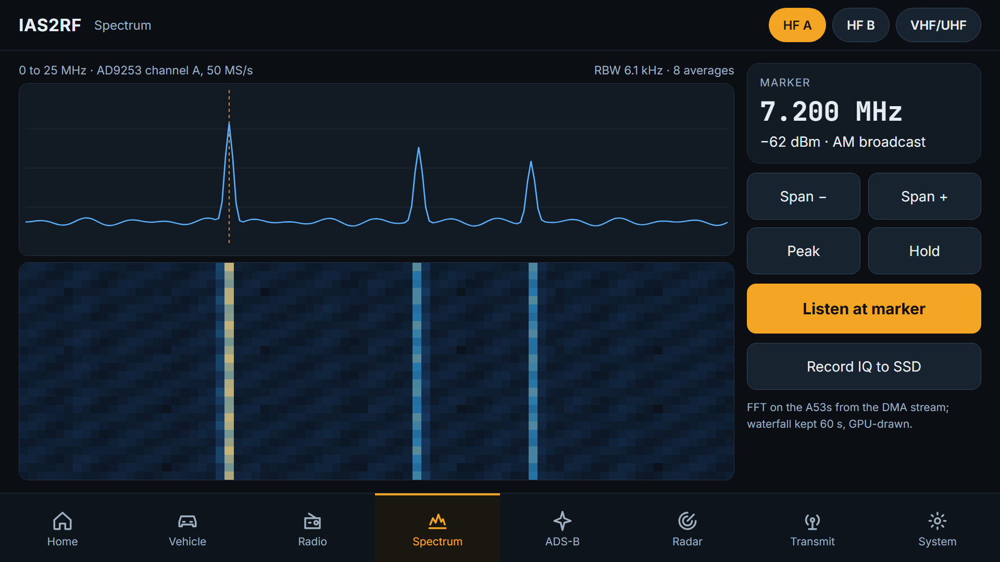
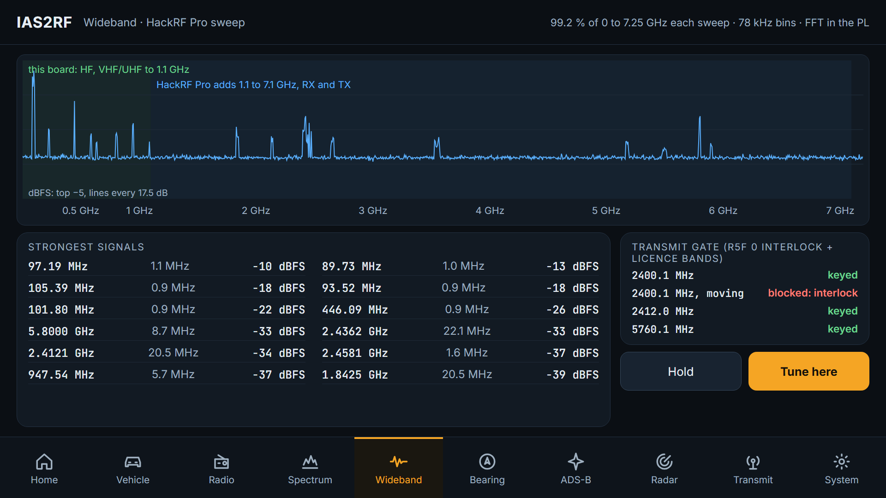
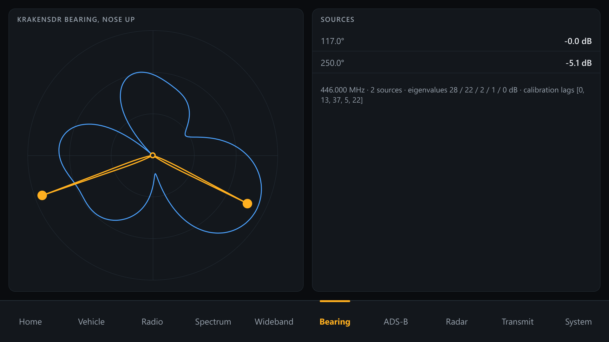
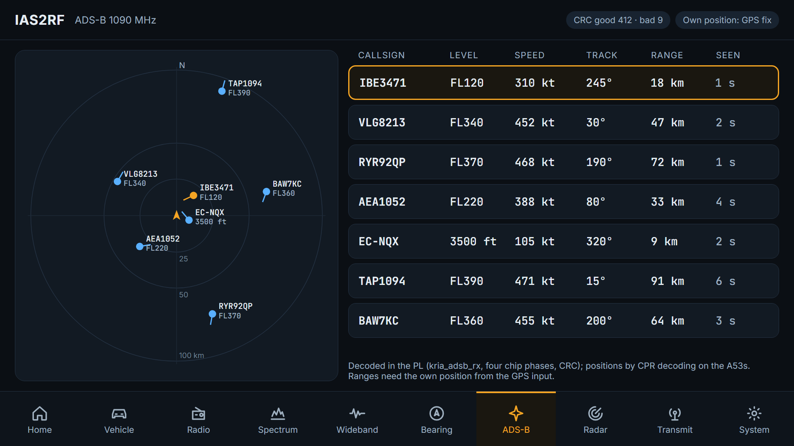
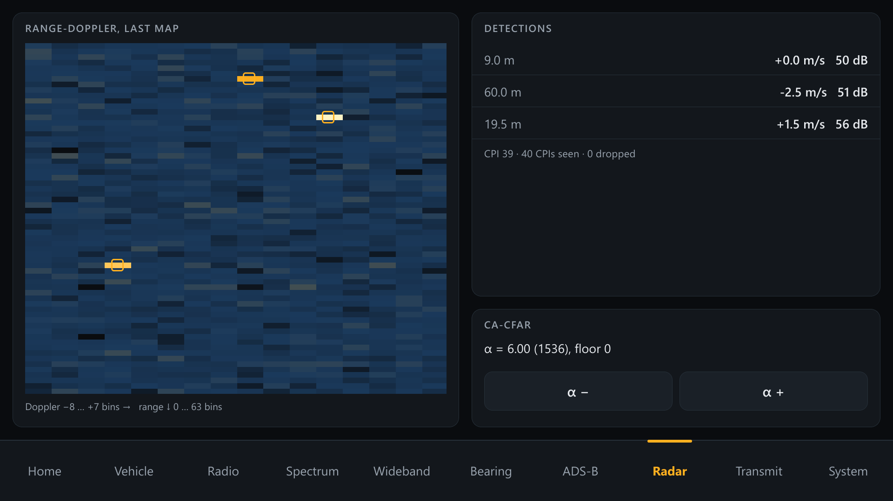
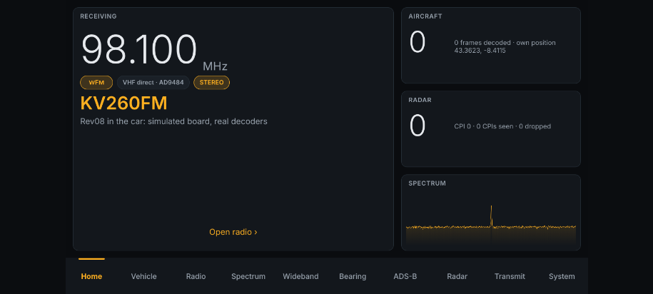

# In-car HMI: the screens, their software and the processing partition (Rev08)

*17 November 2026, rewritten 18 November for the real application · built and run on a PC against the simulated board; not yet run on a KV260*

These are the screens that drive and display the whole system on a touchscreen in the car. They cover this board's functions (receiver, spectrum, ADS-B, radar, transmitter, system health) and the vehicle integrations analysed in [INTEGRATIONS.md](INTEGRATIONS.md) (vehicle telemetry, GPS, a KrakenSDR and a HackRF Pro). The document also says which part of the K26 does each job.

The screens are a real application, not mock-ups. Every image below is drawn by that application from the snapshot its data service produces. On a PC the data service runs a simulated board: it generates the same DMA blocks, in the same formats, that the PL sends (§4), and every decoder behind the screens is the one that would run on the KV260. The RDS text, the aircraft, the radar detections and the interlock states in the images are decoded from those blocks, not typed in.

Sources: [`sw/kria/hmi-core`](../sw/kria/hmi-core/) (the data plane), [`sw/kria/hmid`](../sw/kria/hmid/) (the data service), [`sw/hmi/app`](../sw/hmi/app/) (the screens). [`sw/hmi/make_images.sh`](../sw/hmi/make_images.sh) regenerates the images below; [`sw/kria/README.md`](../sw/kria/README.md) has the build and run commands.

---

## 1. Display path on the KV260

| Item | What the KV260 has | Source |
|---|---|---|
| Video outputs | HDMI (`J5`) and DisplayPort (`J6`) on the carrier | UG1089 Interfaces table `[V]` |
| Who drives them | **Both come from the PS DisplayPort controller.** Two PS-GTR lanes (`GTR_DP0`, `GTR_DP1`) go to an `STDP4320` DisplayPort hub on the carrier, and the hub drives the DP connector and the HDMI connector | KV260 carrier schematic XTP682 rev 2, pages 10 to 12 `[V]` |
| GPU | Mali-400 MP2 in the PS (OpenGL ES 2.0) | K26 data sheet `[V]` |
| Video codec | VCU, H.264 / H.265, a hard block on the PL side; using it means adding its wrapper to the block design | K26 data sheet `[V]`; PL cost not yet measured `[E]` |
| Touch | A USB touchscreen controller (HID) on one of the four USB 3.0 ports | `[E]`, any car display with USB touch |

The PL is therefore **not in the display path**. The screens are drawn on the A53s and shown through Linux DRM/KMS with no desktop: Slint's `linuxkms` back end opens the display directly. It can draw with the Mali-400 (`femtovg`, OpenGL ES 2.0) or entirely on the CPU (Slint's software renderer, which needs no GPU driver). The design size is 1280 × 720, which suits 7 to 10 inch car displays. On a 1920 × 1080 panel the same layout scales by 1.5, which is how the images below are drawn.

## 2. Design rules

- **Glanceable while driving.** One main number per card, in 48 to 96 px figures. Every touch target is at least 56 px, and the bottom bar is 88 px.
- **Night theme by default.** The ground is near-black and text is light grey with at least 4.5:1 contrast. A single amber accent marks the selected item and alerts. Spectra and maps use a dark-to-amber colour scale, so a strong signal is bright and the background stays dark.
- **Transmit is locked while the vehicle moves**, and also while the licence flag is not set. The screen only asks: R5F core 0's interlock decides, and it alone sets `TX_KEY` (§5). Vehicle speed comes from the vehicle's CAN 2.0 bus on R5F core 1 or from the `opendash` stream, with GPS as the fallback ([INTEGRATIONS.md §2.2, §4](INTEGRATIONS.md)). Transmitting with home-built equipment needs an amateur licence and stays inside the amateur bands.
- **The same bottom bar on every screen:** Home, Vehicle, Radio, Spectrum, Wideband, Bearing, ADS-B, Radar, Transmit, System. Ten items of 128 px each at 1280 px.
- **A lost data service is shown, not hidden.** If the screens stop receiving snapshots, a red "No data from kria-hmid" banner covers the top of every screen until they return.

## 3. The screens

### 3.1 Home

What is being received (frequency, mode, the converter it comes from, stereo, the RDS name and text), the aircraft and radar counts, and a spectrum thumbnail. "Open radio" opens Radio.

### 3.2 Vehicle

Speed, engine speed, coolant and fuel from the ECU stream (`opendash-telemetry/1`, [INTEGRATIONS.md §4](INTEGRATIONS.md)), and the transmit lock's state and reason as the interlock reports it. Shown: driving at 68 km/h, so transmit is locked.

### 3.3 Radio

Frequency with large step buttons, the five demodulator modes of `kria_channel_rx` (AM, USB, LSB, NBFM, WBFM), the signal meter with the audio level and rate, and the pilot and CTCSS flags from the audio stream. The RDS card shows the station name, RadioText, PI, PTY and the group count, decoded on the A53s from the RDS bits the PL sends with the audio (`kria_hmi_core::audio`, CRC and offset words A to D). The presets cover FM broadcast, HF AM, airband, marine channel 16, a 2 m repeater with CTCSS, PMR446 and 20 m SSB. A frequency and mode becomes the register writes of the G-8 cases (`kria_hmi_core::modes`): the DDC's NCO, the channel's decimation and mode, the front end's switches and amplifiers, the RFFC5072 LO above 170 MHz. Shown: 98.1 MHz WBFM, stereo, with the simulated station's RDS.

### 3.4 Spectrum

The stream the radio is tuned on (HF A or B from the AD9253, or VHF/UHF from the AD9484), as a spectrum and a 60-row waterfall. The FFT (2048 points, Hann window) runs on the A53s on the stream's I/Q. A touch on the trace sets the marker; "Listen at marker" retunes the radio there. "Record IQ" writes the stream to the SSD as interleaved 16-bit I and Q (`.cs16`, which GNU Radio, SDR# and inspectrum open), with a `.json` beside it giving the centre frequency, sample rate and stream. Checked on the simulated board: one second recorded at 98.1 MHz holds the station 64 dB above the noise at the centre.

### 3.4a Wideband (HackRF Pro)

One sweep of a HackRF Pro from 0 to 7.2 GHz ([INTEGRATIONS.md §10](INTEGRATIONS.md)): the band this board covers shaded green, what the HackRF adds shaded blue, the signals `kria-sdrd`'s detector found marked at the top, and the strongest of them listed. The trace is the maximum per MHz of `kria_sweep`'s 78 kHz bins; bins the sweep has not reached hold the last swept value. Shown: the end-to-end run's output, 25 signals of a car's radio environment.

### 3.4b Bearing (KrakenSDR)

Direction finding with a KrakenSDR ([INTEGRATIONS.md §9](INTEGRATIONS.md)): a polar plot with the vehicle's nose up and bearings clockwise, the Bartlett spectrum from `kria_doa` in blue and the MUSIC spectrum in amber, each source as a dot at the tip of its MUSIC peak, the sources with their bearings and powers, R's eigenvalues and the calibration lags. Shown: the end-to-end run's output, two emitters at 446 MHz.

### 3.5 ADS-B

A polar view around the vehicle with 33, 67 and 100 km rings, and the aircraft list (callsign, flight level, range, speed). The PL demodulates the frames and checks their CRC (`kria_adsb_rx`, stream 0x21); the A53s decode identity, altitude, velocity and position (`kria_hmi_core::adsb`: CRC-24, CPR global and local decoding, checked against the published test vectors). **Ranges and bearings need the vehicle's own position**, which comes from the USB GPS ([INTEGRATIONS.md §2](INTEGRATIONS.md)). Shown: six aircraft, 144 frames.

### 3.6 Radar

The last 64 × 16 range-Doppler map (stream 0x23, sent every fourth CPI), with the CA-CFAR detections outlined, and the detection list (stream 0x22) with range, radial speed and power. α − and α + step `RADAR_ALPHA` by 1.0. Shown: three targets at 9, 19.5 and 60 m.

### 3.7 Transmit

Carrier, the five modes of `kria_tx_mod` (CW, AM, NBFM, USB, LSB; `DSP_CTRL[12:10]`), frequency steps, level, the licence flag, and a large hold-to-talk button. **The board transmits on HF only:** `kria_tx_mod` puts the carrier inside the 25 MS/s stream to the AD9767, out of `J952`, so the carrier must stay below 12.5 MHz. Above that the request is not passed on and the screen says why. VHF and UHF transmit goes through the HackRF Pro's gate ([INTEGRATIONS.md §10](INTEGRATIONS.md)). The modulation source is a 1 kHz test tone. Shown: 7.100 MHz LSB, parked and licensed, keyed.

### 3.8 System

The IAS1 link, the packet and block counts, sequence gaps and CRC errors on the PL's result stream, the stream rate into the A53s, the K26 and Artix temperatures, both R5F cores' status, the platform, and the I/Q recording. The function card chooses what the PL's DSP suite runs: the receiver, ADS-B at 1090 MHz, or the radar. The suite runs one function at a time on the one front end.

### 3.9 In a browser or on a phone

The same application, compiled to WebAssembly, runs in a browser. `kria-hmid --www` serves it on the same port as the snapshots, so a phone on the car's network opens `http://<KV260>:8080/` and gets every screen with live data and working controls. The 1280 × 720 layout is scaled to fit the browser; landscape is the intended orientation. Shown: headless Chrome at a phone's 915 × 412.

## 4. The software

| Part | Where it runs | What it does |
|---|---|---|
| **PL result path** (`kria_dsp_out`, `kria_ps_framer`) | K26 PL | The DSP suite's results as streams: audio with the pilot, CTCSS and RDS flags (0x20), ADS-B frames (0x21), radar detections with a CPI summary (0x22), range-Doppler maps (0x23), enabled by `DSP_CTRL[14]`, maps every 2^`DSP_CTRL[18:15]` CPIs. `kria_ps_framer` merges them with the link's I/Q streams into 64 KiB blocks for `axi_dma_0` (S2MM); every packet has a header word (magic 0xA5, stream id, flags, length, sequence number) and the PL clock's 64-bit time. A flush packet closes a block after 1 ms without data. Tested in `tb_kria_ps_framer` (798 of 798 packets, 136 blocks); see [FPGA_GATEWARE.md](FPGA_GATEWARE.md) |
| **`kria-hmi-core`** (Rust, no I/O) | anywhere; tested on a PC | Parses the blocks (sequence gaps, CRC flags), decodes audio and RDS, ADS-B, radar detections and maps; the spectrum and waterfall; turns a frequency and mode into register writes (the G-8 channel words, the front end, the RFFC5072); holds the snapshot and applies the screens' commands. 18 host tests |
| **`kria-hmid`** (Rust) | A53, Linux (`--features hw`); a PC with the simulated board | Each 20 ms takes the DMA blocks (`/dev/mem` and `/dev/udmabuf0`), plays the audio through ALSA, writes the registers (the K26's directly, the Artix's through the link's command stream 0x10), records I/Q, and every 100 ms sends the snapshot over WebSocket. Asks R5F core 0 for transmit through `/run/kria-hmi/tx`, which `kria-vehicled` puts in the mailbox; it cannot key transmit via `DSP_CTRL` (`DSP_CTRL[1]` is read-only and mirrors `TX_KEY[0]`). Serves the browser build |
| **`kria-hmi`** (Rust and Slint) | A53 (Linux KMS), a PC, a browser (WebAssembly) | The ten screens. Draws each snapshot, sends the commands. The traces and maps are rasterised in Rust into images, which Slint's renderers then only scale |

**Why Slint.** The screens' requirements were a Rust core, low resource use, one code base for the car, a PC, a phone or a web page, and a clean modern look that is easy to change. Slint compiles its `.slint` markup into Rust, runs without a desktop on Linux KMS, has a software renderer for when the GPU driver is not available, and builds for WebAssembly. Qt Quick and Compose Multiplatform were the alternatives; both bring a larger runtime (a C++ or JVM one) and neither shares the Rust core as directly.

**Licence.** The screens' source in this repository is MIT, like the rest of `sw/kria`. A built `kria-hmi` binary links Slint, so it is distributed under Slint's terms: on an embedded device such as the KV260 that is the GPL-3.0, which means whoever ships such a binary also offers its source. `kria-hmi-core` and `kria-hmid` do not link Slint. Nothing from Slint is stored in this repository.

**Measured on a PC against the simulated board** (`scenes/tour.jsonl`, 59 s of simulated time): FM with RDS "KV260FM" and its RadioText, the 2 m repeater's CTCSS, six aircraft, three radar targets, transmit blocked while driving and keyed once parked and settled, 205,098 packets in 2,949 blocks with 0 sequence gaps and 0 CRC errors. The native build, the headless renderer and the browser build were run; the `aarch64` build with `--features hw` compiles but has not run on a KV260.

## 5. Processing partition

| Unit | Jobs | Why there |
|---|---|---|
| **PL** (`kria_pl_link`, `kria_dsp_suite`, `kria_dsp_out`, `kria_ps_framer`, `kria_bev_axi`, `kria_doa`, `kria_sweep`) | Link, packet streams, channel demodulation with RDS bits, ADS-B demodulation and CRC, radar FFT and CFAR, transmit modulation, the result streams and the blocks for the DMA, the fusion grid ([INTEGRATIONS.md §6](INTEGRATIONS.md)), the KrakenSDR's covariance and Bartlett scan, the HackRF's sweep FFT (§9, §10) | Fixed rates up to 100 MS/s per stream, one sample per clock |
| **A53 × 4** (Linux) | `kria-hmid` and the screens: RDS, ADS-B position decoding, the spectrum and waterfall, audio, recording; the telemetry client (`kria-vehicled`); LiDAR driver and SLAM; the Ethernet and USB devices; `kria-sdrd`: the KrakenSDR's calibration and MUSIC, the HackRF's panorama and transmit gate | General-purpose code, drivers and the display |
| **R5F core 0** | 1 kHz loop, **written** ([`kria-r5f0`](../sw/kria/r5f/src/bin/core0.rs), Rust): the GPS PPS discipline of `kria_pps`, the watchdog on the IAS1 link (retrain with a back-off), and the transmit interlock (vehicle speed from CAN1 or `opendash`, licence, time-out, link up), which owns `TX_KEY` (`0x8000_0038`). The AGC needs no core: it runs in the Artix fabric (`fe_agc`) | Must keep running when Linux is busy or restarting; deterministic latency |
| **R5F core 1** | 10 kHz loop, **written** ([`kria-r5f1`](../sw/kria/r5f/src/bin/core1.rs), Rust): the 10.5 GHz radar's beam scan, one step per CPI with a longer dwell where there are detections, `BEAM_STROBE` into the Artix's scan mode; the fusion grid's only command writer (its detections and Linux's ring) and its frames; PS `CAN1` (`0xFF07_0000`, EMIO to `J9` pins 6 and 8) reading the vehicle's CAN 2.0 bus for road speed and raw frames ([INTEGRATIONS.md §2.2](INTEGRATIONS.md)) | Timing tied to the CPI, about 0.4 ms, and CAN polling independent of Linux |
| **Mali-400** | The screens, when Slint draws with `femtovg` | OpenGL ES 2.0 |
| **VCU** | H.265 recording of the screens or of a camera on IAS0 | Hardware encoder; costs nothing on the A53s |

The software on all these cores is Rust, with the logic in I/O-free crates (`kria-core`, shared by the A53s and the R5Fs, and `kria-hmi-core`) that are tested on a PC ([INTEGRATIONS.md §7](INTEGRATIONS.md)). The two R5F cores can reach the PL's control registers directly. `bd.tcl` already places `kria_pl_link`'s AXI-Lite slave and the DMA's registers on `M_AXI_HPM0_LPD`, in the low-power domain where the RPU sits, so no FPD path is involved. Linux starts and stops the R5F firmware through remoteproc `[E]` and talks to it through a fixed mailbox in reserved memory, stamped with the PL clock both read (`kria_core::mailbox`).

Register ownership: core 0 owns `kria_pps`, the link's retrain bit and the transmit enable (`TX_KEY` at `0x8000_0038`); core 1 owns `BEAM_STROBE`, PS `CAN1`, the grid's command port and its DMA; Linux (`kria-hmid`) owns tuning, modes, streams, the AGC's thresholds and the front end's sequencing. The Artix registers are reached only through the link's command stream, which Linux's DMA carries. The earlier `DSP_CTRL` race is gone: `TX_KEY` sits at its own register offset `0x38` on `pl_clk_100m`, writes take effect only with `24'h4B4559` (`"KEY"`) in `[31:8]` and full byte strobes, and `DSP_CTRL[1]` (`0x40`) is now a read-only reflection of `TX_KEY[0]`, so whole-register writes to `DSP_CTRL` from `kria-hmid` cannot key or clear the transmitter (verified by `tb_system.v` S7 and its mutation `tx_key_from_dsp_ctrl`). Core 0 clears `TX_KEY` on every panicking or unready path even when the IAS1 receive clock is absent. The Zynq's PS `CAN1` controller (classic CAN 2.0 in the low-power domain) is now routed through EMIO (`can1_txn` on `J9` pin 6, `can1_rx` on `J9` pin 8) to the adapter's `TCAN3403` transceiver circuit, so R5F core 1 reads the car's road speed even when Linux or Wi-Fi is down ([INTEGRATIONS.md §2.2](INTEGRATIONS.md)). The 77 GHz imaging radar still needs its own CAN FD adapter or 100BASE-T1 converter (§3).

## 6. What is left

- **On a KV260:** run `kria-hmid --hw` with the rebuilt PL (the framer and the result streams), the `udmabuf` buffer and ALSA, and the screens on KMS with a USB touchscreen. Nothing of the HMI has run on the board.
- **Not on the screens yet:** the fusion grid and the 77 GHz radar's objects (the Vehicle screen shows the ECU values only), the radar's beam controls, logging a bearing with the GPS position for triangulation, a microphone as the transmit source, and a transmit time-out shown on the screen (the interlock already has one).
- **Usability on the road:** the 56 px minimum and the contrast are design values. They have to be checked on a real display in daylight and at night.
