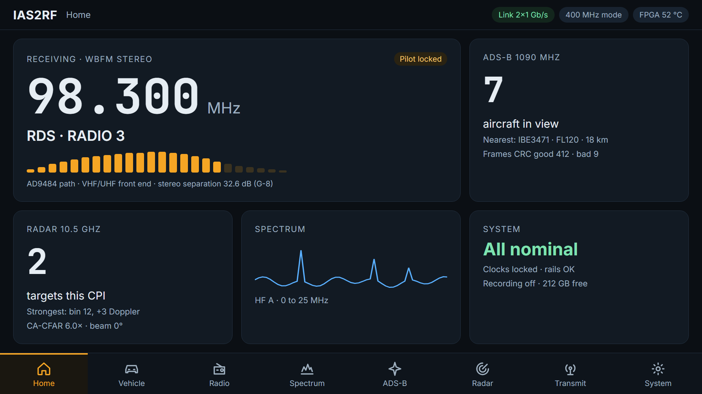
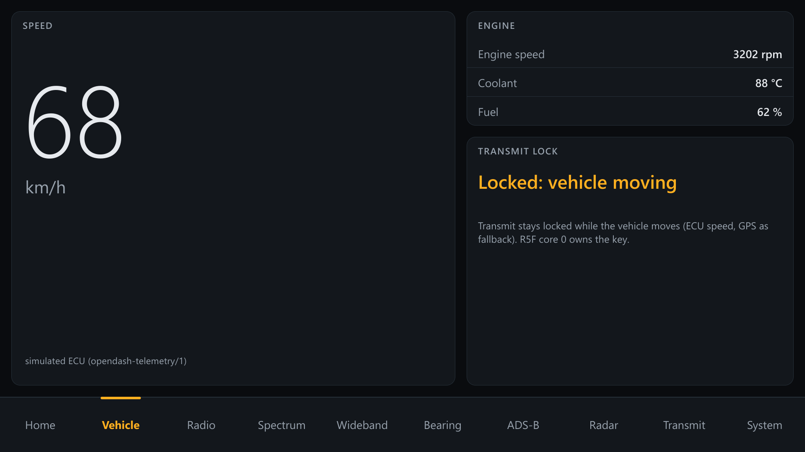
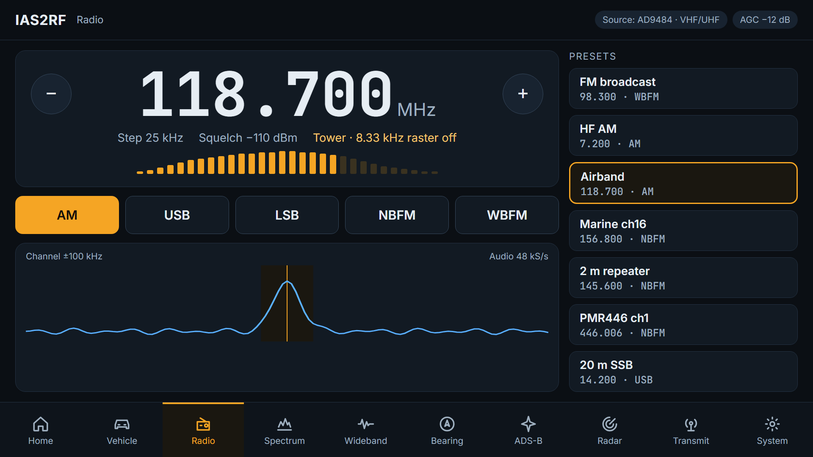
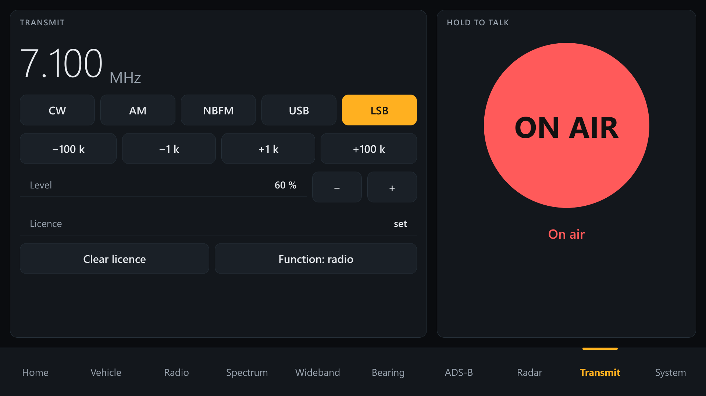
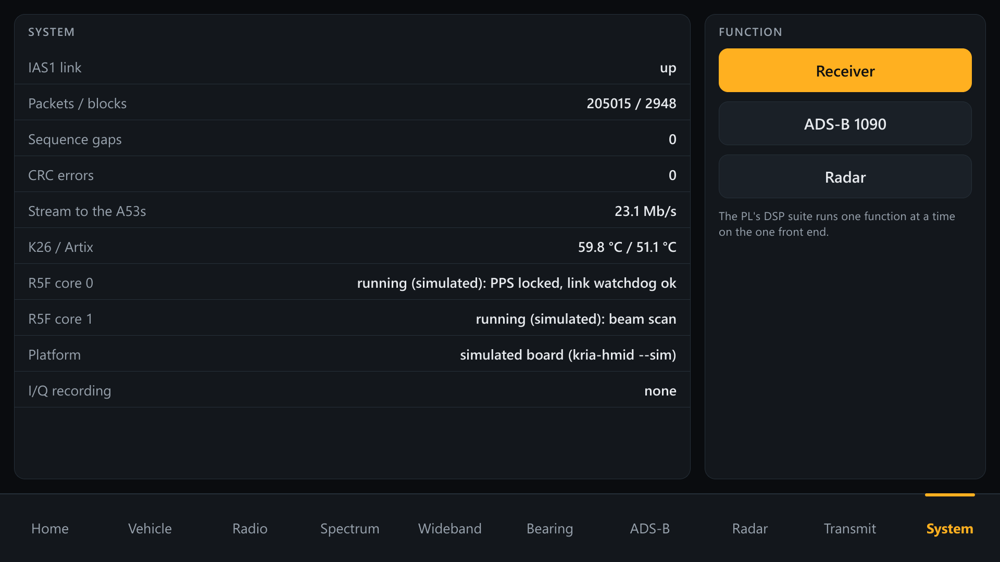

# In-car HMI: screens and processing partition for the KV260 (Rev08)

*17 November 2026 · design, not yet built*

These are the screens that would drive and display the whole system on a touchscreen in the car, once a prototype exists. The document also says which part of the K26 does each job. It covers this board's functions (receiver, spectrum, ADS-B, radar, transmitter, system health). It also covers the vehicle integrations analysed in [INTEGRATIONS.md](INTEGRATIONS.md) (vehicle telemetry, GPS, a 77 GHz radar and a LiDAR). The screens are design mock-ups. Every value on them is a demo state taken from the G-8 test cases or the integration simulations, not live data.

Sources: [`sw/hmi/screens/`](../sw/hmi/screens/) holds one file per screen. Each opens directly in a browser. [`sw/hmi/render.sh`](../sw/hmi/render.sh) regenerates the images below with headless Chrome.

---

## 1. Display path on the KV260

| Item | What the KV260 has | Source |
|---|---|---|
| Video outputs | HDMI (`J5`) and DisplayPort (`J6`) on the carrier | UG1089 Interfaces table `[V]` |
| Who drives them | **Both come from the PS DisplayPort controller.** Two PS-GTR lanes (`GTR_DP0`, `GTR_DP1`) go to an `STDP4320` DisplayPort hub on the carrier, and the hub drives the DP connector and the HDMI connector | KV260 carrier schematic XTP682 rev 2, pages 10 to 12 `[V]` |
| GPU | Mali-400 MP2 in the PS (OpenGL ES 2.0) | K26 data sheet `[V]` |
| Video codec | VCU, H.264 / H.265, a hard block on the PL side; using it means adding its wrapper to the block design | K26 data sheet `[V]`; PL cost not yet measured `[E]` |
| Touch | A USB touchscreen controller (HID) on one of the four USB 3.0 ports | `[E]`, any car display with USB touch |

The PL is therefore **not in the display path**, and the gateware does not change for the HMI. The screens are rendered on the A53s through Linux DRM/KMS. A Qt Quick (QML) application on EGLFS would use the Mali-400 for the waterfall and the maps `[E]`. The design size is 1280 × 720, which suits 7 to 10 inch car displays. On a 1920 × 1080 panel the same layout scales by 1.5, which is how the images below are rendered.

## 2. Design rules

- **Glanceable while driving.** One main number per card, in 48 to 96 px figures. Every touch target is at least 56 px, and the bottom bar is 88 px.
- **Night theme by default.** The ground is near-black and text is light grey with at least 4.5:1 contrast. A single amber accent marks the selected item and alerts. Spectra and maps use a dark-to-amber colour scale, so a strong signal is bright and the background stays dark.
- **Transmit is locked while the vehicle moves**, and also while the licence flag in System is not set. Vehicle speed comes from the ECU stream, with GPS as the fallback ([INTEGRATIONS.md §4](INTEGRATIONS.md)). Transmitting with home-built equipment needs an amateur licence and stays inside the amateur bands.
- **The same bottom bar on every screen:** Home, Vehicle, Radio, Spectrum, ADS-B, Radar, Transmit, System.

## 3. The screens

### 3.1 Home

What is being received (frequency, mode, RDS, signal), the aircraft and radar counts, a spectrum thumbnail and the system state. Each card opens its screen.

### 3.2 Vehicle

The fused bird's-eye grid is the output of the `kria_bev_grid` core: LiDAR plus 77 GHz radar, red occupied, blue free, the vehicle in amber. Beside it are the main engine values from the ECU stream and the 77 GHz radar's object list. The header shows fog mode, which the host switches on when the LiDAR's near returns multiply; [INTEGRATIONS.md §6](INTEGRATIONS.md) explains it.

### 3.3 Radio

Frequency with large step buttons, the five demodulator modes of `kria_channel_rx` (AM, USB, LSB, NBFM, WBFM), the signal meter, the channel spectrum and the presets. The presets cover FM broadcast with RDS, HF AM, airband, marine channel 16, a 2 m repeater with CTCSS, PMR446 and 20 m SSB. The source chip shows which converter the channel comes from: the AD9253 for HF, or the AD9484 behind the RX_VU front end for VHF/UHF.

### 3.4 Spectrum

The wideband view of HF A, HF B (the two AD9253 channels) or VHF/UHF (the AD9484), with a marker, "listen at marker" (which opens Radio on that frequency) and IQ recording to an SSD. The FFT and the 60 s waterfall run on the A53s from the DMA stream and are drawn by the GPU.

### 3.5 ADS-B

A polar view around the vehicle with 25, 50 and 100 km rings, and the aircraft list. The PL decodes the frames (`kria_adsb_rx`, four chip phases, CRC); the A53s decode positions (CPR). **Ranges and bearings need the vehicle's own position**, which comes from the USB GPS ([INTEGRATIONS.md §2](INTEGRATIONS.md)).

### 3.6 Radar

The last CPI's 64 × 16 range-Doppler map, with CA-CFAR detections outlined. Beside it are the detection list, the beam of the eight ADAR1000s (step or scan) and the CFAR settings (`RADAR_ALPHA`, power floor, window).

### 3.7 Transmit

Carrier, mode (CW, AM, NBFM, USB and LSB: the five modes of `kria_tx_mod`), deviation, level and audio source, and a large hold-to-talk button. In the state shown it is locked, because the vehicle is moving; the header button switches the demo between that and "parked, licensed". A transmit time-out and receiver muting are part of the design.

### 3.8 System

The IAS1 link, clocks, temperatures, front end, the A53 cluster, the two R5F cores, recording, and settings (theme, transmit licence, units, position source).

## 4. Processing partition

| Unit | Jobs | Why there |
|---|---|---|
| **PL** (`kria_pl_link`, `kria_dsp_suite`, `kria_bev_axi`) | Link, packet streams, channel demodulation, ADS-B decoding, radar FFT and CFAR, transmit modulation, the fusion grid ([INTEGRATIONS.md §6](INTEGRATIONS.md)) | Fixed rates up to 100 MS/s per stream, one sample per clock |
| **A53 × 4** (Linux) | HMI, wideband FFT and waterfall, CPR position decoding, recording, telemetry client, LiDAR driver and SLAM, the Ethernet and USB devices | General-purpose code, drivers and the GPU |
| **R5F core 0** | 1 kHz loop, **written** ([`kria-r5f0`](../sw/kria/r5f/src/bin/core0.rs), Rust): the GPS PPS discipline of `kria_pps`, the watchdog on the IAS1 link (retrain with a back-off), and the transmit interlock (vehicle speed, licence, time-out, link up), which owns `DSP_CTRL[1]`. The AGC needs no core: it runs in the Artix fabric (`fe_agc`) | Must keep running when Linux is busy or restarting; deterministic latency |
| **R5F core 1** | 10 kHz loop, **written** ([`kria-r5f1`](../sw/kria/r5f/src/bin/core1.rs), Rust): the 10.5 GHz radar's beam scan, one step per CPI with a longer dwell where there are detections, `BEAM_STROBE` into the Artix's scan mode; the fusion grid's only command writer (its detections and Linux's ring) and its frames; optionally the PS's own CAN controller for the 77 GHz radar | Timing tied to the CPI, about 0.4 ms, independent of Linux |
| **Mali-400** | Waterfall, maps and grids in the HMI | OpenGL ES 2.0 |
| **VCU** | H.265 recording of the HMI or of a camera on IAS0 | Hardware encoder; costs nothing on the A53s |

The software on all these cores is Rust, with the logic in one I/O-free crate, `kria-core`, that the A53s and the R5Fs share ([INTEGRATIONS.md §7](INTEGRATIONS.md)). The two R5F cores can reach the PL's control registers directly. `bd.tcl` already places `kria_pl_link`'s AXI-Lite slave and the DMA's registers on `M_AXI_HPM0_LPD`, in the low-power domain where the RPU sits, so no FPD path is involved. Linux starts and stops the R5F firmware through remoteproc `[E]` and talks to it through a fixed mailbox in reserved memory, stamped with the PL clock both read (`kria_core::mailbox`); RPMsg (OpenAMP) is the general alternative. Register ownership: core 0 owns `kria_pps`, the link's retrain bit and the transmit enable (`DSP_CTRL[1]`); core 1 owns `BEAM_STROBE`, the grid's command port and its DMA; Linux owns tuning, modes, streams, the AGC's thresholds and the front end's sequencing (the Artix registers are reached only through the link's command stream, which Linux's DMA carries), asks for transmit through the mailbox and sends grid commands through the ring. The PS also has two CAN controllers in the low-power domain `[V, Zynq UltraScale+ TRM]`. Routed through EMIO to a CAN transceiver, they would let R5F core 1 read the 77 GHz radar without a USB adapter. That needs a free PL pin pair `[E]`.

## 5. What is left

- **The application:** Qt Quick on EGLFS with the Mali-400 driver (`libmali` from the Kria Linux image) `[E]`. A data service would publish the PL registers, the DMA streams and the integrations to the screens.
- **R5F firmware:** both cores' images are written and build, and their logic is tested on the host and, for core 1, end to end through the grid's RTL ([INTEGRATIONS.md §6.1](INTEGRATIONS.md)). None of it has run on a KV260.
- **Usability on the road:** the 56 px minimum and the contrast are design values. They have to be checked on a real display in daylight and at night.
