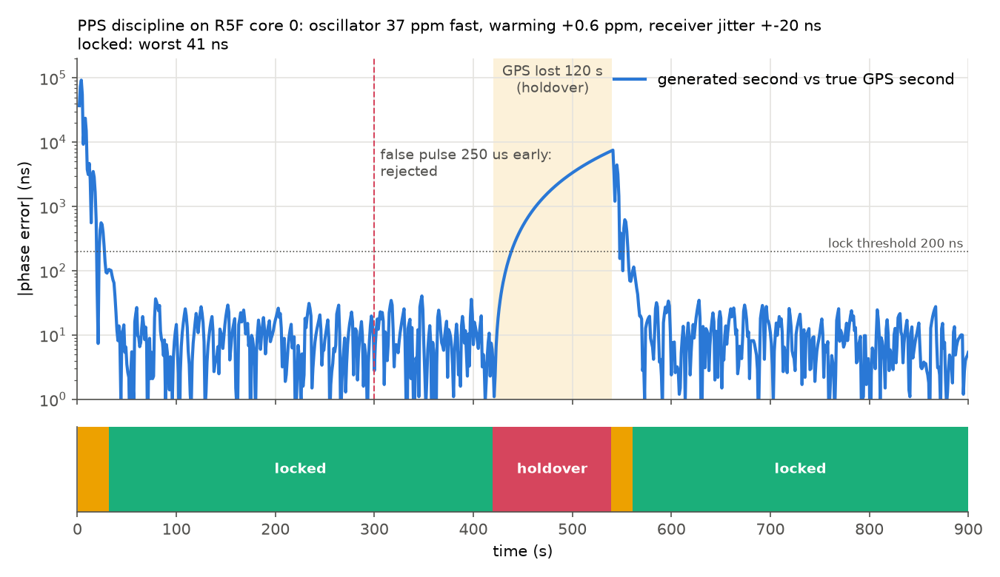
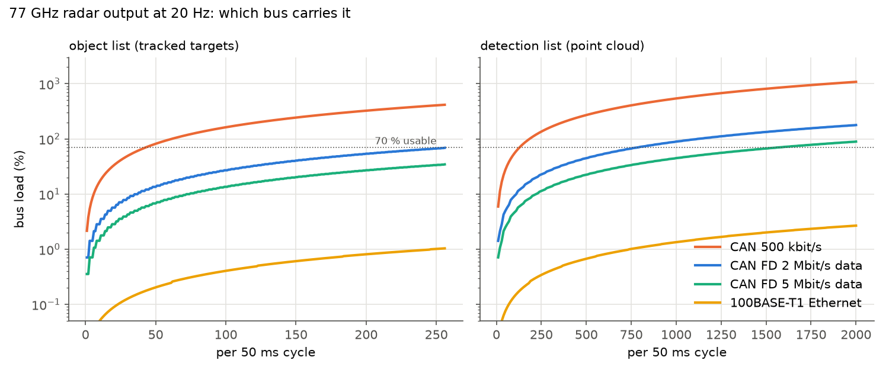
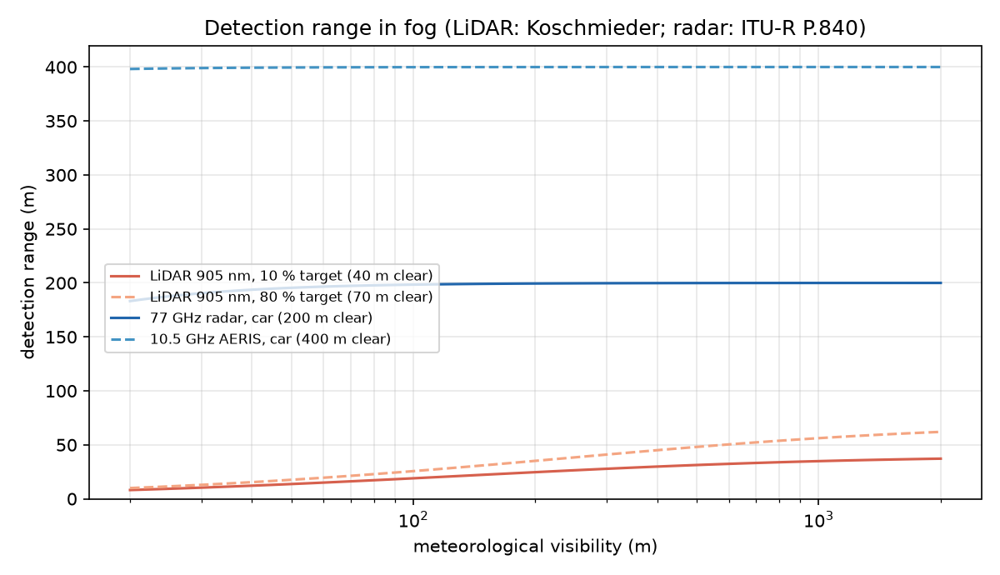
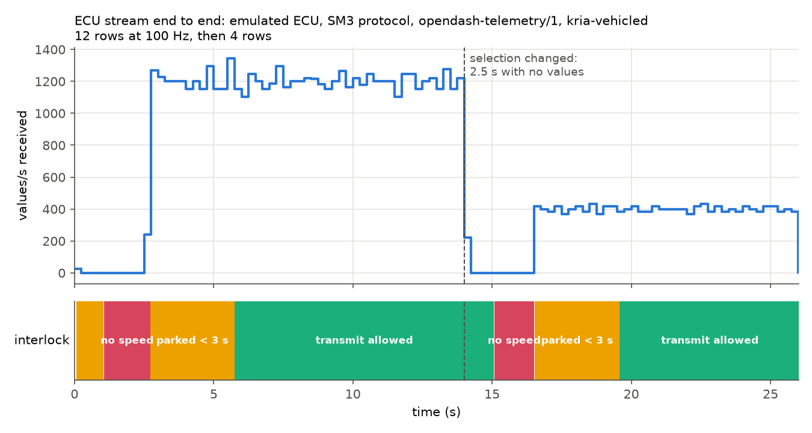
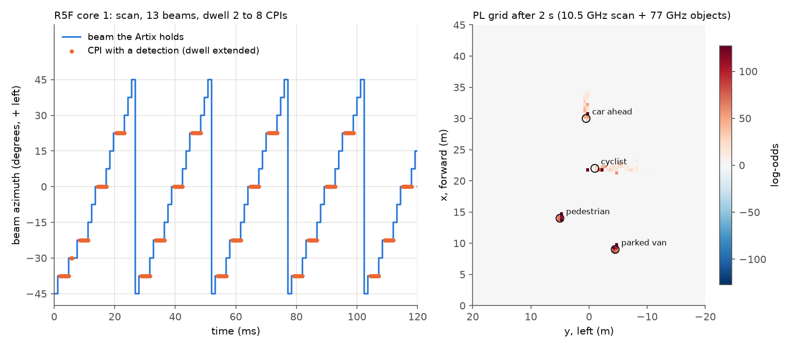

# Possible integrations: GPS, 77 GHz radar, vehicle telemetry, LiDAR and fusion on the PL

*17 November 2026 · analysis, simulation and end-to-end tests on the bench; no vehicle hardware yet*

Four devices could be connected to the KV260 alongside this board in the owner's vehicle (a Mitsubishi Montero V80, [VEHICLE_PLATFORM.md](VEHICLE_PLATFORM.md)):
- a USB GPS;
- a 77 GHz automotive radar through a CAN-to-USB adapter;
- the engine's live data through opendash;
- a 3D LiDAR on a USB-to-Ethernet adapter.

None of them needs a change to this board. This document gives each one's link, data rate and processing, what it adds to the system, and the simulations and tests behind the numbers. Three pieces are built and tested end to end:
- the GPS's pulse-per-second on a free PL pin, disciplined by an R5F core (§2);
- the engine's live data from opendash into a daemon on the A53s, which feeds the transmit lock on the R5F (§4);
- a fusion grid in the PL that combines the LiDAR and the radars into one occupancy grid, in the K26's block design with its own DMA, fed by R5F core 1, which also scans the board's 10.5 GHz radar beam by beam (§6).

The software that runs on the K26's processors is in Rust, with its logic in one I/O-free crate shared by the A53s and the R5F cores (§7). [HMI.md](HMI.md) shows the screens that display all of it.

## 1. Summary

| Device | Link to the KV260 | Data | Processing | Status |
|---|---|---|---|---|
| GPS receiver with PPS | USB (or UART) for position and time; its PPS on KV260 `J9` pin 12, a free PL pin | 1 to 10 fixes/s; one pulse a second | PL: `kria_pps` timestamps it to 10 ns; R5F 0: disciplines the PPS sent to the front end | RTL bench and K26 build; loop simulated (§2) |
| 77 GHz radar | Its own CAN FD bus (USB-CAN FD adapter), or 100BASE-T1 Ethernet through a media converter | Object list or detections at about 20 Hz; classic CAN is too small for either (§3) | A53 or R5F 1: decode; PL: into the grid | Bus load and fog performance simulated (§3, §6) |
| Engine live data (opendash) | opendash's telemetry server on the phone (Wi-Fi), or the SM3 directly | Up to 40 identifiers at 100 Hz, about 3,500 values/s | A53: `kria-vehicled`; R5F 0: road speed into the transmit lock | End to end against an emulated ECU (§4) |
| 3D LiDAR, Ethernet | USB 3.0 to Gigabit Ethernet adapter | 0.2 to 1.3 Mpoints/s, 20 to 70 Mbit/s | A53: driver, SLAM; PL: occupancy grid | Fog performance simulated (§5, §6) |
| Fusion grid | Inside the PL | 100 M cell updates/s | PL: `kria_bev_grid` behind `kria_bev_axi`; R5F 1: its commands, the 10.5 GHz scan, the frames | RTL bit-exact against its model, in the K26 build; end to end from R5F 1's code through the RTL (§6.1) |

The KV260's own Gigabit port (`J10`) already carries this board's Ethernet link, so the LiDAR needs the USB adapter. The four USB 3.0 ports take the GPS, the CAN adapter, the Wi-Fi adapter and the LiDAR's Ethernet adapter, with the touchscreen on a hub or on the HDMI display's own USB.

## 2. USB GPS

**Role.**
- **Own position.** ADS-B ranges and bearings need it. Positions are decoded with CPR: locally from one frame against the vehicle's position, or globally from an even/odd pair. Without a position the ADS-B screen can show the aircraft but no distance.
- **Time.** `chrony` with `gpsd` keeps the Linux clock on GPS time, which stamps recordings, radar CPIs and detections.
- **Heading and speed.** Used when the vehicle is not moving fast enough for the ECU speed to be useful. They are the fallback for the transmit lock ([HMI.md §2](HMI.md)).
- **Odometry.** It is weaker than wheel speed, but useful for the SLAM when the wheel signal is missing.

**Limits of USB alone.** A USB GPS has no pulse-per-second line. Its time over USB carries some milliseconds of latency and jitter `[E]`. That is enough for logs and ADS-B positions, not for the things below.

### 2.1 The PPS on a free PL pin

**What the PPS is for.**
- **The sample clock.** The front end already disciplines its `Si549` (the converters' clock) to the pulse on Pmod `PPS_SYNC`, through `hk_xadc_pps` on the Artix ([CLOCK_SPEC.md](CLOCK_SPEC.md)). Until now that pulse was a PS GPIO toggled by software, with the timing of whatever Linux was doing. With the GPS second behind it, the oscillator's error goes from its own tolerance (tens of ppm, kHz at 100 MHz) to the GPS's, and every tuned frequency with it.
- **Absolute time stamps.** The link's packet time stamps count seconds on the same pulse (`kria_pl_link`), so recordings, ADS-B frames and radar CPIs carry GPS time to tens of nanoseconds. That is what ADS-B multilateration with other receivers needs, and what lines the radar's detections up with the vehicle's position.
- **A pulse that keeps going.** When the receiver loses its fix (a tunnel, a garage), the generated second carries on from the learnt frequency instead of stopping.

**The pin.** The KV260 has no free Pmod pin: `J2`'s eight lines carry the SPI, the beam strobe, `PPS_SYNC` and the debug UART. The Raspberry Pi camera connector `J9` is unused by this design, and one of its pins is wired straight to the SOM:
- **`J9` pin 12 is `HDA10`**, SOM240 `A16`, ball `J12`, bank 45 at 3.3 V `[V]`. The source is the KV260 schematic (XTP682 rev 2, page 13), with the ball from AMD's K26 board file `part0_pins.xml`.
- Pin 11 next to it goes through a reset supervisor and is not usable.

A 15-way 1 mm FFC breakout takes the receiver's 3.3 V PPS to pin 12 and ground to pin 10 `[E: the ground pin is from the Raspberry Pi pinout; check with a meter]`. Any GPS module with a PPS output works, and it can share the USB link for its position and time.

**`kria_pps`** ([`fpga/kria/kria_pps.v`](../fpga/kria/kria_pps.v)) is an AXI-Lite slave at `0x8002_0000`:
- It timestamps each GPS edge on a 64-bit counter at `clk_pl_0` (10 ns). The pulse must first stay high for 1 µs, so a glitch is flagged and never captured.
- It measures the interval between edges and flags a missing pulse after 1.25 s.
- It generates its own second from a fractional period (32 + 32 bits), with a one-shot phase adjustment.
- It drives `PPS_SYNC` from one of three sources: the software GPIO (mode 0, the reset default, as before), the GPS pulse (mode 1) or the generated pulse (mode 2).
- It raises `pl_ps_irq0[4]` on each capture.

The register map is in [FPGA_GATEWARE.md §5.6](FPGA_GATEWARE.md).

**The loop on R5F core 0** (`kria_core::pps`, §7). Once a second it reads the GPS edge and the generated edge and computes three things:
- the frequency over a window of up to 1,024 s, which averages out the receiver's jitter;
- a phase correction of half the error;
- an integral term, which removes the lag of the windowed estimate while the oscillator warms up.

It rejects any interval more than 200 ppm off, or more than 2 µs off the estimate once locked. In holdover it changes nothing.

The simulation runs the same Rust code against a model of `kria_pps`, with:
- an oscillator 37 ppm fast that warms by 0.6 ppm over ten minutes;
- ±20 ns of receiver jitter;
- a false pulse 250 µs early;
- 120 s with no GPS.



| | Result |
|---|---|
| Locked after | 31 s |
| Phase error while locked | 41 ns worst, against the true GPS second |
| False pulse | rejected, lock kept |
| After 120 s of holdover | 7.3 µs off, almost all of it the warm-up that went on during the outage |
| Locked again after the GPS returns | 21 s |

Without the integral term, the warm-up showed up as a constant 300 ns error. The simulation found it, and the term went in. Source: `cargo run --example pps_sim` in [`sw/kria`](../sw/kria/README.md); the figure is drawn by [`sw/integrations/kria_sw_figures.py`](../sw/integrations/kria_sw_figures.py).

**Verification of the RTL.** [`fpga/sim/tb_kria_pps.v`](../fpga/sim/tb_kria_pps.v) runs with 10,000-tick "seconds", so a run covers dozens of them. It checks:
- the ID, mode 0 forwarding, and captures with the IRQ and its clearing;
- the capture period, and mode 1 forwarding after qualification;
- a 5-tick glitch: flagged, not counted, not captured, not forwarded;
- the missing flag and its clearing;
- the fractional generator: eight seconds of 10,000.25 ticks total 80,002;
- the one-shot adjustment;
- a closed loop shaped like the R5F's, which holds the generator within 1 tick of a GPS second of 10,000.37 ticks with ±1 tick of jitter;
- five seconds of holdover.

It passes, and the mutation `pps_no_filter` (no glitch filter) fails three checks. The bench also set a rule for the firmware: clear only the status bits that were read, or a capture that lands between the read and the clear is lost.

## 3. 77 GHz radar over CAN

**Why it is worth adding.** [VEHICLE_PLATFORM.md §3.4](VEHICLE_PLATFORM.md) already makes the case. AERIS-10 is a 10.5 GHz surveillance radar for targets at kilometres. A 77 GHz automotive radar is the sensor built for obstacles in front of a vehicle, legal in 76 to 77 GHz without a licence, and unaffected by fog. The simulation below puts a number on that last point.

**What a radar sends.** Two kinds of output, often both:
- an **object list**: tracked targets, each with range, lateral position, closing speed, class and quality, typically three 8-byte CAN frames per object;
- a **detection list**: the raw point cloud before tracking, about 8 bytes per point and hundreds to thousands of points per cycle on the newer imaging radars.

The message layout comes from the sensor's own DBC file or interface document. **The radar goes on its own bus, never on the vehicle's**: a sensor that floods a bus does not belong on the one the engine uses.

**Classic CAN is too small.** One 8-byte standard frame is at most about 135 bits on the wire, so 500 kbit/s carries at most about 3,700 frames a second. At 20 Hz with three frames per object, that is 40 objects at 70 % load. The figure and the table compare the buses:



| Per 50 ms cycle | CAN 500 kbit/s | CAN FD, 2 Mbit/s data | CAN FD, 5 Mbit/s data | 100BASE-T1 |
|---|---|---|---|---|
| 32 objects | 52 % | 9 % | 5 % | 0.1 % |
| 64 objects | 104 % | 18 % | 9 % | 0.3 % |
| 100 objects | 163 % | 27 % | 14 % | 0.4 % |
| 256 objects | 415 % | 69 % | 35 % | 1.0 % |
| 500 detections | 271 % | 45 % | 22 % | 0.7 % |
| 1,000 detections | 541 % | 90 % | 45 % | 1.3 % |
| 2,000 detections | 1,081 % | 178 % | 89 % | 2.7 % |

The model:
- **Classic CAN:** worst-case stuffing on every frame.
- **CAN FD:** 64-byte frames, about 30 bits at the 500 kbit/s arbitration rate and 590 at the data rate.
- **100BASE-T1:** UDP in 1,472-byte payloads with all headers, preamble and gap.

Source: [`sw/integrations/kria_sw_figures.py`](../sw/integrations/kria_sw_figures.py).

**The alternatives:**
- **CAN FD.** A radar with a CAN FD output, 2 to 5 Mbit/s in the data phase, carries a full object list with room to spare, and a modest detection list.
  - On the KV260 it needs a USB CAN FD adapter (gs_usb or PCAN-USB FD class, SocketCAN).
  - The Zynq UltraScale+ PS's own CAN controllers are CAN 2.0 only `[V, Zynq UltraScale+ TRM]`, so they cannot do it.
  - A CAN FD controller in the PL would be another way, at the cost of a PL pin pair and a transceiver.
- **Automotive Ethernet, 100BASE-T1.** Imaging radars and some long-range ones send their detections over 100BASE-T1, a single twisted pair `[E: e.g. Continental ARS548]`. It carries 2,000 detections at under 3 %.
  - The KV260's own Ethernet port is taken by this board's link.
  - So the path is a 100BASE-T1 to 100BASE-TX media converter into a USB 3.0 Ethernet adapter, the same kind as the LiDAR's (§5). The radar then arrives as UDP, decoded on the A53s.
- **Development radars** (TI AWR-class evaluation boards) give a USB serial stream, or CAN FD and Ethernet on the automotive parts `[E]`. They are useful on the bench, not as the vehicle's sensor.

**Which to choose:**
- **100BASE-T1** if the point cloud is wanted for the fusion grid (§6).
- **CAN FD** if only tracked objects are.

Either way the stream is small for the KV260: decoding it takes negligible CPU, and R5F core 1 could own it ([HMI.md §4](HMI.md)).

**Fog.** Two-way attenuation in fog follows ITU-R P.840. The liquid-water coefficient comes from the double-Debye permittivity of water. The fog's liquid water content comes from its visibility (Eldridge, `V = 0.024 M^-0.65` km). The LiDAR's extinction uses Koschmieder's `sigma = 3.912 / V` on both ways. Each sensor is scaled from its clear-air range: a radar's return falls as `1/R^4`, a LiDAR's on an extended target as `1/R^2`:



| Visibility | Liquid water | LiDAR, 10 % target | LiDAR, 80 % target | 77 GHz attenuation | 77 GHz range | 10.5 GHz attenuation |
|---|---|---|---|---|---|---|
| 1,000 m | 0.003 g/m³ | 34.9 m (of 40) | 56.2 m (of 70) | 0.01 dB/km | 200 m | 0.0002 dB/km |
| 200 m | 0.038 g/m³ | 24.7 m | 35.2 m | 0.12 dB/km | 199 m | 0.003 dB/km |
| 100 m | 0.11 g/m³ | 19.0 m | 25.7 m | 0.35 dB/km | 198 m | 0.008 dB/km |
| 50 m | 0.32 g/m³ | 13.7 m | 17.6 m | 1.0 dB/km | 196 m | 0.024 dB/km |
| 30 m | 0.71 g/m³ | 10.4 m | 12.9 m | 2.2 dB/km | 190 m | 0.054 dB/km |

Between clear air and a 30 m fog the LiDAR loses about three quarters of its range. The 77 GHz radar loses 5 %, and 10.5 GHz loses nothing measurable. Rain is the radar's weather problem instead: tens of millimetres an hour attenuate 77 GHz by several dB/km `[E: ITU-R P.838]`, which over a 200 m two-way path is still a few dB. These curves treat attenuation alone. They leave out the LiDAR's false returns from fog droplets close to the sensor, which §6 models because it matters more than the lost range.

Source: [`sw/integrations/bev_fusion_sim.py`](../sw/integrations/bev_fusion_sim.py), which regenerates the figure and the table.

## 4. Engine live data with opendash

**What it is.** [opendash](https://github.com/PabloSoage/opendash) talks to a Scanmatik SM3 directly, without the vendor's software. Its protocol core (`core/`, Rust) has no I/O, so it builds for the K26's A53s (aarch64 Linux) as it is. [VEHICLE_PLATFORM.md §3.6](VEHICLE_PLATFORM.md) dismissed the SM3 on board for lack of Linux support. With opendash's direct protocol that no longer holds.

**Links.** There are two:
- **SM3 over Wi-Fi.** The SM3 is a TCP server on `192.168.81.1:777` on its own access point, so the KV260 needs a USB Wi-Fi adapter in station mode.
- **SocketCAN on the OBD port.** The same requests go out as ISO-TP from a USB-CAN adapter, with no SM3.

The OBD CAN adapter has to be a different one, or a different channel, from the radar's (§3).

**The fast way to read live data.** opendash's `docs/protocol.md` documents it:
- `2C <dpid> <id16>…` declares a packet of the module's own identifiers.
- `AA 04 <dpid>…` starts them.
- The module then streams 8-byte frames on `0x5E8` at 100 Hz per packet. That is about 30 times what polling achieves.
- A round holds at most 40 identifiers, and a packet at most seven bytes.
- The stream stops about five seconds after the tester goes quiet, so a `3E` TesterPresent goes out every two seconds.

**Measured here, against an emulated ECU.** The ECU here is the Opel Astra J's Denso SH7059, running its own flash image in `sh705x-emu` behind that emulator's emulated SM3 on this workstation. The SM3 test client declared one-byte identifiers in 5, 6 and 7 packets and counted the frames that arrived over 6 to 8 s:

| Packets × identifiers | Rate per packet | Frames/s | Values/s |
|---|---|---|---|
| 5 × 6 = 30 | 100.0 Hz | 500 | 3,000 |
| 6 × 6 = 36 | 100.0 Hz | 600 | 3,599 |
| 7 × 5 = 35 | 100.0 Hz | 700 | 3,500 |
| 7 × 6 = 42 | refused: the seventh declaration gets `7F 2C 31`, over the 40-identifier ceiling | | |

The emulator ran the ECU at 2.85 times real time on this machine (`sh705x bench`, 197 M SH-2E instructions/s), so the stream was never short of ECU time. The figures match what the real car gave on the SM3: seven packets at 98.9 Hz and 3,163 values/s (opendash's measurements).

**The Montero.** The fast stream above is a GMLAN feature of the Astra's ECU. The V80's own ECU speaks Mitsubishi's protocol, for which opendash carries a catalogue (`plugins/mitsubishi-mut3se`). By the owner's own measurement, filling every request frame, about 42 parameters come at around 100 Hz `[E, to be confirmed on the vehicle]`. Either way the data rate is a few kB/s, nothing for the KV260.

**What it gives the system.**
- The Vehicle screen.
- **Wheel speed for the SLAM's odometry**, which the LiDAR mapping needs to remember the ground it has already passed.
- **Ego speed for the radars.** A stationary target's Doppler is `v cos(theta)`, so speed separates moving targets from the ground.
- **The transmit lock.**

### 4.1 The integration, end to end

The stream reaches the board through opendash's **telemetry output**, added to opendash for this (its `docs/telemetry.md`):
- The app sends every live value it receives as one JSON line (`opendash-telemetry/1`) to any client on TCP port 35001.
- It takes back a **selection**: the rows to read, by identifier, including the rows that must ride in every round (road speed).

A selection sent while streaming replaces the one on the phone's live screen exactly as a preset does. The app stops the module's packets, declares the new ones and starts them again. This is opendash's rotation mechanism, which already cycles through rounds when more than 40 identifiers are selected. So the car's screen can ask for any parameter the ECU has, at the cost of a couple of seconds per change.

On the board, **`kria-vehicled`** ([`sw/kria/vehicled`](../sw/kria/vehicled/src/main.rs), Rust) does the rest:
- It connects to that port and sends the selection.
- It keeps the latest value of every row.
- Every 50 ms it writes road speed to R5F core 0 through the shared mailbox, stamped with the PL clock both sides read.
- The transmit lock on the R5F (§7) runs on that speed.

**Tested end to end on the workstation**, with only the ECU emulated. The chain was:
- the Astra J's ECU in `sh705x-emu` (its own flash image), behind the emulator's SM3;
- a bench bridge that speaks the SM3 protocol and serves `opendash-telemetry/1` exactly as the app does (not in this repository);
- `kria-vehicled`, with the interlock also running on the PC.

The daemon asked for 12 identifiers with road speed always on. After 14 s it changed to 4, as a screen changing page would:



| | Measured |
|---|---|
| 12 identifiers | 1,200 values/s (100 Hz each) |
| 4 identifiers | 400 values/s |
| Gap when the selection changes | 2.5 s with no values |
| Transmit lock through that gap | locked 1.1 s into the gap (speed older than 1 s); allowed again 4.5 s later (the 2.5 s gap, then 3 s parked) |

The gap is the declaration: each `2C` with more than two identifiers is a multi-frame ISO-TP exchange with flow control. The bridge alone measured 2.4 to 3.7 s per change, with 1 to 6 packets. Two consequences follow:
- **A screen should change the selection only when it needs to**, not on every page.
- **The GPS fallback matters.** Without it, every selection change locks the transmitter for about four seconds. With a fresh GPS speed (under 2 s old), the interlock switches source instead; the core test `falls_back_to_gps_then_fails_safe` covers this.

To rerun, with the emulator and a server on port 35001:

```
cargo run --release -p kria-vehicled -- --server 127.0.0.1:35001 --select 0x000D,0x000C,0x0005,0x000B,0x0004,0x0010,0x000F,0x0023,0x308A,0x1A2D,0x303A,0x131F --always 0x000D --licensed --interlock --seconds 26 --then-after 14 --then-select 0x000D,0x000C,0x0023,0x308A --csv run.csv
python sw/integrations/kria_sw_figures.py --telemetry-csv run.csv
```

The figure plots only rates and interlock states. The engine values come from the owner's own ECU image and stay out of the repository.

## 5. 3D LiDAR on a USB-Ethernet adapter

[VEHICLE_PLATFORM.md §3.1](VEHICLE_PLATFORM.md) names the candidates: the Livox Mid-360 (360° × 59°, about 200,000 points/s) or the Unitree L2. A 64-beam spinning LiDAR is the upper end, at up to 1.3 million points/s (64 × 2,048 × 10 Hz). On the wire that is roughly 20 to 70 Mbit/s of UDP `[E, from the point formats]`. A USB 3.0 Gigabit adapter (RTL8153 or AX88179 class) carries it with room to spare. Its time stamps come from PTP over the adapter (software time stamping) or from the GPS (§2).

The LiDAR is the sharpest sensor in clear air and the weakest in fog (§3). Its returns from droplets also land close to the sensor, where they read as obstacles. That is why the integration that matters is the fusion in §6, not the LiDAR alone.

## 6. Fusion on the PL: `kria_bev_grid`

[`fpga/kria/integrations/kria_bev_grid.v`](../fpga/kria/integrations/kria_bev_grid.v) is a bird's-eye-view occupancy grid: 256 × 256 signed 8-bit log-odds cells around the vehicle. At 0.5 m cells it covers 128 m × 128 m. It is in the K26's block design behind an AXI wrapper, with a DMA channel for its frames, and R5F core 1 feeds it (§6.1).

**What it does.**
- **Detections.** The host sends detections already transformed to the vehicle frame (x and y in Q8.8 cells), each tagged with its sensor.
- **Hits.** A detection adds that sensor's hit weight to its cell.
- **Ray casting.** For sensors with ray casting on (the LiDAR), every cell on the line from the sensor to the detection first loses that sensor's miss weight: the beam went through, so the space is free. The line is drawn with Bresenham, one cell per clock.
- **Decay.** A decay pass moves every cell toward zero by `max(1, |v| >> 3)`, so obstacles that are not seen again fade.
- **Dump.** A dump streams the 65,536 cells out, eight per 64-bit beat, for the HMI or the SLAM.

Each sensor has its own weights and origin, set by the host.

**Fog mode.** In fog the LiDAR's near returns multiply. The host can see that in its point statistics, and lowers the LiDAR's hit weight. The radar's objects then carry the grid. The simulation uses the scene shown below:
- a car at 24 to 28 m;
- a truck at 46 to 54 m;
- a post at 14 m;
- a guard rail on the right.

It runs four frames of a ±60° LiDAR (0.2° steps, 10 % reflectivity on the car, Koschmieder losses, false returns at 0.8 to 6 m whose probability grows with the extinction) and of a 77 GHz radar (two scatterers per object, 0.15 to 0.2 m noise):


- **Clear air, LiDAR only.** The car, truck, post and guard rail are occupied, and the free space up to them is clear.
- **30 m fog, LiDAR only.** Nothing beyond about 12 m is seen, and the near field fills with false obstacles.
- **Fused.** The radar restores the car, the truck, the post and the rail.
- **Fused in fog mode.** The near-field clutter fades below the occupancy threshold too.

**Verification.**
- **Bit-exact against the model.** [`fpga/sim/tb_kria_bev_grid.v`](../fpga/sim/tb_kria_bev_grid.v) feeds the fog-mode run's 974 commands with random gaps and random output backpressure. All 65,536 dumped cells match the Python model in `sw/integrations/bev_fusion_sim.py`, which is written to be bit-exact.
- **Mutation `bev_no_forward`.** It removes the read-modify-write forwarding; the bench catches it on two beats.

To rerun: first `python sw/integrations/bev_fusion_sim.py` (writes `fpga/sim/out/bev/`), then `fpga/sim/run.ps1 tb_kria_bev_grid`.

**Cost on the K26** (out-of-context synthesis and implementation, `xck26-sfvc784-2LV-c`, Vivado 2026.1):

| | Used | Of the K26 |
|---|---|---|
| CLB LUTs | 344 | 0.3 % |
| CLB registers | 301 | 0.1 % |
| Block RAM tiles | 16 | 11 % |
| DSP48E2 | 0 | 0 |
| Timing at 100 MHz (`clk_pl_0`) | WNS +2.361 ns, WHS +0.057 ns | |

In the full build it costs about what it costs alone (§6.1). The 64 K × 8 memory is cascaded over 16 block RAMs, so the read-modify-write path is about 6.5 ns. The core closes at 100 MHz but not at 250 MHz (−2.5 ns). A registered RAM output, with one more forwarding stage, would be the way up if it were needed.

**Does it need the PL?** One cell update per clock is 100 million per second. A Mid-360's 200,000 points/s with 60-cell rays is 12 million cell updates per second, which one A53 core can probably keep up with `[E]`. A 1.3 Mpoint/s LiDAR is 78 million, scattered across 64 KB, which is where a core that never misses its cache and never waits for Linux pays off. Doing it in the PL also leaves the A53s for the SLAM.

**Not done yet:**
- **Ego-motion.** The grid is vehicle-centred, so as the vehicle moves the host has to shift it, or keep a world-anchored grid and recentre it.
- **A LiDAR DMA.** The wrapper's stream input (`s_axis_det`) is there for a LiDAR's points at full rate; nothing drives it yet.
- **Real data.** Real point clouds and object lists.

### 6.1 On the K26: wrapper, DMA and R5F core 1

**In the block design** ([`fpga/kria/bd.tcl`](../fpga/kria/bd.tcl)):
- **`kria_bev_axi`** ([`fpga/kria/kria_bev_axi.v`](../fpga/kria/kria_bev_axi.v), AXI-Lite at `0x8003_0000`) holds the per-sensor origins, weights and ray-casting flags, and a command port: `DET_XY`, then `DET_CMD`, which pushes the command into a 512-entry queue. A second input, `s_axis_det`, takes commands as a stream for a LiDAR DMA; the queue has priority over it. The register map is in [FPGA_GATEWARE.md §5.7](FPGA_GATEWARE.md).
- **`axi_dma_1`** (S2MM only, `0x8004_0000`, interrupt `pl_ps_irq0[5]`) writes each dump, 64 KiB, into one of two frame buffers after the mailbox region (`0x3EE1_0000`, `bev_frames` in [`sw/ias2rf_pl.dtsi`](../sw/ias2rf_pl.dtsi)), in about 82 µs.

**R5F core 1 owns the command port.** A command is two register writes, so two writers would pair one's position with the other's command. Core 1 ([`sw/kria/r5f/src/bin/core1.rs`](../sw/kria/r5f/src/bin/core1.rs)) is the only writer. Every 100 µs it:
- **Scans the 10.5 GHz radar.** It reads `RADAR_STAT` and steps `kria_core::radar::Scheduler` once per CPI. The scheduler dwells 2 CPIs on a beam, plus 2 more for each CPI with a detection, up to 8. It ignores the CPI that straddles a beam change and pulses `BEAM_STROBE` for the next beam. In the Artix's new scan mode (`ADAR_CTRL[13]`), each strobe loads the next of beams `0..scan_last`, so no register write is needed per beam. `RADAR_STAT[31:26]` now counts CPIs, which is how core 1 knows one has finished.
- **Puts each detection in the grid.** The strongest cell of the CPI is converted back from the map's conjugate position, then from range and beam azimuth to vehicle coordinates (`bev::Mount`), and pushed as the 10.5 GHz radar's point.
- **Drains Linux's ring.** The 77 GHz radar's objects (decoded on the A53s, §3), and anything else Linux wants in the grid, go through a ring in the shared region ([`kria_core::ring`](../sw/kria/core/src/ring.rs)), 64 per loop.
- **Makes the frames.** Every `frame_ms` (100 ms by default) it arms the DMA on the free buffer, pushes a decay pass and a dump, and publishes the buffer in its status block when the DMA finishes.

Linux sets the scan (beams, azimuths, dwell, range and Doppler per bin), the radar's mount and the frame cadence in the mailbox (`Core1Config`), and writes the grid's weights and origins once. Silent for a second, Linux stops core 1's scan and grid.

**End to end.** [`sw/kria/core/examples/radar_grid.rs`](../sw/kria/core/examples/radar_grid.rs) runs core 1's code in core 1's order for 2 s. Around it are models of the Artix's beam scan, of `kria_radar_proc` (a CPI every 400 µs, three CFAR cells per target in the beam, the conjugate map) and of a scene: a car ahead closing at 2 m/s, a pedestrian, a cyclist crossing, and a parked van. The 77 GHz radar sees the same objects every 50 ms, through the ring. Its 2,705 commands then go through the RTL: [`tb_kria_bev_axi`](../fpga/sim/tb_kria_bev_axi.v) alternates them between the register port and the stream, and the dump matches the bit-exact model in all 65,536 cells.

| | |
|---|---|
| CPIs in 2 s | 4,999, none missed |
| Beam changes | 1,034; a full scan of 13 beams in about 25 ms |
| CPIs with a detection | 2,525, every one on a real target's beam and range |
| Commands | 2,525 radar detections, 160 objects through the ring (none dropped), 19 decay passes, 1 dump |



On the left, the dwell grows on the four beams with a target. On the right, the grid after 2 s:
- the car's trail as it closes;
- the cyclist's track across the road;
- the pedestrian and the van as fixed cells.

To rerun:
1. `cargo run --release --example radar_grid` in `sw/kria/core`;
2. `python sw/integrations/radar_grid_replay.py`, which writes the expected grid and the figure;
3. `fpga/sim/run.ps1 tb_kria_bev_axi -PlusArg BEV_DIR=../radar_grid`.

**Verification of the wrapper.** [`tb_kria_bev_axi`](../fpga/sim/tb_kria_bev_axi.v) on the fog run of §6 (974 commands) checks:
- the reset values;
- the configuration read-back;
- both command paths against the model;
- the queue filling to 512 with `STATUS.overflow` set and cleared;
- `COUNT`.

The mutation `bev_axi_no_stage` (`DET_CMD` ignores `DET_XY`) fails it. The Artix's scan mode is in `tb_adar_ctrl`: five strobes load beams 0, 1, 2, 0 and 1, each with its own weights; the mutation `scan_ignored` fails it. The CPI count is checked by the system bench `tb_system_signals` in the G-8 radar case, which passes again with it.

**Cost in the K26 build:** `kria_bev_0` takes `790` LUT (`192` of them LUTRAM), `623` FF and `16` BRAM36, and its DMA `axi_dma_1` `1,046` LUT, `1,590` FF and one BRAM36 and one BRAM18. The whole block design is at `36,393` LUT (`31.1 %`), `32.5` BRAM36 (`22.6 %`) and `106` DSP48E2, and meets timing with `WNS = +0.874 ns` and `WHS = +0.010 ns` (FPGA_GATEWARE §3.3).

## 7. Software on the K26's processors

Code that runs on the Kria's ARM cores is written in Rust, with its logic in an I/O-free core, as in opendash. [`sw/kria`](../sw/kria/README.md) holds it:

| Crate | Runs on | What it does |
|---|---|---|
| [`kria-core`](../sw/kria/core/src/lib.rs) | A53 and R5F (`no_std`, no allocation, no `unsafe`) | `pps` (the loop of §2.1), `interlock` (the transmit lock), `link` (the IAS1 link watchdog), `radar` (the beam scan), `bev` (the grid's commands and coordinates), `ring` (Linux's grid commands for core 1), `telemetry` (`opendash-telemetry/1` lines), `mailbox` (the shared blocks' layout and seqlock) |
| [`kria-vehicled`](../sw/kria/vehicled/src/main.rs) | A53, Linux | §4.1 |
| [`kria-r5f0`](../sw/kria/r5f/src/bin/core0.rs) | R5F core 0, from TCM, started by remoteproc | At 1 kHz: the PPS loop on `kria_pps`, the IAS1 link watchdog, the transmit lock (it owns `DSP_CTRL[1]`), and status back to Linux |
| [`kria-r5f1`](../sw/kria/r5f/src/bin/core1.rs) | R5F core 1, from its own TCM | At 10 kHz: the 10.5 GHz radar's beam scan, the fusion grid's command port and frames (§6.1) |

**The transmit lock** (`kria_core::interlock`) runs on R5F core 0 every millisecond:
- **Speed source:** the ECU's road speed first, while fresh (1 s), then the GPS's (2 s).
- **Moving or parked:** 3 km/h or more is moving. Parked needs under 1 km/h for 3 s, with hysteresis in between.
- **Licence:** the flag must be set.
- **Time-out:** at most 180 s of continuous transmission, then a 10 s cooldown after the button is released.
- **Fail-safe:** no fresh speed from either source, or Linux silent for 0.5 s, means locked.

On the R5F it holds while Linux is busy or restarting. Linux never writes the transmit-enable bit; it asks through the mailbox. Core 0 also requires the IAS1 link to be up: with the link down the transmit samples do not reach the front end, and when it returns they should not resume on their own.

**The IAS1 link watchdog** (`kria_core::link`), also on core 0 every millisecond:
- **Down:** after 20 ms with `link_up` low, it pulses `LINK_CTRL[2]` to retrain. If the link stays down, it retrains again after 100 ms, then 200, 400 and so on up to 5 s, so a front end that is switched off is not hammered. The first training after start gets 3 s.
- **Errors:** more than 100 CRC errors within a second of link time retrain it once.
- **Health and counts:** go to Linux in the mailbox.

A link register read can abort: `kria_pl_link` answers SLVERR when the link's receive clock is missing, which is when the link is down. The firmware's data-abort handler counts the abort and resumes at the next instruction, and the watchdog takes an aborted read as "down". A core that hung on that abort would leave the transmitter as it was.

**AGC and front-end sequencing stay where they are.** The AGC loop already runs in the Artix fabric (`fe_agc`, Rev08 G-5): it reads the AD9484's peak every 131 µs and drives the `PE4312` and the LNA bypass with no processor in the loop. The front end's sequencing is a handful of Artix register writes at start-up and on a band change. The Kria reaches those registers only through the link's command stream (`0x10`), whose DMA Linux owns. So both stay as they are, with Linux setting the AGC's thresholds and doing the sequencing.

**The mailbox:**
- **Where:** a 64 KiB `reserved-memory` region at `0x3EE0_0000` ([`sw/ias2rf_pl.dtsi`](../sw/ias2rf_pl.dtsi)), with the grid's two frames right after it.
- **Layout:**

  | Offset | Block | Writer |
  |---|---|---|
  | `0x000` | speeds, licence, transmit request | Linux |
  | `0x040` | PPS, interlock and link status | core 0 |
  | `0x080` | scan and grid status, the latest frame | core 1 |
  | `0x100` | scan and grid configuration | Linux |
  | `0x1000` | grid command ring | Linux (head), core 1 (tail) |
- **Who writes:** one writer per block, and each block is a seqlock.
- **Time base:** `kria_pps`'s `NOW`, the PL clock that all three read. Reading `NOW_LO` latches `NOW_HI` for whoever reads it next, so each reader takes two pairs and keeps them only if they agree.

RPMsg (OpenAMP) is the general-purpose alternative. For a few numbers a millisecond, a fixed block with no driver is enough.

**Tests:**
- **`kria-core`:** 29 tests on the host.
  - PPS: lock with a fast and a slow oscillator, a frequency step, a false pulse, holdover and reacquisition, a counter that wraps.
  - Interlock: settling, creeping, GPS fallback and fail-safe, licence, time-out and cooldown.
  - Link watchdog: power-up training, the back-off sequence and its reset, slow errors counted, a burst retrained once.
  - Radar scan: dwell and beam order with nothing in view, a target holding the beam, the conjugate map, negative Doppler, CPIs missed across the counter's wrap.
  - Grid: command words against the RTL layout, cell edges, sine and cosine within 2e-6, mounts, configuration words.
  - Telemetry: lines exactly as opendash writes them, and junk.
  - Mailbox and ring: round trips, seqlock, counters that wrap.
- **Cross-builds:** the core builds for `armv7r-none-eabihf` and `aarch64-unknown-linux-gnu`.
- **The R5F firmware:** two images, each linked into its core's ATCM (7.5 KB and 7.8 KB of code) and BTCM.
- **The daemon:** builds for the A53s, and ran the end-to-end test of §4.1.
- **Core 1 end to end:** §6.1.

None of it has run on a KV260 yet.

## 8. What it would take, in order

1. **On a KV260:**
   - the bitstream with `kria_pps`, the grid and its DMA;
   - the overlay with the PPS and grid nodes, the mailbox and the frame buffers;
   - `kria-r5f0` and `kria-r5f1` loaded through remoteproc;
   - the Artix's beam table loaded in scan order and `ADAR_CTRL[13]` set;
   - `kria-vehicled` against opendash on the phone;
   - `gpsd` and `chrony` for the GPS's position and time, and its PPS on `J9` pin 12.

   Everything here is built and tested on the bench. Only the board is missing.
2. **The LiDAR on its USB adapter.** Its ROS 2 driver and a SLAM (FAST-LIO2 or similar), fed with the wheel speed from step 1.
3. **The 77 GHz radar on its own CAN FD adapter or 100BASE-T1 converter (§3).** Its DBC or interface document and a decoder, with its objects on the Vehicle screen.
4. **The LiDAR into the grid at full rate:** a DMA channel (MM2S) into `kria_bev_axi`'s `s_axis_det`, and the points converted to grid commands on the A53s.
