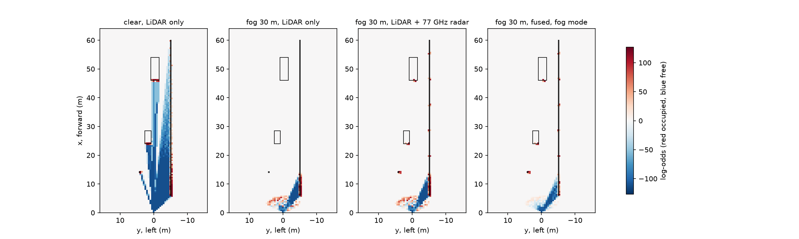

# Possible integrations: GPS, 77 GHz radar, vehicle telemetry, LiDAR and fusion on the PL

*17 November 2026 · analysis and simulation; nothing here is built yet*

Four devices could be connected to the KV260 alongside this board in the owner's vehicle (a Mitsubishi Montero V80, [VEHICLE_PLATFORM.md](VEHICLE_PLATFORM.md)):
- a USB GPS;
- a 77 GHz automotive radar through a CAN-to-USB adapter;
- the engine's live data through opendash;
- a 3D LiDAR on a USB-to-Ethernet adapter.

None of them needs a change to this board or to its gateware. This document gives each one's link, data rate and processing, what it adds to the system, and the simulations behind the numbers. It ends with a fusion core for the K26's PL, built and verified in simulation, which combines the LiDAR and the radar into one occupancy grid. [HMI.md](HMI.md) shows the screens that display them.

## 1. Summary

| Device | Link to the KV260 | Data | Processing | Status |
|---|---|---|---|---|
| USB GPS (NMEA or UBX) | USB, `gpsd` | 1 to 10 fixes/s, under 2 kB/s | A53: position, time, heading | Analysed (§2) |
| 77 GHz radar, CAN output | USB-CAN adapter (SocketCAN) on its own CAN bus | Object list, about 14 Hz, up to a few hundred kbit/s (§3) | A53 or R5F: decode the list; PL: into the grid | Fog performance simulated (§3, §6) |
| Engine live data (opendash) | Scanmatik SM3 over Wi-Fi (USB Wi-Fi adapter), or SocketCAN on the OBD port | 700 frames/s, about 3,500 values/s | A53: client, decoding, recording | Stream measured against an emulated ECU (§4) |
| 3D LiDAR, Ethernet | USB 3.0 to Gigabit Ethernet adapter | 0.2 to 1.3 Mpoints/s, 20 to 70 Mbit/s | A53: driver, SLAM; PL: occupancy grid | Fog performance simulated (§5, §6) |
| Fusion grid | Inside the PL | 100 M cell updates/s | PL core `kria_bev_grid` | RTL, bit-exact against its model, K26 timing (§6) |

The KV260's own Gigabit port (`J10`) already carries this board's Ethernet link, so the LiDAR needs the USB adapter. The four USB 3.0 ports take the GPS, the CAN adapter, the Wi-Fi adapter and the LiDAR's Ethernet adapter, with the touchscreen on a hub or on the HDMI display's own USB.

## 2. USB GPS

**Role.**
- **Own position.** ADS-B ranges and bearings need it. Positions are decoded with CPR: locally from one frame against the vehicle's position, or globally from an even/odd pair. Without a position the ADS-B screen can show the aircraft but no distance.
- **Time.** `chrony` with `gpsd` keeps the Linux clock on GPS time, which stamps recordings, radar CPIs and detections.
- **Heading and speed.** Used when the vehicle is not moving fast enough for the ECU speed to be useful. They are the fallback for the transmit lock ([HMI.md §2](HMI.md)).
- **Odometry.** It is weaker than wheel speed, but useful for the SLAM when the wheel signal is missing.

**Limits.** A USB GPS has no pulse-per-second line. Its time over USB carries some milliseconds of latency and jitter `[E]`. That is enough for logs and ADS-B, but not for sub-millisecond time stamps on the radar. If that is wanted, a GPS module's PPS output would go to a spare PL input (if a Pmod pin stays free on `J2` `[E]`), where a counter on `clk_pl_0` stamps it to 10 ns.

## 3. 77 GHz radar over CAN

**Why it is worth adding.** [VEHICLE_PLATFORM.md §3.4](VEHICLE_PLATFORM.md) already makes the case. AERIS-10 is a 10.5 GHz surveillance radar for targets at kilometres. A 77 GHz automotive radar is the sensor built for obstacles in front of a vehicle, legal in 76 to 77 GHz without a licence, and unaffected by fog. The simulation below puts a number on that last point.

**Link.** Radars with a CAN output send an object list: each object is one or a few 8-byte frames with range, lateral position, closing speed, class and quality. A cluster list is longer. The message layout comes from the sensor's own DBC file. A USB-CAN adapter (gs_usb or PCAN class) appears as a SocketCAN interface, and `can-utils` and a DBC decoder read it with no kernel work. **The radar goes on its own CAN bus, never on the vehicle's**: a sensor that floods a bus does not belong on the one the engine uses.

**Bus load.** One 8-byte standard frame is at most about 135 bits on the wire, with stuffing and the interframe space, so 500 kbit/s carries at most about 3,700 frames/s `[E: CAN 2.0A worst case]`. For a cycle of 72 ms (about 14 Hz, a common radar cycle `[E]`):

| Objects | Frames per object | Frames/s | Load at 500 kbit/s |
|---|---|---|---|
| 32 | 1 | 470 | 13 % |
| 64 | 1 | 920 | 25 % |
| 100 | 1 | 1,420 | 38 % |
| 100 | 3 (with quality and extended data) | 4,200 | over capacity |

So a long object list with all its extra messages needs CAN FD or fewer messages per object. Either way the stream is small for the KV260: decoding it takes negligible CPU, and R5F core 1 could own it ([HMI.md §4](HMI.md)).

**Fog.** Two-way attenuation in fog follows ITU-R P.840. The liquid-water coefficient comes from the double-Debye permittivity of water. The fog's liquid water content comes from its visibility (Eldridge, `V = 0.024 M^-0.65` km). The LiDAR's extinction uses Koschmieder's `sigma = 3.912 / V` on both ways. Each sensor is scaled from its clear-air range: a radar's return falls as `1/R^4`, a LiDAR's on an extended target as `1/R^2`:

| Visibility | Liquid water | LiDAR, 10 % target | LiDAR, 80 % target | 77 GHz attenuation | 77 GHz range | 10.5 GHz attenuation |
|---|---|---|---|---|---|---|
| 1,000 m | 0.003 g/m³ | 34.9 m (of 40) | 56.2 m (of 70) | 0.01 dB/km | 200 m | 0.0002 dB/km |
| 200 m | 0.038 g/m³ | 24.7 m | 35.2 m | 0.12 dB/km | 199 m | 0.003 dB/km |
| 100 m | 0.11 g/m³ | 19.0 m | 25.7 m | 0.35 dB/km | 198 m | 0.008 dB/km |
| 50 m | 0.32 g/m³ | 13.7 m | 17.6 m | 1.0 dB/km | 196 m | 0.024 dB/km |
| 30 m | 0.71 g/m³ | 10.4 m | 12.9 m | 2.2 dB/km | 190 m | 0.054 dB/km |

Between clear air and a 30 m fog the LiDAR loses about three quarters of its range. The 77 GHz radar loses 5 %, and 10.5 GHz loses nothing measurable. Rain is the radar's weather problem instead: tens of millimetres an hour attenuate 77 GHz by several dB/km `[E: ITU-R P.838]`, which over a 200 m two-way path is still a few dB. These curves treat attenuation alone. They leave out the LiDAR's false returns from fog droplets close to the sensor, which §6 models because it matters more than the lost range.

Source: [`sw/integrations/bev_fusion_sim.py`](../sw/integrations/bev_fusion_sim.py), which regenerates the figure and the table.

## 4. Engine live data with opendash

**What it is.** [opendash](https://github.com/PabloSoage/opendash) talks to a Scanmatik SM3 directly, without the vendor's software. Its protocol core (`core/`, Rust) has no I/O, so it builds for the K26's A53s (aarch64 Linux) as it is. [VEHICLE_PLATFORM.md §3.6](VEHICLE_PLATFORM.md) dismissed the SM3 on board for lack of Linux support. With opendash's direct protocol that no longer holds.

**Links.** There are two:
- **SM3 over Wi-Fi.** The SM3 is a TCP server on `192.168.81.1:777` on its own access point, so the KV260 needs a USB Wi-Fi adapter in station mode.
- **SocketCAN on the OBD port.** The same requests go out as ISO-TP from a USB-CAN adapter, with no SM3.

The OBD CAN adapter has to be a different one, or a different channel, from the radar's (§3).

**The fast way to read live data.** opendash's `docs/protocol.md` documents it:
- `2C <dpid> <id16>…` declares a packet of the module's own identifiers.
- `AA 04 <dpid>…` starts them.
- The module then streams 8-byte frames on `0x5E8` at 100 Hz per packet. That is about 30 times what polling achieves.
- A round holds at most 40 identifiers, and a packet at most seven bytes.
- The stream stops about five seconds after the tester goes quiet, so a `3E` TesterPresent goes out every two seconds.

**Measured here, against an emulated ECU.** The ECU here is the Opel Astra J's Denso SH7059, running its own flash image in `sh705x-emu` behind that emulator's emulated SM3 on this workstation. The SM3 test client declared one-byte identifiers in 5, 6 and 7 packets and counted the frames that arrived over 6 to 8 s:

| Packets × identifiers | Rate per packet | Frames/s | Values/s |
|---|---|---|---|
| 5 × 6 = 30 | 100.0 Hz | 500 | 3,000 |
| 6 × 6 = 36 | 100.0 Hz | 600 | 3,599 |
| 7 × 5 = 35 | 100.0 Hz | 700 | 3,500 |
| 7 × 6 = 42 | refused: the seventh declaration gets `7F 2C 31`, over the 40-identifier ceiling | | |

The emulator ran the ECU at 2.85 times real time on this machine (`sh705x bench`, 197 M SH-2E instructions/s), so the stream was never short of ECU time. The figures match what the real car gave on the SM3: seven packets at 98.9 Hz and 3,163 values/s (opendash's measurements).

**The Montero.** The fast stream above is a GMLAN feature of the Astra's ECU. The V80's own ECU speaks Mitsubishi's protocol, for which opendash carries a catalogue (`plugins/mitsubishi-mut3se`). By the owner's own measurement, filling every request frame, about 42 parameters come at around 100 Hz `[E, to be confirmed on the vehicle]`. Either way the data rate is a few kB/s, nothing for the KV260.

**What it gives the system.**
- The Vehicle screen.
- **Wheel speed for the SLAM's odometry**, which the LiDAR mapping needs to remember the ground it has already passed.
- **Ego speed for the radars.** A stationary target's Doppler is `v cos(theta)`, so speed separates moving targets from the ground.
- **The transmit lock.**

## 5. 3D LiDAR on a USB-Ethernet adapter

[VEHICLE_PLATFORM.md §3.1](VEHICLE_PLATFORM.md) names the candidates: the Livox Mid-360 (360° × 59°, about 200,000 points/s) or the Unitree L2. A 64-beam spinning LiDAR is the upper end, at up to 1.3 million points/s (64 × 2,048 × 10 Hz). On the wire that is roughly 20 to 70 Mbit/s of UDP `[E, from the point formats]`. A USB 3.0 Gigabit adapter (RTL8153 or AX88179 class) carries it with room to spare. Its time stamps come from PTP over the adapter (software time stamping) or from the GPS (§2).

The LiDAR is the sharpest sensor in clear air and the weakest in fog (§3). Its returns from droplets also land close to the sensor, where they read as obstacles. That is why the integration that matters is the fusion in §6, not the LiDAR alone.

## 6. Fusion on the PL: `kria_bev_grid`

[`fpga/kria/integrations/kria_bev_grid.v`](../fpga/kria/integrations/kria_bev_grid.v) is a bird's-eye-view occupancy grid: 256 × 256 signed 8-bit log-odds cells around the vehicle. At 0.5 m cells it covers 128 m × 128 m. It is not part of the build (`bd.tcl` does not add it). It is a core ready to be placed beside the DSP suite on its own AXI-Stream.

**What it does.**
- **Detections.** The host sends detections already transformed to the vehicle frame (x and y in Q8.8 cells), each tagged with its sensor.
- **Hits.** A detection adds that sensor's hit weight to its cell.
- **Ray casting.** For sensors with ray casting on (the LiDAR), every cell on the line from the sensor to the detection first loses that sensor's miss weight: the beam went through, so the space is free. The line is drawn with Bresenham, one cell per clock.
- **Decay.** A decay pass moves every cell toward zero by `max(1, |v| >> 3)`, so obstacles that are not seen again fade.
- **Dump.** A dump streams the 65,536 cells out, eight per 64-bit beat, for the HMI or the SLAM.

Each sensor has its own weights and origin, set by the host.

**Fog mode.** In fog the LiDAR's near returns multiply. The host can see that in its point statistics, and lowers the LiDAR's hit weight. The radar's objects then carry the grid. The simulation uses the scene shown below:
- a car at 24 to 28 m;
- a truck at 46 to 54 m;
- a post at 14 m;
- a guard rail on the right.

It runs four frames of a ±60° LiDAR (0.2° steps, 10 % reflectivity on the car, Koschmieder losses, false returns at 0.8 to 6 m whose probability grows with the extinction) and of a 77 GHz radar (two scatterers per object, 0.15 to 0.2 m noise):

- **Clear air, LiDAR only.** The car, truck, post and guard rail are occupied, and the free space up to them is clear.
- **30 m fog, LiDAR only.** Nothing beyond about 12 m is seen, and the near field fills with false obstacles.
- **Fused.** The radar restores the car, the truck, the post and the rail.
- **Fused in fog mode.** The near-field clutter fades below the occupancy threshold too.

**Verification.**
- **Bit-exact against the model.** [`fpga/sim/tb_kria_bev_grid.v`](../fpga/sim/tb_kria_bev_grid.v) feeds the fog-mode run's 974 commands with random gaps and random output backpressure. All 65,536 dumped cells match the Python model in `sw/integrations/bev_fusion_sim.py`, which is written to be bit-exact.
- **Mutation `bev_no_forward`.** It removes the read-modify-write forwarding; the bench catches it on two beats.

To rerun: first `python sw/integrations/bev_fusion_sim.py` (writes `fpga/sim/out/bev/`), then `fpga/sim/run.ps1 tb_kria_bev_grid`.

**Cost on the K26** (out-of-context synthesis and implementation, `xck26-sfvc784-2LV-c`, Vivado 2026.1):

| | Used | Of the K26 |
|---|---|---|
| CLB LUTs | 344 | 0.3 % |
| CLB registers | 301 | 0.1 % |
| Block RAM tiles | 16 | 11 % |
| DSP48E2 | 0 | 0 |
| Timing at 100 MHz (`clk_pl_0`) | WNS +2.361 ns, WHS +0.057 ns | |

With the DSP suite (33,300 LUT, 15 BRAM) it would fit with most of the device still free. The 64 K × 8 memory is cascaded over 16 block RAMs, so the read-modify-write path is about 6.5 ns. The core closes at 100 MHz but not at 250 MHz (−2.5 ns). A registered RAM output, with one more forwarding stage, would be the way up if it were needed.

**Does it need the PL?** One cell update per clock is 100 million per second. A Mid-360's 200,000 points/s with 60-cell rays is 12 million cell updates per second, which one A53 core can probably keep up with `[E]`. A 1.3 Mpoint/s LiDAR is 78 million, scattered across 64 KB, which is where a core that never misses its cache and never waits for Linux pays off. Doing it in the PL also leaves the A53s for the SLAM.

**Not done yet:**
- **Ego-motion.** The grid is vehicle-centred, so as the vehicle moves the host has to shift it, or keep a world-anchored grid and recentre it.
- **AXI wrapper.** An AXI-Lite wrapper for the configuration and a DMA channel for the dump.
- **Real data.** Real point clouds and object lists.

## 7. What it would take, in order

1. **GPS and opendash on the KV260.** Software only:
   - `gpsd` and `chrony`;
   - opendash's core built for aarch64;
   - a small client using it, as the app does.
2. **The LiDAR on its USB adapter.** Its ROS 2 driver and a SLAM (FAST-LIO2 or similar), fed with the wheel speed from step 1.
3. **The 77 GHz radar on its own CAN adapter.** Its DBC and a decoder, with its objects on the Vehicle screen.
4. **`kria_bev_grid` in the block design:**
   - an AXI-Stream input from a DMA channel;
   - an AXI-Lite wrapper for the weights and origins;
   - the dump back to DDR for the HMI and the SLAM;
   - one more Vivado build of the K26.
