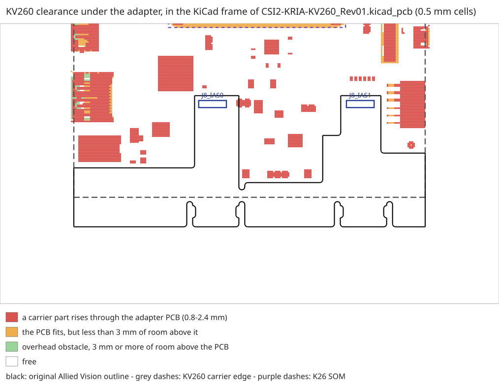

# Interface specification — phase 1

*21 September 2026 · Rev03 architecture, approved*

The pin-by-pin freeze for everything crossing between the Kria KV260 and the adapter board. What
is `[V]` here was measured; what is `[?]` still gates schematic sign-off.

*Updated 23 September 2026: §5.3 registration closed from the STEP model.*

---

## 1. What is settled and what is not

| Item | State |
|---|---|
| J8 / IAS1 connector pinout | ✅ `[V]` measured from the `.kicad_pcb` |
| Allocation of the 5 differential pairs | ✅ Frozen below |
| Single-ended allocation on J8 | ✅ Frozen below |
| Pmod J2 allocation | ✅ Frozen below |
| KV260 mechanical envelope | ✅ `[V]` measured from the official 3D model (§5) |
| Where the adapter sits within that envelope | ✅ `[V]` registered on the STEP, three independent checks — §5.3 |
| `VCCO` of the HPA bank | ✅ 1.2 V `[E, strongly supported]` — see §6 |
| Serial link electrical standard | ✅ AC coupling; Kria side `DIFF_SSTL12` with on-die termination (UG571 read, §6.3). There is no `LVDS_12`. DS925 levels still to confirm |
| Per-rail current budget | ⚠️ 18 of 24 loads from datasheets — [POWER_AND_STACKUP.md](POWER_AND_STACKUP.md) |
| 6-layer stackup and impedances | ✅ computed; fabricator to confirm |

---

## 2. J8 / IAS1 — verified pinout

Extracted from `CSI2-KRIA-KV260_Rev01.kicad_pcb`, footprint `J8_IAS0` `[V]`. Both IAS connectors on
the adapter are the same part, `AVT_KHK_Lib:J-BM20B(0.8)-34DP`, 50.040 mm apart on the X axis and
2.8 mm from the board edge `[V]`.

| Pin | Original net | Pin | Original net |
|---|---|---|---|
| 1 | *(free)* | 18 | `VCC2V75` |
| 2, 3 | GND | 19 | GND |
| 4 / 5 | `B7-CSI2-TXD0_P` / `_N` | 20 | *(free)* |
| 6 | GND | 21 | `PWDN` |
| 7 / 8 | `B7-CSI2-TXC_P` / `_N` | 22 | `I2C_SDA` |
| 9 | GND | 23, 24 | `VCC1V2` |
| 10 / 11 | `B7-CSI2-TXD3_P` / `_N` | 25 | GND |
| 12 | GND | 26 / 27 | `B7-CSI2-TXD2_N` / `_P` |
| 13 | `VCC1V8` | 28 | GND |
| 14 | `I2C_SCL` | 29 / 30 | `B7-CSI2-TXD1_N` / `_P` |
| 15 | *(free)* | 31 | GND |
| 16 | GND | 32 | `GPIO2` |
| 17 | `VCC2V75` | 33 | GND · 34 *(free)* |

Per connector: **5 differential pairs**, 4 single-ended, 4 free pins, 3 incoming rails, 11 grounds.

---

## 3. Link allocation — frozen

The architecture calls for 3 pairs receive and 2 pairs transmit ([ARCHITECTURE.md](../ARCHITECTURE.md)
§4.1). Assignment:

| Signal | Hirose pair | Pins | Direction | Rate `[E]` |
|---|---|---|---|---|
| `LINK_RX_D0±` | `TXD0` | 4 / 5 | FPGA → Kria | ≤1 Gbps |
| `LINK_RX_D1±` | `TXD1` | 29 / 30 | FPGA → Kria | ≤1 Gbps |
| **`LINK_RX_CLK±`** | **`TXC`** | **7 / 8** | FPGA → Kria | source-synchronous |
| `LINK_TX_D0±` | `TXD2` | 26 / 27 | Kria → FPGA | ≤1 Gbps |
| `LINK_TX_CLK±` | `TXD3` | 10 / 11 | Kria → FPGA | source-synchronous |

**Why the clock goes on `TXC` — now confirmed** `[V]`. The reasoning was that the pair had been the
MIPI clock lane, so it was the one most likely to land on a clock-capable SOM pin. The carrier card
schematic (XTP682, `038-05058-03-A1.pdf`, sheet 13) settles it: **that pair is `HPA05_CC`, and the
`_CC` suffix is AMD's own marking for clock capable.** A source-synchronous receiver needs its clock
on a pin that can drive a BUFG/MMCM directly; this one can.

### 3.1 SOM-side mapping — verified against the carrier schematic

Every one of the five pairs was cross-checked against XTP682 sheet 13, where the IAS1 connector is
designator `J8`, a `BM20B_0.8_-34DS-0.4V`. **All five match, polarity included** `[V]`:

| Adapter net (from `.kicad_pcb`) | Pins | Carrier net (XTP682) | SOM bank pin |
|---|---|---|---|
| `B7-CSI2-TXD0_P` / `_N` | 4 / 5 | `HPA06_P` / `HPA06_N` | HPA06 |
| **`B7-CSI2-TXC_P` / `_N`** | **7 / 8** | **`HPA05_CC_P` / `HPA05_CC_N`** | **HPA05, clock capable** |
| `B7-CSI2-TXD3_P` / `_N` | 10 / 11 | `HPA09_P` / `HPA09_N` | HPA09 |
| `B7-CSI2-TXD2_N` / `_P` | 26 / 27 | `HPA08_N` / `HPA08_P` | HPA08 |
| `B7-CSI2-TXD1_N` / `_P` | 29 / 30 | `HPA07_N` / `HPA07_P` | HPA07 |

The `_N`-before-`_P` ordering on pins 26/27 and 29/30 that §3.2 notes is **not** an adapter quirk:
the carrier is wired the same way. Both sides agree, so the pairs mate correctly — but the
constraints file still has to know.

**And B-01 is now confirmed from the primary source.** Sheet 13 is titled *"IMAGE CO-PROCESSOR FOR
IAS 0 CONNECTOR"* and shows the AP1302's sensor-side pins (`S0_CLK_DP`, `S0_D0_DP` …) wired to the
IAS0 connector, with its host-side pins (`H_CLK_DP`, `H_D0_DP` …) wired to `HPA00_CC`, `HPA01`,
`HPA02`, `HPA03`, `HPA04`. IAS0 reaches the SOM **only through the ISP**. IAS1 is direct.

### 3.2 Note on pair polarity

Three of the pairs are listed `_P` / `_N` and two `_N` / `_P` (pins 26/27 and 29/30) `[V]`. That is
how the original design routed them. Polarity inversion is harmless on a self-synchronising serial
link provided the receiver is told, but it **must be carried into the constraints file** rather than
discovered on the bench.

---

## 4. Single-ended allocation

### 4.1 On J8

| Signal | Pin | Direction | Function |
|---|---|---|---|
| `HK_SCL` | 14 | Kria → adapter | Housekeeping I2C: temperature sensor TMP1075 at 0x48, board ID EEPROM M24C02 at 0x50 (CONTROL_SPEC §2) |
| `HK_SDA` | 22 | bidirectional | Same bus |
| `FPGA_PROG_B` | 21 | Kria → adapter | Front-end FPGA reset / reconfigure (was `PWDN`) |
| `FPGA_IRQ` | **15** | adapter → Kria | Interrupt: link error, overflow, beam-update done. Active high, 47 kΩ pull-down on the adapter (R1133). **Moved from pin 32 on 25 Sep**: §4.3 |
| — | 1, 20, 32, 34 | — | Not taken. Left unconnected. Pin 32 is a clock the carrier drives (§4.3) |

### 4.2 On the Pmod J2

Eight signals at 3.3 V, 100 mA on the supply pin `[V — UG1089]`.

| Signal | Count | Function |
|---|---|---|
| `SPI_SCLK`, `SPI_MOSI`, `SPI_MISO` | 3 | Control bus to the FPGA, and through it to everything downstream |
| `SPI_CS` | 1 | Chip select for the FPGA's register file |
| `BEAM_STROBE` | 1 | Synchronous apply of a loaded beam across all ADAR1000s |
| `PPS_SYNC` | 1 | Timing reference in, for correlating detections with GPS |
| *spare* | 2 | Reserved |

**The 100 mA limit means the Pmod supply pin is for signalling only.** The adapter takes its power
from its own 12 V jack.

### 4.3 What the carrier puts on these pins `[V]`

Read in the carrier schematic XTP682 (`038-05058-03-A1.pdf`, sheets 8 and 13) on 25 September 2026.
The file is in `xtp682-kria-k26-carrier-card-schematic.zip`, which AMD distributes behind a login;
it is not in the repository.

| J8 pin | Carrier net | What drives it on the carrier | Level | Use here |
|---|---|---|---|---|
| 14 / 22 | `IAS1_I2C_SCK` / `IAS1_I2C_SDA` | Channel 1 of the TCA9546A I2C switch U18, from the SOM's `HDA00_CC`/`HDA01` | **1.8 V**, 2.21 kΩ pull-ups to `PL_1V8` | `HK_SCL` / `HK_SDA` |
| 21 | `IAS1_RESET_B` | The reset sequencer SLG7XL46528 (U19), `PL_RESET_OUT2_B`, from the SOM's `HDA04` | **1.8 V**, 10 kΩ pull-up to `PL_1V8` (R208) | `FPGA_PROG_B` |
| 15 | `HPA13_FLASH` | **Input to the SOM** through the SN74AVC4T245 U72: A side on J8 at `PL_1V8`, B side on `HPA13_P` at `PL_1V2`, 2DIR tied high (A → B) | **1.8 V** | `FPGA_IRQ` |
| 20 | `HPA13_TRIGGER` | **Output of the SOM** through the same U72: `HPA13_N`, 1DIR tied low (B → A) | 1.8 V | Not used |
| 32 | `IAS1_EXTCLK` | The clock generator Si5332 U17, `OUT2b`, 48 MHz LVCMOS, enabled whenever the PL rails are good | — | **Not connected**: see below |
| 1 | Test point TP31, not fitted | — | — | Not used |
| 34 | `VDD_AF2V8_J8`: 2.8 V through the jumper J19, **not fitted** | — | — | Not used |
| 13; 17, 18; 23, 24 | `PL_1V8`; `IAS_2V75`; `PL_1V2` | Carrier rails | — | Not used (ARCHITECTURE §9.1) |

**Why FPGA_IRQ moved.** The Rev01 adapter called pin 32 `GPIO2`, and this spec put the interrupt
there. On the carrier, pin 32 is the camera's master clock: the Si5332 drives it, and it does not
reach the SOM at all. An FPGA output on it would fight a clock driver and signal nothing. Pin 15 is
the only single-ended pin that goes **into** the SOM, through a translator whose J8 side is 1.8 V,
the level of bank 35. The pull-down is needed because the FPGA's pins float until it is configured
(PUDC_B high), and a CMOS translator input must not float.

**The levels are now verified.** All four signals are 1.8 V on the carrier, so bank 35 at 1.8 V is
right and the `[E]` in CONTROL_SPEC §1 is closed. The SLG's reset output, pulled up to 1.8 V, meets
the 74LVC1G07's V<sub>IH</sub> of 0.65 × 1.8 V = 1.17 V.

---

## 5. Mechanical envelope — measured

### 5.1 What was measured

From the official 3D CAD model (XTP679), `KV260V2-Starter-Kit.stl`, 1,320,454 triangles, by
`_work/kv260_envelope.py` `[V]`:

| | Value |
|---|---|
| Overall bounding box | **140.00 × 123.10 × 35.84 mm** |
| X range | −10.00 … 130.00 |
| Y range | −11.57 … 111.53 |
| Z range | −7.09 … 28.75 |
| Anything above 40 mm | **nothing** |

### 5.2 The obstacles an adapter has to clear

| Height above the model's Z minimum | Footprint | Area |
|---|---|---|
| > 10 mm | X −4 … 124, Y −11.6 … 110.4 | 6,216 mm² |
| > 20 mm | X 58 … 112, Y 18.4 … 110.4 | 3,660 mm² |
| > 30 mm | X 60 … 110, Y 18.4 … 74.4 | 2,584 mm² |
| > 35 mm | X 62 … 108, Y 18.4 … 72.4 | 1,396 mm² |

The block above 30 mm — roughly **50 × 56 mm** — is the fansink. It is the dominant obstacle. The
band above 20 mm that extends to high Y is the rear I/O (USB, Ethernet, video).

**The useful conclusion:** an adapter sitting at Hirose stacking height, a handful of millimetres
above the carrier PCB, **cannot pass over the fansink**. It can extend freely over the low regions.

### 5.3 Registration and growth direction — measured `[V]`

**Closed without touching the hardware.** Neither the STL nor the `.brd` could do it, but the
**STEP** the STL was made from can. It is a Creo assembly with every part named and every placement
stored as a transform, so the IAS connectors can be found by name instead of by shape.

**Why the STL search failed.** `_work/kv260_locate_ias.py` looked for bodies of about
11.6 × 2.9 mm. The STEP shows the carrier's IAS connector is **9.38 × 2.40 × 0.80 mm**. At 0.8 mm
tall it is nearly flush with the board, so it was never going to show up as a separate body.

#### How it was done — three sources, three independent checks

| Source | What it gives |
|---|---|
| **STEP** (`_work/kv260_step_locate.py`) | Two instances of `CONN_928X90X80_38P` at X 21.647, Y 11.986 and Y 62.024: **50.038 mm apart**. The adapter's pair is 50.040 mm apart, and that match is what identifies the part |
| **XTP681 plot** (`default.pdf`) | It has no text layer, but its silkscreen **renders**. **J7 (IAS0) is the +Y connector, J8 (IAS1) the −Y one**, and the pin-1 marks are at the −Y end |
| **Our `.kicad_pcb`** | `J8_IAS0` and `J8_IAS1` on the bottom face, with their pad 1 |

`_work/kv260_register_adapter.py` builds the rigid transform (adapter → carrier: **rotation
−90.00°**, residual **2 µm** at the second connector) and then checks it three ways. None of the
three was used to build it:

| Check | Result |
|---|---|
| 1. The adapter's pad 1 lands on the carrier connector's pin-1 end | ✅ 3.20 mm towards −Y, where the silkscreen draws the mark |
| 2. The original Allied Vision outline is a product that fits, so nothing may rise through it | ✅ 11,948 of 11,958 cells clear. The other 10 are **J18**, below |
| 3. The adapter's two M3 holes land on the carrier's corner holes | ✅ **both within 5 µm**. Holes have nothing to do with the connectors |

Check 3 also answers a mechanical question: the original board is not cantilevered off two 0.8 mm
connectors. It **screws down through the KV260's own corner holes**, the same ones the rubber feet
sit under.

**The original board, seen from the carrier:** 119.00 × 44.50 mm (the designer's own dimensions in
`Dwgs.User` agree). It lies along the carrier's side edge, **flush with the front and rear edges**
(Y −10.00 and 109.00), and overhangs the side by 10 mm. It is U-shaped, with one tongue reaching each
IAS connector.

#### Which way it can grow



The map is drawn in the KiCad frame of `CSI2-KRIA-KV260_Rev01.kicad_pcb`, so it reads the way the
board is edited. Red means something on the carrier rises through the adapter's PCB. The adapter
sits at **0.8 mm** above the carrier (the Hirose mated height), so any part taller than that
collides, and nothing can be fitted on the adapter's underside.

| Direction on the carrier | In KiCad | Clear |
|---|---|---|
| **Outward, off the carrier's side edge** | **down (+Y)** | **25+ mm along the full 119 mm — nothing at all in the model** |
| Past the front edge | right (+X) | 25+ mm for the part already off the carrier; 2–8.5 mm over it |
| Past the rear edge | left (−X) | 25+ mm for the part off the carrier; 8.5–16.5 mm for the IAS0 tongue |
| Inward, towards the SOM | up (−Y) | **1.5–5 mm** almost everywhere. The carrier is crowded |

**The answer: grow outward, off the side of the KV260.** Every other direction runs into the carrier
within a few millimetres. The same 119 mm length, growing outward. *At layout (25 Sep) the board
became 119 × 120 mm (132 mm since 10 October 2026), not the ~90 estimated here: the parts' courtyards need it
([LAYOUT.md](LAYOUT.md) §1). The overhang past the carrier edge is 85 mm, with three supports.*

**That overhang needs a support at its outer edge**, because two corner screws are not enough for a
board carrying an FPGA and SMA connectors. The model gives the height exactly: the rubber feet reach
**Z −7.085**, so from the adapter's underside (Z +0.8) to the surface the KV260 stands on is
**7.9 mm**. An 8 mm M3 standoff under the outer edge lands on the same plane.

#### A constraint the original design only just meets: J18

**J18** is the IAS0 autofocus jumper (`VDD_AF2V8` → `VDD_AF2V8_J7`, XTP682 p. 13): a 2-pin header,
**fitted**, with a 2.4 mm body and pins to 7.5 mm. Its IAS1 twin, J19, is `DNP`. Allied Vision
cut a notch for it, but in the official model the notch edge (KiCad X 144.901) **overlaps the
header body by 1.0 mm**, 20 % of its footprint.

The model can't tell whether that's real or a generic header drawn slightly too large. It doesn't
matter for Rev03: **keep the board edge at least 1.5 mm clear of KiCad X 143.9–149.0, Y 84.0–86.5**
(the header body in the Rev01 frame). J18 can stay where it is either way. It feeds J7 **pin 34**
only, and the adapter leaves pin 34 of both connectors unconnected: no net on the pads in the
`.kicad_pcb` or in the exported netlist, and §4.1 lists it as free.

#### Reproducing it

```
py _work/kv260_register_adapter.py KV260V2-Starter-Kit.stp KV260V2-Starter-Kit.stl --svg docs/img/kv260_clearance.svg
```

Both model files are the official XTP679 download (not redistributed here). It runs in about 20 s.

---

## 6. `VCCO` of the HPA bank — 1.2 V, on strong evidence

Everything electrical about the link depends on the `VCCO` the KV260 applies to the SOM bank behind
J8. XTP682 does not print a net called `VCCO_HPA`, so this is **not a direct citation**. But the
evidence points one way and it is worth setting out, because the design decision hangs on it.

**What is verified** `[V]` in XTP682:

1. The carrier has a dedicated **`PL_1V2` regulator**, enabled by `VCCOEN_PL_M2C` — the signal the
   SOM asserts when it wants the carrier to bring up the PL's `VCCO` rails.
2. `PL_1V2` is routed to the SOM connector (sheet 6).
3. On sheet 13 the AP1302's MIPI I/O supplies, **`HMIPI_VDD` and `SMIPI_VDD`, are tied to
   `PL_1V2`**.
4. That AP1302 host interface is what drives `HPA00_CC`, `HPA01` … `HPA04` into the SOM.

For a device whose MIPI I/O runs from a 1.2 V rail to signal into the SOM's HPA bank, that bank has
to be at 1.2 V as well. **`VCCO_HPA` = 1.2 V** `[E, strongly supported]`.

### 6.1 What that means for the design

| Consequence | |
|---|---|
| The Kria side of the link runs **`DIFF_SSTL12`** (§6.3) | Not `LVDS`: at 1.2 V it is input-only and without internal termination. (Until 12 Nov this said `LVDS_12`, a standard that does not exist) |
| The ADC's ANSI LVDS output sits at 1.2 V common mode | Into a 1.2 V bank there is no headroom → **AC coupling and re-biasing are required** |
| The Pmod is on a 3.3 V HD bank | So the single-ended control signals **do** need level translation |

**This is the case the mitigation was designed for, so it stops being a contingency and becomes the
baseline:** series AC-coupling capacitors on all five pairs, with 0 Ω links as the alternative
stuffing option. Ten footprints. If a later measurement shows 1.8 V, they get stuffed with 0 Ω and
nothing is lost.

### 6.2 `[?]` How to turn this from strong evidence into a fact

Either read `VCCO_HPA` directly in the **K26 SOM datasheet (DS987)** pin table, or measure the rail
on an assembled board. Neither is urgent: the design that follows from 1.2 V also survives 1.8 V,
because the AC coupling is stuffable.

### 6.3 The link's I/O standard on the Kria side: what UG571 says (12 Nov)

Read in AMD's *UltraScale Architecture SelectIO Resources*, UG571 v1.9. It covers the K26's HP
banks.

**There is no `LVDS_12`.** In an HP bank, `LVDS` is an output only at VCCO = 1.8 V
(Table 1-77).

**`LVDS` as an input at 1.2 V is allowed, under three conditions** (Table 1-77, note 1; LVDS
section):
- **No internal termination:** `DIFF_TERM_ADV = TERM_NONE`. The 100 Ω would have to be an
  external resistor *"placed physically close to the device inputs"*. Those inputs are inside the
  SOM, so this board cannot place it.
- **The input levels meet the data sheet's VIN and VIDIFF**, which may need an external circuit
  that both AC-couples and DC-biases the pins.
- **Internal bias needs equalisation.** `DQS_BIAS = TRUE` is an internal bias for AC-coupled
  `LVDS` inputs, and it requires `EQUALIZATION = EQ_LEVEL0`…`4`.

**`DIFF_SSTL12` fits a 1.2 V bank.** It is an input and an output at VCCO = 1.2 V.
- As an input it has an on-die split termination, `ODT = RTT_40 / RTT_48 / RTT_60`: two resistors
  of 2R, one to VCCO and one to ground (*"Uncalibrated Input Termination"*). Each leg sees R to
  0.6 V. `RTT_48` gives about 96 Ω across the pair and re-biases the AC-coupled pair at the same
  time. Note 2 requires VCCO to be 1.2 V when ODT is used: here it is.
- As an output its source impedance is set with `OUTPUT_IMPEDANCE = RDRV_40_40 / 48_48 / 60_60`.

**The baseline from now on:**

| Direction | Kria side | Level at the receiver, estimated | Change to this board |
|---|---|---|---|
| `LINK_RX_*` (FPGA → Kria) | `DIFF_SSTL12` input, `ODT = RTT_48` | The Artix-7's `LVDS_25` current (about 3.5 mA) into 96 Ω: about ±0.34 V | None: the capacitors stay, the SOM terminates and biases |
| `LINK_TX_*` (Kria → FPGA) | `DIFF_SSTL12` output, `OUTPUT_IMPEDANCE = RDRV_60_60` | 1.2 V × 50 / (60 + 50) ≈ 0.55 V differential across R101–R104 | None |

**On the transmit side, keep 60 Ω.** `RDRV_48_48` would give 0.61 V, above the 0.6 V maximum
VIDIFF of the Artix-7's `LVDS_25` input. That 0.6 V is from memory, to confirm in DS181.

**Two caveats.**
- UG571 says SSTL12 *"should only interface with SSTL12"*. Receiving an LVDS driver with
  `DIFF_SSTL12` is common practice, and AMD's answer record AR 66786 names it as the alternative.
  Even so, it is outside the standard, and the bring-up test (IAS_LINK_SPEC §6) is what proves it.
- DS925 could not be read here. Two things are still to confirm there: `DIFF_SSTL12`'s input
  threshold, and the rate ceiling at the K26's −2LV grade. The eyes of `LINK_TX` are still to be
  re-simulated with an SSTL12 driver in place of the LVDS model.

**`IDELAYE3`** (UG571 Table 2-12): 512 taps; in `TIME` mode up to **1.1 ns** on UltraScale+,
about 2 ps per tap. That is just over one 1 ns bit.

---

## 7. Exit criteria for phase 1

| Criterion | State |
|---|---|
| Pin map of J8 and the Pmod frozen | ✅ §3, §4 |
| SOM-side mapping verified | ✅ §3.2, against XTP682 |
| Clock pair on a clock-capable pin | ✅ §3.2, `HPA05_CC` |
| Mechanical envelope measured | ✅ §5.1, §5.2 |
| `VCCO` and the link's I/O standard | ✅ §6, 1.2 V; AC coupling, `DIFF_SSTL12` on the Kria side (§6.3) |
| ADC/DAC operating points fixed | ✅ [ARCHITECTURE.md](../ARCHITECTURE.md) §5 |
| Growth direction within the envelope | ✅ §5.3 — registered on the STEP; grow outward, off the carrier's side |
| Per-rail current budget from datasheets | ⚠️ 18 of 24 loads verified — [POWER_AND_STACKUP.md](POWER_AND_STACKUP.md) |
| 6-layer stackup with computed impedances | ✅ computed; ⬜ fabricator's field solver to confirm |

Nothing in this list needs the hardware any more. What remains is the fabricator's impedance
confirmation and the nine power figures still estimated.
