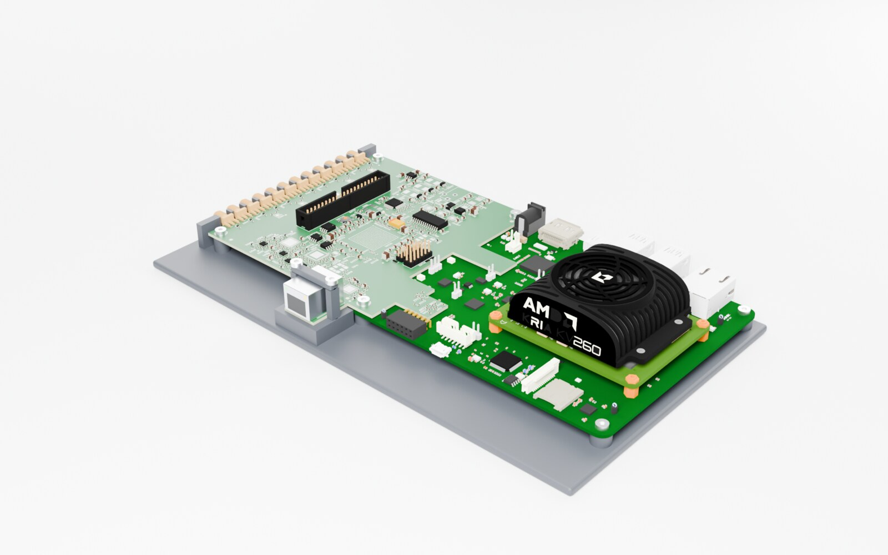
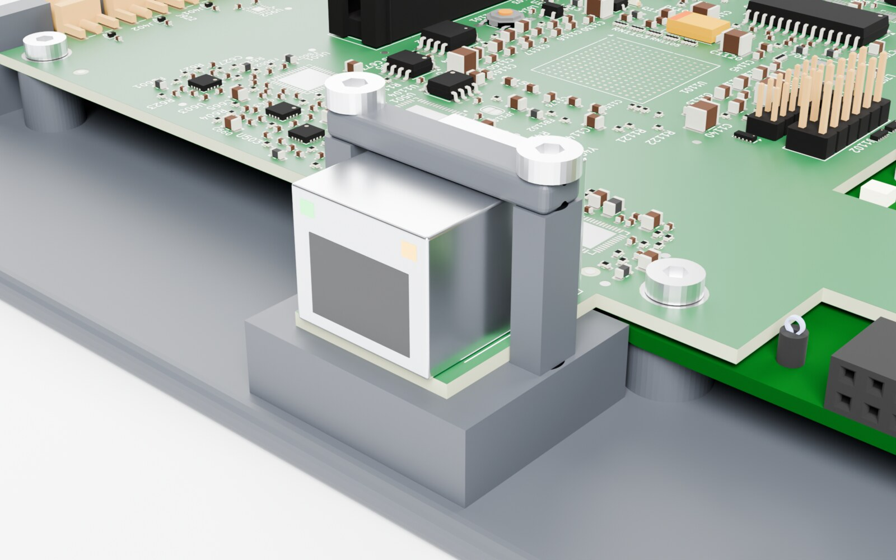
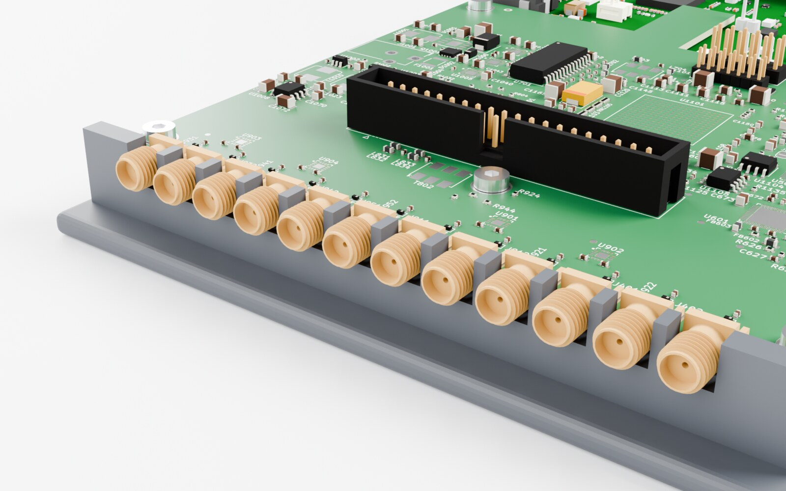
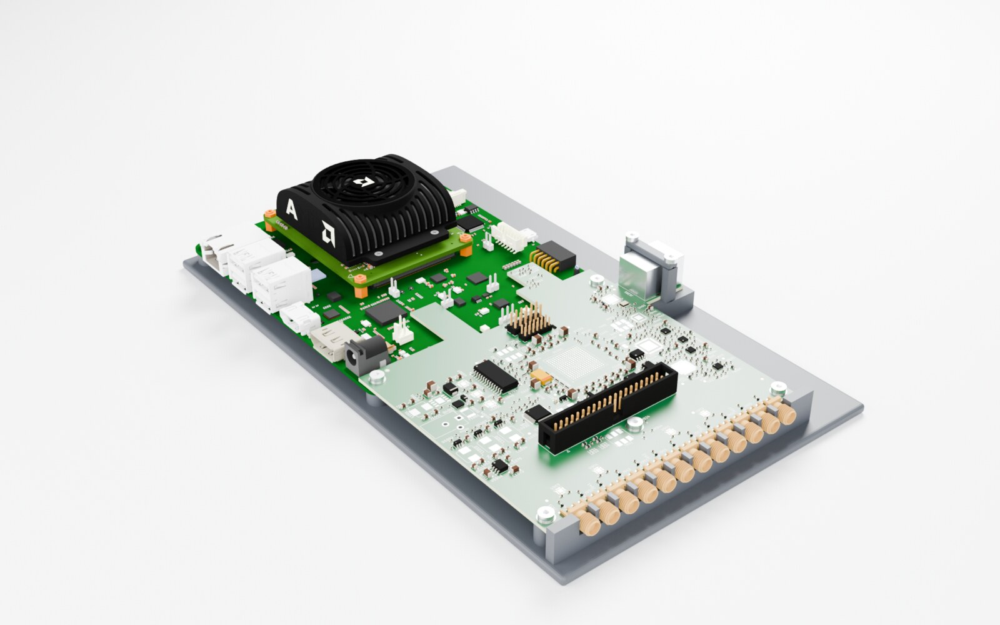
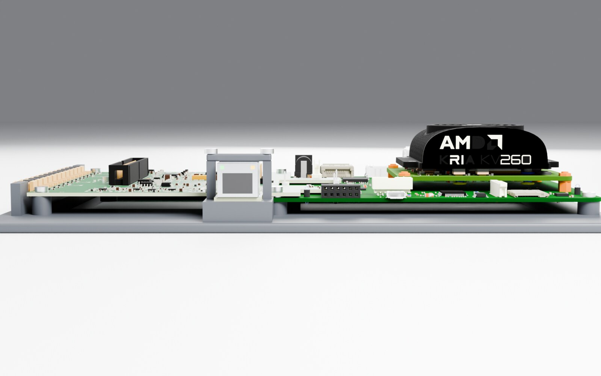

# Mounting the adapter on the KV260

*13 November 2026*

The adapter plugs into the KV260's two IAS connectors (Hirose BM20B, 0.8 mm mated height), screws
through the carrier's two corner holes beside them (H1, H2), and overhangs the carrier's side by
97 mm, where three supports (H3–H5) carry it. A 0.8 mm connector stack and two screws do not make a
rigid assembly for a board with twelve SMAs and an RJ45 on a tab. This is a printed base that holds
the KV260 and the adapter together, takes the connectors' forces, and stands on the bench.



## 1. What it is

**One printed base plate, 254 × 149 mm, 4 mm thick**, whose top face is the plane the KV260 stood on
(the bottom of its rubber feet, Z −7.11 in AMD's model). On it:

| Part | Where | What it does |
|---|---|---|
| **4 carrier posts**, Ø9 mm, 5.5 mm tall | Under the carrier's four corner holes, in place of its rubber feet | Hold the KV260; an M3 heat-set insert in each |
| **3 adapter posts**, Ø8 mm, 7.9 mm tall | Under H3, H4, H5 | Carry the overhang (LAYOUT §2: the supports were sized for 8 mm standoffs to this same plane) |
| **SMA front wall**, 4 mm thick, 12 slots | Just past the adapter's outer edge, around each SMA's 6.35 mm square body, below its thread | Takes the torque of tightening an SMA cable, so it does not reach the board or the solder joints. The slots are open at the top: the board drops in |
| **RJ45 pedestal** | Under the Ethernet tab, from the plate to the tab's underside | Supports the tab from below; a pocket clears the jack's through-hole pins |
| **RJ45 strap** (separate part) | Over the jack, screwed into the pedestal either side of the tab | Clamps the jack and the tab onto the pedestal: plugging and unplugging a cable loads the strap, not the tab's neck |
| 2 windows | Under the carrier and under the adapter's open middle | Air for the carrier's underside; less plastic |





## 2. Assembly

1. Peel the KV260's four rubber feet off.
2. Press M3 heat-set inserts (M3 × 5.7 mm, Ø4.0 mm hole) into the seven posts and the pedestal's two holes.
3. KV260 on the carrier posts; **M3 × 6** at its two far corners (the ones the adapter does not use).
4. Adapter onto the IAS connectors, with a **0.8 mm spacer** (M3 washer, Ø6 mm) between the adapter and
   the carrier at H1 and H2: the board sits 0.8 mm above the carrier there, and the screw must not pull
   it down onto the connectors. **M3 × 8** through the adapter, spacer and carrier into the posts.
5. **M3 × 6** at H3, H4 and H5.
6. The strap over the RJ45, **2 × M3 × 20** into the pedestal.

Nothing on the adapter changes: H1–H5 and their positions are as in LAYOUT §2.

## 3. How it was made, and how far to trust it

- **The KV260** is AMD's own model (XTP679, `KV260V2-Starter-Kit.stp`). It is not redistributed here;
  download it from AMD to rebuild. The adapter is placed on it by INTERFACE_SPEC §5.3's registration
  (the two IAS connectors; the corner holes land within 5 µm).
- **The heights come from that model**: the carrier's PCB at Z −1.59…0, its rubber feet down to −7.11,
  its lowest underside part at −4.7 (well clear of the plate), nothing past its front edge where the
  pedestal stands (one connector, P1, sticks out 1.6 mm, 50 mm away).
- **The RJ45** is drawn at the HR911130C's data sheet size (15.9 × 21.3 × 13.5 mm): its footprint has no
  3D model. Check the strap's height on a real part before printing it.
- **The SMA wall** is placed from KiCad's 3D model of the SMA (Samtec SMA-J-P-H-ST-EM1): its body and
  thread are both 6.35 mm across, from the board edge out to 9.5 mm. Check that the wall sits on the body,
  not on the thread, with the real part.
- **Not checked:** print tolerances (the slots are 6.7 mm for a 6.35 mm body), the bed size (254 mm
  needs a 256 mm bed; otherwise split the plate at the carrier's edge, X −10, with a lap joint), and the
  KV260's fan airflow with the base under it (the fan blows up, away from the plate).

## 4. Files and rebuilding

| | |
|---|---|
| `mech/mount_base.stl`, `mech/mount_rj45_strap.stl` | The two printed parts, in mm. PETG, 0.2 mm layers, 4 perimeters, 30 % infill |
| `_work/mech/build_mount.py` | Builds the scene in Blender (KV260, adapter, mount) and writes the STLs |
| `_work/mech/render_mount.py` | The renders (Cycles, GPU) |
| `_work/mech/step2glb.py` | AMD's STEP to glTF, with its colours (OpenCascade's Python bindings, `pip install cadquery-ocp`) |

```
python _work/mech/step2glb.py KV260V2-Starter-Kit.stp _work/mech/cache/kv260.glb 0.08
kicad-cli pcb export glb --subst-models --include-tracks --include-pads --include-zones \
  --include-silkscreen --include-soldermask --user-origin 0x0mm -o _work/mech/cache/board.glb \
  CSI2-KRIA-KV260_Rev01.kicad_pcb
blender -b --factory-startup --python _work/mech/build_mount.py -- --stl mech
blender -b _work/mech/cache/assembly.blend --python _work/mech/render_mount.py -- iso,iso_back,rj45,sma,side
```




