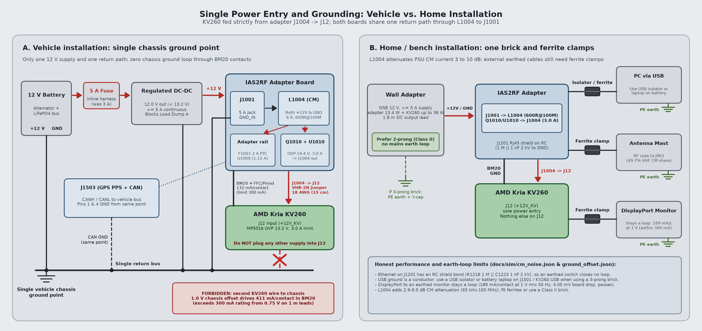
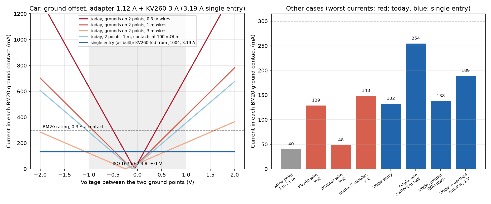
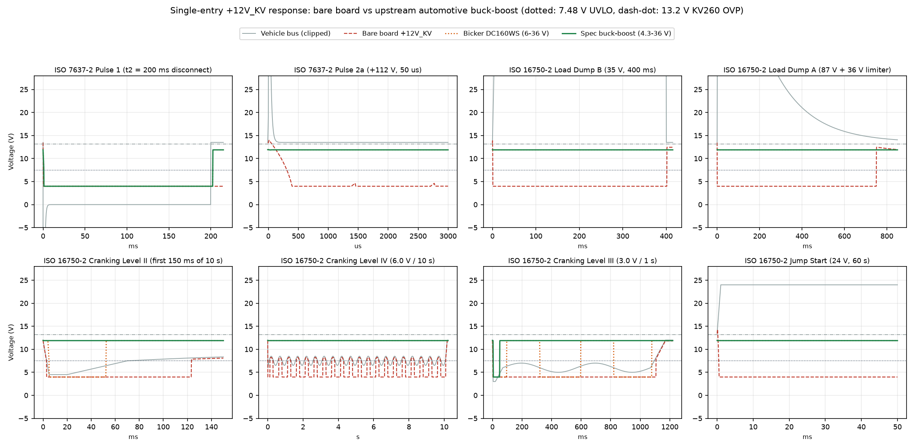
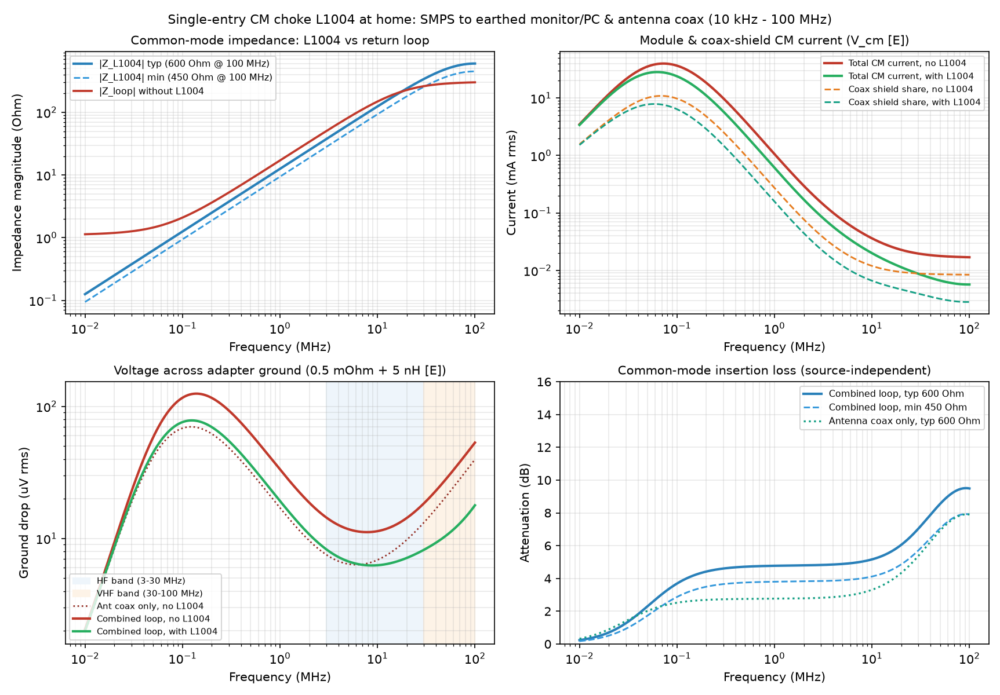

# POWER sheet: specification and review guide

*25 September 2026 · `rev03/POWER.kicad_sch` (A2) · drawn by `_work/sheets/power.py` from the
connection list in `_work/sheets/power_spec.py`*

The whole power tree on one sheet. Every regulator circuit is its datasheet's typical
application, with the values read from the datasheet's own table. The loads and the regulator
sizing are in [POWER_AND_STACKUP.md](POWER_AND_STACKUP.md) §1, recomputed by `_work/power_budget.py`
for the tree as drawn.

```
J1001 (12 V, 5 A) -> L1004 (6 A CMC, both lines) -> VIN_J
  |-- F1001 PTC -> SMCJ33CA -> Q1001/Q1003 (LM74502-Q1 U1009, OVP 18.3 V) -> SMBJ18CA -> +12V  (adapter, 1.12 A worst)
  +-- Q1010 (DMT10H015LFG) -> U1010 (TPS26631, OVP 14.4 V, ILIM 3.0 A) -> SS34 -> +12V_KV -> J1004 (§1.4)
+12V   ─ U1001 LMR33630  buck ─► +5V0    2410 mA   (3 A part)
+5V0   ─ U1002 TPS563201 buck ─► +3V3_D  1891 mA   (3 A part; a 2 A TPS562201 until the Rev08 audit)
       ─ U1003 TPS562201 buck ─► +2V5     601 mA   FPGA LVDS banks, and feeds +1V8_A
       ─ U1004 TPS562201 buck ─► +1V0     735 mA   FPGA VCCINT, at 1.017 V (R1031 3.24 k)
       ─ U1007 TPS7A8300 LDO  ─► +3V3_A   100 mA   DACs' AVDD
+2V5   ─ U1005 TPS7A8300 LDO  ─► +1V8_A   500 mA   ADCs' AVDD, at 1.85 V
       ─ divider              ─► +1V2       1 mA   link termination bias
+3V3_D ─ U1006 TPS7A8300 LDO  ─► +1V8_D   629 mA   FPGA VCCAUX, ADCs' DRVDD, at 1.85 V (50 mV pin grounded)
       ─ U1008 LM2663         ─► −3V3       8 mA   RF switches' VEE
       ─ U1315 LP5907-2.8 LDO ─► +2V8_RF  180 mA   Rev08 VHF/UHF front end (RX_VU sheet)
```

Input at `+12V` (adapter only, 70 °C, maximum process, bias tee at its limit, CAN dominant, fan on): 1.12 A at 12 V, 13.4 W;
typical 0.97 A, 11.7 W. The FPGA rails come from Vivado's power report, which the budget lacked until the Rev08 audit
of 18 November; four loads were also added then (Ethernet PHY, CAN transceiver, fan and bias tee,
[AUDIT_Rev08.md](AUDIT_Rev08.md) §2.1). With the single power entry feeding the KV260 through `J1004` (§1.4; KV260
0.92 A idle, 3.0 A brick rating, `U1010` 2.98 A nominal / 2.77 to 3.19 A at ±7 % with `R1043` 6.04 kΩ), **`J1001` and
`L1004` carry 1.89 A typical, 4.12 A at the KV260 rating, and 4.31 A worst case** within `J1001`'s 5 A rating.

---

## 1. Parts, and where each circuit comes from

| Block | Part | Circuit from | Datasheet |
|---|---|---|---|
| +5V0 | **LMR33630ADDA**, 400 kHz | Figure 9-1, Table 9-2, row *400 kHz, 5 V*: L 8 µH, COUT 4 × 22 µF, RFBT 100 k, RFBB 24.9 k, CIN 10 µF + CHF 220 nF, CBOOT 100 nF, CVCC 1 µF. EN tied to VIN (*"Can be connected directly to VIN"*), PG left open (*"Can be left open when not used"*) | SNVSAN3F, from ti.com (`_work/fetch_datasheets.py`) |
| +3V3_D | **TPS563201**, 580 kHz (3 A; was TPS562201 until the Rev08 audit, P5) | Figure 7-1 and Table 7-2: same pin-out and 0.768 V reference; R2 10 k, R1 33.2 k, L 3.3 µH (SRP7028A), COUT 2 × 22 µF, CIN > 10 µF + 0.1 µF | SLVSCI8 / SLVSD91D |
| +2V5, +1V0 | **TPS562201**, 580 kHz (2 A) | Figure 7-1 and Table 7-2: R2 10 k; R1 22.6 k (`+2V5`) / **3.24 k** (`+1V0` at `1.017 V`; was `3.09 k` before the Rev08 audit, P7); L 3.3 / 2.2 µH; COUT 2 × 22 µF; CIN > 10 µF + 0.1 µF; VBST 0.1 µF; EN pulled up by 10 k (Figure 7-1's R3) | SLVSD91D, AERIS-10 folder |
| +1V8_A, +1V8_D, +3V3_A | **TPS7A8300RGR** | Figure 51, ANY-OUT: SNS to OUT, 10 nF feed-forward OUT→FB, 10 nF on NR/SS, EN to IN, BIAS open (*"VIN ≥ 1.4 V ... BIAS pin can be left floating"*). CIN 10 µF, COUT 22 µF (Pin Functions). Voltage set by grounding pins (Table 2): `+1V8_A` = 1.85 V (50 mV + 200 mV + 800 mV pins, 12 Nov: copper/ferrite drop); **`+1V8_D` = 1.85 V** (50 mV pin grounded too since the Rev08 audit, P4: keeps VCCAUX at 1.714–1.873 V at the balls); `+3V3_A` = 100 mV + 800 mV + 1.6 V pins | SBVS197F, AERIS-10 folder |
| −3V3 | **LM2663M** | Pin Functions: SD to GND for normal operation, LV to GND below 3.5 V in, OSC open. 47 µF flying and output capacitors, as its Electrical Characteristics are measured with | SNVS002E, AERIS-10 folder |
| +1V2 | Divider, 1.10 k / 1.02 k, 1 µF | 2.5 V × 1.02 / 2.12 = 1.203 V | none |

The four regulator symbols are new, each transcribed from its datasheet's pin table. KiCad has an
LMR33630 symbol, but it inherits from another one (`extends`), which the generator doesn't
support.


### 1.1 Input protection for a vehicle supply (Rev05, 13 Nov)

The RF review of 13 November (finding B1) was right: the old chain was jack, PTC, a −30 V P-MOSFET and only
then the TVS. ISO 7637-2 pulse 1 (−150 V from 10 Ω, LM74502-Q1 datasheet §10.2.3) puts its whole amplitude
across that MOSFET before anything clamps. The input is now TI's 12 V battery design (LM74502-Q1 datasheet
SNOSDE0A, Figure 10-1), oversized where the board allows it:

| Part | Value | Why |
|---|---|---|
| F1001 | PTC **2.0 A hold**, 24 V, mSMD200-24V (1.5 A until the Rev08 audit, P3: that one tripped above 60 °C at the audited load) | Ahead of everything. It holds 1.32 A at 70 °C, against 1.12 A worst case at 12 V and 1.28 A at 10.5 V ([AUDIT_Rev08.md](AUDIT_Rev08.md) §2.3). Only a sustained input above the TVS breakdown (36.7 V) can trip it: an abnormal fault, see the limits below |
| D1003 | **SMCJ33CA**, bidirectional, 1500 W, at VIN_F | Breakdown ≥ 36.7 V: above the 24 V jump start and the 35 V suppressed load dump (ISO 16750-2 test B), as §10.2.3 requires; ≥ 16 V reverse battery. Clamps pulse 1 to about 47–53 V at 15 A. TI's design uses the 600 W SMBJ33CA; the SMC part doubles its energy rating |
| Q1001, Q1003 | **DMT10H015LFG**, 100 V, 13.5 mΩ at 10 V, PowerDI3333-8 | Back to back, common source. With the TVS clamping pulse 1 at −53 V and the output held at +12 V by its capacitors, the blocking FET sees about 65 V: TI's 60 V example would have no margin. VGS(max) ±20 V > the 13.9 V gate drive (§10.2.2.2). Q1001 keeps its footprint |
| U1009 | **LM74502-Q1** (SOT-23-8) | 3.2–65 V, −65 V reverse (Features), charge pump 12.4 V, 60 µA gate source, 2 A sink |
| R1004, R1005 | 100 k / 7.32 k (0603) | Overvoltage cut-off. V<sub>OVR</sub> = 1.165 / 1.25 / 1.333 V (§7.5) gives **17.1 / 18.3 / 19.5 V**. That is above the 14.8 V a charging alternator gives and below D1001's 20.0 V minimum breakdown, so D1001 never conducts steadily. 171 µA in the divider against 110 nA OV leakage |
| C1090 | 100 nF 100 V at VS | Pin Functions: "Connect a 100-nF capacitor across VS and GND" |
| C1091 | 220 nF 25 V, VCAP to VS | §10.2.2.4: ≥ 10 × C<sub>ISS</sub> of the two FETs; TI's value |
| D1001 | **SMBJ18CA** on +12V (was SMBJ15CA) | Catches the microseconds before the OV comparator opens the FETs, at ≤ 29 V: inside the 36 V of the LMR33630 and a brief overshoot for the 25 V input capacitors. Its 20 V minimum breakdown keeps it off below the cut-off |

EN/UVLO is tied to VS (always on). The +12V rail now sees at most about 19.5 V steady state; anything above
opens both FETs and the board resets, which is the intended response to a load dump or a 24 V jump start.

**Layout.** Q1001 stays where it was on the top side. U1009, Q1003, D1003, C1090 and C1091 are on the bottom
under the jack, outside the KV260's outline (y > 117.25 mm), where the bottom was empty; R1004 and R1005 take
D1002's and R1001's place on the top. DRC with zones refilled and schematic parity: 0 errors, 0 unconnected,
0 parity issues (one warning: D1003's flipped footprint differs from the library copy in its silkscreen only).

**Limits, said plainly.**
- A sustained input above 36.7 V (an unsuppressed load dump, or a 24 V system's alternator fault) makes D1003
  conduct; the PTC then trips with more than its 24 V rating across it. An 1812 PTC rated 60 V at 2.0 A does
  not exist (the 1812 `mSMD200-24V` is 24 V). Fit the vehicle harness with a **5 A** inline fuse (updated from 3 A
  for the single power entry in §1.4) in any case.
- The new parts are not in [JLCPCB_QUOTE.md](JLCPCB_QUOTE.md) yet; LCSC stock of the DMT10H015LFG was not
  confirmed (alternative: any 80–100 V N-FET, ≤ 20 mΩ at 10 V, VGS ±20 V, in PowerDI3333-8).
- The enclosure's tray honeycomb must be pocketed under the new bottom parts (D1003 is 2.3 mm tall) before
  printing: see [ENCLOSURE.md](ENCLOSURE.md).

---

### 1.2 Fan header for enclosure v2 (Rev06, 14 Nov)

`_work/rev06_fan.py`. **J1002** (JST PH 2-pin, vertical, LCSC C131337): pin 1 FAN_5V, pin 2 GND, for a 50 × 50 ×
10 mm 5 V fan (docs/ENCLOSURE.md section 6). **F1002**, a 0.5 A-hold 1206 PTC (SMD1206P050TF, C43379), keeps a
shorted fan lead from pulling +5V0, and the whole board, down; **C1092** 10 µF holds the motor's commutation current
at the header. Always on: the FPGA has no escapable ball left for PWM or tach, and HK_ALERT (TMP1075) would leave the
fan off at power-up, the wrong failure. Placed near the input section, through-hole, outside the carrier's
footprint (LAYOUT §1). The fan's ~0.1 A adds about 2 % to +5V0's load (LMR33630, 3 A).

---

### 1.4 Single power entry and the KV260 output (Rev08, 19 Nov)





Why (`_work/power/ground_offset.py`, `docs/sim/ground_offset.json`). With the KV260 and the adapter on separate
vehicle grounds, their boards are bridged by the 22 ground contacts of the two BM20 connectors (`J101`/`J102`), the FFC
and the Pmod cable: 1.29 mΩ typical total (3.79 mΩ with contacts at 100 mΩ maximum), with the BM20 contacts carrying
94.3 % of any link current (83.3 % at max contact resistance) against a 0.30 A per-contact rating. At the ISO 16750-2
section 4.8 ground offset of 1.0 V, the inter-board loop drives 411 mA per BM20 contact on 1 m leads (exceeding 0.30 A
from 0.75 V), 355 mA at max contact resistance (from 0.85 V), 714 mA on 0.3 m leads (from 0.40 V) and 203 mA on 3 m leads
(from 1.60 V). Even grounded to the same point, unequal wire lengths (0.3 m / 2.0 m) drive 84 mA per contact (40 mA on
1 m / 1 m), and losing the KV260 ground wire puts 129 mA per contact (3.00 A on the link) across the BM20s. The KV260's
own input eFuse (`MP5016`, XTP682 p. 3) also cuts off above 13.2 V, below the adapter's 18.3 V OVP.

With single-entry power, **the KV260's own DC return runs through the BM20 ground contacts by design**: the BM20 link is
1.3 mΩ (1.29 mΩ) against the 150 mm 18 AWG jumper's 33 mΩ (33.1 mΩ), so 96 % of the KV260's return crosses the BM20
link. That is why `U1010` limits the KV260 to its brick's 3 A rating (2.98 A nominal, 2.77 to 3.19 A at ±7 % with
`R1043` 6.04 kΩ; at 3.6 A, one contact at half resistance carried 305 mA, over the 300 mA rating):

| Case (`docs/sim/ground_offset.json`) | Inter-board link | Per BM20 contact | Against 0.30 A rating |
|---|---|---|---|
| Separate grounds, same point (1.0 m / 1.0 m) | -0.93 A | 40 mA | Pass |
| Separate grounds, same point (0.3 m / 2.0 m) | -1.96 A | 84 mA | Pass |
| Separate grounds, 1.0 V offset (1 m typ / max R) | 10.2 / 9.9 A | 411 mA / 355 mA | **Fail** (from 0.75 V / 0.85 V) |
| Separate grounds, 1.0 V offset (0.3 m / 3.0 m typ) | 17.7 / 5.0 A | 714 mA / 203 mA | **Fail** on 0.3 m (from 0.40 V) / Pass on 3 m (1.60 V) |
| Separate grounds, KV260 ground wire lost | 3.00 A | 129 mA | Pass (surviving jack 4.12 A) |
| Single entry, typical KV260 load (0.92 A) | -0.89 A | 38 mA | Pass |
| Single entry, at `U1010` limit (3.19 A) | -3.09 A | 132 mA | Pass |
| Single entry, contacts at 100 mΩ maximum | -2.88 A | 109 mA | Pass |
| Single entry, one contact at half resistance (3.19 A / 0.92 A) | -3.09 A / -0.89 A | 254 mA / 73 mA | Pass |
| Single entry, one contact at a third of the others' resistance (2 A) | | 219 mA | Pass |
| Single entry, one contact at a third (3.19 A; the other 21 typical / at 100 mΩ max) | -3.09 A | 352 mA / 306 mA | Over 0.30 A, pass on heat: 1.86 mW / 3.13 mW in that contact |
| Single entry, jumper ground contact open (typ / max R) | -3.21 A | 138 mA / 122 mA | Pass |
| Home, single entry, earthed monitor 50 Hz (1.0 V / 0.1 V) | 3.27 A / 0.33 A loop | 189 mA / 133 mA | Pass (4.05 mV / 405 uV adapter drop) |

The 0.30 A rating is a heating limit: Hirose derives its ratings from the temperature rise under current, and the
BM20's operating range includes that rise. One contact carries more than its share only because its resistance is
low, so its heat (I²R) is the figure to check: 3.13 mW at worst, against 9.0 mW for a contact at its 100 mΩ maximum
at 0.30 A (2.7 mW for a typical one), and 25 mW in all 22 against 59 mW ([AUDIT_Rev08.md](AUDIT_Rev08.md) §6.3,
`single_entry.heat` in the JSON).

Topology (`KVPWR` sheet). `J1001` passes both +12 V and return through `L1004` (`VIN_JACK` to `VIN_J`, `GND_IN` to `GND`;
`F1001` keeps carrying only the adapter). From `VIN_J`, the KV260 branch runs through reverse-blocking N-FET `Q1010`
(source on `VIN_J`) and `U1010` (`TPS26631PWPR` eFuse, 4.5 to 60 V, -60 to +67 V abs max on `IN_SYS`, 75 V for 10 ms,
31 mΩ typical integrated FET) to `+12V_KV` and right-angle header `J1004`. Reference: TI TPS2663x datasheet SLVSE94G
(revised June 2024).

| Part / Setting | Value and formula | Margin and datasheet reference |
|---|---|---|
| `L1004` | `ZEGMCM9070-501T` (C53154905, Coilmaster SMM9070-501 equiv.): 600 Ω at 100 MHz (450 Ω min), 6 A, 2 x 8 mΩ max (16 mΩ total), 80 V | Carries 1.89 A typ / 4.12 A rated / 4.31 A worst vs 6 A (0.057 W / 0.272 W / 0.297 W both windings). Pads 1-2 `GND`, 3-4 `+12V`, dotted ends on jack side |
| `Q1010`, `Q1011` | `DMT10H015LFG` (100 V, 13.5 mΩ, source on `VIN_J`) + `2N7002` (>= 15 V VDS, Ciss <= 50 pF, VGS 20 V) | Reverse polarity to -60 V (SLVSE94G §8.3.5, §9.2.2.6). `Q1010` sees 57.3 V peak VDS in pulse 1 (0.011 W at 0.92 A, 0.122 W at 3.00 A, 0.137 W at 3.19 A) |
| `U1010` | `TPS26631PWPR` (C2866319): `MODE` = `GND` (auto-retry), `SHDN` open (2.7 V internal enable), `PGTH` = `GND`, `IMON`/`FLT` open | Active current limit with 2x IOL pulse support (SLVSE94G §8.3.7.1.2). 0.026 W at 0.92 A, 0.279 W at 3.00 A, 0.315 W at 3.19 A |
| `R1040`, `R1041`, `R1042` | 316 kΩ / 24.9 kΩ / 30.9 kΩ (Rsum = 371.8 kΩ): OVP 14.44 V rising / 13.50 V falling (±2 %), UVLO 8.00 V rising / 7.48 V falling | SLVSE94G §8.3.3 requires R1 >= 300 kΩ (316 kΩ) between `IN_SYS` and `UVLO` with reverse polarity. Equations 9-10 (§9.2.2.2) keep `+12V_KV` under KV260's 16 V `SMAJ16A` |
| `R1043` | 6.04 kΩ (0603, 1 %): IOL = 18 kΩ·A / 6.04 kΩ = 2.98 A (2.77 to 3.19 A at ±7 %) | SLVSE94G §8.3.7.1 Equation 5. Caps KV260 at its 3.0 A brick rating while 1.12 + 3.19 = 4.31 A stays within `J1001`'s 5 A rating |
| `C1093` | 22 nF (0603) on `dVdT`: t_dVdT = 20.8e3 x 12 V x 22 nF = 5.49 ms | SLVSE94G §8.3.1 Equation 2: controlled soft-start slew into KV260 bulk capacitance |
| `C1094`, `C1095` | 1 uF 100 V 1206 X7R (`IN_SYS`), 10 uF 25 V 1206 X7R (`+12V_KV` at `J1004`) | High-voltage ceramic buffer (>= 67 V abs max on `IN_SYS`) + output decoupling at jumper |
| `D1004` | `SS34` (C8678, 40 V, 3 A SMA Schottky) on `+12V_KV` to `GND` | Clamps inductive negative kick on the KV260 jumper when `U1010` opens on fault (SLVSE94G §9.5.1) |
| `J1004` | `JST B2PS-VH` (C158007, right-angle, 10 A): pin 1 `+12V_KV`, pin 2 `GND` | Mates with `VHR-2N` / 18 AWG (15 cm) to 5.5 x 2.5 mm centre-positive barrel plug for KV260 `J12` |
| `R1218`, `C1223` | 1 MΩ 0603 in parallel with 1 nF 2 kV X7R 1206 on `J1201` RJ45 shield to `GND` | Breaks the DC / 50 Hz earth loop to an earthed PC or switch while keeping the RF / ESD bond (`CONTROL` sheet) |

Transients (`_work/power/power_audit.py`, `docs/sim/power_transients.png`, `docs/sim/power_audit.json`). The 4-node
backward-Euler solver models `J1001 -> L1004 -> VIN_J -> F1001/LM74502 (+12V)` in parallel with `Q1010/U1010 (+12V_KV)`
(`D1003` SMCJ33CA clamping through `F1001`'s 40 mΩ and `L1004`'s 16 mΩ):

| Pulse / Fault | `VIN_J` min..max | `Q1010` VDS max | `+12V_KV` min..max | `U1010` OVP / `SMAJ16A` | Result |
|---|---|---|---|---|---|
| ISO 7637-2 Pulse 1 (-150 V, 10 Ω, 2 ms) | -44.4..+13.4 V | 57.3 V (< 100 V) | 4.00..13.34 V | No trip / 0 J | **PASS** |
| ISO 7637-2 Pulse 2a (+112 V, 2 Ω, 50 us) | +11.4..+58.8 V | 34.6 V | 7.60..13.88 V | OVP at 11.7 us / 0 J | **PASS** |
| ISO 7637-2 Pulse 3a (-220 V, 50 Ω, 0.1 us) | +13.3..+13.4 V | 0 V | 13.29..13.34 V | No trip / 0 J | **PASS** |
| ISO 7637-2 Pulse 3b (+150 V, 50 Ω, 0.1 us) | +13.3..+13.4 V | 0 V | 13.29..13.34 V | No trip / 0 J | **PASS** |
| ISO 16750-2 Load Dump B (suppressed 35 V) | +6.4..+35.0 V | 31.0 V | 3.99..14.45 V | OVP at 480 us / 0 J | **PASS** |
| ISO 16750-2 Load Dump A (87 V unsuppressed) | +12.6..+55.8 V | 52.0 V | 3.78..14.55 V | OVP at 275 us / `D1003` 116.5 J (> 29.7 J) | **FAIL** (`D1003` energy) |
| Jump start (24 V, 60 s, first 50 ms) | +13.4..+24.0 V | 20.0 V | 4.00..14.49 V | OVP at 116 us / 0 J | **PASS** |
| Reverse battery (-14 V, first 50 ms) | -30.3..+12.9 V | 43.3 V | 4.00..13.19 V | Reverse blocked / 0 J | **PASS** |
| ISO 16750-2 Cranking Level II (4.5 V, 15 ms) | +4.3..+13.4 V | 5.4 V | 3.93..13.34 V | Survives sag / 0 J | **PASS** |

In every fault, `+12V_KV` peaks at or below 14.55 V (never reaching the KV260 `SMAJ16A` clamp) and `VIN_J` stays inside
`U1010`'s -60 to +67 V (75 V for 10 ms) limits. PASS means nothing is damaged, not that the KV260 keeps running: in
every case but pulses 3a and 3b, `U1010` opens or the input falls away and the KV260 resets (ISO 16750-2 functional
status C). The 4 V floor of `+12V_KV` in the plots is where the model's loads stop drawing, not a regulated level.

#### Ride-through in the vehicle

The bare adapter protects both boards from damage (except unsuppressed 87 V Load Dump A), not from reset. To see
whether local capacitors could keep the system running or whether an upstream pre-regulator is required,
`_work/power/ride_through.py` (`docs/sim/ride_through.json`) evaluates every vehicle event against the KV260 and
adapter cut-off limits:



1. Standards and fault waveforms evaluated `[V]`:
   - `ISO 16750-2:2012` Clause 4.6.3 Table 5 starting profiles (retained unchanged in `ISO 16750-2:2023` Table 11):
     Level I (Us = 8.0 V, Ua = 9.5 to 11.5 V, tf = 5 ms, t6 = 15 ms, t7 = 50 ms, t8 = 1.0 s, tr = 40 ms), Level II
     (Us = 4.5 V, Ua = 6.5 to 8.5 V, t8 = 10 s, tr = 100 ms), Level III (Us = 3.0 V, Ua = 5.0 to 7.0 V, t8 = 1.0 s,
     tr = 100 ms), and Level IV (Us = 6.0 V, Ua = 6.5 to 8.5 V, t8 = 10 s, tr = 100 ms).
   - `ISO 16750-2:2012` Tables 6 and 7 Load Dump Test A (87 V from 79 to 101 V, Ri = 1 Ω, td = 400 ms) and Test B
     (35 V suppressed, Ri = 0.5 Ω, td = 400 ms); Clause 4.3.1.2 Jump Start (24 V, 60 s); Clause 4.7 Reverse Battery
     (-14 V, 60 s).
   - `ISO 7637-2:2011` Table 2 / Figure 5 Pulse 1 (-150 V, Ri = 10 Ω, td = 2 ms, with supply disconnected for
     t2 = 200 ms; load dump migrated from `ISO 7637-2:2004` Pulse 5a/5b into `ISO 16750-2`) and Table 3 Pulse 2a
     (+112 V, Ri = 2 Ω, td = 50 us), Pulse 3a (-220 V, Ri = 50 Ω, td = 0.1 us), and Pulse 3b (+150 V, Ri = 50 Ω,
     td = 0.1 us).

2. Operating floors (`Vmin`) and rail loads:
   - KV260 (`XTP682` p. 3, `XTP713`, `DS986`, `DS987`): `U41` (`MP5016H`) UVLO falls at 2.33 V `[V]` and the downstream
     `MP8772GQ-Z` 5 V buck (700 kHz, `toff_min` = 100 ns -> `Dmax` = 0.930, `R_HS` = 16 mΩ, `L1` = 9.7 mΩ) drops out at
     5.48 V for 11 W `[E]` or 5.62 V at 36 W `[V]` (5.32 V at the 4.75 V `DS987` `VCC_SOM` floor). `U1010` cuts off
     higher at 7.476 V `[V]` (7.48 V), setting `Vmin_KV` = 7.48 V with 11 W `[E]` typical load and 23.84 W `[V]`
     (3.189 A x 7.476 V) worst-case `U1010` current-limit bound. Note that `MP5016H` OVP (`R134` = 274 kΩ) opens
     above 13.2 V `[V]`, so even a steady 13.5 V `[V]` alternator bus drops the KV260 without upstream regulation.
   - Adapter (`SNOSDE0A`, `SNVSAN3F`): `LM74502-Q1` (`Q1001`/`Q1003`) `VS` POR falls at 3.2 V `[V]` (3.9 V rising) and
     has no reverse-current blocking comparator. Downstream `LMR33630ADDA` (`+5V0` = 5.016 V, `Dmax` = 0.98,
     `R_HS max` = 160 mΩ, `L` DCR = 30 mΩ) drops out at `Vmin_adp` = 5.59 V `[V]` worst case at 2.409 A `[V]` (5.39 V
     typ; 5.06 V at the `TPS56x` 4.5 V floor), drawing 11.7 W typical / 13.4 W worst case `[V]`.

3. Hold-up energy (`E = P x t`), capacitance (`C = 2 x E / (V0^2 - Vmin^2)`), `U1010` start-up check, and Nichicon
   `UHE` 25 V radial bank sizing (`CAT.8100M`: `UHE1E102MHD6` 1000 uF 25 V, 12.5 x 20 mm, 35 mΩ, 1.90 A rms;
   `UHE1E472MHD` 4700 uF 25 V, 16 x 40 mm, 13 mΩ, 4.08 A rms; -40 to +105 C, 10,000 h at 105 C / 40,000 h at 85 C):

| Event (V0 -> Vmin) | `E_KV` typ / bnd | `C_KV` typ / bnd (7.48 V) | `C_ADP` typ / wst (5.59 V) | `U1010` recharge | `UHE` 25 V cans (typ..bnd) | Fits case |
|---|---|---|---|---|---|---|
| Pulse 2a (+112 V, 1.35 ms) | 0.015 / 0.032 J | 0.24 / 0.51 mF | 0.02 / 0.02 mF | 5.5 ms (**PASS**) | 1..1 x `UHE1E102MHD6` (3.1 cm3) | Yes (above PCB) |
| Pulse 1 spike alone (2 ms, unrealistic) | 0.022 / 0.048 J | 0.35 / 0.75 mF | 0.31 / 0.35 mF | 5.5 ms (**PASS**) | 1..1 x `UHE1E472MHD` (10.2 cm3) | No |
| Pulse 1 disconnect (t2 = 200 ms) | 2.22 / 4.82 J | 35.17 / 76.22 mF | 30.99 / 35.50 mF | 141.6 ms (**FAIL**) | 16..24 x `UHE1E472MHD` (163.8 cm3) | No |
| Load Dump B (35 V, 400 ms) | 4.41 / 9.56 J | 69.82 / 151.31 mF | 61.99 / 70.99 mF | 281.1 ms (**FAIL**) | 30..48 x `UHE1E472MHD` (307.2 cm3) | No |
| Load Dump A (87 V, 757 ms > OVP) | 8.33 / 18.05 J | 131.80 / 285.64 mF | 75.16 / 86.08 mF | 530.7 ms (**FAIL**) | 47..80 x `UHE1E472MHD` (481.3 cm3) | No |
| Jump Start (24 V, 60 s) | 660.0 / 1430.4 J | 10.45 / 22.64 F | 9.30 / 10.65 F | 42.1 s (**FAIL**) | 4489..7083 x `UHE1E472MHD` (46.0 L) | No |
| Reverse Battery (-14 V, 60 s) | 660.0 / 1430.4 J | 10.45 / 22.64 F | 9.30 / 10.65 F | 42.1 s (**FAIL**) | 4489..7083 x `UHE1E472MHD` (46.0 L) | No |
| Cranking Level I (8.0 V min, 1 s) | 0 / 0 J | 0 / 0 mF | 0 / 0 mF | 0 ms (**PASS**) | 0 cans | Yes (stock C) |
| Cranking Level IV (6.0 V, 10 s) | 111.32 / 241.26 J | 2527 / 5476 mF | 0 / 0 mF | 10.2 s (**FAIL**) | 538..1166 x `UHE1E472MHD` (5.51 L) | No |
| Cranking Level II (4.5 V, 10 s) | 111.32 / 241.26 J | 2527 / 5476 mF | 7.89 / 9.03 mF | 10.2 s (**FAIL**) | 540..1168 x `UHE1E472MHD` (5.53 L) | No |
| Cranking Level III (3.0 V, 1 s) | 12.43 / 26.94 J | 282.15 / 611.49 mF | 234.51 / 268.59 mF | 1.14 s (**FAIL**) | 118..188 x `UHE1E472MHD` (1.21 L) | No |

4. Why bulk hold-up fails thermal start-up, enclosure fit, and back-feed checks:
   - `U1010` thermal SOA (`SLVSE94G`): `C1093` = 22 nF `[V]` sets a 2.19 V/ms ramp (5.49 ms to 12 V), hitting the 2.98 A
     `IOL` knee above 1.36 mF. Larger banks charge under current limit at 18 W average FET dissipation (12 V x 2.98 A
     triangular average). At 70 C (`RthetaJA` = 32.2 C/W `[V]`, steady thermal regulation power 2.33 W), `t(Treg_timeout)`
     min = 2.30 s sets a no-load hard ceiling of 74.4 mF, while `SLVSE94G` Fig 6-18 18 W thermal shutdown trips at about
     150 ms (25 C) to 45 ms (85 C) ahead of `tCL_PLIM` min = 129 ms. In practice, only small glitch banks around 1 mF
     start cleanly through `U1010`.
   - Enclosure pockets (`_work/mech/build_case.py`): tray cavities beneath the adapter are at most 7.6 mm deep
     (`pk_kvpwr` is 15.9 x 24.8 x 2.8 mm) and headroom above the adapter is 16.35 mm under the v2 fan or 25.85 mm outside
     the fan envelope. Only 1 x `UHE1E102MHD6` (12.5 x 20 mm, Pulse 2a) fits vertically outside the fan envelope; `UHE1E472MHD`
     (16 x 40 mm) and 16 to 1168-can banks cannot fit in the enclosure.
   - 4-node solver bank checks (`ride_through.json`): `Pulse 2a` with 1 mF on `+12V_KV` + 0.1 mF on `+12V` holds 10.70 to
     13.54 V / 10.95 to 17.83 V. For `Pulse 1` (t2 = 200 ms), the closed-form 8 x 4.7 mF = 37.6 mF per rail still drops to
     7.39 V on `+12V_KV` and 5.47 V on `+12V` because of IR drop and `U1010`'s 1.83 ms turn-on delay; 9 x 4.7 mF = 42.3 mF
     per rail is needed to hold 8.28 V / 6.83 V. `Load Dump B` (400 ms) holds with 16 x 4.7 mF = 75.2 mF per rail (8.06 V /
     12.53 V), and `Cranking Level I` rides through on stock 47 uF / 28.6 uF (7.73 V / 7.67 V). Because `LM74502-Q1` lacks
     reverse-current blocking, an unmodified adapter bank back-feeds into the 4.5 V Level II cranking bus and drops `+12V`
     to 4.06 V; adding upstream reverse blocking lets 2.70 F (KV260) + 12 mF (adapter) hold 7.89 V / 5.93 V across Level II,
     and 300 mF + 282 mF hold 7.76 V / 6.25 V across Level III.

5. Upstream automotive buck-boost converter specification (single external module before `J1001`):
   - **Feed `J1001` from a 4-switch automotive buck-boost converter (4.3 to 36 V continuous input, regulated 12.0 V +-2 %
     output strictly below KV260's 13.2 V `MP5016H` OVP, >= 5 A / 60 W) preceded by an active 36 V surge limiter for
     unsuppressed 87 V Load Dump A.**
   - Required parameters: 11.76 to 12.24 V output (<= 12.4 V max transient overshoot), -14 V for 60 s reverse-polarity
     protection, and a monotonic 2 to 20 ms rise into `U1010`'s 5.49 ms `dVdT` ramp with no dwell inside the 7.48 to 8.00 V
     hysteresis window. A passive `SM8S33A` TVS alone reaches 43.8 V and absorbs 141.7 J during 87 V Load Dump A, exceeding its
     130.7 J Wunsch-Bell limit, so unsuppressed 87 V transients require an active surge stopper such as `LM5060-Q1`
     (`TIDA-01167`). Reference buck-boost controllers meeting 4.3 to 36 V directly are `LM5118-Q1` (`TIDA-01179`) or
     `LTM4607`.
   - Never fit a 13.6 V or 13.8 V automotive battery stabiliser: KV260 `MP5016H` OVP opens permanently above 13.2 V.
   - Comparison with real COTS DC-DC modules (every gap stated honestly):
     - `Bicker Elektronik DC160WS` (`https://www.bicker.de/en/dc160ws`): 6.0 to 36.0 V in, 12.0 V +-3 % out (11.64 to 12.36 V,
       120 mVpp), 8.3 A free air / 13.3 A chassis, -20 to +70 C, reverse polarity protection. Misses 4.5 V Level II and 3.0 V
       Level III cranking (runs Level I and IV), needs an external 36 V limiter for 87 V Load Dump A, stops at -20 C rather
       than -40 C, and does not specify start-up rise time.
     - `Mini-Box DCDC-USB-200` in J7 Dumb Mode
       (`https://resources.mini-box.com/online/PWR-DCDC-USB-200/PWR-DCDC-USB-200-manual.pdf`): 6.0 to 34.0 V in (electronic
       shutdown at 34 V, clamps 34 to 36 V), 12.0 V +-2.5 % out (11.70 to 12.30 V), 6 A at 6 V / 9 to 12 A at 9 to 18 V,
       -40 to +85 C open (-20 to +65 C cased). Misses 4.5 V Level II and 3.0 V Level III cranking, trips 1 V below 35 V Load
       Dump B and fails 87 V Load Dump A without an external 36 V limiter, and lists fuse-only rather than active reverse
       blocking.

6. 4-node solver re-run with upstream converters (`docs/sim/ride_through.json`):

| Event | Bare board (no converter) | Spec 4.3 to 36 V + 36 V limiter | `Bicker DC160WS` + 36 V limiter | `Mini-Box DCDC-USB-200` (no ext. limiter) |
|---|---|---|---|---|
| ISO 7637-2 Pulse 1 (t2 = 200 ms disconnect) | Class C (reset) | Class C (reset) | Class C (reset) | Class C (reset) |
| ISO 7637-2 Pulse 2a (+112 V, 50 us) | Class C (reset) | **Class A** (runs) | **Class A** (runs) | **Class A** (runs) |
| ISO 7637-2 Pulse 3a (-220 V, 0.1 us) | Class A at 12 V (13.5 V > 13.2 V OVP) | **Class A** (runs) | **Class A** (runs) | **Class A** (runs) |
| ISO 7637-2 Pulse 3b (+150 V, 0.1 us) | Class A at 12 V (13.5 V > 13.2 V OVP) | **Class A** (runs) | **Class A** (runs) | **Class A** (runs) |
| ISO 16750-2 Load Dump B (35 V, 400 ms) | Class C (reset) | **Class A** (runs) | **Class A** (runs) | Class C (reset at 34 V) |
| ISO 16750-2 Load Dump A (87 V, 400 ms) | **FAIL** (`D1003` burns, 116.4 J) | **Class A** (runs) | **Class A** (runs) | Class C (reset) |
| ISO 16750-2 Jump Start (24 V, 60 s) | Class C (reset) | **Class A** (runs) | **Class A** (runs) | **Class A** (runs) |
| ISO 16750-2 Reverse Battery (-14 V, 60 s) | Class C (reset, protected) | Class C (reset) | Class C (reset) | Class C (reset) |
| ISO 16750-2 Cranking Level I (8.0 V, 1 s) | **Class A** (runs) | **Class A** (runs) | **Class A** (runs) | **Class A** (runs) |
| ISO 16750-2 Cranking Level IV (6.0 V, 10 s) | Class C (reset) | **Class A** (runs) | **Class A** (runs) | **Class A** (runs) |
| ISO 16750-2 Cranking Level II (4.5 V, 10 s) | Class C (reset) | **Class A** (runs) | Class C (reset) | Class C (reset) |
| ISO 16750-2 Cranking Level III (3.0 V, 1 s) | Class C (reset) | Class C (reset) | Class C (reset) | Class C (reset) |

With the specified 4.3 to 36 V converter and upstream 36 V surge limiter, every continuous and over-voltage vehicle event
including Level I/II/IV cold cranking, Jump Start, and Load Dump A/B stays Class A (no reset). Without external energy
storage, disconnecting the supply for 200 ms (`ISO 7637-2` Pulse 1), prolonged -14 V reverse battery connection, and
aged-battery Level III cranking down to 3.0 V still drop `+12V_KV` cleanly and restart once power returns (Class C).

Common-mode noise at home (`_work/power/cm_noise.py`, `docs/sim/cm_noise.png`, `docs/sim/cm_noise.json`).  With an earthed SMPS brick (120 mV peak switching factor across 50 to 150 kHz, 5 mV VHF floor, 1.0 Ω PE bond `[E]`, 1.8 m DC cord) and earthed external cables (1.5 m monitor/PC lead, 5.0 m coax, board ground 0.5 mΩ + 5 nH `[E]`):

| Frequency | `|Z_L1004|` (typ) | Icm combined (no -> with `L1004`) | Combined IL (min 450 Ω corner) | Coax shield share | Vgnd (no -> with `L1004`) |
|---|---|---|---|---|---|
| 65 kHz | 0.82 Ω | 39.44 -> 28.30 mA | 2.9 dB (2.2 dB) | 27.6 % | 82.9 -> 59.5 uV |
| 100 kHz | 1.26 Ω | 36.58 -> 23.93 mA | 3.7 dB (2.9 dB) | 26.7 % | 116.4 -> 76.1 uV |
| 1 MHz | 12.57 Ω | 1.06 -> 0.61 mA | 4.8 dB (3.8 dB) | 25.7 % | 33.3 -> 19.2 uV |
| 10 MHz | 124.2 Ω | 36.2 -> 20.0 uA | 5.2 dB (4.1 dB) | 33.1 % | 11.4 -> 6.3 uV |
| 30 MHz | 340.9 Ω | 19.6 -> 8.7 uA | 7.0 dB (5.7 dB) | 45.0 % | 18.5 -> 8.2 uV |
| 100 MHz | 600.0 Ω | 16.9 -> 5.7 uA | 9.5 dB (7.9 dB) | 49.7 % | 53.2 -> 17.9 uV |

Mains 50 Hz Y-capacitor leakage (230 V across 2.2 nF `[E]` = 159.0 uA rms) meets `|Z_L1004(50 Hz)|` = 4.05 mΩ and leaves
0.0795 uV across the board's ground.

Limits, said plainly.
- `L1004` adds 3 to 10 dB across 65 kHz to 100 MHz (2.9 dB at 65 kHz, 9.51 dB peak at 92 MHz), useful for cleaning
  switching CM current on the DC cord, and `R1218`/`C1223` isolate Ethernet `J1201`'s shield at DC/50 Hz, **but USB (`J1501`
  or KV260 USB to an earthed PC) and DisplayPort (to an earthed monitor) still close ground loops**: prefer a two-prong
  (Class II) bench brick, use a USB isolator or battery laptop on USB, and fit clip-on ferrites on earthed leads.
- **In a vehicle, feed `J1001` from a 4.3 to 36 V automotive buck-boost converter (12.0 V +-2 % output strictly below
  13.2 V, >= 5 A / 60 W, with an upstream 36 V active surge limiter and a 5 A inline fuse to `J1001`)**: unsuppressed
  Load Dump A (87 V) exceeds `D1003`'s 29.7 J rating (116.5 J) on a bare board, and alternator voltages above 13.2 V
  trip KV260 `MP5016H` OVP. With that converter, only disconnecting the supply (`ISO 7637-2` pulse 1, 200 ms off),
  prolonged -14 V reverse polarity, or aged-battery 3.0 V Level III cranking still resets the module.

## 2. Decisions this sheet makes, for your approval

| Decision | Evidence | Alternative |
|---|---|---|
| **These regulator parts** | All TI, all with datasheets on hand, and three of the four already used by AERIS-10's own boards | A multi-rail PMIC |
| **No pre-regulator for +3V3_A** | Since the AD8352s moved to 5 V, +3V3_A carries 100 mA. Its LDO straight off +5V0 dissipates 0.17 W | n/a |
| **+2V5 feeds both the FPGA's LVDS banks and the +1V8_A LDO** | The FPGA's link bank must be at 2.5 V (IAS_LINK_SPEC §3); the rail already existed. The analogue 1.8 V gets there through a low-noise LDO | A separate 2.5 V LDO for the FPGA |
| **+1V2 is a resistor divider** | Its only load is the bias of two AC-coupled terminations, with no DC current. The planned "+1V2 LDO for the IAS bank" was based on the wrong bank voltage | An LDO |
| **No power sequencing** | Every regulator comes up as soon as its input does. Xilinx recommends an order for the 7 series (VCCINT, then VCCAUX, then VCCO) to minimise inrush current. **Checked in DS181 since** ([CONTROL_SPEC.md](CONTROL_SPEC.md) §4): the order is a recommendation; the one hard limit, VCCO − VCCAUX > 2.625 V for at most 300 ms per cycle, is met because +1V8_D is an LDO fed from +3V3_D | An EN chain, or an RC delay on each EN |
| **Switching frequencies 400 and 580 kHz** | The datasheets' own designs. Their harmonics fall in the HF band the SDR receives. The layout has to keep the switchers away from the SDR front-end inputs, and the ADCs have ferrite-filtered rails | 2.1 MHz LMR33630 version: fewer harmonics in HF, a little less efficient |
| **LM2663 gives about −3.25 V** | ROUT 3.5 Ω typ × 8 mA pulls it about 30 mV below −3.3 V in magnitude. The M3SWA2 quotes VEE −3.3 V typical, −3.6 V minimum, and no maximum | A regulated negative rail |
| **Bidirectional TVS** (SMBJ15CA, now SMBJ18CA on +12V and SMCJ33CA at the input) | Superseded by §1.1 | n/a |

**Chosen at layout (25 Sep; [LAYOUT.md](LAYOUT.md) §5), each against its datasheet:**
- **Inductors:** Bourns SRP7028A. The 8R2M has Isat 7.5 A, above the LMR33630's 5.05 A current
  limit. The 3R3M and 2R2M have Isat 12 A and 14 A, above the 3.5 A needed.
- **P-MOSFET:** Diodes DMP3013SFV (−30 V, −12 A, 9.5 mΩ, VGSS ±25 V), with numbered pins that
  match its PowerDI3333-8 footprint. **Replaced on 13 Nov (§1.1).**

The TPS7A8300's stock footprint has a 2 × 2 mm pad; check it against the RGR drawing.

---

## 3. How the drawing was verified

| Check | Result |
|---|---|
| `_work/check_sheet.py power`: 38 nets exact, 19 no-connects alone, every pin of the 71 parts accounted for | **PASS** |
| KiCad ERC across the design | Every Rev03 rail is now driven: the `power_pin_not_driven` errors on the other sheets are gone. The 8 left belong to the old Rev01 IAS0/IAS1 sheets, which go when the root is wired |

---

## 4. How to review this sheet

About 30 minutes, with the four datasheets.

1. **§2's decisions**, sequencing above all.
2. **Each regulator block against its datasheet's figure and table** (§1).
3. **The TPS7A8300 program pins**: which are grounded on each of the three.

```
py _work/check_sheet.py power
```
