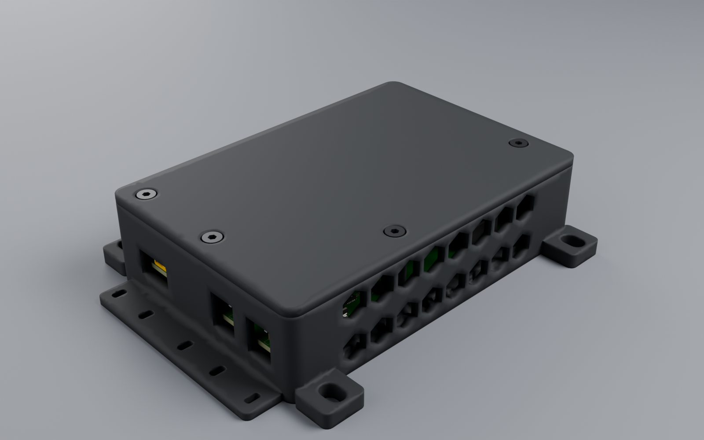
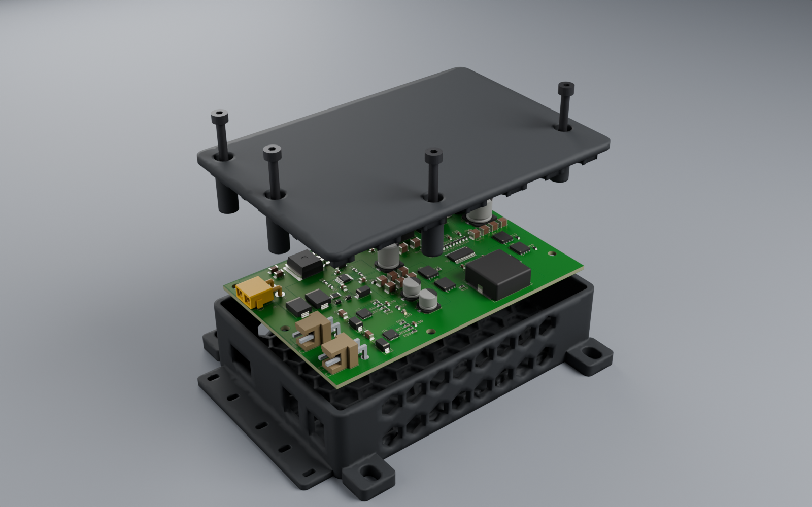
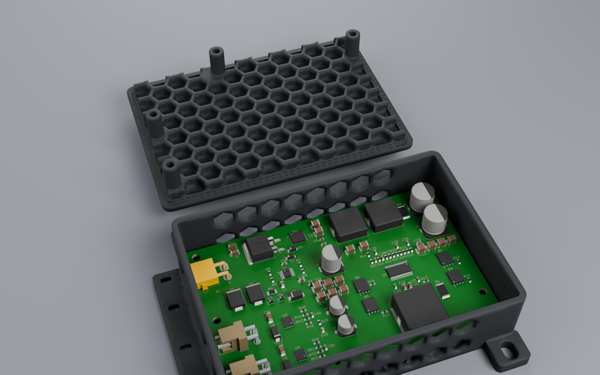
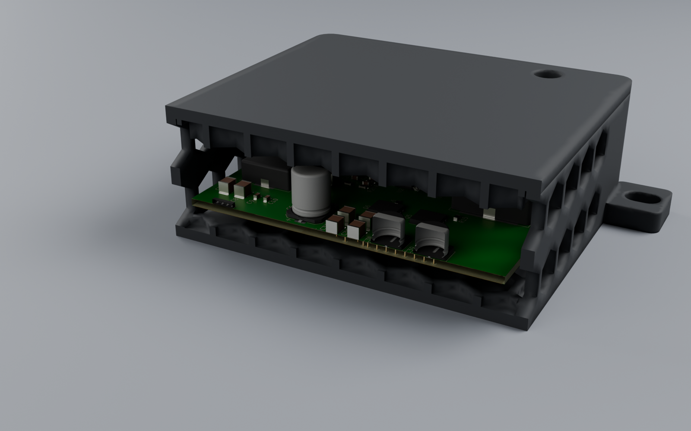
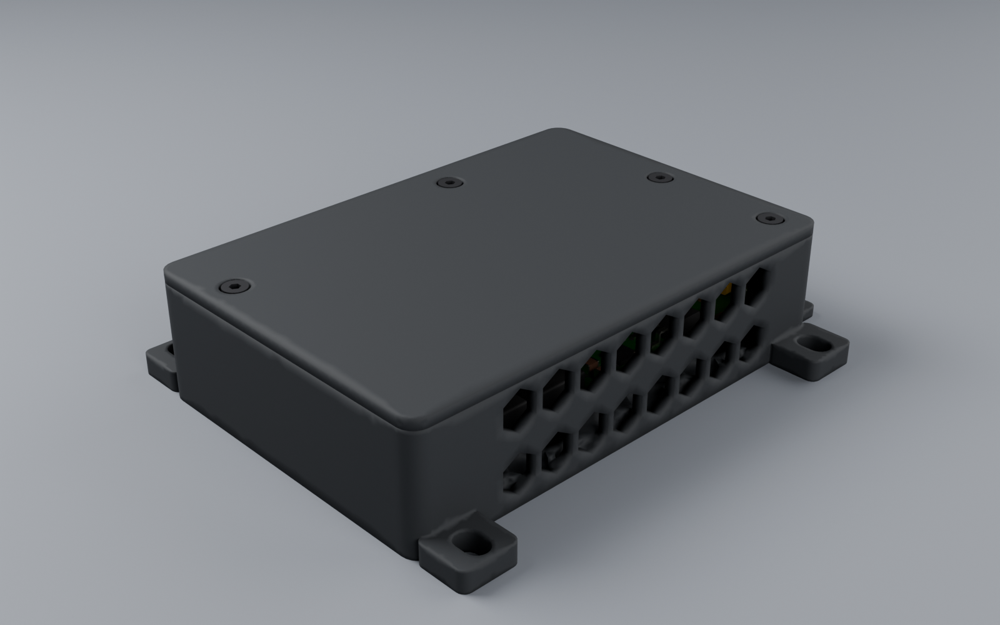
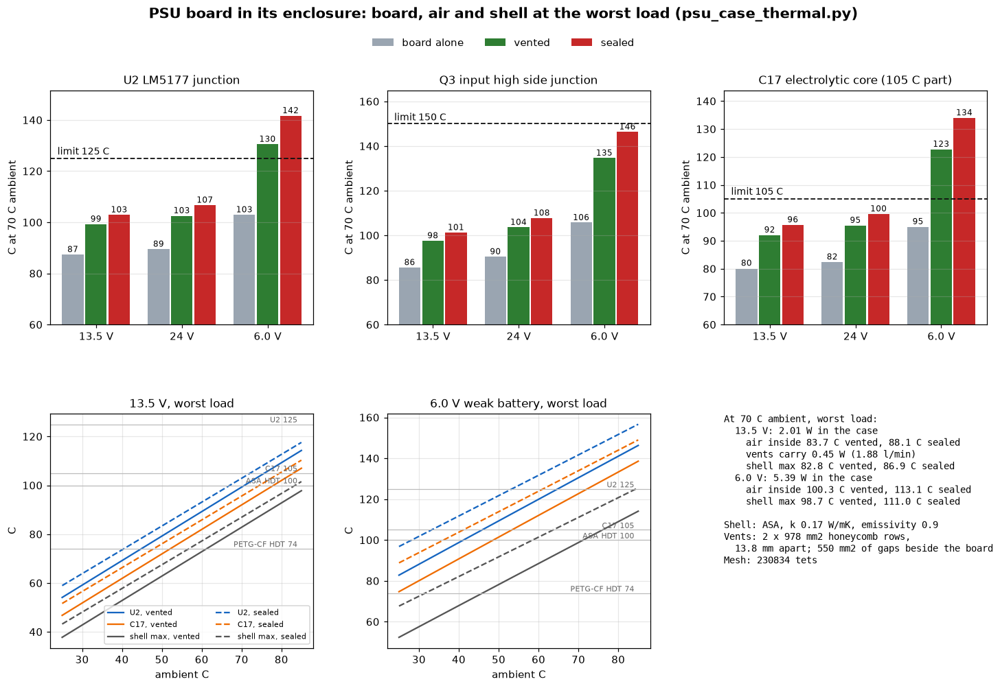
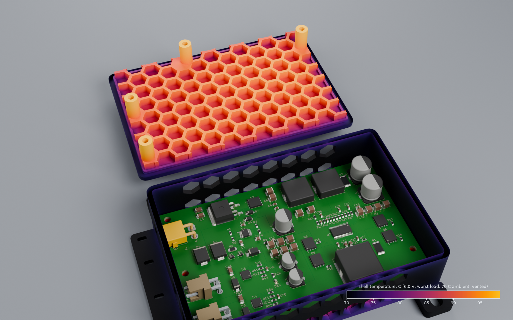
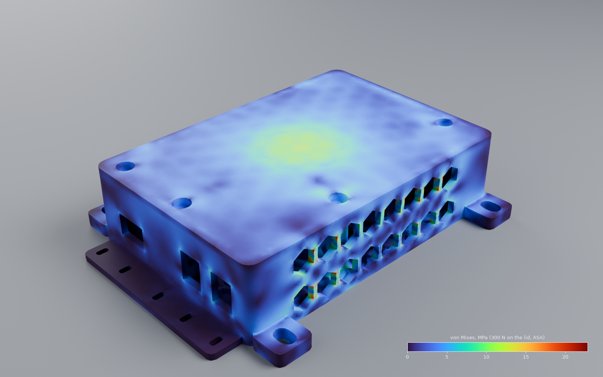

# PSU board enclosure

A printed case for the [PSU board](PSU_SPEC.md), in the main enclosure's honeycomb (10 mm cells, 1.6 mm walls):
a tray and a lid, four M3 screws that hold the board and close the case at once, honeycomb vents in the long walls,
and four ears with M5 slots. The simulations below answer whether it needs vents (it does), what it should be printed
in (ASA, not PETG-CF), and whether it holds the board through shocks, cable pulls and a knee on the lid.

`[E]` marks an engineering estimate, `[I]` a typical or inferred value, `[C]` a textbook correlation.

## 1. The design (`_work/psu/psu_case.py`)

| | |
|---|---|
| Outside | 117 x 80 x 30 mm (ears and cable shelf excluded); 129 x 104 mm over the ears and the shelf |
| Board | 6.0 mm above the floor on four stand-offs with M3 x 5.7 heat-set inserts (4.0 mm hole, 7 mm deep), clamped from above by four posts in the lid; six rests under its bare underside carry it between the holes |
| Screws | four M3 x 25 DIN 912 (A2 stainless or black-oxide steel), through lid, post and board into the inserts; the heads sit in 6.5 mm counterbores |
| Tray | 2.5 mm walls and floor; honeycomb ribs 2 mm high over the whole floor; a conical foot under each stand-off and rest |
| Lid | 2.5 mm, closed on top; honeycomb ribs 5 mm deep underneath, 2.4 mm clear of the tallest parts (C6, C17, C18); a 1.2 mm lip locates it in the tray |
| Connectors | `J1` (XT30, battery), `J2` (to the adapter's `J1001`) and `J3` (to the KV260's `J12`) through openings in the left wall, 0.8 mm round each mating face |
| Cable shelf | 12 mm under the openings, five slots for cable ties (up to 3.6 mm wide) either side of each cable |
| Vents | in each long wall, two rows of eight honeycomb cells (8.4 mm across flats, vertex up so they print without support): 978 mm2 low, 978 mm2 high, 13.8 mm apart |
| Mounting | four ears with M5 slots at the floor, as the main case's |
| Mass | about 96 g of ASA (tray 56 g, lid 39 g, solid) |

The board's mounting holes decide everything above: they are not at the corners, so the posts that clamp the
board also carry the lid, and no screw goes into the walls. The lid's honeycomb keeps a flat 2.5 mm plate stiff;
the floor's carries the stand-offs. The first FEA of this design (3 mm lid ribs, no rests) failed twice, and
the two fixes came from it: a 300 N press bent the lid 2.1 mm, to 0.4 mm from C6, so the ribs went to 5 mm; a 50 g
shock bent the board's far corners round its four holes (730 microstrain), so it now lies on six rests.

| The lid's honeycomb and posts | Section at x = 148 mm through a vent column |
|---|---|
|  |  |

## 2. Printing and assembly

- **Material: ASA.** With the car running the shell's hottest spot is 13 C above ambient (section 3): 83 C at 70 C ambient,
  past PETG-CF's 74 C heat deflection temperature and well within ASA's 100 C. PETG-CF is fine below 61 C ambient
  with the car running.
- **Orientation:** the tray on its floor, the lid on its top face. Nothing needs support: the vents are hexagons
  standing on a vertex, the connector openings bridge 9 to 13 mm.
- **Settings:** 0.2 mm layers, 4 walls, 40 % infill; the walls, ribs and posts are thin enough to print solid.
- **Assembly:** press the four inserts into the stand-offs with a soldering iron; lay the board in, connectors to
  the openings; put the lid on and drive the four M3 x 25 screws to snug (about 0.5 N m: the joint is plastic).
- **Mounting:** floor down on the four ears, M5 screws with washers, on rubber isolators as the main case. Keep
  the long walls clear by 10 mm so the vents breathe. Tie each cable to the shelf.

## 3. Thermal: does it need vents? (`_work/psu/psu_case_thermal.py`)

**Model.** Coupled steady state:
- **The board:** [PSU_SPEC §5](PSU_SPEC.md)'s 2-D model, its losses recomputed at the temperature it sees in
  the case (the MOSFETs' resistance rises with it).
- **The shell:** 3-D conduction in the tray and lid as meshed (231 k tetrahedra, ASA k = 0.17 W/mK [I]).
  - Outside: natural convection on each face by its orientation [C] and radiation, emissivity 0.9 [E].
  - Inside: convection to one well-mixed air node.
  - The board's radiative share lands on the lid and floor under it, spread by its own temperature map.
- **The vents:** stack flow through the low row, up the 2.5 mm gaps beside the board and out of the high row,
  Cd 0.6 for the cells and 0.8 for the gaps [E].
- **Sealed:** the same case with the vents closed.
- The loop runs until the temperature the board sees settles. The board alone at 70 C air ([PSU_SPEC §5](PSU_SPEC.md))
  is the reference.

**At 70 C ambient, both boards at their worst draw:**

| Case | In the case | Air inside, vented / sealed | U2 (125 C) | Q3 (150 C) | C17 core (105 C part) | Shell max |
|---|---|---|---|---|---|---|
| 13.5 V, car running | 2.0 W | 84 / 88 C | 99 / 103 C | 98 / 101 C | 92 / 96 C | 83 / 87 C |
| 24 V jump start | 2.3 W | 85 / 90 C | 103 / 107 C | 104 / 108 C | 95 / 100 C | 84 / 89 C |
| 6.0 V weak battery | 5.4 W | 100 / 113 C | **130** / **142** C | 135 / 146 C | **123** / **134** C | 99 / 111 C |
| Cranking Level IV, 10 s at 6.5 V | | (the case frozen at its 13.5 V state) | 100 / 104 C | 102 / 106 C | 93 / 96 C | |

**Highest ambient for each limit (vented / sealed):**

| Limit | 13.5 V, car running | 6.0 V weak battery |
|---|---|---|
| U2 junction 125 C | above 85 / above 85 C | 65 / 53 C |
| Q3 junction 150 C | above 85 / above 85 C | 84 / 73 C |
| C17 at its 105 C rating | 83 / 80 C | 53 / 41 C |
| ASA shell at its 100 C HDT | above 85 / 83 C | 71 / 59 C |
| PETG-CF shell at its 74 C HDT | 61 / 57 C | 46 / 32 C |

What this says:
- **The case adds 12 C** to what the board sees at 13.5 V (82 C at 70 C ambient instead of PSU_SPEC's 70 C air),
  and 27 C at 6.0 V. The board in 70 C air was the optimistic view.
- **The vents are needed.** They carry a fifth to a quarter of the heat (0.45 W of 2.0 W at 13.5 V, 1.5 W of 5.4 W at
  6.0 V, 1.9 to 2.8 l/min) and take 3.5 C off U2 with the car running and 11 C at 6.0 V. Sealed, the weak-battery case
  loses U2 above 53 C ambient; vented, above 65 C.
- **With the car running** every part stays within its rating to 85 C ambient. The input electrolytics (C17, C18,
  Panasonic FK, 105 C) set the life: at 70 C ambient they run at 92 C, 2.5 times their rated life (life halves each
  10 C); at 55 C, 7 times; at 85 C, 0.9 times.
- **A battery held at 6.0 V with both boards at their worst draw** is the case that does not pass at 70 C ambient.
  It takes a battery too weak to start the car, held there while both boards draw their maximum; even in open
  70 C air U2 was 22 C from its limit there.
- **Lid vents** would add little: the lumped estimate made before drawing the case put an exhaust in the lid (twice
  the area, 19 mm of chimney) 1 to 3 C below these side rows, and the closed lid keeps drips and dust out.

The shell at the weak-battery case (lid turned over beside the tray; the hot spots face up):

The lid runs hottest over the switching stage, where the board radiates most, and at its posts, which touch
the board.

## 4. Structural FEA (`_work/psu/psu_case_fea.py`)

**Model** (the main case's method, [ENCLOSURE.md §5.3](ENCLOSURE.md)):
- **Bodies:** tray, lid and board meshed together in CalculiX, 10-node tetrahedra (254 k tets, 1.4 M degrees of
  freedom). The board is FR-4 carrying its 50 g of parts [E] as density.
- **Bonding:** the board is bonded to the stand-offs, the rests and the lid's posts (the screws clamp that stack).
  The lid is bonded where it sits on the walls, exact for loads that press it on, slightly stiff for any that would
  lift it (the screws carry those).
- **Supports:** the four ears held at their M5 washers.
- **Materials:** ASA and PETG-CF, each at 23 C and at 70 C, with the main case's modulus and strength factors. The
  shell's von Mises stress (99.7th percentile, as for the main case, and the peak) is checked against the across-layer
  strength: ASA 25 / 20 MPa, PETG-CF 29 / 17.4 MPa. The board's largest principal strain is checked against the
  500 microstrain guide.
- **Loads:**
  - 50 g quasi-static shocks down, sideways and fore-aft;
  - a cable pulled at 50 N out of `J1`, and at 30 N out of `J2` and `J3` together;
  - 300 N on a 30 mm disc at the lid's centre: a knee, or luggage;
  - the first natural frequency.

**ASA (the material this case is for), 23 C / 70 C:**

| Load | Shell, 99.7th pct / peak | Safety factor, 99.7th pct | Board strain, 99.7th pct / peak | Max displacement |
|---|---|---|---|---|
| 50 g down | 1.5 / 3.3 MPa | 16 / 13 | 208 / 339 microstrain (242 / 399 at 70 C) | 0.06 mm |
| 50 g sideways | 0.5 / 1.7 MPa | 49 / 39 | 74 / 124 | 0.01 mm |
| 50 g fore-aft | 1.1 / 2.9 MPa | 23 / 18 | 109 / 165 | 0.02 mm |
| `J1` cable, 50 N | 0.6 / 1.9 MPa | 39 / 31 | 141 / 218 | 0.02 mm |
| `J2` + `J3` cables, 30 N each | 0.7 / 2.8 MPa | 34 / 27 | 164 / 311 | 0.04 mm |
| 300 N on the lid | 18.3 / 27.1 MPa | 1.4 / 1.1 | 1117 / 2008 (1376 / 2475 at 70 C) | 1.2 mm (1.5 at 70 C) |
| First mode | | | | 552 Hz (500 at 70 C) |

What this says:
- **Shock, vibration and cable pulls are easy.** The shell's safety factors are 13 or more, and the board stays
  under half the 500 microstrain guide (it has no BGA; the guide is the main case's, kept for comparison). With a
  first mode above 500 Hz, rubber isolators decouple the case as cleanly as the main one's.
- **300 N on the lid** passes at the 99.7th percentile (1.4 cold, 1.1 hot). Its peak is at the foot of the `H3`
  stand-off where it meets the wall (133.8, 172.5 mm), a re-entrant corner where the linear model's stress grows
  with mesh refinement; it reaches the across-layer strength there (0.92 cold, 0.74 hot). The lid sags 1.2 mm
  (1.4 hot) and stays 1.4 mm (1.2 hot) clear of `C6`, the tallest part under it, so nothing presses on the board's
  parts; the board itself takes 1100 to 1400 microstrain round the post. Do not stand on it; a knee or a bag is the
  limit.
- **PETG-CF at 70 C** (already above its heat deflection temperature in section 3): the lid sags 2.6 mm under
  300 N, to 0.25 mm from `C6`, and the board's shock strain doubles. ASA it is.

Raw results: [`sim/psu_case_fea.json`](sim/psu_case_fea.json).

## 5. Limits, said plainly

- The thermal model is steady state with one mixed air node, natural convection correlations and an estimated
  orifice coefficient; sun on the case, a hot panel under it or a closed glovebox are not in it. Ratings in section 3
  are for still air at the stated ambient.
- The FEA is linear and quasi-static: no contact at the lid's seat (it only rests there, so it was left free), no
  layer orientation (one modulus, the mean of in-layer and across-layer), the screws' preload not modelled.
- The board's 50 g is an estimate spread over its volume; the parts' own masses (L1, the electrolytics) are not
  lumped where they sit.
- Not tested in print yet: fit of the connectors' mating plugs through the openings, and the inserts' pull-out in ASA.

## 6. Files

| File | What |
|---|---|
| `mech/psu_case_tray.stl`, `mech/psu_case_lid.stl` | the parts to print |
| `_work/psu/psu_case.py` | the geometry (gmsh/OpenCASCADE); STEP of each part in `_work/psu/cache/` |
| `_work/psu/psu_case_thermal.py` | section 3; `docs/sim/psu_case_thermal.json`, `.png` |
| `_work/psu/psu_case_fea.py` | section 4; CalculiX in WSL; `docs/sim/psu_case_fea.json` |
| `_work/psu/psu_case_render.py` | the renders (Blender Cycles, the main case's studio and materials) |
| `site/assets/psu_case.glb` | the case in the 3-D explorer (`node site/scripts/build_assets.mjs --psu-case`), beside the PSU board, following the Closed / Open Lid / No Case buttons |
