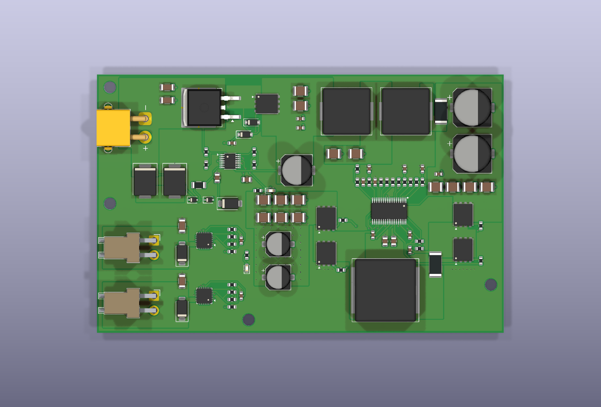
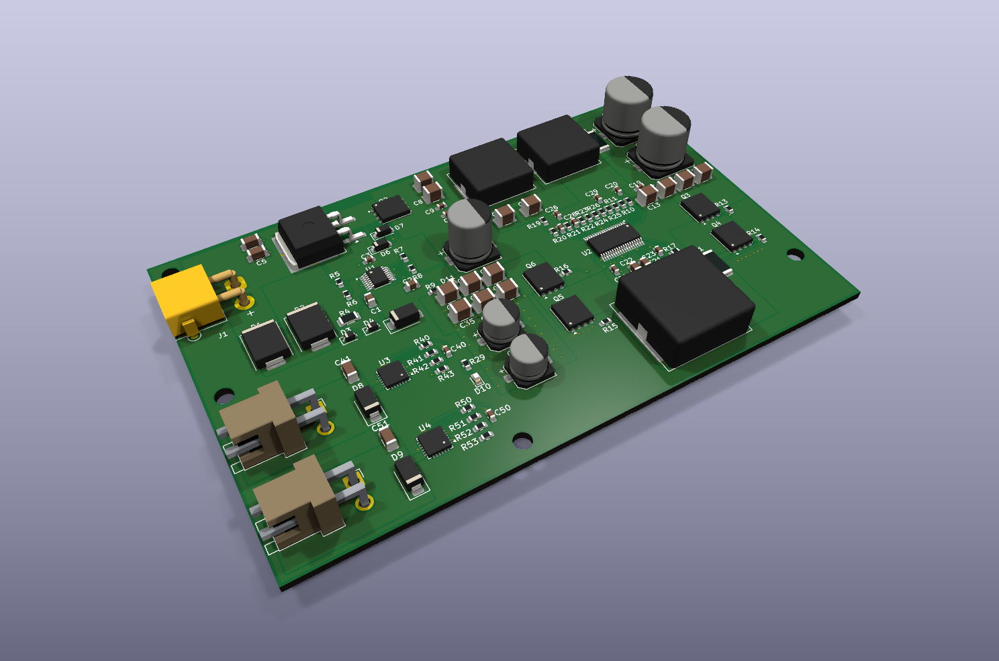

# PSU board: vehicle and bench power for the adapter and the KV260

A separate 110 x 70 mm board that takes the car's battery, or any 6 to 36 V bench supply, and feeds both boards of
the module: the adapter through its `J1001`, the KV260 through its `J12`, each by its own cable from one ground.
It replaces the regulated DC-DC converter that [POWER_SPEC](POWER_SPEC.md) section 1.4 asked for in a vehicle: no
module on the market met that specification (section 9), so this board does.

Every number below comes from the scripts in `_work/psu/` and their outputs in `docs/sim/psu_*.json`. `[V]` marks a
data-sheet or standard figure, `[E]` an estimate; where an input can only be estimated, the result is also given at
its bound.

## 1. What it does

| | |
|---|---|
| Input | `J1` (XT30), 6.0 V to start, runs from 2.9 to 48 V (the surge clamp), 60 V on the converter |
| Output | 12.0 V (11.68 to 12.36 V worst case), 5.3 A at most: the adapter's 2.0 A eFuse plus the KV260's 3.0 A one |
| To the adapter | `J2` (JST VH): 2.0 A limit (1.84 to 2.12 A), OVP 14.4 V, UVLO 8.0 V, to its `J1001` |
| To the KV260 | `J3` (JST VH): 3.0 A limit (2.77 to 3.19 A), OVP 14.4 V, UVLO 8.0 V, to its `J12` |
| Efficiency | 96.8 % (typical load) to 97.3 % (worst) at 13.5 V; 92 to 94 % at 6 V |
| Vehicle events | Runs through ISO 7637-2 pulses 2a, 3a, 3b, ISO 16750-2 Load Dump A (87 V) and B, jump start, cranking Levels I, II and IV (section 5) |
| Board | 4 layers, 1.6 mm, 2 oz outer, 110 x 70 mm, all three connectors on one edge |

```
J1 -> D1 SMCJ100A + D2 SMCJ24A (in series, opposed: +111 V / -27 V clamp)
   -> U1 LTC4364-2: Q1 IPB048N15N5 (150 V pass FET, clamps B0 at 48 V), Q2 BSC040N10NS5 (ideal diode)
   -> B0 (47 uF + 2 x 4.7 uF) -> L3 0.47 uH -> B (2 x 4.7 uF) -> L2 1.0 uH -> R2 3 mOhm (input current limit)
   -> VIN (4 x 4.7 uF + 2 x 100 uF, the filter's damping)
   -> U2 LM5177 four-switch buck-boost: Q3/Q4 BSC0805LS, R1 2 mOhm, L1 2.2 uH, Q5/Q6 BSC026N04LS -> +12V
   -> U3 TPS26631 (2.0 A) -> J2 -> the adapter's J1001
   -> U4 TPS26631 (3.0 A) -> J3 -> the KV260's J12
```

## 2. Why it feeds both boards by their own cables

The adapter's own single entry (KVPWR, [POWER_SPEC](POWER_SPEC.md) section 1.4) sends the KV260's whole return
current across the BM20 ground contacts, because the link (1.3 mOhm) is far lower than the jumper (33 mOhm). With
two cables from this board, both returns meet on its ground and each cable carries its own board's return; the BM20
link carries only the difference of the two cables' drops (`_work/power/ground_offset.py`, `vfe_two_cables`):

| Case, worst currents (adapter 1.12 A, KV260 3.19 A) | Per BM20 contact | Against 0.3 A |
|---|---|---|
| Cables 0.5 m / 0.5 m | 36 mA | Pass |
| Cables 1.0 m / 1.0 m | 38 mA | Pass |
| Cables 0.3 m to the adapter, 2.0 m to the KV260 | 66 mA | Pass |
| The same, one contact at a third of the others' resistance | 178 mA | Pass |
| The KV260 cable's ground open (all its return across the link) | 138 mA | Pass |
| The adapter cable's ground open | 48 mA | Pass |
| At home, an earthed monitor on DisplayPort, 1 V between the earths | 71 mA | Pass |

The single entry through the adapter gave 132 mA in the first case, 352 mA with one contact at a third and 189 mA
with the earthed monitor ([AUDIT_Rev08](AUDIT_Rev08.md) section 6.3). With this board, the adapter's KV260 branch
(`U1010`, `J1004` and their parts) is not needed: section 8.

## 3. Parts, and why each one

| Ref | Part (LCSC) | Why |
|---|---|---|
| `U2` | TI LM5177DCPR (C7425536) | Four-switch buck-boost, 3.5 to 60 V, down to 2.8 V once its BIAS runs from the output, 85 V absolute; 2 A drivers; input average current limiter |
| `Q3`, `Q4` | Infineon BSC0805LS (C534374) | Input half bridge: 100 V, 8.5 mOhm at 4.5 V gate drive (the LM5177 drives at 5 V) |
| `Q5`, `Q6` | Infineon BSC026N04LS (C3039672) | Output half bridge: 40 V, 3.6 mOhm at 4.5 V |
| `L1` | KOHERelec MDA1870-2R2M (C3015590) | 2.2 uH, saturation 35 A against a 29.3 A worst peak limit, 1.8 mOhm, AEC-Q200 |
| `R1`, `R2` | 2 mOhm, 3 mOhm 2512 | Peak current 19.3 / 25 / 29.3 A; input current 16.3 / 16.7 / 17.2 A |
| `U1` | Analog Devices LTC4364HMS-2 (C580875) | Surge stopper with ideal diode: 4 to 80 V, -40 V reverse, regulates its output during a load dump instead of absorbing it |
| `Q1` | Infineon IPB048N15N5 (C536509) | 150 V, 4.8 mOhm, D2PAK: the pass device; SOA at 40 V about 2.5 A DC at 25 C case [V] |
| `Q2` | Infineon BSC040N10NS5 (C534334) | 100 V, 4 mOhm: reverse input and no back-feed while cranking |
| `D1`, `D2` | SMCJ100A, SMCJ24A (C42371542, C310039) | In series and opposed (as TI's TIDA-01179): clamp at +111 V and -27 V, so the load dump (87 V) is not absorbed and the reverse battery (-14 V) does not conduct |
| `U3`, `U4` | TI TPS26631RGER (C1850273) | Per-output eFuse, 60 V: a converter fault cannot reach either board; same settings as the adapter's own `U1010` |
| `C17`, `C18` | Panasonic EEE-FK1J101P (C128460) | 100 uF 63 V, 0.35 ohm at 100 kHz: the damping that keeps the input filter stable (section 4.3) |

Values from the LM5177 data sheet's own equations (SNVSBU4F section 8.2.2): RT 75 kOhm (400.8 kHz), FB 71.5 k /
6.49 k (12.02 V), SLOPE 54.9 k (eq. 11), CFG 3.83 k (spread spectrum on, hiccup off, current limit on), soft start
47 nF (4.7 ms), EN/UVLO 576 k / 383 k (on at 6.0 V, 5.4 to 6.7 V; off at 3.0 V, 2.9 to 3.1 V), compensation
15.8 k, 15 nF, 120 pF (eq. 3 to 5: 8.6 kHz target against a 25.7 kHz right half plane zero), CSA/CSB filter
2 x 10 ohm and 150 pF (eq. 15). LTC4364: output clamp 374 k / 10 k (48.0 V), UV 140 k / 100 k (3.0 V), timer 4.7 uF.
U3 / U4: ILIM 9.09 k and 6.04 k, UVLO/OVP 316 k / 24.9 k / 30.9 k, dVdT 22 nF.

## 4. Electrical simulations

### 4.1 Steady state (`psu_design.py`, `docs/sim/psu_design.png`)

| VIN | Mode | Worst load 51.7 W: efficiency, loss | Input current | Inductor peak |
|---|---|---|---|---|
| 6.0 V | boost | 91.7 %, 4.69 W | 9.44 A | 11.2 A |
| 9.0 V | boost | 95.5 %, 2.42 W | 6.04 A | 7.3 A |
| 12.0 V | buck-boost | 95.8 %, 2.26 W | 4.52 A | 7.9 A |
| 13.5 V | buck | 97.3 %, 1.46 W | 3.96 A | 5.1 A |
| 24 V | buck | 96.8 %, 1.70 W | 2.24 A | 7.7 A |
| 36 V | buck | 96.1 %, 2.10 W | 1.50 A | 8.9 A |
| 48 V (load dump clamp) | buck | 95.3 %, 2.54 W | 1.09 A | 9.5 A |

Output ripple 2.6 mV at 13.5 V, 26 mV at 6 V (boost). Cranking at the board, with 1 m of 16 AWG each way and the
input path's resistance: Level I (8.0 V) 7.6 V and 7.7 A at the worst load; Level II (4.5 V) 3.7 V and 15.8 A
(under the 16.3 A limit); Level IV (6.0 V) 5.5 V and 10.8 A; Level III (3.0 V) leaves 2.5 V, under the LM5177's
2.9 V floor.

### 4.2 Loop stability (`psu_loop.py`, `docs/sim/psu_loop.png`)

Peak current mode, Ridley's model as TI's design equations use it, at 4.3 to 48 V and 1 W to the worst load: the
lowest phase margin is 57.7 degrees and the lowest gain margin 8.5 dB (4.3 V, boost, worst load). Crossover 9 to
18 kHz in boost, 23 kHz in buck. The slope ramp is modelled as half the buck dead-beat slope [E]; the transition
region near VIN = VOUT is the LM5177's own and is not modelled.

### 4.3 Input filter (Middlebrook)

The filter's output impedance seen by the converter peaks at 0.148 ohm (8.7 kHz, the harness and L3 + L2 against the
input capacitors, damped by `C17`/`C18`). The converter's negative input impedance, V^2 / P, is 0.32 ohm at 4.3 V
and the worst load: 6.7 dB of margin there, 12.5 dB at 6 V, 26.6 dB at 13.5 V. Without the two 100 uF dampers the
first layout had -7 dB at 4.3 V (an oscillator during cranking).

### 4.4 Vehicle events (`psu_transient.py`, `docs/sim/psu_transient.png`)

Averaged time-domain model of the whole chain, both boards as constant-power loads that stop below their own
cut-off (the adapter 5.59 V, the KV260 5.48 V), each standard's own waveform and source resistance
(`_work/power/ride_through.py`). A board "runs" (functional status A) if its input never fell below that.

| Event | Typical load: KV260 / adapter | Worst load: KV260 / adapter | Input (A) min..max | After U1 max | +12V min..max | Stress (worst load) |
|---|---|---|---|---|---|---|
| ISO 7637-2 pulse 1 (-150 V, 10 ohm, then 200 ms disconnected) | resets / resets | resets / resets | -30.6..13.9 V | 13.7 V | 7.45..12.03 V | D1+D2 365 W, 0.19 J |
| ISO 7637-2 pulse 2a (+112 V, 2 ohm, 50 us) | runs / runs | runs / runs | 13.2..23.2 V | 22.6 V | 12.00..12.03 V | none |
| ISO 7637-2 pulse 3a (-220 V, 50 ohm, 0.1 us) | runs / runs | runs / runs | 12.8..13.3 V | 13.3 V | 12.00..12.03 V | none |
| ISO 7637-2 pulse 3b (+150 V, 50 ohm, 0.1 us) | runs / runs | runs / runs | 12.8..13.3 V | 13.3 V | 12.00..12.03 V | none |
| ISO 16750-2 Load Dump A (87 V, 1 ohm, 400 ms) | runs / runs | runs / runs | 12.0..85.8 V | 48.2 V | 12.00..12.03 V | Q1 42 W, 2.5 J; timer 0.23 of 1.35 V |
| ISO 16750-2 Load Dump B (35 V suppressed) | runs / runs | runs / runs | 12.2..34.2 V | 34.1 V | 12.00..12.03 V | none |
| Jump start (24 V) | runs / runs | runs / runs | 13.2..23.8 V | 23.8 V | 12.00..12.03 V | none |
| Reverse battery (-14 V) | resets / resets | resets / resets | -14.0..13.2 V | 13.2 V | 7.48..12.03 V | none |
| Cranking Level I (8.0 V) | runs / runs | runs / runs | 7.4..11.6 V | 11.6 V | 12.00..12.03 V | Q1 1 W, 0.5 J |
| Cranking Level II (4.5 V, then 6.5 V for 10 s) | runs / runs | resets / resets | 3.5..11.6 V | 11.6 V | 7.43..12.03 V | Q1 4 W, 18.9 J |
| Cranking Level III (3.0 V) | resets / resets | resets / resets | 3.0..11.6 V | 11.6 V | 7.38..12.03 V | Q1 4 W, 3.3 J |
| Cranking Level IV (6.0 V, 6.5 V for 10 s) | runs / runs | runs / runs | 5.0..11.6 V | 11.6 V | 12.00..12.03 V | Q1 2 W, 11.6 J |
| A short on the KV260 output (`J3`) | resets / runs | resets / runs | 13.3..13.3 V | 13.3 V | 12.00..12.01 V | none |

Notes: ISO 7637-2's generator resistance (Ri) is applied while its pulse lasts; the supply's own (10 mOhm) outside
it. For Load Dump A the alternator's 1 ohm is applied while the dump is above 20 V: a 55 W load cannot be fed through
1 ohm from 13.5 V at all (13.5^2 / 4 = 45 W at best), in any design. Cranking Level II at the worst load resets
both boards because the input current limit (16.3 A) then leaves about 46 W; at the typical load (22.7 W) they run.

## 5. Thermal (`psu_thermal.py`, `docs/sim/psu_thermal.png`)

The board as placed, a 2-D plate with its copper's conductance, convection and radiation from both faces to 70 C
case air (the hot car), each part's loss over its pads and its data-sheet junction-to-board resistance:

| Case | Loss | Hottest parts (limit) |
|---|---|---|
| 13.5 V, worst load, continuous | 2.0 W | U4 88 C (125), U2 87 C (125), Q3 86 C (150) |
| 24 V jump start, worst load, continuous | 2.2 W | Q3 90 C, U2 89 C, Q4 88 C |
| 6.0 V weak battery, worst load, continuous | 5.2 W | Q3 106 C (150), U2 103 C (125), Q5 and Q6 100 C |
| Cranking Level IV, 10 s at 6.5 V from 13.5 V | 4.6 W | Q3 90 C, U2 88 C |

## 6. Conducted noise (`psu_emi.py`, `docs/sim/psu_emi.png`)

Into the vehicle harness, CISPR 25 voltage method, Class 5 peak limits as TI SLLA569B (April 2025) Table 3 gives
them (check them against the edition the vehicle maker asks for), with the LM5177's spread spectrum:

| Band | 13.5 V in: level, margin | 24 V in: level, margin |
|---|---|---|
| MW 0.53 to 1.8 MHz (54 dBuV) | 34.2 dBuV, 19.8 dB | 40.5 dBuV, 13.5 dB |
| SW 5.9 to 6.2 MHz (53) | 27.2, 25.8 dB | 33.4, 19.6 dB |
| CB 26 to 28 MHz (44) | 21.2, 22.8 dB | 26.5, 17.5 dB |
| VHF 30 to 54 MHz (44) | 31.7, 12.3 dB | 36.9, 7.1 dB |
| VHF 68 to 87 MHz (38) | 23.8, 14.2 dB | 29.3, 8.7 dB |
| FM 76 to 108 MHz (38) | 22.1, 15.9 dB | 27.4, 10.6 dB |

Above 30 MHz the common mode dominates: the switch nodes' capacitance to the test bench's ground plane, 0.5 pF [E].
At 2 pF it reaches 43.7 / 48.9 dBuV, at the 44 dBuV line. The average limits (about 20 dB below the peak ones) are
not assured: in the MW band this peak estimate sits on the average line (34 dBuV) before any credit for the spread
spectrum, and above 30 MHz it is over it. That needs the bench. `R13` to `R16` (0 ohm) slow the switching edges if it
asks for it.

Onto the two boards' supply: the switching ripple at the adapter's and the KV260's input is 42.9 dBuV (140 uV) at
400 kHz from 13.5 V and 56.7 dBuV at 6 V (boost); in the HF band (3 to 30 MHz, the adapter's `J951` input) its
harmonics are under -29 dBuV from 13.5 V and under 6.5 dBuV (2 uV) from 6 V, far below what the adapter's own
regulators make.

## 7. The board (`psu/`, `_work/psu/psu_pcb.py`)

Schematic: [KV260-IAS2RF_PSU_schematic.pdf](KV260-IAS2RF_PSU_schematic.pdf) (vector, one A1 sheet).

4 layers: F.Cu the parts and the power pours, In1.Cu ground, In2.Cu the +12V plane, B.Cu ground and short signal
links. The power runs in a U: `J1` top left, protection and filter along the top, the power stage along the bottom
from right to left, the outputs bottom left, so the three cables leave one edge. The input loop (VIN capacitors, `Q3`,
`Q4`) is closed within 10 mm, the output loop (`Q6`, the output capacitors, `Q5`) likewise; the gate drives run
15 to 20 mm from `U2`. The three connectors open on the left edge: `J1`'s XT30 and the two VH sockets, whose plugs
(`VHR-2N`) leave the board edge-on.

DRC with the zones refilled and schematic parity: 0 errors, 0 unconnected (the warnings left are silkscreen
clipped at the edge and the mounting holes' library copy). ERC 0. Fabrication: `_work/psu/psu_fab.py` (Gerbers,
drill, BOM of 65 lines and 102 parts, every one with an LCSC code, CPL) into `fab/`.

3-D bodies: KiCad's own where its library ships them. `J1` is a stand-in built from its footprint's outline
(`_work/mech/xt30pw_model.py`), `J2`/`J3` the adapter's VH model, and the SON-8 MOSFETs and the electrolytics use
copies of KiCad's models with their near-white metal toned to grey (`psu_pcb.py`, `tone_models`).





## 8. Installation

- **Vehicle:** `J1` to the battery by 16 AWG, a 20 A fuse at the battery, the ground to the same chassis point as the
  CAN cable's ground (`J1503`). `J2` to the adapter's `J1001` and `J3` to the KV260's `J12`, each by its own 18 AWG
  cable (1 m or less, the two about the same length), nothing else on `J12`.
- **Bench:** any 12 to 24 V supply of 60 W on `J1`, preferably two-prong (Class II); the same two cables.
- **The adapter's KV260 branch** (`U1010`, `Q1010`, `Q1011`, `R1040` to `R1043`, `C1093` to `C1095`, `D1004`,
  `J1004`) is not needed with this board and can be left unfitted. It stays on the board for use with a plain brick
  and the jumper. `U1010` is TPS26631PWPR (LCSC C2866319); the same part on a 250-piece reel, TPS26631PWPT
  (C2832195), is the drop-in alternative. Both showed no stock at LCSC on 19 November 2026; the RGE (VQFN) version
  this board uses (C1850273) had 314.

## 9. Limits, said plainly

- Disconnecting the battery (ISO 7637-2 pulse 1, 200 ms), a reverse battery and cranking Level III (3.0 V) still
  reset both boards: there is nothing to run from. Nothing is damaged.
- Cranking Level II at both boards' worst draw at once resets them (section 4.4); the typical load runs.
- Held below 4.4 V at the worst load and 70 C air, the hottest MOSFET passes its 150 C rating (156 C at 4.3 V, from
  `psu_design.py`'s steady-state model; 122 C at 5.0 V, 101 C at 6.0 V). Cranking is that low for milliseconds
  (Level II holds 4.5 V for 15 ms), far shorter than the parts' thermal time constants; a battery that stays that
  low does not start the car.
- The averaged models do not show the switching ripple, the LM5177's transition region or the parasitics of the
  layout. The loop compensation and the IMON loop (`R25`/`C29`) are the data sheet's starting values, to be checked
  on the bench; so are the emissions above 30 MHz.
- Off-the-shelf modules checked before this board: Bicker DC160WS (6 to 36 V), Mini-Box DCDC-USB-200 (6 to 34 V),
  DFRobot 5 A buck-boost (6 to 35 V), Analog Devices DC1198B-B (6 to 36 V as built); none starts below 6 V, so none
  holds the module through cranking Level II.

## 10. Audit (`psu_audit.py`, `docs/sim/psu_audit.json`)

Checked on 19 November 2026, against the data sheets and the simulated extremes:

- **Every IC pin against its data sheet's pin table** (93 pins: LTC4364-2 MS16, LM5177 HTSSOP-38, two TPS26631
  VQFN-24). Each pin left open is one its data sheet allows open: the LM5177's `HO1_LL`/`HO2_LL` ("make no external
  connection"), the TPS26631s' `B_GATE`, `DRV`, `IMON`, `FLT` and `PGOOD`, their `SHDN` (open-circuit 2.48 to 3.3 V,
  above its 2 V threshold), the LTC4364's `ENOUT` and `SHDN` (an internal current source to a 4 V clamp; the board's
  leakage there must stay under 1 uA, so keep it clean of flux). The pins that must not float are tied as their data
  sheets say: `DTRK` to ground, `SYNC` and `MODE` (forced PWM) to `VCC`, `OV` to ground (the OV comparator unused),
  `IN_SYS` to `IN`.
- **Every pin's absolute maximum against its net's worst voltage**: the LTC4364's `VCC` (100 V) sees at most D5's
  62.7 V breakdown; its `SOURCE` and `OUT` the 48 V clamp (52 V with tolerances); the LM5177's `VIN`, `SW1`, `CSA`/`CSB`
  (85 V) the same 52 V, its `BIAS` (50 V) 14.4 V; the TPS26631s' `IN` and `OUT` (67 V) 14.4 V.
- **Every part's voltage against its rating** (ceramics at 80 %, electrolytics at 85 %): the highest are `C6`, `C17`,
  `C18` (63 V electrolytics, 52 V for the 400 ms of a load dump: 83 %), `C1` and `C3` (100 V, 63 %), `Q1` (150 V,
  77 V across it in the clamp: 51 %), `Q2` (100 V, 54 V in a negative pulse: 54 %).
- **Every resistor's dissipation**: the shunts `R1` (2 W part) 0.43 W and `R2` (3 W) 0.89 W at their worst currents;
  the dividers under 40 mW.
- **The simulation** (section 4.4): after `U1` the bus never passes 48.2 V; `Q1` takes at most 18.9 J (cranking
  Level II, within its SOA averaged over 1 ms); the TVS pair at most 0.19 J (rated 1500 W for 1 ms); no part is
  overstressed in any event.

Changed by this audit:

- **`R4`** (`U1`'s `VCC` feed): in Load Dump A, `D5` clamps `VCC` and `R4` takes 0.88 W at the peak, 23.5 mJ over
  92 ms, over a plain 1206's 0.25 W. It is now an anti-surge 1206, Panasonic ERJ-P08F1001V (0.66 W, LCSC C4261071).
  It stays 1 kohm: more would stop `U1` starting from 6 V (its `VCC` needs 4 V at 750 uA).
- **`J2`, `J3`**: turned so that their openings face the board edge, with the plugs leaving edge-on (they first faced
  inwards; the 3-D render showed it).

Left for the bench: the loop with the real layout, the `IMONOUT` compensation (`R25`, `C29`), conducted emissions
above 30 MHz and the CISPR 25 average limits, and the switching nodes' ringing (`R13` to `R16` are there to slow
them).
