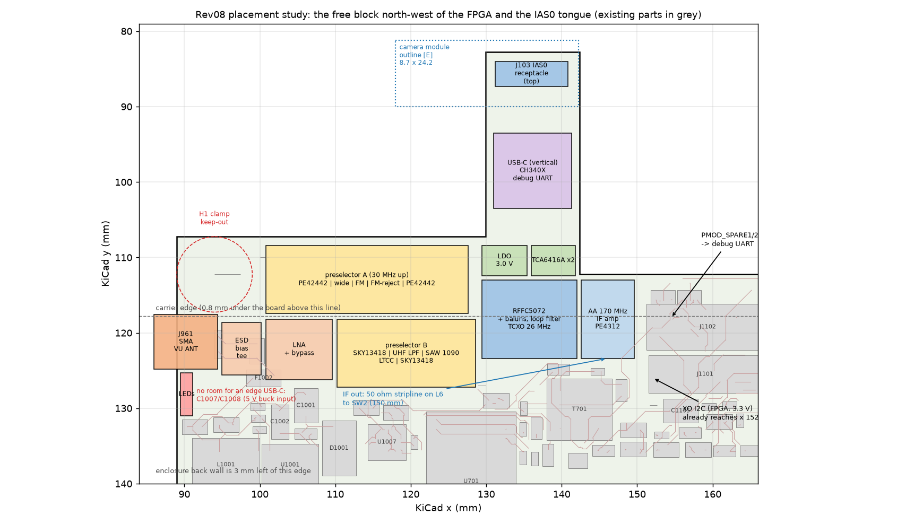
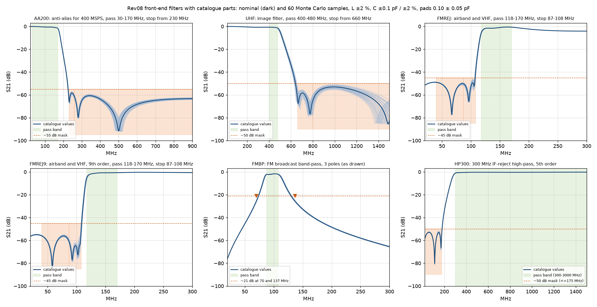
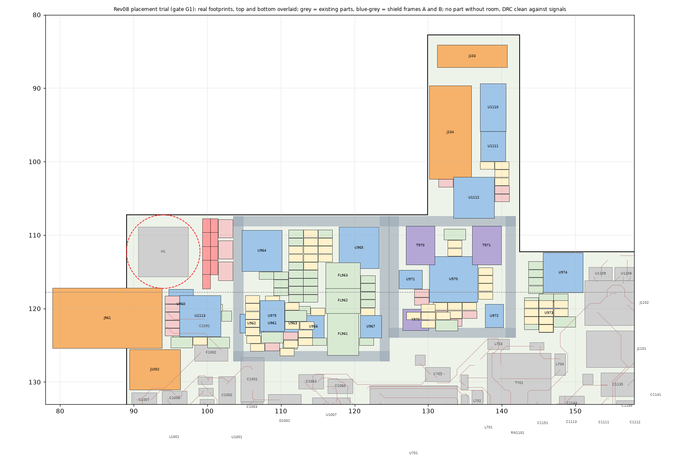
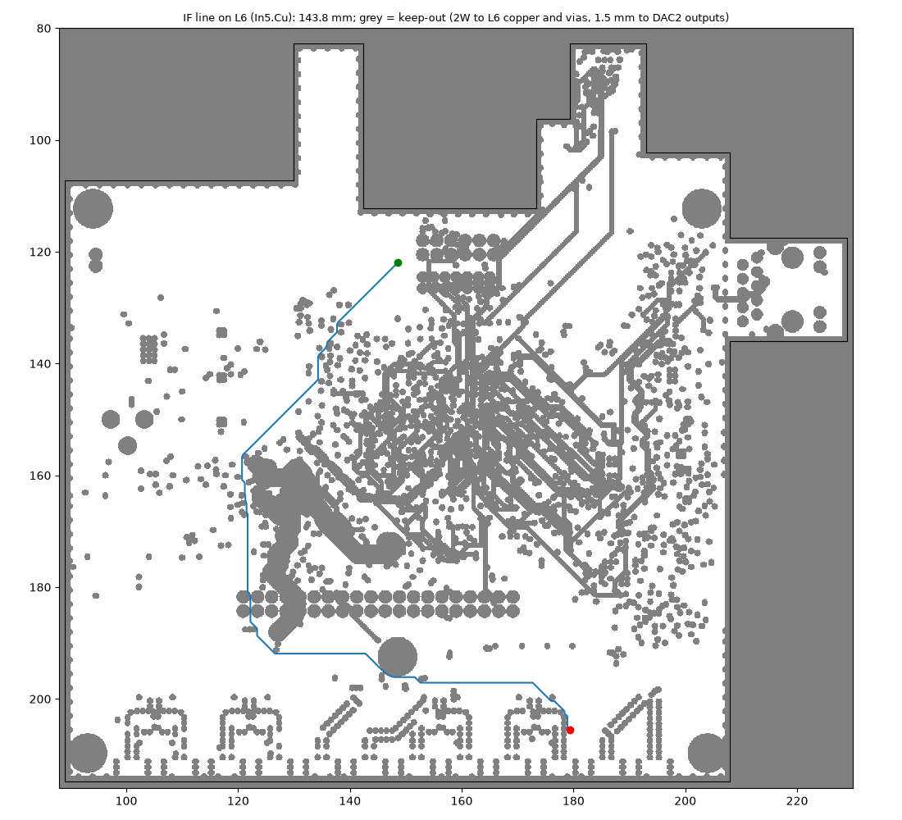

# Rev08: plan and analysis

*16 November 2026 · analysis and plan only: nothing in the schematic, the board or the gateware has changed*

> **Status.** Scope approved on 16 November 2026: **all of it** (WP1–WP6 and the 500 MSPS gateware of
> section 7), the thirteenth SMA on the back wall, the camera pass-through receptacle, and a vertical debug USB
> inside the box. Section 12 records the decisions. Nothing is to be bought yet: parts are chosen for the
> design, and their stock is re-checked when the board is ordered. Implementation has not started; it begins
> with phase 1 of section 11 when the owner says so.

Rev07 closed the final RF review. This document studies what a Rev08 could add so that the board needs less
around it, and what a fresh look at Rev07 still finds to correct. It answers six questions:

1. Can the board show its own state (LEDs)?
2. Can it have a serial port for debugging?
3. Can the unused IAS0 connector do something?
4. Can it receive FM, airband, VHF and UHF handhelds with nothing external but the antenna?
5. What about above 500 MHz?
6. Is anything else wrong in Rev07, board or gateware?

Marks: **[V]** measured or read today from the board file, a datasheet or a tool; **[E]** an estimate, with its
basis. Stock and prices are JLCPCB's parts API on 16 November 2026.

---

## 0. Summary

| # | Work package | Verdict | Board area | Parts cost per board | Risk |
|---|---|---|---|---|---|
| WP1 | Status LEDs: 5 rail LEDs, 8 status LEDs behind an I²C expander | **Approved** | 40 mm² | $1.1 | Low |
| WP2 | Debug serial: UART on the two spare Pmod lines, USB bridge with a vertical USB-C inside the box | **Approved.** The gateware half needs no board change | 60 mm² | $1.1 | Low |
| WP3 | IAS0: camera pass-through receptacle on the top face, pin for pin | **Approved**, fitted | 30 mm² | $0.2 | Low electrically, medium mechanically |
| WP4 | VHF receive front end, 30–170 MHz, direct sampling on the AD9484: own SMA (the thirteenth), bias tee, LNA, three preselector paths, anti-alias filter, IF amplifier, step attenuator | **Approved** | 430 mm² | $32 | Medium |
| WP5 | Converter for 300 MHz – 3 GHz (was 170 MHz before the Rev08 audit, section 11.10): RFFC5072 mixer and synthesiser, second preselector behind a 300 MHz HPF | **Approved**, behind a bypass switch so the board works without it | 260 mm² | $34 | Medium–high |
| WP6 | Corrections from the audit (section 8): two timing-constraint errors, a hard-coded NCO, documentation | **Approved**, first; independent of the board | n/a | n/a | Low |
| WP7 | Board manual: a motherboard-manual style layout diagram of the final board, every connector, header, chip, LED, SMA, switch and test point labelled with its use (section 11.3) | **Approved** (owner, 16 November) | n/a | n/a | Low |

Totals: about 820 mm² of the 1,090 mm² that is free in one block (section 1), about $68 of parts per board in
some 17 new part types, and 0.8 W more at 12 V (+9 %).

**What the audit found (section 8).** Two timing constraints in `xc7a50t.xdc` do not describe the clocks the
board produces, so "timing closed at 400 and 500 MHz" is true for the master-clock domain only. The radar DDC's
NCO is a constant for 400 MSPS. `FPGA_GATEWARE.md` §4.1 and one line of the README give sample rates and
connector names that are wrong. None of this needs a board change.

**Two statements made before this analysis were wrong and are corrected here.**
- "FM fits the second Nyquist zone of the wideband channel at 125 MSPS." The AD9253 runs at 62.5 MSPS (50 MSPS
  with the 400 MHz master) [V], and the FM band straddles a zone boundary at both rates (93.75 and 100 MHz).
- "Airband is in the third zone." It straddles 125 MHz.

The board already has the right converter for these bands: the AD9484 at 400 MSPS, which `SW2` connects to
`J922`. Its first Nyquist zone is 0–200 MHz, so FM, airband, 2 m and marine VHF are all sampled directly. What
is missing is everything between the antenna and that ADC: gain, filtering and level control. That is WP4.

---

## 1. Where the room is

Measured from `CSI2-KRIA-KV260_Rev01.kicad_pcb` as text, per copper layer [V].

| Area | KiCad x, y (mm) | Size | Top | L3 / L6 / bottom | Limits |
|---|---|---|---|---|---|
| **Block north-west of the FPGA** | 89–150, 107.25–127 | 61 × 19.7 mm, 1,200 mm² | `J1002`, `C1092`, `F1002` (the fan header's parts), `FID1`, `H1` | Empty but for two tracks on L3 at its east end (`FPGA_PROG_B` and a DAC filter net) | Over the carrier for y < 117.75: 0.8 mm underneath, so no through-hole pins and nothing on the bottom there. `H1`'s clamp takes a 10 mm circle. Net free area about 1,090 mm² |
| **IAS0 tongue** | 129.9–142.4, 82.75–107.25 | 12.5 × 24.5 mm | Empty | `J102` on the bottom, ground vias only | All of it is over the carrier. `J18` on the carrier (7.5 mm pins) stands 1.5 mm east of it |
| Strip above the SMAs | 100–176, 188–200 | n/a | `IF_TX_A`, `IF_TX_B`, `T802`, the Rev07 filter, `IF_RX_B`, `H4` | L6 carries the AD9767's DAC2 outputs and `SW_CTRL0` | Not usable for new blocks; a route can cross it on L6 |
| Left edge below the block | 89–100, 128–200 | n/a | The 5 V, 3.3 V and −3.3 V converters | **L6 empty** | A route on L6 passes under the converters between two ground planes |



The sketch places every new block at its real size. It is a study, not a layout: gate G1 in section 11 is a
placement trial on a scratch copy of the board.

**Which edges reach the outside.** The board's left edge (x = 89) faces the enclosure's back wall, 3 mm away,
where the 12 V jack already has its opening. The north edge is over the carrier, inside the box. So a new
connector for the outside goes on the left edge, between `H1`'s clamp (ends at y 117.25) and the 5 V buck's
input capacitors `C1007`/`C1008` (start at y 131.2): **13.9 mm** [V]. An edge SMA needs 7.2 mm and a USB-C
9.2 mm. Both do not fit; the SMA takes the edge (section 5.6) and the USB connector goes inside (section 3).

---

## 2. Control lines: what is available without new FPGA balls

The FPGA has 32 unconnected I/O balls [V], and CONTROL_SPEC §7 found that none can still be routed out. Rev08
therefore uses what already arrives at the free block:

| Resource | Where it is today [V] | Use in Rev08 |
|---|---|---|
| `XO_SCL` / `XO_SDA`: an I²C bus the FPGA masters, 3.3 V, only the Si549 on it (address 0x55) | Its tracks run inside x 152–194, y 126–150: they touch the block's east end | Two TCA6416A expanders (0x20, 0x21): 32 static lines for the switches, the attenuator, the synthesiser's serial port and the LEDs |
| `PMOD_SPARE1` (FPGA input, ball G15) and `PMOD_SPARE2` (FPGA output, G11) | From the FPGA to `J1102` pins 6 and 8, x 154–160, y 115–147 | The debug UART. Their present uses are soft: spare1 gates the DDC, spare2 reports link-up; both move to register bits |
| IAS0 pin 15 (`HPA14_FLASH`, into the SOM) and pin 20 (`HPA14_TRIGGER`, out of the SOM), 1.8 V, through the carrier's SN74AVC4T245 `U72` | On `J102`, not connected | **Not used by the board.** Studied and rejected (section 4.2); they pass through to the camera |

**One bus, two rules.** The expanders sit on the Si549's bus. (a) Nothing may toggle on it while receiving:
LED states are written on change only, never blinked through I²C. (b) The gateware's `hk_xo_ctrl` becomes a
shared master with a queue. Clocking the synthesiser's 25-bit words through an expander costs two writes per
bit: about 4 ms per word at 400 kHz, some 25 ms for a retune [E]. That suits a tuned receiver, not a frequency
hopper. A faster port would need three FPGA balls, and there are none.

Rejected: the housekeeping bus (`HK_SCL`/`HK_SDA`, 1.8 V). Linux could drive the expanders on it with a stock
driver and no gateware, but the bus ends 60 mm from the block, it already has two masters, and the front end
would stop working when the board runs from Ethernet without the Kria.

---

## 3. WP1 and WP2: LEDs and a debug serial port

### 3.1 LEDs

Today the board has `D1101` (DONE) and the two LEDs in the RJ45 [V].

| LED | Driven by | Meaning |
|---|---|---|
| `+12V`, `+5V0`, `+3V3_D`, `+1V8_D`, `+1V0` | The rail itself, 1 mA each | A dead rail shows without a meter. `+1V0` needs a transistor (below an LED's forward voltage) |
| `CFG` | Expander, written once after configuration | The FPGA runs and the clock sequencer finished (`xo_boot_done`) |
| `CLK` | Expander | Master clock mode: on = 500 MHz, off = 400 MHz |
| `LINK` | Expander | IAS1 link trained |
| `ADC-R`, `ADC-S` | Expander | A converter clipped since the last read (sticky) |
| `LO` | Expander | The RFFC5072 is locked |
| `TX` | Expander | A DAC is driving an SMA |
| `ERR` | Expander | Any sticky error: CRC, FIFO overflow, I²C no-acknowledge, over-temperature |

Activity is shown by the UART's transmit line: one LED on `PMOD_SPARE2` blinks with every status line the FPGA
prints, once a second. That is the heartbeat, and it costs no bus traffic.

Placement (revised by the trial, section 11.4): the 9 status LEDs in a column north of `J961`, x 99.4–103.5,
y 107.8–117.2, seen through a small window in the lid; the five rail LEDs beside their regulators. Parts:
0402 LEDs, TCA6416ARTWR (33 k in stock, $0.82).

### 3.2 Debug serial

| Option | Board change | Gateware | Works with the lid on | Works without the Kria |
|---|---|---|---|---|
| **A. UART on `PMOD_SPARE1/2` to the Kria** (PS UART1 through EMIO, `/dev/ttyPS1`) | None | `dbg_uart` on the Artix, two EMIO pins on the Kria | Yes | No |
| **B. USB bridge on the board**, tapping the same two nets | CH340X, USB-C, ESD, 1 kΩ | Same as A | Only with a hole in the lid | Yes |
| C. UART through JTAG (`BSCANE2`) | None | A JTAG-UART core and a host script | No | Yes, with a JTAG cable |
| D. A text console on a UDP port | None | A second UDP port in `eth_mac_udp` | Yes | Yes, once Ethernet is up |

**Proposal: A and B together**, one gateware block.

- `dbg_uart`, 115,200 baud 8N1 by default: a boot banner (build date, git hash, clock mode), one status line a
  second (lock bits, link state, clip counters, die and board temperature, error flags), and a monitor that
  reads and writes the register file (`r 44`, `w 44 12345678`). About 300–400 LUTs [E]; the device is at 48 %.
- The bridge is powered from the USB cable, so it adds nothing to the board's rails and enumerates with the
  board off. Its TXD reaches `PMOD_SPARE1` through 1 kΩ: the Kria's driver wins when the Pmod cable is fitted,
  and an unpowered FPGA sees at most 3 mA.
- **The connector cannot go on the back wall** (section 1). **Decided: a vertical USB-C inside the box**, on
  the IAS0 tongue at KiCad x 131–141, y 93.5–103.5, reached with the lid off, like JTAG and the Pmod. With the
  lid on, the same console is on the Kria (option A).
- **Why the tongue, and what it demands of the part.** It is the only free top area left once WP4 and WP5 fill
  the block. It is clear of the camera (section 4.3: the module lies across the tongue at y 81–90), of the
  lid's fan (enclosure X −65 to −15; the tongue is at X 0–24.5) and of the KV260's own fan. But the tongue lies
  over the carrier, 0.8 mm above it: **the connector must be surface-mount only, shell tabs included**. A
  vertical USB-C is about 10 mm tall, which leaves 20 mm to the lid.
- Chosen after the trial (section 11.4): **HX-TYPE-C 16P 180 LT H10.0** (LCSC C49261569, 3,635 in stock),
  surface-mount legs and two locating pegs. `U262-161N-4BVC11` was rejected: through-hole shell legs and not a
  vertical part. Fallback if the pegs do not clear the carrier: a 1 × 4 header for a USB-TTL cable, same position.
- **Replaced on 18 November** ([LAYOUT §6.8](LAYOUT.md)): the HX part's drawing shows four through-hole shell legs
  2.1 mm long, which the land pattern had missed and which would have reached the carrier. `J1501` is now the HRO
  TYPE-C-31-E-17 (LCSC C7424785): contacts and shell tabs surface mount, pegs 0.7 mm long, 6.0 mm tall.

Stock: CH340X 43 k ($0.66), USBLC6-2SC6 38 k.

---

## 4. WP3: IAS0

### 4.1 What IAS0 carries on the carrier

Read from the carrier schematic XTP682, sheet 13, connector `J7` [V] (the file is AMD's and is not in this
repository):

| `J7` pin | Carrier net | Goes to |
|---|---|---|
| 4/5, 7/8, 10/11, 26/27, 29/30 | `IAS0_D0`, `IAS0_CLK`, `IAS0_D3`, `IAS0_D2`, `IAS0_D1` | The AP1302 ISP's sensor port. Not the SOM |
| 14, 22 | `IAS0_SCL`, `IAS0_SDA` | The AP1302's own sensor I²C master |
| 21, 32 | `IAS0_RESET`, `IAS0_EXTCLK` | AP1302 pins: dead until its firmware runs |
| **15** | **`HPA14_FLASH`** | **Into the SOM** (`HPA14_P`) through `U72`, 1.8 V on this side |
| **20** | **`HPA14_TRIGGER`** | **Out of the SOM** (`HPA14_N`) through `U72`, 1.8 V |
| 13; 17, 18; 23, 24 | `PL_1V8`; `IAS_2V75`; `PL_1V2` | Carrier rails |
| 34 | `VDD_AF2V8_J7` | 2.8 V through jumper `J18` |

So ARCHITECTURE §1.1's open question has an answer: the I²C and reset do not reach the SOM, but **pins 15 and
20 do**. Feeding our own data into the MIPI lanes is not possible: the AP1302 expects a specific sensor and its
firmware.

### 4.2 Pins 15 and 20: are they any use to the board?

**What they are.** Two single wires between IAS0 and programmable-logic pins of the K26, `HPA14_P` and
`HPA14_N`, through the carrier's level translator `U72` (SN74AVC4T245). Their directions are fixed by the
carrier, not by software: pin 15 can only carry a signal **into** the SOM, pin 20 only **out of** it, both at
1.8 V [V, XTP682 sheet 13: `U72`'s 2DIR is tied high, 1DIR low; the same arrangement serves IAS1, where pin 15
is already the board's `FPGA_IRQ`]. They are the camera's flash and trigger lines.

**What they could do for the board, and why each use was rejected.**

| Possible use | Why not |
|---|---|
| Pin 15 as a second interrupt to Linux (front end unlocked, bias-tee fault, clipping) | The FPGA already masters the expanders and already has an interrupt to the SOM (`FPGA_IRQ`, IAS1 pin 15) and a register file Linux reads over the link. A second interrupt adds nothing the first cannot carry |
| Pin 20 as an enable or reset of the front end from Linux | The front end is useless without the FPGA: its samples, its switches and its synthesiser all go through it. The FPGA can switch the 3.0 V rail itself through an expander |
| A timing or trigger line (PPS, radar sync) | The Pmod already carries `PPS_SYNC` and `BEAM_STROBE`, and IAS1 the link clocks |
| Any fast or bidirectional signal | Fixed direction, a CMOS translator, and only one wire each way |

**Conclusion: they are of no real use to this board.** Two wires that need a level shifter, a pull resistor and
a jumper each, to duplicate what IAS1 and the Pmod already do. They are left to their own purpose: they pass
through to the camera receptacle with every other IAS0 pin (section 4.3), so a module that uses flash or
trigger works exactly as on the bare carrier.

### 4.3 Camera pass-through

A second connector on the tongue's top face, wired pin to pin to `J102`, so that an IAS camera module still
plugs in above the adapter and the KV260 keeps its AP1302 camera (radar and camera on the same platform).

- **Part.** `J102` is the header (BM20B(0.8)-34DP). The carrier's `J7` and the new `J103` are the receptacle,
  **BM20B(0.8)-34DS-0.4V(51)**: 18,191 in stock, $0.18 [V].
- **Geometry** [V, Hirose BM20 catalogue]. Receptacle land pattern: pads 0.23 × 0.42 mm, rows 2.18 mm apart.
  `J102`'s pads are 0.23 × 0.60 mm, rows 1.50 mm apart. With `J103` centred on `J102`, pad *n* on the top is
  directly over pad *n* on the bottom, overlapping it by 0.17 mm in plan. The connection is a via beside each
  pad pair: no crossing, no length to match.
- **Vias.** The board's 0.45 / 0.20 mm via does not fit a 0.4 mm pitch in line (0.06 mm to the next pad). Two
  staggered ranks outside each row do: the edge-side row's outer rank sits 0.43 mm from the board edge
  (minimum 0.30). 34 vias, 23 nets; the 11 grounds stitch every plane, and each lane pair (4/5, 7/8, 10/11,
  26/27, 29/30) has a ground pin on both sides, a ground–signal–signal–ground crossing.
- **Signal integrity** [E]. The added path is 1.6 mm of via and two stubs of about 0.6 mm: 15 ps, against a
  D-PHY rise time above 100 ps. The pair's two vias sit in different ranks, 0.55 mm apart: under 4 ps of skew.
  It is one more mated BM20 pair in a link that already has one.
- **Mechanics, not verified.** onsemi's AR1335 IAS module is listed as 8.74 × 24.18 mm with this 34-pin
  header. It would sit 2.4 mm higher than on the bare carrier, overhanging the 12.5 mm tongue sideways. The
  module drawing was not available: its outline in the sketch is an estimate, and its orientation and its
  clearance to `J18` must be checked with a module in hand. A 0.8 mm connector does not hold a module in a
  vehicle: the lid needs a clamp over it and a window for the lens (lid inner face 30.4 mm above the board).

- **Every pin passes through, none is used.** The 23 nets of `J102` become carrier nets on this board: the five
  lanes, the AP1302's I²C, reset and clock (`IAS0_SCL/SDA`, `IAS0_RESET`, `IAS0_EXTCLK`), the flash and trigger
  lines of section 4.2, and the rails the camera draws from the carrier (`PL_1V8` pin 13, `IAS_2V75` 17–18,
  `PL_1V2` 23–24, `VDD_AF2V8_J7` 34 through the carrier's `J18`). The BM20 contact is rated 0.3 A, so each
  doubled rail carries up to 0.6 A; each rail gets two vias. Nothing on the adapter connects to any of them,
  so a wrong camera, or none, cannot disturb the board.
- **Lid** (section 9). A window for the lens over the tongue and a clamp that holds the module down on its
  connector, with a TPU pad, as the enclosure's other clamps.

**Verdict. Approved and fitted.** Electrically simple and nearly free; the open points are mechanical: the
module's outline, its clearance to the carrier's `J18`, and the clamp. They close with a module in hand before
the lid is printed (risk register).

---

## 5. WP4 and WP5: VHF/UHF receive front end

### 5.1 What is there, and why it is not enough

| Path | Converter | Rate [V] | First Nyquist zone | Filter |
|---|---|---|---|---|
| `J951` | AD9253 channel B, 14 bit | 62.5 / 50 MSPS | 31.25 / 25 MHz | Rev07 low-pass, 30 MHz |
| `J911` | AD9253 channel A, 14 bit | 62.5 / 50 MSPS | 31.25 / 25 MHz | None |
| `J922` through `SW2` | AD9484, 8 bit | 400 MSPS (500 with the other master) | 200 MHz | None |

`J922` into the AD9484 already samples 0–200 MHz. Its noise figure at the SMA is about **27 dB** and its full
scale about −17 dBm [E: AD9484 47 dBFS and 1.5 V p-p behind 25 dB of AD8352, AD8352 2.7 nV/√Hz]. That is a
noise floor of −106 dBm in 12.5 kHz: a narrow-FM signal needs about −94 dBm (4.5 µV) to be readable, some
25 dB worse than a handheld's own receiver. And without a filter everything from 200 MHz to 1 GHz folds onto
the band. So the ADC is right and the front of it is missing.

Above 200 MHz the same ADC can only undersample. For 400–470 MHz that needs a band-pass that rejects
television at 470–700 MHz within a few percent of the band edge, at either sample rate. That is not an LC
filter. Above 200 MHz the board needs a mixer.

### 5.2 Architectures compared

| Architecture | Coverage | Parts in stock at JLCPCB [V] | Verdict |
|---|---|---|---|
| TV-tuner IC (R820T2, R828D, MSi001), IF into the AD9253 | 24–1766 MHz, 8 MHz wide, image-free | **None: 0 stock, consignment only** | Rejected: the simplest circuit, but not buyable through the board's assembly flow, and the R82xx data sheets are not public |
| Quadrature demodulator (ADL5387, LTC5584, AD8348) + PLL, I and Q into the AD9253's two channels | 30 MHz – 2 GHz, 50 MHz wide, 14 bit | ADL5387: 7; the others: 0 | Rejected for stock. It would also take the HF channel away while in use |
| Dual conversion through a 2.4 GHz IF (two RFFC5072, as the HackRF does with one plus a transceiver) | 30 MHz – 4 GHz, image-free | RFFC5072: 64 | Deferred: two synthesisers, twice the area and 0.8 W; section 6 |
| **Direct sampling 30–170 MHz, single conversion 300 MHz – 3 GHz (170–300 MHz not covered since the Rev08 audit), both into the AD9484** | 30–170 MHz & 300 MHz – 3 GHz | All parts in stock | **Adopted** |

### 5.3 Block diagram

```
J961 ─ ESD ─ DC block ─┬─ LNA ─┬─ preselector A ─┬─ [300 MHz HPF] ─ preselector B ─┬─ RFFC5072 ─┬─ low-pass ─ IF amp ─ attenuator ─ L6 stripline ─ SW2 ─ AD8352 x2 ─ AD9484
 SMA     bias tee ─────┘ bypass┘                 │                                 └─ bypass ───┘  170 MHz    +21 dB   0–31.5 dB     150 mm        RF2
                                                 └────────────────────────────────── (direct 30-170 MHz bypasses B and mixer) ──────────────────────┘
                                                                                     LO 85–4200 MHz, TCXO 26 MHz
```

| Block | Part | Stock, price [V] | Key figures |
|---|---|---|---|
| Antenna connector `J961` | SMA-J-P-H-ST-EM1, as the other twelve | 114, $5.45 | Left edge, back wall |
| Bias tee | AP22652 current-limited switch, a GHz ferrite bead and a 1 µH inductor (phase 6: the two inductors first drawn resonated in band, section 11.7), **3.3 V or 5 V** selectable (`JP1301`) | 8.5 k, $0.33 | Feeds an active antenna or a mast-head LNA; fault flag to an expander |
| LNA and IF amplifier | SPF5043Z × 2, at **2.8 V (`+2V8_RF`)** (was 3.0 V pre-audit) | 5,923, $3.39 | 50–4000 MHz; 22.6 dB and NF 0.60 dB at 100 MHz, 18 dB at 900 MHz, 25 mA |
| Bypass switches | PE4259 × 4 | 14.7 k, $1.19 | 10 MHz – 3 GHz SPDT |
| Preselector A, 30 MHz up | PE42442 × 2 (SP4T, 30 MHz – 6 GHz) | 245, $4.95 | Paths: straight, FM band-pass, FM-reject high-pass, to preselector B |
| Preselector B, **300 MHz up** (behind `HP300`; 170 MHz pre-audit) | SKY13418-485LF × 2 (SP8T, 0.1–6.0 GHz) | 4,562, $1.02 | Paths: UHF low-pass 480 MHz, SAW 1090 MHz (TA1090EC, 149), LTCC high-pass 1 GHz (HFCN-1000+, 302), LTCC low-pass 1 GHz (LFCN-1000+, 615); four spare |
| Converter | **RFFC5072** (RFFC5072TR13) | **64**, $14.62 | LO 85–4200 MHz, mixer 30–6000 MHz in, 30–4500 MHz out; gain −2 dB into a 4:1 balun (−7 dB into a 1:1); NF 10 dB (low current) to 13 dB (high linearity); IIP3 +10 / +23 dBm; 100–125 mA at 2.7–3.3 V; reference 10–104 MHz, 0.5–1.5 V p-p AC-coupled; logic high ≥ VDD/1.5 |
| Baluns | Input TC1-1-13M+ (1:1, 4.5–3000 MHz; the LCSC listing, 239 at $2.12, is HLT's 5-pad clone with other pin numbers, so the genuine Mini-Circuits part is ordered: RX_VU_SPEC §1.4); output **TC4-1W+** (1:4, 3–800 MHz, 2,136 in stock), the data sheet's 4:1 output arrangement, same 3.8 × 3.8 mm body | n/a | Mixer input 100 Ω differential |
| Reference | 26 MHz TCXO (KDS 1XXD26000MAA) | 15.7 k, $0.61 | Not locked to the Si549: section 5.9 |
| Anti-alias filter | 7th-order elliptic, 0402 | n/a | Section 5.4 |
| Step attenuator | PE4312 | 1,557, $2.84 | 0–31.5 dB in 0.5 dB steps, serial |
| Supply | **LP5907-2.8** (`+2V8_RF`, was `-3.0` before audit P8) from `+3V3_D` through a ferrite | 32 k, $0.28 | One 2.8 V rail for the whole block |

Read from the data sheets on 16 November (phase 3) [V]: PE42442 30 MHz–6 GHz, logic high ≥ 1.17 V, internal
negative supply; PE4259 10 MHz–3 GHz, logic high ≥ 0.7·VDD (1.96 V at 2.8 V); PE4312 1 MHz–4 GHz, 1.8 V logic; SKY13418
0.1–6.0 GHz, logic high ≥ 1.35 V; SPF5043Z 50–4000 MHz; AP22652 enable high ≥ 1.5 V. Everything is driven from
the expander at 2.8 V (was 3.0 V pre-audit), so all levels are met. **Correction:** the RFFC5072's −2 dB is with a 4:1 output
balun; the output balun becomes a TC4-1W+ (it was a 1:1). **Loop filter:** the data sheet's wideband
application schematic (26 MHz reference, active filter on LFILT1–3) is used as is; its phase noise is
checked in phase 6.

### 5.4 The three filters the plan depends on

Each was optimised as a 7th-order elliptic ladder with lossy inductors, the method of the Rev07 filter
(`_work/sim/rev08_frontend.py --filters`) [V, ideal element values]:

| Filter | Pass band | Stop band | Inductor Q | Loss in band | Rejection |
|---|---|---|---|---|---|
| Anti-alias for 400 MSPS | 30–170 MHz | from 230 MHz | 50 | 0.1–1.5 dB | **≥ 55.0 dB** |
| FM reject, for airband and VHF | 118–170 MHz | 87–108 MHz | 55 | 0.5–3.2 dB | **≥ 44.9 dB** |
| UHF image filter | 400–480 MHz | from 660 MHz | 60 | 0.5–1.4 dB | **≥ 50.4 dB** |

All three meet their masks with ideal values. **Phase 3 (16 November): catalogue values and tolerance Monte Carlo**
(`_work/sim/rev08_filters_mc.py`, 2,000 samples, L ±2 % LQW15AN/LQW18AN, C0G ±0.1 pF below 10 pF and ±2 % above,
pads 0.10 ± 0.05 pF) [V arithmetic on E parts data]:

| Filter | Parts | Loss in band, p99 | Rejection, p1 | Verdict |
|---|---|---|---|---|
| Anti-alias, 7th order | 11 pF, 56 nH ‖ 5.6 pF, 22 pF, 62 nH ‖ 7.5 pF, 24 pF, 75 nH ‖ 1.2 pF, 20 pF | 2.2 dB (at 170 MHz) | **56.0 dB** (mask 55) | Pass; 0.7 dB more edge loss than the ideal, after the mixer where it costs nothing |
| UHF image, 7th order | 6.2 pF, 22 nH ‖ 1.8 pF, 6.8 pF, 27 nH ‖ 2 pF, 6.8 pF, 22 nH ‖ 0.4 pF, 1.3 pF | 2.4 dB | **50.7 dB** (mask 50) | Pass, 90 % yield; needs the ±0.1 pF parts (with ±0.25 pF: 45 dB) |
| FM reject, 7th order | none | 7.3 dB | 34.4 dB | **Fails G2**: a 9 % transition does not survive ±2 % parts |
| **FM reject, 9th order (adopted)** | 18 pF, 68 nH + 110 pF, 13 pF, 82 nH + 36 pF, 18 pF, 100 nH + 24 pF, 24 pF, 220 nH + 10 pF, 91 pF | ≤ 3.1 dB from 121.5 MHz up; 4.1–6.7 dB at 118–120 MHz | **42.5 dB** (gate 40) | **G2 passed.** 13 parts instead of 10. The edge costs about 1 dB of noise figure on the lowest 2 MHz of the airband in a worst-case unit |
| FM band-pass, 3 poles (added in phase 5) | 16 nH ‖ 160 pF, 390 nH + 6.8 pF, 16 nH ‖ 160 pF | 3.1 dB | **24.3 dB** at 70 and 137 MHz (mask 21) | Pass; re-chosen from the first drawing's values (3.4 dB, 21.1 dB) |
| **Preselector B high-pass `HP300`, 5th order (added by Rev08 audit R1)** | 11 pF, 24 nH + 36 pF, 5.6 pF, 22 nH + 91 pF, 8.2 pF (`C1441`–`C1445`, `L1441`–`L1442`) | **1.52 dB** (`1.51 dB` in `rev08_rf_audit.py`; `<= 1.13 dB` nominal) in 300–3000 MHz | **51.7 dB** below 175 MHz (`52.8 dB` nominal; mask 50) | **Pass (99.8 % tight / 97.3 % loose yield)** |

No commercial FM band-stop filter is stocked (searched 16 November); higher inductor Q does not help, since the
tolerances, not the losses, set the edge.



### 5.5 Sensitivity and range

`_work/sim/rev08_frontend.py`, maximum gain [V arithmetic on E inputs] (converted modes include the 1.1 dB `HP300` high-pass added ahead of preselector B by AUDIT_Rev08 R1; pre-audit without-HPF figures in parentheses):

| Mode | Gain | Noise figure | Full scale at the antenna | Noise floor in 12.5 kHz |
|---|---|---|---|---|
| Direct, 30–170 MHz | 34.9 dB | 2.0 dB | −51.9 dBm | −131 dBm |
| Direct, FM broadcast | 32.9 dB | 2.3 dB | −49.9 dBm | −131 dBm |
| Direct, airband and VHF | 31.9 dB | 2.5 dB | −48.9 dBm | −131 dBm |
| Converted, UHF 300–480 MHz | 28.2 dB (was 29.3) | 4.2 dB (was 3.7) | −45.2 dBm (was −46.3) | −129 dBm |
| Converted, ADS-B 1090 MHz | 22.3 dB (was 23.4) | 7.9 dB (was 7.1) | −39.3 dBm (was −40.4) | −125 dBm (was −126) |
| Converted, general coverage (300 MHz–3 GHz) | 23.8 dB (was 24.9) | 6.8 dB (was 6.1) | −40.8 dBm (was −41.9) | −126 dBm (was −127) |

- The attenuator takes off up to 31.5 dB and the LNA bypass another 22 dB, so full scale moves from −52 dBm
  to about +2 dBm.
- **The 8-bit ADC sets the dynamic range**: 47 dB in 200 MHz, which is 89 dB in one 12.5 kHz channel.
  Everything inside the selected preselector path shares that range, so the strongest signal in the path sets
  the gain. That is why FM broadcast has its own path and airband its FM-reject path.
- Compared with today's bare `J922` (NF 27 dB), the improvement is about 25 dB.

### 5.6 Frequency plan at 400 MSPS

| Band | LO | Image | LO as seen by the ADC | Image rejection |
|---|---|---|---|---|
| 30–170 MHz | none | none | n/a | Aliases from 230 MHz up: ≥ 55 dB |
| PMR446, 446 MHz | 581 MHz | 716 MHz | 181 MHz | ≥ 50 dB (UHF low-pass) |
| 70 cm, 435 MHz | 570 MHz | 705 MHz | 170 MHz | ≥ 50 dB |
| TETRA, 390 MHz | 525 MHz | 660 MHz | 125 MHz | ≥ 50 dB |
| ADS-B, 1090 MHz | 955 MHz | 820 MHz | 155 MHz | ≥ 40 dB (SAW) [E] |
| 868 MHz, GNSS L1, 2.4 GHz | ±135 MHz | ±270 MHz | n/a | **None**: section 6 |

The IF is centred on 135 MHz and 100–170 MHz reaches the ADC: 70 MHz at once. The LO is always above 230 MHz,
in the anti-alias filter's stop band, and it is one tone at a known frequency. From 300 to 480 MHz the
converter works behind the UHF low-pass (and the 300 MHz IF-reject high-pass ahead of preselector B; 170–300 MHz is
not covered); below 390 MHz its image rejection falls with the filter's skirt.

### 5.7 Getting the IF to the ADC

- **Route.** 50 Ω stripline on L6 (0.151 mm, between the L5 and L7 ground planes, LAYOUT §3), from the block
  down the left edge and east along the strip above the SMAs to `SW2`: about 150 mm, 0.5 dB at 170 MHz [E]. L6
  is empty along the left edge [V]. In the strip it meets the AD9767's DAC2 outputs on the same layer [V]: it
  crosses them at right angles through L3, or keeps 1.5 mm. To be shown by routing it on a scratch copy.
- **Connection.** `SW2`'s RF2 throw connects to `J922` through `C926` today. A second footprint for that
  capacitor selects the source: `J922` (as built until now) or the IF line. No new switch in the path, and the
  radar's throw (`J921` → RF1) is untouched. With the IF line fitted, `J922` is free; it can carry the IF out
  for an external receiver.

### 5.8 Control lines (expander 0x20, supplied from the 3.0 V rail on its port side)

| Lines | Function |
|---|---|
| 2 | PE42442 pair, path select |
| 3 | SKY13418 pair, path select |
| 1 + 1 | LNA bypass, converter bypass |
| 1 + 1 | Bias tee enable, bias tee fault (input) |
| 3 | RFFC5072 serial port (ENX, SCLK, SDATA) |
| 1 + 1 | RFFC5072 lock detect (input), reset |
| 1 | PE4312 latch (shares SCLK and SDATA) |
| 1 | Spare |

### 5.9 Open points of this block

| Point | Why it is open | How it closes |
|---|---|---|
| RFFC5072 logic thresholds and serial timing | **Closed 16 November**: data sheet read (through JLC's copy). Input high ≥ VDD/1.5 = 2.0 V at 3.0 V; proprietary 3-wire bus with read-back (register map in Qorvo's programming guide, still to be fetched for G-3) | n/a |
| RFFC5072 stock | 64 units today, and the A version has none. Nothing is bought during the design | Designed in as the RFFC5072; re-check stock when the board is ordered. Fallback, kept in the schematic as a note: MAX2871 (3,065) with an ADE-1+ mixer (139), about 60 mm² more |
| Switches below their specified band | SKY13418 is specified from 100 MHz, so it only carries paths from 300 MHz up (was 170 MHz before the Rev08 audit). PE42442 is specified from 30 MHz | Bench check of loss at 30–100 MHz on the first board |
| Reference not locked to the ADC clock | A separate TCXO: the LO and the sample clock drift apart by a few ppm. Harmless for voice and data reception; not for phase-coherent work | Option: feed the synthesiser's reference from `J401`'s 10 MHz when one is connected |
| Shielding | An LO from 85 MHz to 4.2 GHz 40 mm from the JTAG and Pmod headers and 60 mm from the FPGA | Two shield-can frames (LNA and preselector; converter), ground-via fence, the 3.0 V rail's ferrite; coupling estimate as `txrx_isolation.py` |
| Placement density | 820 mm² of blocks in 1,090 mm² | Gate G1 |

---

## 6. Above 500 MHz

What Rev08 as proposed gives:

| Range | How | Image rejection |
|---|---|---|
| 170–480 MHz | Converter behind the UHF low-pass | ≥ 50 dB from 390 MHz up, falling below |
| 1090 MHz | Converter behind a SAW | ≥ 40 dB [E] |
| Any other band with a SAW or LTCC filter narrower than 270 MHz | One of preselector B's four spare paths (433 MHz and GNSS L1 SAWs are stocked; 868 MHz has 4 units) | That filter's |
| 480 MHz – 3 GHz, general coverage | Converter behind a 1 GHz low-pass or high-pass | **None within 270 MHz**: a signal 270 MHz from the tuned one lands on it. Software can pick the LO side whose image is quiet, and can tell images apart by retuning the LO (real signals stay, images move). Good for looking at a band, not for unattended reception next to strong transmitters |
| 3–4.2 GHz | Same, outside the SKY13418's range, LNA gain falling to 7 dB | None |

For image-free coverage of everything the answer is dual conversion: a first RFFC5072 up to a 2.45 GHz IF, a
band-pass there (BFCN-2450+, 80 in stock), a second RFFC5072 down to 135 MHz. It adds one synthesiser, about
250 mm², 0.4 W and $25. **Not in Rev08, because it does not fit**: WP4 and WP5 already take about 820 of the
1,090 mm² of the free block, and the tongue holds the camera and the USB connector. It is the first candidate
for Rev09 if the single-conversion chain proves itself. Preselector B's four spare paths are the way to add
specific bands meanwhile, each with its own SAW or LTCC filter and no layout change.

Transmit above 30 MHz is not part of this plan.

---

## 7. Gateware that Rev08 needs

| Item | What | Notes |
|---|---|---|
| G-1 | `dbg_uart` on the Artix; PS UART1 on EMIO on the Kria; the two soft functions of the spare lines moved to register bits | Board-independent: can be built and tested now |
| G-2 | `hk_xo_ctrl` becomes a shared I²C master: Si549, two TCA6416A with shadow registers, interrupt handling | No traffic while receiving, except on request |
| G-3 | RFFC5072 and PE4312 serial sequencers over the expander; lock detect read back | Bench model of both parts' serial ports |
| G-4 | Tunable DDC for the AD9484 stream. The AERIS DDC's NCO is a constant (section 8, A-3): make it a register, default unchanged, and add a second decimation stage down to channel bandwidths | **Only 10 of 120 DSP48 are free** [V]: the second stage has to be CIC plus a distributed-arithmetic FIR. The NCO carries the one local correction to the AERIS code (its image fix, 17 November: `fpga/third_party/aeris/README.md`, "Local changes") |
| G-5 | AGC: a clip and peak detector on the raw ADC codes drives the attenuator and the LNA bypass, in the FPGA or from Linux | Hold-off so that it does not chatter on bursts |
| G-6 | Status-LED mapping, written on change | n/a |

**Sample-rate consequence.** The gateware closes timing for the AD9484 at 400 MSPS only (section 8, A-1). The
front end is therefore planned at 400 MSPS, and in that mode the AD9253 runs at 50 MSPS: 25–30 MHz folds onto
20–25 MHz on the HF port (SIGNAL_INTEGRITY §9.9). Receiving HF to 30 MHz and VHF/UHF at the same time needs
the 500 MHz master and a polyphase rewrite of the capture and first DDC stage (two samples per clock at
250 MHz).

| Item | What | Notes |
|---|---|---|
| G-7 | **500 MSPS radar/VHF capture**: the AD9484 path at 500 MHz as two samples per 250 MHz clock (polyphase NCO and CIC), so that HF to 30 MHz on the AD9253 (62.5 MSPS) and VHF/UHF on the AD9484 run at the same time | In scope (full scope approved). The largest gateware item: the AERIS DDC is upstream third-party code with one local correction, the NCO's image fix of 17 November (half-step sine table and phase dither, confined to `nco_400m_enhanced.v` and `ddc_400m.v`; `fpga/third_party/aeris/README.md`, "Local changes"), and otherwise stays as it is for 400 MSPS; G-7 is a second, selectable path. Its DSP48 cost decides whether it replaces G-4's second stage. Until it exists, A-1's gating holds |
| G-8 | **Signal-level verification with realistic synthetic data, receive and transmit** (owner, 16 November). Receive: for every band the board claims (HF AM and SSB, CB, FM broadcast, airband AM, 2 m and marine NBFM, PMR446 and other handheld NBFM, 70 cm, ADS-B 1090 MHz PPM), a generator writes realistic signals (modulated audio or data, fading, adjacent strong carriers, noise at the figures of section 5.5) through the front-end, ADC and clock models into the gateware; the received output is demodulated and compared with what was sent (audio SNR/SINAD, bit/packet error rate, ADS-B messages decoded). Where no demodulator or decoder exists, it is written in Verilog (AM envelope, FM discriminator with de-emphasis, SSB, ADS-B preamble and Mode-S CRC), within the DSP48 budget or on the Kria PL. Transmit: AM, NBFM, SSB and a test chirp through `dac_sdr`/`dac_radar` and the DAC and filter models; spectrum, occupied bandwidth, spurious and EVM against the bands' masks. Radar: synthetic scenes (point targets at known range, speed and angle, clutter, noise) through the ADAR1000 array and AD9484 models into the AERIS chain; range, Doppler and beam detected and compared with the truth. Every case produces figures (spectra, waterfalls, constellations, eye/audio traces, range–Doppler maps) that go into the documents and the PDF | Board-independent except the Rev08 front-end model; a bench per case with a mutation; part of 11.1 |

---

## 8. Audit of Rev07: what a fresh look found

Board: nothing new that needs a change. The findings are in the gateware constraints and the documentation.

| # | Severity | Finding | Evidence [V] | Correction |
|---|---|---|---|---|
| **A-1** | **High** | In 500 MHz mode the AD9484 samples at 500 MSPS, but its capture and DDC domain is constrained for 400 MSPS only, and it is the tightest domain of the design | `xc7a50t.xdc` line 229: `clk_adcr_dco` 5.000 ns, no second clock. `timing_summary.rpt`: `clk_400m_unbuf` 2.500 ns, WNS **+0.111 ns** over 6,056 endpoints. At 2.000 ns that is about −0.39 ns. Nothing in `top.v` gates the domain by clock mode | Hold `u_adc_cap` and `u_ddc` in reset whenever the master is 500 MHz, and say so in the documents; or add the 4.000 ns clock and close timing, which the DSP48-based DDC is unlikely to reach. "WNS +0.111 ns at 400 and 500 MHz" in README, `fpga/README.md` and the PDF is true for the master-clock domain only and must be reworded. Rev07's review of the clock rework missed this |
| **A-2** | **Medium** | The AD9253's bit clock is constrained at half its real frequency | `xc7a50t.xdc` line 230: `clk_adcs_dco` 4.000 ns (250 MHz). The RTL programs one-lane 16-bit DDR (`conv_spi.v` step 7; `adcs_capture.v` header: "DCO = 8·f_S"), which is 500 MHz at 62.5 MSPS and 400 MHz at 50 MSPS; the AD9253 data sheet (p.28–29) gives 1 Gbps per lane in that mode. The divided domain is analysed at 16 ns instead of 8 ns: its slack of 9.116 ns becomes about +1.1 ns [E], so it probably still closes, but the pulse-width checks at 500 MHz were never run | Two `create_clock` lines (2.000 ns, and 2.500 ns with `-add`), rebuild, re-read the reports |
| **A-3** | Medium | The radar DDC's NCO is the constant `PHASE_INC_120MHZ = 32'h4CCCCCCD` (0.3 × f_S) | `fpga/third_party/aeris/ddc_400m.v` line 207 | Correct at 400 MSPS; at 500 MSPS it tunes to 150 MHz. Covered by A-1's gating; becomes a register in G-4 |
| **A-4** | Medium | `FPGA_GATEWARE.md` §4.1 describes an SDR the board does not have | "125 MSPS AD9253", "0.1–62.5 MHz Nyquist zone 1", "6 m directly", "0.0291 Hz at 125 MHz", connectors `J901`–`J906` | The ADC runs at 62.5 / 50 MSPS; the first zone ends at 31.25 / 25 MHz; 50 MHz is in the second zone and only on the unfiltered channel; the NCO step is f_S / 2³² = 0.01455 Hz (0.01164 Hz at 50 MSPS), so **a tuning word computed for 125 MHz tunes to half the intended frequency**; the connectors are `J911`, `J951`, `J952`. Also the block diagram's "2x125 MSPS" and the timing line's "437.5 MHz SDR ADC" |
| A-5 | Low | README: "a direct 0–62.5 MHz HF/CB bypass path" | README line 216 | 0–31.25 MHz, and 0–30 MHz on `J951` |
| A-6 | Low | README lists FM, airband and PMR446 as bands of the SDR | README line 15 | True only behind an external converter until Rev08; say so |
| A-7 | Info | DSP48 use is 110 of 120 (91.7 %) | `utilization.rpt` | No room for a multiplier-based addition; see G-4 |
| A-8 | Info | The board is hard to diagnose without instruments | One LED of its own, no serial port | WP1, WP2 |

A-1 to A-6 need no board change and are independent of everything else here.

**State at the end of phase 9 (17 November 2026), checked against the files:**

| # | State |
|---|---|
| A-1 | Done. The AD9484 path is held in reset at 500 MHz (`clk_mode_ctrl`, `RADAR_STATUS[0]`); `xc7a50t.xdc` declares `clk_adcr_dco_500` (4.000 ns) beside the 5.000 ns clock; the documents say "closed at 400 MSPS". G-7 (path D2, FPGA_GATEWARE §4.3) then added a real 500 MSPS path |
| A-2 | Done. `clk_adcs_dco_500` (2.000 ns) and `clk_adcs_dco_400` (2.500 ns, `-add`), exclusive groups; rebuilt (25,068 LUT, WNS +0.076 ns, WHS +0.049 ns) |
| A-3 | Done. The NCO is a register (`RADAR_CTRL[2]`, `[31:8]`, G-4), default unchanged; and the two NCO fixes of 17 November (table half-step, dither into the address bits), also sent upstream (section 14) |
| A-4 | Done. FPGA_GATEWARE §4.1 has the 62.5 / 50 MSPS rates, the 31.25 / 25 MHz first zone, the 0.01455 Hz step and `J911`, `J951`, `J952` |
| A-5 | Done. The README no longer claims 0–62.5 MHz |
| A-6 | Done, and overtaken: the VHF/UHF bands now have their own front end on `J961` |
| A-7 | Info, still true and tighter: 119 of 120 DSP48E1 with G-7 |
| A-8 | Done by WP1 and WP2: 14 LEDs, the debug console on the Pmod and on USB-C |

---

## 9. Power, heat and the enclosure

| Rail | Today [V, `power_budget.py`] | Added | After | Regulator |
|---|---|---|---|---|
| 2.8 V front end (`+2V8_RF`, `U1315` from `+3V3_D`; planned at 3.0 V) | none | 25 + 25 mA amplifiers, 125 mA converter, 5 mA rest | 180 mA | `LP5907MFX-2.8`, 250 mA |
| `+3V3_D` | 1,128 mA | 180 mA + 15 mA of LEDs and expanders | 1,890 mA (audit) | `U1002` `TPS563201`, 3 A (audit P5) |
| `+5V0` | 1,584 mA | 140 mA (+ audit loads) | 2,409 mA (audit) | `LMR33630`, 3 A |
| 12 V input | 8.8 W (Rev07) | **+0.8 W** (Rev08) + PHY/CAN/fan/Vivado (audit) | 11.7 W typ / **13.4 W** worst (9.6 W plan) | n/a |

- The bias tee, when on, adds what the external load draws (limited to 100 mA).
- The USB bridge draws from the USB cable.
- **Thermal** [E]. 0.8 W more inside the box, 0.4 W of it in a 5 × 5 mm package. The enclosure's rating
  (56 °C with the stock KV260, limited by the K26's junction) will move by about 1 °C; the LMR33630, the
  hottest part of the adapter at 109.8 °C of 125 °C in 70 °C air, carries 9 % more current. Both need the CFD
  re-run with the new sources, not an estimate.
- **Enclosure (approved: thirteenth SMA).**
  - `J961`'s notch in the back wall at enclosure X ≈ −14, split at the SMA's centre line as the other twelve,
    so the two shells clamp its body. It lands on the back-wall lug at X = −20 and the exhaust slots at −19.5
    and −25. The lug cannot go west (the 12 V jack's opening spans −51.5 to −31), so it moves east of the
    notch, to about X −5, and the two slots move with it.
  - A 2 mm slot for the LED row beside it (section 3.1).
  - The camera: a lens window in the lid over the tongue, and a clamp with a TPU pad on the module.
  - The fan header `J1002` moves a few millimetres inside the block; its cable is unchanged.
  - The 50 g FEA and the CFD are re-run with the new openings and heat sources.

---

## 10. Cost

Parts per board, JLCPCB prices for small quantities [V]:

| Group | Parts | $ |
|---|---|---|
| WP1 | 13 LEDs, resistors, one TCA6416A | 1.1 |
| WP2 | CH340X, USB-C, ESD array | 1.1 |
| WP3 | BM20B-34DS | 0.2 |
| WP4 | SMA, bias tee, 2 × SPF5043Z, 2 × PE4259, 2 × PE42442, PE4312, LDO, TCA6416A, about 60 passives, shield frame | 31.9 |
| WP5 | RFFC5072, 2 × baluns, TCXO, 2 × PE4259, 2 × SKY13418, SAW, 2 × LTCC, UHF filter, about 35 passives, shield frame | 33.8 |
| **Total** | | **≈ 68** |

About 17 new extended part types add roughly $51 of feeder fees per order. Against Rev07's quote ($2,172 for
two boards) that is about +9 % [E]; the real figure comes from re-running the quote.

---

## 11. Execution plan

| Phase | What | Verification | Gate |
|---|---|---|---|
| 0 | Decisions (section 12) | n/a | Done, 16 November |
| 1 | Audit corrections A-1 to A-6, and G-1 (debug UART) | Rebuild: timing with the corrected clocks; the existing benches at both clock modes; a new bench for the UART with a mutation; documents and PDF regenerated | Independent of the rest; can be merged as Rev07 gateware |
| 2 | Placement trial on a scratch copy: every block of section 5.3 as real footprints in the free block; `J961` on the edge; the IF line routed to `SW2`; `J103` and its vias; the vertical USB-C on the tongue | DRC on the scratch copy; the IF line's clearance to the DAC outputs; the USB-C's drawing confirms surface-mount legs | **G1: if the blocks do not fit with shield frames, the plan comes back to the owner before any schematic work.** Passed 16 November (section 11.4) |
| 3 | Filters to catalogue values; tolerance Monte Carlo for the three; RFFC5072 data sheet read; loop filter designed | Masks met at the 1st percentile, as for the Rev07 filter | **G2: FM-reject filter ≥ 40 dB with real tolerances.** Passed 16 November with a 9th-order filter (section 5.4); the RFFC5072 data sheet and loop filter are still open |
| 4 | Schematic: new sheet `RX_VU`; LEDs, expanders and UART bridge on CONTROL; `J103` wired pin for pin to `J102` on IAS_LINK; power additions | ERC unchanged in warnings; `check_sheet` for the new sheet | **Done 16 November** (section 11.5): ERC 7 warnings as before, `check_sheet` PASS for `RX_VU`, `STATUS`, `IAS_LINK` |
| 5 | Layout | DRC with zones refilled and schematic parity: 0 / 0 / 0 | **Done 16 November** (section 11.6): 0 errors, 0 unconnected, 0 parity errors |
| 6 | Simulation of the new copper: coupling of the IF line and the LO into the converters and the clock tree; return loss of `J961`'s launch | Numbers in SIGNAL_INTEGRITY, same method as §9.9 | **Done 17 November** (section 11.7): G3 passed; `J961` brought to the other SMAs' standard, bias tee and LNA bias fixed, DRC 0 / 0 / 0 |
| 7 | Gateware G-2 to G-6, then G-7 | A bench for each block with models of the expander, the synthesiser and the attenuator; mutations; build at both clock modes | DSP48 count stays within 120 |
| 8 | Enclosure: `J961` notch, LED slot, lug and slots moved, lens window and camera clamp; CFD and FEA re-run | Rated ambient and stress table updated from the runs | **Done**: rated 56.1 °C stock, 63.3 °C adapter `Tb <= 85 °C`, **70.9 °C K26I with `HS4` fitted** (`68.0 °C` without `HS4`; `XC7A50T` drops `102.08 -> 93.38 °C` @ 70 °C, ENCLOSURE_V2_THERMAL §8); 50 g FEA SF 8.3 / 5.0, BGAs ≤ 96 µε after the honeycomb fix (ENCLOSURE §5.3) |
| 9 | Regenerate every output and review every document (section 11.1); draw the board manual (section 11.3) | Section 11.1, item by item | **G4: Rev08 is not finished until all of 11.1 is done.** Passed 18 November (section 11.8) |
| 10 | Tag `rev08`, push | n/a | n/a |

Phases 1 and 2 can run in parallel. Nothing in phases 4–10 starts before G1.

### 11.1 Definition of done

Rev08 changes the board, the enclosure, the power and the gateware, so **every figure, simulation and result
derived from them is stale until it is re-run**. None may be carried over from Rev07, and none is updated by
editing numbers into a document. Before Rev08 is called finished:

| Group | What is redone from the final Rev08 files |
|---|---|
| Board electrical checks | ERC; DRC with zones refilled and schematic parity (0 / 0 / 0); net-length and skew tables |
| Signal integrity | LVDS eyes and skews, the SMA launch return loss (openEMS) including `J961`, the IF line, coupling and isolation (`txrx_isolation.py` with the new aggressors: LO, IF line, USB), filter responses and Monte Carlo (the Rev07 HF filter and the three new ones), DAC filters, the clock-tree spur estimates, the cascade and frequency plan of section 5 |
| Power | `power_budget.py` with every new load; regulator dissipation; rail LED currents |
| Thermal | Board thermal maps; the enclosure CFD at the rated ambients (stock K26 and K26I), with the new heat sources and openings; heatsink map; rated ambient recomputed |
| Mechanical strength | The 3-D FEA of the enclosure (50 g in three axes), with the new notch, slots, lug, lens window and camera clamp; BGA strain; safety factors at 23 and 70 °C |
| Gateware | Vivado build at both clock modes with the corrected constraints; utilisation, timing, pulse-width, methodology and CDC reports; every bench and its mutations, old and new; the floorplan, schematic and pipeline figures (`render_fpga_views.py`) **The full end-to-end simulation must pass again**: `tb_system` with both FPGAs, the board's channel models between them, the IAS1 link and Ethernet carrying traffic together (about 3 Gb/s aggregate), at both clock modes, plus the Vivado builds of both FPGAs; the G-8 synthetic-signal campaign (receive, transmit, radar) re-run and its figures regenerated |
| Renders and 3-D | Board renders (top, iso, 4K), case and mount renders, heatsink renders, FEA images, camera module on the tongue; each checked against the render rules before upload |
| Fabrication | BOM and placement files, LCSC selection with live stock, the quote, the fab package |
| Documents | **Every document reviewed against the final design**, not only the ones the work touched: README, ARCHITECTURE, every `*_SPEC.md`, LAYOUT, SIGNAL_INTEGRITY, POWER, ENCLOSURE and its thermal study, MECHANICAL, FABRICATION, JLCPCB_QUOTE, FPGA_GATEWARE, `fpga/` and `sw/` documents, LINK_PROTOCOL's register map, PINMAP. Numbers checked against the regenerated outputs; no stale part reference, sample rate, connector name or count (thirteen SMAs). Then the schematic, layout and documentation PDFs regenerated and read through |
| Documentation PDF layout | The visual defects of the current book fixed (section 11.2), and every page of the regenerated PDFs inspected as an image, not only searched as text. **Done 17 November** for the table breaks; the book is regenerated again at the end of phase 9 |
| Board manual | Section 11.3, drawn from the final Rev08 board files, in the README and in the documentation PDF |
| Design history | [`docs/history/README.md`](history/README.md) gets a Rev08 row describing what changed against Rev07 (Rev07's row was added on 16 November 2026) |
| This plan | Each item of sections 8 and 12 marked done or explicitly deferred, with the reason |

### 11.2 Known defect in the documentation PDF (reported 16 November 2026)

**Fixed 17 November 2026** (route 1, below). `export_documentation.py` now cuts every table into complete tables, each starting with its header row, at the rows where the page really breaks, and puts a spacer under a header that would be orphaned at a page foot. `_work/pdf_table_check.py` checks the drawn PDF. The Rev07 book had 3 empty header bands and 199 text-over-border crossings on 14 pages; the regenerated book (225 pages, each inspected as an image) has none. What follows is the defect as reported.

In `docs/KV260-IAS2RF_Documentation.pdf` as built for Rev07, long tables that break across pages are drawn
wrongly. Seen on pages 162–163 (the LCSC parts table of JLCPCB_QUOTE) and page 38 (the register map of
LINK_PROTOCOL) [V, rendered and inspected]:

- **A navy band across the table in the middle of a page** (page 162 at y ≈ 300 pt, page 163, page 38 at
  y ≈ 485 pt). It is the table header's background (`th`, `#0f3a60` in `export_documentation.py`), drawn
  empty, 4–7 pt tall, over a body row: the header is repeated where the HTML layout engine (MuPDF's Story)
  split the table on an earlier pass, not where the page actually breaks. It looks like an end-of-page bar
  while the table carries on beneath it.
- **Rows that overlap their neighbours.** In the two price columns the text wraps to three lines while the
  rest of the row has one or two. The cells then come out taller than their row, and their borders no longer
  line up with the other columns.
- The table continues on the next page with no header.

**Fix, before Rev08 is finished.** The table renderer must break tables at row boundaries, repeat the header
row at the top of each continuation page (and only there), and size every row to its tallest cell. Two routes:

| Route | What | For | Against |
|---|---|---|---|
| Keep `export_documentation.py` | Paginate tables in the script: split each long table into per-page chunks, each a complete table with its header, measured before placing; widen or shorten the price columns so they do not wrap to three lines | Smallest change; the rest of the book is unchanged | The splitting logic has to be right for every table |
| LaTeX (`longtable` or `xltabular`, via Pandoc or a direct writer) | Built-in page breaking with repeated headers, `\endhead` / `\endfoot` | The standard tool for exactly this; better typography throughout | A new toolchain; the cover, part pages and the figures' layout have to be rebuilt |

The choice is made when the work is done; either is acceptable as long as the defects are gone. Acceptance: a
script that renders every page and flags (a) a header-coloured band with no text in it, (b) a cell whose bottom
edge crosses the next row's top, (c) a table continuing from the previous page without a header row; it must
report zero, and the pages it would have flagged are checked by eye as well.

### 11.3 Board manual (requested 16 November 2026)

A reference page in the style of a PC motherboard manual, so that someone holding the board can tell what every
part is for without the schematic. It goes in the README (image plus tables) and as its own chapter near the
front of the documentation PDF.

- **Layout diagram**, top and bottom, generated from the final `.kicad_pcb` (positions and outlines from the
  file, never drawn by hand), clean line art with numbered callouts; a photo-like render beside it for
  orientation. Re-generated by a script, so it cannot drift from the board.
- **Connectors**: the thirteen SMAs (name, band, direction, what to connect, level limits), `J102` IAS1 and
  `J103` IAS0 pass-through, Pmod `J1102` pin by pin (SPI, beam strobe, PPS, debug UART), JTAG `J1101`, fan
  `J1002`, the debug USB-C, the 12 V input, the RJ45, `J401` reference input, every test point.
- **Chips**: each IC with its function in one line and the sheet it lives on.
- **LEDs**: every LED, its colour, what on/off/blinking means, and the patterns (heartbeat on the UART line,
  boot sequence, error states), with a short troubleshooting table ("`+1V0` off: …").
- **Jumpers, assembly options and switches**: the `C926` source selection (section 5.7), BOM options
  (Ethernet), clock mode, the RF switch paths.
- **Typical uses**: radar, HF SDR, VHF/UHF reception, transmit, camera pass-through, standalone over Ethernet,
  each as "connect this, set that".
- Acceptance: every designator in the callouts exists on the board and every connector, LED and IC of the
  board appears in the tables (checked by script); the pages are inspected as images like the rest of the PDF.

### 11.4 Phase 2 result: placement trial (16 November 2026); gate G1 passed

Every block of sections 3–5 was placed on a scratch copy of the Rev07 board with its real land pattern (EasyEDA
footprints for the LCSC parts, KiCad's for the generic ones), two shield-can frames as copper rings, and KiCad's
DRC run on the copy with the zones refilled [V].



| Item | Result |
|---|---|
| Parts | 164 new footprints: 18 ICs, 4 connectors (`J961`, `J1002` moved, `J103`, `J104`), 3 RF filters, 2 baluns, TCXO, 9 LEDs, 3 resistor arrays, about 120 passives. 119 on the top, **45 on the bottom**, only where the board is not over the carrier (y > 117.75): decoupling, bias chokes, the LED expander and the 3.0 V LDO. The board already has bottom-side assembly |
| Shield frames | **A** (LNA, bypass, preselectors A and B): 20.7 × 19.2 mm at x 103.8–124.5. **B** (converter): 16.7 × 16.0 mm at x 124.9–141.6. The IF chain (anti-alias filter, IF amplifier, `PE4312`) at x 142–151 needs no can at 30–170 MHz: a via fence |
| DRC on the copy | **0 conflicts between new parts, 0 with any existing signal net.** What remains is with existing ground: 26 stitching vias, 14 short ground tracks and 3 pads to move (on the tongue and in the block), and the `FAN_5V` track, which is re-routed with `J1002` |
| `J103` vias | The 34 vias in two staggered ranks clear `J102`'s bottom pads: no violation. The tongue's ground stitching vias under them move |
| IF line | Routed on L6 from the IF chain to `C926`: **143.8 mm**, 2W from all L6 copper and vias, 1.5 mm from the DAC2 outputs; about 0.5 dB at 170 MHz [E]. It takes a diagonal between the via fields, not the left edge |



**What the trial changed in this plan:**
- **`J1002` (fan header, through-hole) sat where `J961` goes.** It moves 5 mm south, under `J961`, off the carrier;
  `F1002` and `C1092` stay.
- **13 LEDs do not fit at y 125–131.** The 9 status LEDs (the 8 of section 3.1 and the UART heartbeat), with three
  resistor arrays, go in a column north of `J961`, x 99.4–103.5, y 107.8–117.2, beside `H1`'s clamp. They are seen
  through a small window in the lid, not through the back wall (the clamp is in the way); section 9's back-wall
  slot is dropped. The five rail LEDs go beside their regulators.
- **The debug USB-C changes.** `U262-161N-4BVC11` has through-hole shell legs and is a mid-mount, not a vertical
  part: rejected. **HX-TYPE-C 16P 180 LT H10.0** (LCSC C49261569, 3,635 in stock) has surface-mount legs and two
  plastic locating pegs into 0.9 mm non-plated holes [V: maker's drawing]. It sits rotated on the tongue at
  x 130–136, y 89.6–102.4. Open point: the pegs' length against the board (1.54 mm) and the 0.8 mm gap to the
  carrier, read off the drawing before the footprint is made.
- The RF expander (0x20) is on the tongue with the CH340X and the ESD array; the LED expander (0x21) is on the
  bottom near the LEDs.
- **Pin numbering of `J102` and `J103`.** The board's `J102` footprint numbers the contacts along each row
  (1–17 on one row), the BM20 receptacle footprint numbers them odd/even across the rows. "Pin for pin" is a
  physical contact-to-contact mapping and is drawn from the Hirose drawings in phase 4, not from the numbers.
- Not yet tested by the trial: routing inside the blocks (fill is about 60 % in frame A), the ground-via fences, and
  the exact passive count, which the schematic fixes. They are phase 4 and 5 work.

### 11.5 Phase 4 result: schematic (16 November 2026)

Two new sheets, `RX_VU` (the front end, its expander and LDO) and `STATUS` (LEDs, LED expander, USB bridge), and
edits to `IAS_LINK` (`J103`), `ROUTING` (`C927`, `IF_VU`), `CONTROL` (two sheet pins) and the root. Details,
control-line map and values: [RX_VU_SPEC.md](RX_VU_SPEC.md). ERC: the same 7 warnings as Rev07, no error;
`check_sheet` passes for `RX_VU` (131 parts, 95 nets), `STATUS` and `IAS_LINK` [V].

What drawing it changed in this plan:
- **The AP22652's enable is active low** (section 5.3 said high): pulled up, so the bias tee is off until written.
- **The bias tee's low option is 3.3 V from `+3V3_D`**, not the 3.0 V rail, which has 70 mA of headroom.
- **An FM band-pass was missing** from phase 3 (section 5.4 covered three filters, the preselector needs four):
  3-pole band-pass, shunt 16 nH ‖ 160 pF, series 390 nH + 6.8 pF, shunt 16 nH ‖ 160 pF. Phase 5 added it to
  `rev08_filters_mc.py` (`--fmbp`): the first drawing (24 nH ‖ 110 pF, 560 nH + 4.7 pF) gave 3.4 dB in band and
  only 21.1 dB at p1, so the values were re-searched over catalogue parts: **loss 2.2 dB nominal, 3.1 dB p99;
  ≥ 24.3 dB at 70 and 137 MHz at p1** (mask 21) [V arithmetic, 2,000 samples, inductor Q 40-45].
- **The mixer's bias current flows through the TC4-1W+'s centre tap**, rated 30 mA: G-3 keeps `MIX2_IDD` ≤ 3.
- **The LEDs and the USB bridge are on their own sheet**, not on `CONTROL` (no legible room on that A1 sheet).
  `+1V8_D`'s LED gets a transistor as well as `+1V0`'s.
- **The vertical USB-C's land pattern** was redrawn from the maker's layout: 1.00 mm pitch and no soldered shell
  tabs; the trial's provisional pattern (0.5 mm, four tabs) was wrong. Placement is unaffected (same outline).
- **`SW2` is built with the front end**: `C927` fitted, `C926` (`J922`) DNP; swapping the two restores `J922`.

### 11.6 Phase 5 result: layout (16 November 2026)

The two new sheets are on the board: 183 footprints (588 to 771), 2,631 mm of new track and 336 vias. DRC with
the zones refilled: **0 errors, 0 unconnected, 0 schematic-parity errors** [V, kicad-cli 10.0]. The copper of
every net that existed before Rev08 is unchanged, checked item by item against Rev07 (the LVDS pairs, the DAC
outputs, Ethernet); only `FAN_5V` (reconnected) and the two Pmod spare lines (renamed in phase 4) differ.

What the layout settled:
- **`J103` mapping.** The 34-pin footprint numbered its contacts in a different order from `J102`'s; it is now
  renumbered by position (`_work/rev08_footprints.py`), so contact *n* of `J103` sits over contact *n* of `J102`
  and the pass-through vias are straight.
- **Frames.** Frame A holds the LNA, the bypass and preselector A; preselector B moved into frame B beside the
  converter. The IF chain (anti-alias filter, IF amplifier, `PE4312`) is on the bottom east of frame B.
- **`U1313`** (the front end's expander) is on the bottom, south of frame B, with every pin fanned out to a
  via so the control lines leave in all directions. `R1340`, `R1341` and `R1345` are on the bottom by the
  converter; the rail LEDs are on the tongue.
- **Decoupling.** The RFFC5072's six decaps sit on their supply pins; `C1310`, `C1312` and `C1313` (switch
  supplies) were turned so that the switches' control pins are not walled in. `U1501`'s decaps sit south of
  frame A's wall, where vias are allowed.
- **`JP1301`** moved 0.15 mm west so that `U1501`'s pin 4 has its 0.15 mm clearance to the 3.3 V pad.
- **IF line `IF_VU`**: 142.3 mm of 0.151 mm stripline on L6 between the L5 and L7 ground planes, a via at each
  end; at least 0.3 mm (2W) from all other L6 copper and vias, at least 1.5 mm from the DAC2 output tracks,
  and at least 0.575 mm from the DAC output vias that cross L6 (a via is a short vertical, not a parallel run).
  About 0.47 dB at 170 MHz [E: 0.33 dB/100 mm].
- **`VU_PSB_OUT`** (preselector B to preselector A, up to 1.1 GHz) crosses the wall between the two frames
  as 0.12 mm stripline: 21 mm on L3 and 9 mm on L6, three vias, about 55 ohm [E]. Phase 6 simulates it.
- **Fiducials** moved to (130.6, 125.2) on the top and (122.6, 132.0) on the bottom, clear of the new parts.
- References of the new parts are on the assembly (Fab) drawing: the blocks are too dense for legible silkscreen.

Left as warnings (no error): 10 dangling track ends and 7 vias left by the router (inert copper), 13
silkscreen-over-pad warnings from footprint outlines (the fab clips silkscreen on pads), and one hole-to-hole
warning between two vias of the same net.

### 11.7 Phase 6 result: simulation of the new copper (17 November 2026), gate G3 passed

Details, tables and figures: SIGNAL_INTEGRITY 9.10. Every check ran on a copy of the board with the zones refilled.

- **G3 passed.** `_work/sim/txrx_isolation.py`, extended with the front end as aggressors (LO, reference, IF
  chain, `IF_VU`, `VU_PSB_OUT`, USB), finds:
  - no front-end copper on the same layer within 1.5 mm of either ADC's input or of the clock tree;
  - no front-end via within 1.0 mm of them.

  The LO is 8.7 mm from `IF_VU`, 29.8 mm from `CLK_FPGA` and 57.8 mm from the AD9484 drivers. Where `IF_VU`
  crosses the `IF_RX` lines, L5 and L7 are solid ground. The coupling into either ADC is therefore below the
  Rev07 figure (`CLK_REF_IN` into `IF_RX_B`, −102 dB at 120 MHz). The first board's spectrum with the LO on
  is the measurement.
- **`VU_PSB_OUT`** is 55.2 ohm (field solver), against the 55 ohm estimated in phase 5: left as drawn (26 dB
  return loss at 1.1 GHz).
- **`J961` brought to the other SMAs' standard.** The L2-L6 cut-out under its pad was already in phase 5. Added:
  - three ground vias in each leg;
  - a via fence where B.Cu leaves room;
  - an L1 ground pour along `VU_ANT`.

  openEMS launch: |S11| −18.1 dB at worst over 0.1-1.1 GHz, the same as the phase 5 copper within 0.3 dB, 6 dB above J921's bare pattern because of D1301's 0.5 pF and the bias tee's pads on the line (0.07 dB of mismatch loss); |S21| −0.28 dB at 1.1 GHz.
- **Bias tee fixed.** The drawn 56 nH + 1 µH made a series resonance (the 1 µH's own capacitance with the
  56 nH) at 0.85-1.7 GHz: 12 dB of loss near 1 GHz nominal. Now `FB1302` is a BLM15HD102SN1 GHz bead in the
  56 nH's pads, and `L1301` is an LQW2BAS1R0J. Worst extra loss from 25 MHz to 1.1 GHz: 0.30 dB over 3,000
  Monte Carlo draws, including the bead's derating at the 155 mA bias limit (target under 0.5 dB).
- **The same fault on the LNA, fixed.** The SPF5043Z's drain feed (56 nH to a node with 100 pF to ground) was a
  short at 67 MHz on the LNA's output: 21 dB at 67 MHz, 4.7 dB at 100 MHz. Now `FB1304` is a BLM15HD102SN1
  and `C1305` is not fitted: 0.23 dB at worst. The sweep of every other choke on an RF line in `RX_VU` found
  nothing else (`L1305`, the IF amplifier's, costs 0.31 dB at most over its band).
- **Checks.** DRC with zones refilled and schematic parity: **0 errors, 0 unconnected, 0 parity errors**. ERC:
  the same 7 warnings. `check_sheet rx_vu`: PASS. Nothing else's copper moved: the board diff is 5 property
  lines, 9 vias and 1 zone, and after the refill only the fills around `J961` differ. The BOM rules name the
  four parts (`lcsc_select.py`): BLM15HD102SN1, LQW2BAS1R0J, and AHW1608F-1R0KTF for the 0603 1 µH chokes.

### 11.8 Phase 9 result: every output regenerated (17 and 18 November 2026), gate G4

Each row of section 11.1, with what was redone and where the result is. The phase 9 commits are `52e0ea0` to the commit that adds this section, merged into `main` together.

| Group | State |
|---|---|
| Board electrical checks | **Done.** ERC 0 errors, the same 7 warnings. DRC with zones refilled and schematic parity 0 / 0 / 0 (`make_fab`). LVDS skew table re-run: all 29 pairs identical to the 8-layer table (LAYOUT 6.7) |
| Signal integrity | **Done in phase 6** (section 11.7, SIGNAL_INTEGRITY 9.10): `J961`'s launch, the IF line, coupling and isolation with the new aggressors, the bias tee and LNA feed; the three new filters' Monte Carlo in phase 3 (section 5.4) |
| Power | **Done.** Revised by the RF and power audit ([AUDIT_Rev08.md](AUDIT_Rev08.md)): **1.12 A, 13.4 W worst case; 0.97 A, 11.7 W typical** (`power_budget.py` with Vivado FPGA rails + PHY, CAN, fan and bias tee; before the audit it showed 823 mA at 12 V, 9.9 W, with 1.07 A / 12.8 W margin); regulator dissipation and rail LED currents in POWER_AND_STACKUP |
| Thermal | **Done.** Enclosure CFD at the rated ambients with the front end, camera, Vivado `XC7A50T` power and audited regulator losses: **56.1 °C stock, 63.3 °C adapter `Tb <= 85 °C`, 70.9 °C K26I with `HS4` fitted** (`68.0 °C` without `HS4`; [ENCLOSURE_V2_THERMAL §8](ENCLOSURE_V2_THERMAL.md)); the 2-D board map at 9.4 W (re-run) and 8.2 W (earlier) (SIGNAL_INTEGRITY 9.6); the heatsink map |
| Mechanical strength | **Done in phase 8.** 50 g in three axes with the new notch, lug, slots, lens window and clamps; SF 8.3 / 5.0 at 23 / 70 °C, BGAs ≤ 96 µε after the honeycomb fix (ENCLOSURE 5.3) |
| Gateware | **Done.** Artix rebuilt with the corrected constraints (25,068 LUT, `WNS +0.076 ns`, `WHS +0.049 ns` over both clock modes); K26 rebuilt on 18 November with the integrations of section 14, `kria_ps_framer`, `TX_KEY` and PS `CAN1` EMIO (53,294 LUT, `45.5%`, 44.0 BRAM36 eq., 1 URAM, 229 DSP48E2, `WNS +0.991 ns`, `WHS +0.010 ns`, 0 new methodology or CDC warnings); utilisation, timing, pulse-width, methodology and CDC reports, floorplans and schematics regenerated from the routed designs. `tb_system` passes at both clock modes (S1..S7, `TX_KEY` mutation fails at S7); the G-8 campaign re-run on the final RTL passes all 8 cases (FPGA_GATEWARE 6.1, figures moved by 0.9 dB at most); the two new benches pass bit-exact and their mutations fail |
| Renders and 3-D | **Done.** Board renders (top, iso, bottom, 4K) with the 22 Rev08 part models; mount, case v1 and v2, the camera on the tongue, `J961`'s notch, the 4K case views, the heatsink renders; each checked against the render rules. `check_case`: the same 15 / 16 intended contacts |
| Fabrication | **Done.** BOM 219 lines / 751 parts, CPL 751, 776 vias in pads (after the 18 November changes, LAYOUT 6.8); LCSC codes for 217 of 219 lines on live stock; quote about $2,372 for two boards, $4,679 for five (18 November). Nine lines are short at the moment, the SMA among them (5 in stock): to be re-checked at order (decision 5) |
| Documents | **Done.** Every document reviewed against the final design on 17 November (the list in the phase 9 commit), then again where the 18 November additions touched them: INTEGRATIONS, HMI, FPGA_GATEWARE, the READMEs, this plan |
| Documentation PDF layout | **Done.** The table defects of section 11.2 stay fixed. A further fault, found on 18 November: the pagination of JLCPCB_QUOTE's parts table never settled. Cut at row 96, the rows from 96 fit on the page; uncut, row 96 started the next one; the cut came and went for all 3,000 passes, which is also what made a build run 2 hours and 30 GB without finishing. The cut is now held after three returns, with a spacer that moves its part to the next page (55 passes). Long part numbers in that document's tables get break points. Final book: 250 pages, `pdf_table_check` 0 (a) and 0 (b) defects; every page inspected as an image, the (c) pages and the held cut (rows 94 to 97, each once) by eye |
| Board manual | **Done.** BOARD_MANUAL.md and the README section, drawn from the `.kicad_pcb` (90 callouts); its check passes both ways. Chapter 2 of the book |
| Design history | **Done.** The Rev08 row in [history/README.md](history/README.md) |
| This plan | **Done.** Sections 8 and 12 marked; the additions of 17 and 18 November in section 14 |

**Known gaps, carried over on purpose:**
- **`J1501`'s 3-D model is our own** (no vendor or EasyEDA model exists), drawn from the maker's drawing; `SH1` and `SH2`, the shield frames, are drawn as walls.
- **Nothing has run on hardware.** The board is not built; the gateware, the R5F firmware and `kria-sdrd` run in simulation and on the host only.
- **Closed on 18 November:** the in-car application's framework. The owner chose Slint (section 11.9).

### Risk register

| Risk | Likelihood | Effect | Mitigation |
|---|---|---|---|
| The block does not hold WP4 + WP5 with shielding | Medium | WP5 slips | G1 before any schematic work |
| RFFC5072 runs out (64 today) before the board is ordered | Medium | No converter | Nothing bought during design (decision 5); stock re-checked at order; MAX2871 + ADE-1+ fallback |
| No vertical USB-C with surface-mount shell legs | Low | Header instead | Three candidates in stock; G1 checks the drawings |
| Strong FM or TV signals use up the 8-bit range | Certain near transmitters | Lower sensitivity there | Dedicated FM and FM-reject paths, AGC, bias-tee for a mast-head filter |
| LO or its harmonics reach an ADC or the clock tree | Medium | Spurs | Distance (60 mm), shield frames, own LDO, power-down when unused, G3 |
| I²C traffic disturbs the Si549 | Low | Close-in spurs while retuning | No traffic while receiving |
| FM-reject filter detunes with tolerances | Medium | Less than 45 dB | 2 % inductors, Monte Carlo, G2 |
| Camera module does not clear `J18` or needs support | Unknown | Receptacle unused | Check with a module before cutting the lid; the footprint costs nothing |
| DSP48 budget | High | G-4 has to be multiplier-free | Stated in G-4 |

---

### 11.9 The last additions before the tag (18 November 2026)

The owner asked for four things before `rev08`: lower skew on the two worst pairs, a 3-D model for `J1501`, the GPS PPS brought onto the board, and the in-car software real rather than mocked up, with the receiver and radar simulations shown. All are done; section 14 lists them.

**Board.** `CLK_ADCS`, `ETH_MDI2` and `CLK_FPGA` were meandered on the inner layers to under 1 ps of intra-pair skew. `J1501` became the surface-mount HRO TYPE-C-31-E-17: the earlier part's four shell legs reached 2.1 mm below the seat, through the board. The GPS PPS reaches KV260 `J9` pin 12 (`HDA10`, a PL pin) through a 15-pin FPC on the board, buffered and protected, and correct with either FFC cable type. DRC 0/0/0 with schematic parity; ERC 0 errors; the renders, the PDFs, the BOM and the quote regenerated.

**The HMI.** The owner chose Slint for the screens: a Rust core, light, and the same code on the KV260 (Linux KMS), a PC and a phone's browser (WebAssembly), knowing that a binary for an embedded device is GPL-3.0. The screens' source stays MIT. Behind them: `kria-hmi-core` (the decoders and register plans, no I/O), `kria-hmid` (DMA, audio, registers, recording, WebSocket) and two PL blocks that bring the DSP suite's results to the A53s, which were missing (`kria_dsp_out`, `kria_ps_framer`). Writing it found two faults that the mock-ups could not: the HMI's default transmitter setting (145.5 MHz NBFM) is outside what the board transmits (HF below 12.5 MHz), and a whole-register write of `DSP_CTRL` from Linux would have cleared R5F core 0's transmit enable. Both are fixed and tested.

**Transmit key and the vehicle's CAN bus.** Transmit enable moved out of `DSP_CTRL[1]` into its own register `TX_KEY` (`0x38` in `kria_pl_link`, clocked on `pl_clk_100m`), requiring `24'h4B4559` (`"KEY"`) in `[31:8]` and full byte strobes; `DSP_CTRL[1]` is now a read-only reflection of `TX_KEY[0]`, owned only by R5F core 0 and tested by `tb_system.v` S7 (`-Mutate tx_key_from_dsp_ctrl`). In parallel, PS `CAN1` (`0xFF07_0000`, classic CAN 2.0 up to `1 Mbit/s`) was routed through EMIO to KV260 `J9` pins 6 and 8 (`can1_txn` on ball `G6`, `can1_rx` on ball `D6`, Bank 66 `LVCMOS12`) and an un-terminated `TCAN3403DDFRQ1` (`±58 V` bus, upgraded from the first drawing's `TCAN330DCNT` by the Rev08 audit P1) + mirror-safe dual-`MMBT3904` adapter circuit (`STATUS` sheet, `J1502` pins 6, 8, 10 and 6-way `J1503`; placed and routed, [LAYOUT §6.8](LAYOUT.md)). R5F core 1 polls `CAN1` in listen-only snoop mode by default (`kria-core::can`, `kria-r5f1`, `kria-vehicled --can`), so core 0 keeps live vehicle speed even without Linux, Wi-Fi or the phone ([INTEGRATIONS.md §2.2](INTEGRATIONS.md)).

### 11.10 The RF and power audit (18 November 2026)

Before the tag, a full RF and power audit of the board: [AUDIT_Rev08.md](AUDIT_Rev08.md). It found and fixed:

- **One design gap in this plan's converter (section 5.6).** The UHF image filter is a low-pass, so everything in
  the 100-170 MHz IF window (FM broadcast, airband, 2 m, marine VHF, PMR) reached the mixer and leaked through it onto
  the UHF tuning.
  - A 300 MHz high-pass now sits ahead of preselector B.
  - IF rejection goes from 31-46 dB to 84-99 dB.
  - The converter covers **300 MHz up**; 170-300 MHz is not covered.
  - The rows of section 6 that start at 170 MHz now start at 300 MHz.
- **Three ways to damage parts:**
  - the CAN transceiver against a CAN wire shorted to the battery (now a TCAN3403-Q1, ±58 V);
  - the Pmod back-powering whichever board is unpowered (now gated in the gateware of both FPGAs);
  - the GPS PPS into an unpowered K26 (330 Ω).
- **A power budget 0.3 A short at 12 V.** Fixed with:
  - a 3 A buck for +3V3_D;
  - +1V8_D and +1V0 trimmed for their drop;
  - a 2 A PTC;
  - a 2.8 V front-end rail.

## 12. Decisions (16 November 2026)

| # | Question | Decision |
|---|---|---|
| 1 | Scope | **Everything**: the audit corrections and all new work, WP1–WP6, G-1 to G-7 |
| 2 | A thirteenth SMA on the back wall for the VHF/UHF antenna | **Yes**, with the enclosure changes of section 9 |
| 3 | IAS0 | Pins 15 and 20 are of no real use to the board (section 4.2), so **the camera pass-through receptacle, pin for pin, is fitted** |
| 4 | Debug USB | **Vertical USB-C inside the box**, where it fits (section 3.2); a 4-pin header only if no surface-mount part places |
| 5 | Buying parts | **Nothing is bought now**: the board is being designed. Parts that are useful and fit go in; their stock is re-checked at order time |
| 6 | Starting the work | **Not yet.** First the analysis and this document; phase 1 starts when the owner says so |
| n/a | Clock mode for the new receiver | Follows from 1: 400 MSPS first (G-4), the 500 MSPS path (G-7) in scope after it |

**State at the end of phase 9 (17 November 2026).** 1: done, WP1–WP7 and G-1 to G-8 all built. 2: done, `J961` on the
back wall with its enclosure notch. 3: done, `J103` fitted. 4: done, the HX vertical USB-C placed (no header
needed). 5: still in force, nothing bought; stock re-checked on 17 November (FABRICATION §3). 6: superseded, the owner
started the work on 16 November. Clock mode: both done, G-4 at 400 MSPS and G-7's D2 at 500 MSPS.

---

## 13. How this was measured

| What | How |
|---|---|
| Free areas, tracks per layer, pad geometry, net endpoints | The board file read as text; never `pcbnew.LoadBoard` |
| IAS0 pins | XTP682 sheet 13 rendered and read (AMD's file, not redistributed) |
| Filters, cascade, frequency plan | `_work/sim/rev08_frontend.py` |
| Stock and prices | JLCPCB parts API, the one `_work/fab/lcsc_select.py` uses, 16 November 2026 |
| Timing and utilisation | `fpga/artix/reports_rev06/`, `fpga/artix/xc7a50t.xdc`, the RTL |
| Converter and connector data | AD9484, AD8352 and AD9253 data sheets in `_work/datasheets/`; Hirose BM20 catalogue (land patterns, p.3); Qorvo's SPF5043Z data sheet figures and RFFC5072 product page; Skyworks SKY13418-485LF data sheet figures |
| Not obtained | The RFFC5072 data sheet itself, and onsemi's IAS module drawing |

---

## 14. Additions of 17 and 18 November 2026

The owner added these items before the `rev08` tag. Each is documentation and verification work, not a board change, and each falls under section 11.1 like everything else.

| Item | What | Where | State |
|---|---|---|---|
| K26 timing with the G-8 DSP suite | The suite (G-8) missed `clk_pl_0` by 13.8 ns on the K26. Every block is now pipelined as a pure time shift, and the corner-turn and power-map memories moved to block RAM. The K26 closes at `WNS +0.772 ns` with 33,300 LUT | [FPGA_GATEWARE.md §3.3, §5.5](FPGA_GATEWARE.md) | Done; G-8 rerun gives the same results |
| AERIS NCO fix upstream | The image-rejection fix in the AERIS NCO, ported to the upstream code: issue NawfalMotii79/PLFM_RADAR#213 and pull request #214 against `develop`, from the owner's fork (branch `develop`) | Upstream repository; the fork's `main` and `develop` | Ready for review: full upstream CI run locally (regression 28/28, MCU tests, cross-layer and GUI tests); the fork's `main` carries the fix too, adapted to its asynchronous-reset NCO |
| In-car HMI and processing partition | Ten screens for a car touchscreen, the KV260's display path (PS DisplayPort controller, both connectors), and which job runs on the PL, the A53s, the two R5F cores, the GPU and the VCU | [HMI.md](HMI.md) | Done on 18 November as a real application (section 11.9); not run on a KV260 |
| Possible integrations | GPS with PPS, a 77 GHz radar (CAN FD or 100BASE-T1, with the bus loads), engine live data through opendash, a 3D LiDAR, their fog performance, and `kria_bev_grid`, a fusion grid for the PL | [INTEGRATIONS.md](INTEGRATIONS.md) | Analysed and simulated; the grid is in the K26 build with its DMA, fed by R5F core 1, verified end to end through the RTL |
| GPS PPS on a free PL pin | `kria_pps` on KV260 `J9` pin 12 (`HDA10`, ball `J12`): GPS edge timestamps, glitch filter, a disciplined PPS generator with holdover, and the source of `PPS_SYNC`; in the K26 build at 568 LUT, `WNS +1.121 ns` | [INTEGRATIONS.md §2.1](INTEGRATIONS.md), [FPGA_GATEWARE.md §5.6](FPGA_GATEWARE.md) | Done: `tb_kria_pps` passes, mutation fails; loop simulated with the Rust core |
| Engine data integration | opendash's telemetry output (`opendash-telemetry/1`, in opendash), and `kria-vehicled` on the A53s feeding road speed to the transmit lock | [INTEGRATIONS.md §4.1](INTEGRATIONS.md) | Done and tested end to end against the emulated ECU |
| Software on the Kria's cores | Rust: `kria-core` (no_std; PPS loop, interlock, link watchdog, `can`, radar scan, grid, ring, telemetry, mailbox), `kria-vehicled` (A53), `kria-r5f0` and `kria-r5f1` (the two R5F cores) | [INTEGRATIONS.md §7](INTEGRATIONS.md), [`sw/kria`](../sw/kria/README.md) | Built and host-tested (35 tests in `kria-core`, 1 in `kria-vehicled`), core 1 end to end through the grid's RTL; not run on a car or on a KV260 |
| KrakenSDR direction finding (18 Nov) | Five coherent RTL-SDR channels over USB: stream offsets and phases from the noise source and MUSIC on the A53s (`kria-sdrd`), weights, covariance and a 360-bearing Bartlett scan in the PL (`kria_doa`), the Bearing screen | [INTEGRATIONS.md §9](INTEGRATIONS.md), [HMI.md](HMI.md) | Done end to end from synthetic USB transfers through the RTL (bit-exact, mutation fails): MUSIC 117.0° and 250.0° for emitters at 117° and 250°; in the K26 build (53,294 LUT for the whole design, `WNS +0.991 ns`, no new clock crossings); not run on hardware |
| HackRF Pro (18 Nov) | Reception and transmission from 1.1 to 7.1 GHz, beyond this board's front ends, and its sweep: block parsing and an FFT averaged over 8 segments per block in the PL (`kria_sweep`), the panorama, signal list and a transmit gate on the R5F interlock on the A53s, the Wideband screen. No board change: both devices stay on USB | [INTEGRATIONS.md §10](INTEGRATIONS.md), [HMI.md](HMI.md) | Done end to end from a synthetic 0 to 7.2 GHz sweep through the RTL (bit-exact on 719 blocks, mutation fails): 25 of 25 signals, no false detection; in the K26 build (53,294 LUT for the whole design, `WNS +0.991 ns`, no new clock crossings); not run on hardware |
| Skew of `CLK_ADCS`, `ETH_MDI2` and `CLK_FPGA` (18 Nov) | Meanders on the inner layers bring the three pairs from the worst of the board to under 1 ps; 28 pairs within ±9 ps | [SIGNAL_INTEGRITY.md](SIGNAL_INTEGRITY.md), `docs/sim/lvds_skew.png` | Done; DRC 0/0/0 with parity |
| `J1501`, USB-C (18 Nov) | Replaced by the surface-mount HRO TYPE-C-31-E-17, whose shell legs no longer reach through the board; our own 3-D model from the maker's drawing; re-routed | [LAYOUT.md §6.8](LAYOUT.md), [3D_MODELS.md](3D_MODELS.md) | Done |
| GPS PPS on the board (18 Nov) | A 15-pin FPC (`J1502`) to KV260 `J9` with the PPS on pin 12 for either cable type, a 4-pin JST (`J1503`, later expanded to 6-pin for the vehicle CAN) for the GPS module, a Schmitt buffer, ESD and a PTC | [INTEGRATIONS.md §2.1](INTEGRATIONS.md), [LAYOUT.md §6.8](LAYOUT.md) | Done (PPS and CAN placed and routed) |
| The PL's results to the A53s (18 Nov) | `kria_dsp_out` (audio with RDS bits, ADS-B frames, radar detections and maps as streams 0x20 to 0x23) and `kria_ps_framer` (64 KiB blocks with headers, sequence numbers and the PL time for `axi_dma_0`) | [FPGA_GATEWARE.md](FPGA_GATEWARE.md) | Done: `tb_kria_ps_framer` passes, both mutations fail; in the K26 build (section 11.9) |
| HMI software (18 Nov) | `kria-hmi-core`, `kria-hmid` and the Slint screens: decoders, register plans, audio, I/Q recording, WebSocket, the browser build | [HMI.md §4](HMI.md), [`sw/kria`](../sw/kria/README.md) | Done on a PC against the simulated board (18 host tests); not run on a KV260 |
| Receiver and radar figures (18 Nov) | The G-8 figures and a summary of every receive mode's sensitivity, shown in the README and in FPGA_GATEWARE §6.1 | [README](../README.md), [FPGA_GATEWARE.md §6.1](FPGA_GATEWARE.md) | Done |
| `TX_KEY` transmit-enable register (18 Nov) | Dedicated transmit-enable register (`0x38` in `kria_pl_link`, `pl_clk_100m`, requires `"KEY"` in `[31:8]`), owned by R5F core 0, with `DSP_CTRL[1]` read-only | [FPGA_GATEWARE.md §5.3, §5.5](FPGA_GATEWARE.md), [HMI.md §5](HMI.md) | Gateware, R5F core 0 firmware and `tb_system` S7 (`-Mutate tx_key_from_dsp_ctrl`) verified; not run on a KV260 |
| Vehicle CAN 2.0 on R5F core 1 (18 Nov) | PS `CAN1` (`0xFF07_0000`) through EMIO to KV260 `J9` pins 6 and 8 (`G6`, `D6`), `TCAN3403DDFRQ1` (upgraded from `TCAN330DCNT` in audit P1) + dual-`MMBT3904` mirror-safe adapter (`STATUS` sheet, 6-way `J1503`), R5F core 1 snoop-by-default driver (`kria-core::can`, `kria-r5f1`, `kria-vehicled --can`) | [INTEGRATIONS.md §2.2](INTEGRATIONS.md), [FPGA_GATEWARE.md §5.11](FPGA_GATEWARE.md) | Gateware built (`G6`/`D6` placed in Bank 66), 7 host CAN tests passed; board placed and routed (DRC 0 errors, 0 unrouted); not run on a car or on a KV260 |
