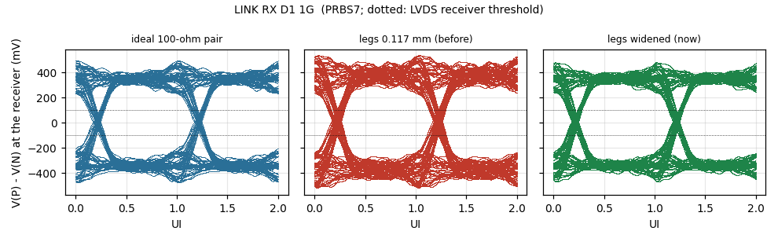

# Signal and power integrity — review of 11 November 2026

*Board `CSI2-KRIA-KV260_Rev01.kicad_pcb` as committed on 11 Nov · stack JLC06161H-2116A · figures
and their data in [`docs/sim/`](sim/)*

An RF/high-speed engineer looked at the board of 10 November and raised the points below. Every one
was checked against the board's own copper, fixed where it was right, and measured or simulated
again. This page is the record: what was wrong, what changed, the numbers before and after, and
what is still a compromise.

| Point raised | Verdict | Now |
|---|---|---|
| The switch → SMA legs were not 50 Ω | **Right**: the RF50 net class missed the auto-named nets, so they were 0.10 mm | Every RF50 net (28) at 183 µm, checked by net class and DRC (§2) |
| The SMA launch is not a transmission line | **Right**: one ground via per SMA, pad over L2 | Three vias per ground leg, L2–L4 cut out under the pad; openEMS: return loss 13.5 → 24.5 dB at 1 GHz (§2.1) |
| Controlled impedance and length matching | Half right: lengths were matched, but the LVDS legs were 59 Ω single tracks (119 Ω pairs) | Legs widened to 50 Ω where they run apart: 74 % of their length at 50 Ω, eye as an ideal pair (§3) |
| Power planes / decoupling loop inductance | **Right** for VCCINT: its L4 island was cut off from its own decoupling and from the regulator by the plane clearance | Zone clearance 0.15 mm, island extended under its caps; VCCINT meets its target to 81 MHz (was 26 MHz) (§4) |
| Autorouted, "random" placement | A style point | The checks below are what decides whether it works; they were all run |

Other things a reviewer would look at, found and fixed in the same pass: return vias at the LVDS
and clock layer changes, two clock lines coupled at −19.5 dB, a clock leg beside a data leg on the
link, exposed pads without vias, the board edge without stitching, the power plane running to the
edge (§5).

---

## 1. Stack and impedance

2D field solver (`_work/field_solver.py`, finite differences on the 2116A cross-sections; JLCPCB's
calculator agrees within 1–3 %, POWER_AND_STACKUP §2.6):

| Line | Width | Z0 |
|---|---|---|
| L1/L6 microstrip over L2/L5 (0.1164 mm) | 0.183 mm | 49.8 Ω |
| L3 stripline (L2 0.13 mm above, L4 0.93 mm below) | 0.175 / 0.183 mm | 50.2 / 48.9 Ω |
| L4 track (L5 0.13 mm below, L2 1.06 mm above) | 0.175 mm | 50.4 Ω |
| L1 RF line beside the L1 ground pour, 0.3 / 0.5 mm gap | 0.183 mm | 49.3 / 49.8 Ω |
| Neck-down at a 0.5 mm-pitch pin (first mm) | 0.15 mm | 53–54 Ω |

Every signal layer has a ground plane 0.12–0.13 mm away: L1 and L3 reference L2, L4 and L6
reference L5. That is why a split in L4 (the power layer) under an L3 line costs little: the line's
return runs in L2.

**Reference-plane check.** The two ground planes were filled the way KiCad fills them and every
RF50/LVDS/clock segment was walked in 0.1 mm steps: is the strip under it (trace width + 0.1 mm a
side) solid copper? Over 3,628 mm, 10 places run more than 1 mm over a void, 11 mm in all, each a
crossing of a via cluster's antipads in the BGA field. No slot, no split.

---

## 2. RF band (switch → DC block → SMA)

Rebuilt by hand, not by the router:

- every leg a straight 183 µm microstrip on L1, no via, 100 pF DC block next to the switch pin;
- the DC-bias parts (100 nF, Zener, resistors) moved to the bottom, under each switch cell;
- four vias in each switch's exposed pad; L1 and L6 ground pours over the band, tied to L2/L5 by a
  via fence 0.8 mm off each line at 1 mm pitch (226 vias);
- the 64.9 Ω terminations of the long IF lines moved under their DC-block caps (R501, R601, R621):
  the 7–10 mm stubs to them are gone;
- the RF50 net-class patterns now cover the auto-named nets (`Net-(J4*-In)`, `Net-(J9*-In)`,
  `Net-(U90*-RFOUT*)`, U401's clock nets). A design rule (`CSI2-KRIA-KV260_Rev01.kicad_dru`) lets
  the 0.15 mm neck at a 0.5 mm-pitch pin keep the default clearance.

The eight long RF lines (six IF, CLK_REF_IN, CLK_OUT) are 183 µm end to end with at most two vias
each, and every via has two ground vias within 0.75–1.8 mm.

### 2.1 SMA launch, simulated

openEMS 0.37 (FDTD), the stack as built, FR-4 loss tan δ 0.02, the L1 pour, the via fence and the
SMA's stitching vias. Through-line model: 183 µm line → the SMA's 1.27 × 3.2 mm signal pad → line.
A bare line through the same set-up is the control: |S11| ≤ −32 dB, |S21| −0.15 dB to 4.5 GHz.

| |S11| | 0.5 GHz | 1 GHz | 2 GHz | 3 GHz |
|---|---|---|---|---|
| Pad over L2 (10 Nov) | −19.4 dB | −13.5 dB | −8.0 dB | −5.2 dB |
| **L2–L4 cut out under the pad (now)** | **−30.3 dB** | **−24.5 dB** | **−19.0 dB** | **−16.4 dB** |

The wide pad 0.116 mm over L2 is a 13 Ω shunt capacitance; with the planes cleared it references
L5 (1.36 mm down) and comes close to 50 Ω. |S21| at 3 GHz: −1.76 → −0.28 dB.

---

## 3. LVDS

### 3.1 What the router left

The LVDS pairs (link to the Kria, both ADCs' data and clocks) were laid as two separate legs:
89 % of their length runs more than 1 mm apart, so they are loosely coupled pairs. A loosely coupled
pair's impedance is twice its legs' Z0, and the legs were 0.117 mm (the coupled-pair width):
59 Ω each, 117–119 Ω for the pair against a 100 Ω termination.

### 3.2 What changed

Each leg was widened to its layer's 50 Ω width (0.183 mm on L1/L6, 0.175 mm on L3/L4) wherever the
clearances allow, judged in 0.5 mm pieces so a leg necks only where something is in the way. The
centre lines did not move, so lengths and skew are unchanged.

| Width | Length | Leg Z0 | Pair |
|---|---|---|---|
| 0.183 / 0.175 mm | 1,896 mm, 74 % | 49–50 Ω | ≈ 100 Ω |
| 0.15 mm | 270 mm, 11 % | 53–54 Ω | ≈ 107 Ω |
| 0.13 mm | 102 mm, 4 % | 57 Ω | ≈ 114 Ω |
| 0.117 mm (no room: BGA escapes) | 237 mm, 9 % | 58–59 Ω | ≈ 118 Ω |
| coupled stretches, left as they were | 55 mm, 2 % | — | 100 Ω |

### 3.3 Eye, simulated

ngspice, PRBS7 at 1 Gb/s, LVDS current driver (3.5 mA, 300 ps edges), 100 Ω across the receiver and
2 pF per input; each leg is its own copper by layer and width, with Z0 and delay from the field
solver, the mismatched sections put together at the receiver end (ordered by Z0; sections under
3 mm lumped). Re-run on the final board of 11 Nov (with the ESD parts); differences from the first
run are within 15 mV and 10 ps.
Three cases per pair: an ideal 100 Ω pair of the same length, the legs at 0.117 mm (10 Nov), the
legs as now.

| Pair (P leg) | Zero-crossing spread: ideal / 0.117 mm / **now** | Eye opening: ideal / 0.117 mm / **now** |
|---|---|---|
| LINK_RX_D1 (144 mm, the longest) | 75 / 102 / **77 ps** | 575 / 547 / **559 mV** |
| LINK_RX_D0 (126 mm) | 36 / 67 / **33 ps** | 603 / 607 / **569 mV** |
| LINK_RX_CLK (118 mm) | 12 / 54 / **14 ps** | 548 / 625 / **516 mV** |
| ADCS_FCO (63 mm) | 48 / 51 / **40 ps** | 643 / 641 / **650 mV** |
| CLK_ADCS (63 mm) | 13 / 13 / **11 ps** | 619 / 668 / **630 mV** |

On the long link pairs the narrow legs doubled the edge spread (the reflections off a 59 Ω leg
into a 100 Ω load come back on the next edges); widened, they match the ideal pair. On the 63 mm
ADC pairs it makes no difference worth the name. The narrow legs show a slightly larger opening
because the same 3.5 mA into a higher impedance gives more volts; the opening is in every case
five times the receiver's ±100 mV threshold. The spread includes each pair's own P−N delay (from
the copper by layer here; `lvds_skew.py`'s pin-to-pin figures are in §3.4). At 1.25 Gb/s (the
Artix-7's LVDS ceiling) LINK_RX_D1 opens 378 mV; at 1.5 Gb/s 208 mV, still above threshold. Each
pair's figure is in [`docs/sim/`](sim/), the numbers in `lvds_eye.csv`.

**On the rate.** IAS1 carries five pairs, but two are source-synchronous clocks: three data lanes
at up to 1 Gb/s each (two to the Kria, one back; INTERFACE_SPEC §3). What signal integrity sees is
the rate per lane, 1 Gb/s.

### 3.4 Skew

Unchanged by the widening (`_work/layout/lvds_skew.py`, pin to pin). One change: **LINK_RX_CLK**
was −60 ps, over the 50 ps rule of LAYOUT §6.3; its P leg now has 10 mm of meander on L1, on the
side of its own N leg: **0 ps**. Data to clock on LINK_RX: D0 +79 → +51 ps, D1 +207 → +177 ps
(the Kria's IDELAYE3 trains these).

**With the FPGA's package delays** (11 Nov evening). The figures above are pad to pad. AMD gives each
XC7A50T-FTG256 ball's flight time inside the package (Vivado `get_package_pins`, MIN_DELAY and
MAX_DELAY; 35–133 ps across the I/O balls). They are in `_work/layout/xc7a50t_ftg256_pkg_delays.csv`, and
`lvds_skew.py` now adds each FPGA ball's mean delay to its leg (`--no-pkg` for pad to pad):

| | Pad to pad | With the package |
|---|---|---|
| Package share of a pair's P−N | — | −4.4 to +9.4 ps |
| Worst P−N, pairs at 1 Gb/s | ±42 ps | ±40 ps (LINK_TX_CLK −40, ADCS_D1 +38) |
| LINK_RX data − clock | D0 +51, D1 +177 ps | D0 +40, D1 +190 ps |
| LINK_TX data − clock | +2 ps | −15 ps |
| ADCS (AD9253) data − DCO | −74 to +45 ps | −81 to +24 ps |
| ADCR (AD9484) data − DCO | −80 to −16 ps | −86 to +2 ps |

The P−N skews stay within the rule. The data-to-clock offsets are what each lane's IDELAY calibrates
at start-up (78 ps taps on the Artix-7, 1.1 ns range on the K26's IDELAYE3).

### 3.5 Crosstalk

Parallel runs closer than three widths for more than 2 mm were listed and the coupling computed
with the field solver (even/odd mode):

| Run | Before | Fix | After |
|---|---|---|---|
| U401's reference input (CLK0) and its output Q3, 47 mm side by side on L3 | 0.22 mm gap, NEXT −19.5 dB: the buffer's output fed back into its own input pin | Q3 moved out to the board edge (x 207.55) and its diagonal 1.3 mm off | 1.0–1.3 mm, about −45 dB |
| LINK_RX_CLK_P beside LINK_RX_D0_P, 31 mm on L1 | 0.16 mm gap, about −18 dB | Each P leg moved next to its own N leg | 1.0 mm between the pairs, about −46 dB |

What is left on the list is a data leg beside a supply track, flash or I²C lines (static while the
board runs), or another lane of the same bus at ≥ 0.3 mm.

---

## 4. Power distribution

### 4.1 What was wrong

Measured on the board's copper (KiCad-style fill of L4, connectivity by overlap, 0.4 nH/mm of
track, via barrels by height; UG483's criterion is the impedance from 100 kHz to 10 MHz):

- **VCCINT's L4 island under the BGA was cut off from the strip that feeds it** from the buck. With a
  0.3 mm zone clearance, the 0.45 mm vias at 1 mm pitch leave no copper between them: the island
  reached the rest of +1V0 only through tracks. The same clearance on the GND planes left no web
  between neighbouring BGA vias.
- VCCINT's 0.47 µF caps reached the balls through 58–63 nH of track.

### 4.2 What changed

- **Inner-plane zone clearance 0.3 → 0.15 mm** (L2, L4, L5): 0.25 mm of copper between vias at
  1 mm pitch. JLCPCB's inner-layer minimum is 0.1 mm.
- The +1V0 island extended under the four 0.47 µF caps below the BGA (no +3V3_D via needs L4
  there) and a notch cut where it swallowed a DAC's +3V3_D via.
- Five vias in the buck inductor L1030's output pad, straight into the strip.
- Butted vias on decoupling pads where there was room (UG483: "never connect vias to the lands with
  a section of trace").

UG483's required caps for the XC7A50T in FTG256 (Table 2-2: VCCINT 1 × 330 µF, 3 × 4.7 µF,
5 × 0.47 µF; VCCBRAM 1 × 100 µF, 1 × 0.47 µF; VCCAUX 1 × 47 µF, 2 × 4.7 µF, 3 × 0.47 µF) are all
on the board. Artix-7 has no capacitors inside its package (UG483 p. 14), so the board's network is
all there is.

### 4.3 Impedance at the balls

| Rail | Target | |Z| max, 0.1–10 MHz (before → now) | Over the target |
|---|---|---|---|
| +1V0 VCCINT | 120 mΩ | 67 → **69 mΩ** | 26 MHz and up → **81 MHz and up**; 470 → 149 mΩ at 100 MHz |
| +1V8_D VCCAUX, VCCO_35 | 700 mΩ | 127 → 109 mΩ | nowhere to 100 MHz |
| +2V5 VCCO_34 | 2 Ω | 149 → 146 mΩ | nowhere |
| +3V3_D VCCO | 1 Ω | 36 → 37 mΩ | nowhere |

Model (`pdn2.py`): each capacitor's loop is its ESL, its pads and vias, and the copper path to the
balls; the die draws on all its balls of a rail at once, so from a plane the paths to the balls are
in parallel. Both boards above are computed with the same model. The step that is left for VCCINT
above 80 MHz is 0402 caps on the bottom face inside the BGA footprint (L4 is 0.25 mm from the
bottom face and 1.18 mm from the top): it needs the BGA's bottom-side fan-out redone (§6).

The other rails' plots: [`sim/pdn_1V8_D.png`](sim/pdn_1V8_D.png), [`sim/pdn_2V5.png`](sim/pdn_2V5.png),
[`sim/pdn_3V3_D.png`](sim/pdn_3V3_D.png).

### 4.4 DC drop

Least-resistance copper path from the regulator to the balls (1 oz outer, 0.5 oz inner; parallel
paths ignored, so an upper bound):

| Rail | Current (FPGA's share) | Path | Drop |
|---|---|---|---|
| +1V0 from L1030 | 700 mA | 27–46 mΩ | 19–32 mV (1.9–3.2 %; 34–53 mΩ before the inductor's vias) |
| +1V8_D from U1006 | about 150 mA | 184–263 mΩ | 28–39 mV (1.5–2.2 %) |
| +2V5 from L1020 | about 100 mA | 287–307 mΩ | 29–31 mV (1.2 %) |

VCCINT's limit is ±5 %. With the TPS562201's ±1.5 % and 32 mV, the worst ball sits at about 0.958 V
at full estimated load: inside, with little to spare. If Vivado's power report comes in above
700 mA, set the buck to 1.02 V (one feedback resistor).

---

## 5. Other checks

| Check | Found | Fixed |
|---|---|---|
| Return vias at layer changes (LVDS, clocks) | 145 of 185 reference-changing vias without a ground via within 1 mm | 118 ground vias added; now 39 within 1 mm, 76 within 2 mm, 49 within 3 mm, 21 farther (λ/20 at the 1.2 GHz knee of a 300 ps edge is 6 mm). RF50: two within 1.8 mm, one exception with one |
| Exposed pads | LMR33630, all three TPS7A8300 (one dissipates 0.5 W), one AD8352 with **no via**; AD9253 3 vias in 31 mm² | Via grids in every pad (POFV): LMR33630 15, each TPS7A8300 4, AD8352s 2–5, AD9253 15, AD9484 16, ADCLK948 6 |
| Board edge | 256 of 1,122 points on the outline had a ground via within 3 mm | 176-via fence 0.8 mm in, 2.5 mm pitch (22 stations blocked by connectors) |
| Power plane at the edge | L4 ran to the edge with L2/L5 | Every L4 zone pulled back 1 mm from the edge |
| Plane splits under fast lines | None (§1) | — |
| Acute angles | 453 junctions under 90°, mostly overlapping collinear segments and the router's 45° steps | None: JLCPCB's process does not need it; no DFM flag |

---

## 6. What is still a compromise

- **17 of the FPGA's 69 supply balls have no via of their own**: VCCINT F7, G6, K9, L8; GND A1,
  F8, G13, K7, K14, N5, N15; +1V8_D A6, J2, K11; +3V3_D L16, T11; +2V5 R4. Each reaches its plane
  through a short top track to a neighbour's via (VCCINT: 5 of 9 balls have one). Adding one means
  re-routing the BGA escape under it; the incremental attempt kept six and reverted fifteen. Tried
  again for the four VCCINT balls (rip the blocking tracks, re-route, then rip around what is left):
  every attempt left 1–12 nets unroutable. It needs the BGA fan-out redone by hand, together with
  the bottom-side VCCINT capacitors (§4.3).
- **The LVDS pairs are loosely coupled**, not routed as coupled pairs: 100 Ω by leg width, but
  less rejection of common-mode noise picked up on the way. A pair-routed board is still the
  better board.
- **21 LVDS/clock layer changes have their nearest ground via 3.0–4.0 mm away** (the limit set
  here is 3 mm; λ/20 at a 300 ps edge is 6 mm), all in the dense field between the FPGA and the
  ADCs and at the link connector. No free spot nearer clears the other nets by 0.15 mm.
- **VCCINT's 4.7 µF caps** sit 6 mm above the BGA, fed by track (7–13 nH): no room on either face
  over the island. UG483 allows "within two electrical inches"; the impedance target holds.

## 7. Environment

| | State |
|---|---|
| Temperature | Every IC industrial or better: XC7A50T-2FTG256**I** (Tj −40 to 100 °C), ADCs, drivers, clock buffer, DACs, regulators −40 to 85/125 °C, RF switches −55 to 105 °C, Hirose BM20B −35 to 85 °C. Capacitors X7R/X5R (X5R to 85 °C) |
| Heat | The 0.5 W LDO now has its thermal vias; the bucks are SOT-23 parts at ≤ 0.4 W |
| Input | 12 V: PTC, reverse-polarity P-FET, SMBJ15CA TVS (POWER_SPEC). Vehicle use needs ISO 7637-2 (VEHICLE_PLATFORM V-05) |
| Mechanics | Five M3 holes (two through the KV260, three to standoffs); edge SMAs soldered and through the board. For vibration: staking of the SMAs and the 7343 capacitor, or a conformal coat, at assembly |
| EMI | Ground planes next to every signal layer, edge fence, power plane pulled back, return vias (§5) |
| ESD | Every external connector: a PESD5V0F1BL (0.4 pF, bidirectional, IEC 61000-4-2) on each of the 12 SMAs, 2.15 mm from the SMA pad; TPD4E05U06DQAR four-channel arrays (0.5 pF) on the Pmod (U1108, U1109) and JTAG (U1110) next to their headers. Each ground pad has its own GND via (0.4–1 mm). The 12 V input already has its SMBJ15CA. §7.1 |

### 7.1 ESD on the SMAs

The SMAs carry HF from 100 kHz, the wideband SDR to about 250 MHz, the radar IF at 120 MHz and the
reference clock to 500 MHz. A shunt inductor to ground (an "RF choke") that does not load 50 Ω at
100 kHz needs more than 80 µH, which self-resonates at a few MHz: it would short VHF and protect
nothing. A low-capacitance TVS is the part for this band. openEMS, the launch of §2.1 with the
diode's pad and 0.5 pF where it is placed (2.15 mm from the SMA pad):

| | 0.5 GHz | 1 GHz | 3 GHz |
|---|---|---|---|
| S11 | −34.0 dB | −26.8 dB | −11.8 dB |
| S21 | −0.15 dB | −0.16 dB | −0.47 dB |

In the band used the launch is as good as without it (the `tvs` curve in the §2.1 figure).

## 8. How it was checked

The checks were scripts run on the board file, none by hand: a KiCad-style plane fill, the
connectivity graph of each net, the field solver, ngspice and openEMS (built from source in WSL).
The DRC after every change: **0 errors, 0 unconnected, 0 schematic-parity problems**.
