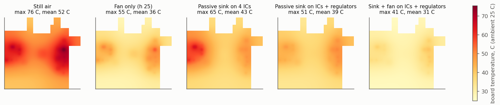
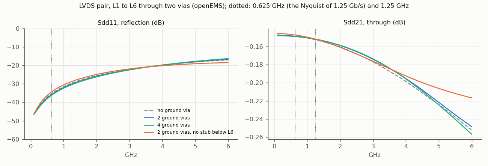
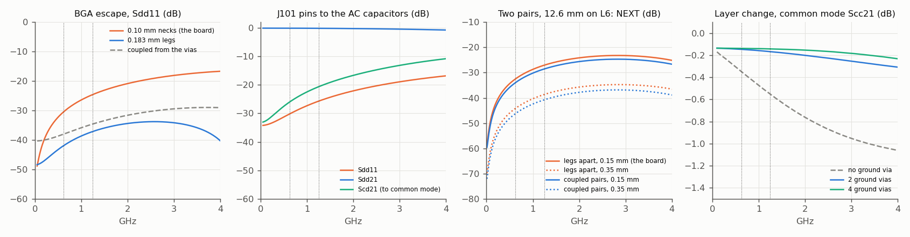
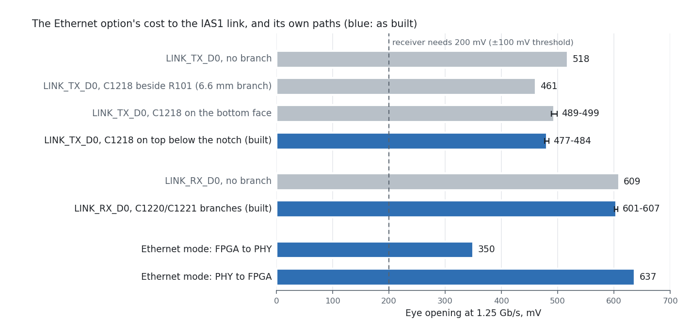

# Signal and power integrity — review of 11 November 2026

*Board `CSI2-KRIA-KV260_Rev01.kicad_pcb` as committed on 11 Nov · stack JLC06161H-2116A · figures
and their data in [`docs/sim/`](sim/)*

> **12 November 2026: the board is now 8 layers (JLC08161H-2116C).** Sections 1–7 are the record of
> the 6-layer review. §8 is the 8-layer board, measured with the same scripts and compared with the
> 6-layer one and with an ideal line; where it changes a statement above, §8 says so.

An RF/high-speed engineer looked at the board of 10 November and raised the points below. Every one
was checked against the board's own copper, fixed where it was right, and measured or simulated
again. This page is the record: what was wrong, what changed, the numbers before and after, and
what is still a compromise.

| Point raised | Verdict | Now |
|---|---|---|
| The switch → SMA legs were not 50 Ω | **Right**: the RF50 net class missed the auto-named nets, so they were 0.10 mm | Every RF50 net (28) at 183 µm, checked by net class and DRC (§2); the only narrower copper is deliberate: 0.15 mm necks at 0.5 mm-pitch pins and 0.1 mm sections that tune out each ESD diode (§7.1) |
| The SMA launch is not a transmission line | **Right**: one ground via per SMA, pad over L2 | Three vias per ground leg, L2–L4 cut out under the pad; openEMS: return loss 13.5 → 24.5 dB at 1 GHz (§2.1) |
| Controlled impedance and length matching | Half right: lengths were matched, but the LVDS legs were 59 Ω single tracks (119 Ω pairs) | Legs widened to 50 Ω where they run apart: 74 % of their length at 50 Ω, eye as an ideal pair (§3) |
| Power planes / decoupling loop inductance | **Right** for VCCINT: its L4 island was cut off from its own decoupling and from the regulator by the plane clearance | Zone clearance 0.15 mm, island extended under its caps, four 0.47 µF on the bottom face under the BGA; VCCINT meets its target to 100 MHz (was over it from 26 MHz) (§4) |
| Autorouted, "random" placement | A style point | The checks below are what decides whether it works; they were all run |

Other things a reviewer would look at, found and fixed in the same pass: return vias at the LVDS
and clock layer changes, two clock lines coupled at −19.5 dB, a clock leg beside a data leg on the
link, legs of different pairs side by side (§3.5), exposed pads without vias, the board edge without stitching, the power plane running to the
edge (§5).

---

## 1. Stack and impedance

2D field solver (`_work/field_solver.py`, finite differences on the 2116A cross-sections; JLCPCB's
calculator agrees within 1–3 %, POWER_AND_STACKUP §2.6):

| Line | Width | Z0 |
|---|---|---|
| L1/L6 microstrip over L2/L5 (0.1164 mm) | 0.183 mm | 49.8 Ω |
| L3 stripline (L2 0.13 mm above, L4 0.93 mm below) | 0.175 / 0.183 mm | 50.2 / 48.9 Ω |
| L4 track (L5 0.13 mm below, L2 1.06 mm above) | 0.175 mm | 50.4 Ω |
| L1 RF line beside the L1 ground pour, 0.3 / 0.5 mm gap | 0.183 mm | 49.3 / 49.8 Ω |
| Neck-down at a 0.5 mm-pitch pin (first mm) | 0.15 mm | 53–54 Ω |

Every signal layer has a ground plane 0.12–0.13 mm away: L1 and L3 reference L2, L4 and L6
reference L5. That is why a split in L4 (the power layer) under an L3 line costs little: the line's
return runs in L2.

**Reference-plane check.** The two ground planes were filled the way KiCad fills them and every
RF50/LVDS/clock segment was walked in 0.1 mm steps: is the strip under it (trace width + 0.1 mm a
side) solid copper? Over 3,628 mm, 10 places run more than 1 mm over a void, 11 mm in all, each a
crossing of a via cluster's antipads in the BGA field. No slot, no split.

---

## 2. RF band (switch → DC block → SMA)

Rebuilt by hand, not by the router:

- every leg a straight 183 µm microstrip on L1, no via, 100 pF DC block next to the switch pin;
- the DC-bias parts (100 nF, Zener, resistors) moved to the bottom, under each switch cell;
- four vias in each switch's exposed pad; L1 and L6 ground pours over the band, tied to L2/L5 by a
  via fence 0.8 mm off each line at 1 mm pitch (226 vias);
- the 64.9 Ω terminations of the long IF lines moved under their DC-block caps (R501, R601, R621):
  the 7–10 mm stubs to them are gone;
- the RF50 net-class patterns now cover the auto-named nets (`Net-(J4*-In)`, `Net-(J9*-In)`,
  `Net-(U90*-RFOUT*)`, U401's clock nets). A design rule (`CSI2-KRIA-KV260_Rev01.kicad_dru`) lets
  the 0.15 mm neck at a 0.5 mm-pitch pin keep the default clearance, and a second one keeps the
  ground pour 0.24 mm off the 0.1 mm ESD compensation sections (§7.1).

The eight long RF lines (six IF, CLK_REF_IN, CLK_OUT) are 183 µm end to end with at most two vias
each, and every via has two ground vias within 0.75–1.8 mm.

### 2.1 SMA launch, simulated

openEMS 0.37 (FDTD), the stack as built, FR-4 loss tan δ 0.02, the L1 pour, the via fence and the
SMA's stitching vias. Through-line model: 183 µm line → the SMA's 1.27 × 3.2 mm signal pad → line.
A bare line through the same set-up is the control: |S11| ≤ −32 dB, |S21| −0.15 dB to 4.5 GHz.

| |S11| | 0.5 GHz | 1 GHz | 2 GHz | 3 GHz |
|---|---|---|---|---|
| Pad over L2 (10 Nov) | −19.4 dB | −13.5 dB | −8.0 dB | −5.2 dB |
| L2–L4 cut out under the pad | −30.2 dB | −24.4 dB | −19.0 dB | −16.4 dB |
| Cut-out + ESD diode, uncompensated | −34.0 dB | −26.8 dB | −17.6 dB | −11.8 dB |
| **Cut-out + ESD diode, compensated (on the board, §7.1)** | **−39.0 dB** | **−30.6 dB** | **−19.9 dB** | **−13.5 dB** |
| Bare line (the set-up's floor) | −42.5 dB | −38.4 dB | −33.8 dB | −31.9 dB |

The wide pad 0.116 mm over L2 is a 13 Ω shunt capacitance; with the planes cleared it references
L5 (1.36 mm down) and comes close to 50 Ω. |S21| at 3 GHz: −1.76 → −0.28 dB.

How to read the figure: the bare line is not a target a connector can reach, it is what the
simulation itself returns for a uniform 50 Ω line with no connector (mesh and port error), so it is
the floor. The band the SMAs carry ends at 500 MHz (shaded). There the board's launch is at
−39 dB, 3.5 dB from the floor; return loss better than 20 dB (VSWR 1.22, the dotted line) holds to
2 GHz, four times the highest frequency used. Above 2 GHz the ESD diode's capacitance shows: the
cost of protecting the connector, and outside the band.

---

## 3. LVDS

### 3.1 What the router left

The LVDS pairs (link to the Kria, both ADCs' data and clocks) were laid as two separate legs:
89 % of their length runs more than 1 mm apart, so they are loosely coupled pairs. A loosely coupled
pair's impedance is twice its legs' Z0, and the legs were 0.117 mm (the coupled-pair width):
59 Ω each, 117–119 Ω for the pair against a 100 Ω termination.

### 3.2 What changed

Each leg was widened to its layer's 50 Ω width (0.183 mm on L1/L6, 0.175 mm on L3/L4) wherever the
clearances allow, judged in 0.5 mm pieces so a leg necks only where something is in the way. The
centre lines did not move, so lengths and skew are unchanged.

| Width | Length | Leg Z0 | Pair |
|---|---|---|---|
| 0.183 / 0.175 mm | 1,896 mm, 74 % | 49–50 Ω | ≈ 100 Ω |
| 0.15 mm | 270 mm, 11 % | 53–54 Ω | ≈ 107 Ω |
| 0.13 mm | 102 mm, 4 % | 57 Ω | ≈ 114 Ω |
| 0.117 mm (no room: BGA escapes) | 237 mm, 9 % | 58–59 Ω | ≈ 118 Ω |
| coupled stretches, left as they were | 55 mm, 2 % | — | 100 Ω |

### 3.3 Eye, simulated

ngspice, PRBS7 at 1 Gb/s, LVDS current driver (3.5 mA, 300 ps edges), 100 Ω across the receiver and
2 pF per input; each leg is its own copper by layer and width, with Z0 and delay from the field
solver, the mismatched sections put together at the receiver end (ordered by Z0; sections under
3 mm lumped). Re-run on the final board of 11 Nov (with the ESD parts); differences from the first
run are within 15 mV and 10 ps.
Three cases per pair: an ideal 100 Ω pair of the same length and termination, the board on 6 layers
(11 Nov) and on 8 layers (12 Nov, §8).

| Pair | 6 layers: ideal / routed | 8 layers: ideal / routed |
|---|---|---|
| ADCR_D0 | 600 / 583 mV, 29 / 25 ps | 634 / 632 mV, 16 / 16 ps |
| ADCR_D1 | 515 / 484 mV, 14 / 15 ps | 474 / 473 mV, 19 / 19 ps |
| ADCR_D2 | 594 / 481 mV, 27 / 56 ps | 465 / 463 mV, 23 / 23 ps |
| ADCR_D3 | 531 / 526 mV, 62 / 53 ps | 464 / 463 mV, 23 / 23 ps |
| ADCR_D4 | 542 / 557 mV, 34 / 54 ps | 633 / 607 mV, 19 / 17 ps |
| ADCR_D5 | 458 / 446 mV, 54 / 71 ps | 505 / 505 mV, 16 / 16 ps |
| ADCR_D6 | 540 / 513 mV, 20 / 41 ps | 471 / 500 mV, 22 / 25 ps |
| ADCR_D7 | 633 / 609 mV, 18 / 18 ps | 471 / 466 mV, 16 / 17 ps |
| ADCR_DCO | 626 / 581 mV, 24 / 35 ps | 609 / 610 mV, 17 / 18 ps |
| ADCR_OR | 450 / 465 mV, 69 / 85 ps | 647 / 646 mV, 19 / 18 ps |
| ADCS_D0 | 581 / 564 mV, 41 / 51 ps | 618 / 614 mV, 22 / 25 ps |
| ADCS_D1 | 589 / 533 mV, 53 / 39 ps | 625 / 607 mV, 16 / 15 ps |
| ADCS_DCO | 597 / 602 mV, 40 / 35 ps | 632 / 609 mV, 18 / 20 ps |
| ADCS_FCO | 648 / 650 mV, 49 / 46 ps | 628 / 617 mV, 17 / 17 ps |
| FPGA_CLK | 448 / 446 mV, 16 / 17 ps | 517 / 499 mV, 29 / 29 ps |
| LINK_RX_CLK | 548 / 516 mV, 12 / 14 ps | 395 / 392 mV, 10 / 10 ps |
| LINK_RX_D0 | 607 / 559 mV, 35 / 30 ps | 509 / 457 mV, 25 / 31 ps |
| LINK_RX_D1 | 575 / 559 mV, 75 / 77 ps | 385 / 372 mV, 41 / 51 ps |
| LINK_TX_CLK | 661 / 635 mV, 63 / 69 ps | 642 / 643 mV, 63 / 63 ps |
| LINK_TX_D0 | 664 / 653 mV, 65 / 68 ps | 674 / 665 mV, 64 / 62 ps |

*Eye opening at the centre of the bit, then zero-crossing spread; each board against the ideal line of its own pair length and termination.*

The ideal line differs between the two boards because the pair lengths and the termination point
changed (on 8 layers every termination sits on the FPGA's ball vias). The opening is in every case
several times the receiver's ±100 mV threshold. For LINK_RX the model ends at the AC capacitors,
so those eyes are indicative only. The numbers are in [`docs/sim/`](sim/) (`lvds_eye.csv`).

**On the rate.** IAS1 carries five pairs, but two are source-synchronous clocks: three data lanes
at up to 1 Gb/s each (two to the Kria, one back; INTERFACE_SPEC §3). What signal integrity sees is
the rate per lane, 1 Gb/s.

### 3.4 Skew

Unchanged by the widening (`_work/layout/lvds_skew.py`, pin to pin). One change: **LINK_RX_CLK**
was −60 ps, over the 50 ps rule of LAYOUT §6.3; its P leg now has 10 mm of meander on L1, on the
side of its own N leg: **0 ps**. Data to clock on LINK_RX: D0 +79 → +51 ps, D1 +207 → +177 ps
(the Kria's IDELAYE3 trains these).

**With the FPGA's package delays** (11 Nov evening). The figures above are pad to pad. AMD gives each
XC7A50T-FTG256 ball's flight time inside the package (Vivado `get_package_pins`, MIN_DELAY and
MAX_DELAY; 35–133 ps across the I/O balls). They are in `_work/layout/xc7a50t_ftg256_pkg_delays.csv`, and
`lvds_skew.py` now adds each FPGA ball's mean delay to its leg (`--no-pkg` for pad to pad):

| | Pad to pad | With the package |
|---|---|---|
| Package share of a pair's P−N | — | −4.4 to +9.4 ps |
| Worst P−N, pairs at 1 Gb/s | ±42 ps | ±40 ps (ADCS_D1 +40, LINK_TX_CLK −36) |
| LINK_RX data − clock | D0 +51, D1 +177 ps | D0 +41, D1 +190 ps |
| LINK_TX data − clock | +2 ps | −17 ps |
| ADCS (AD9253) data − DCO | −74 to +45 ps | −81 to +26 ps |
| ADCR (AD9484) data − DCO | −80 to −16 ps | −88 to 0 ps |

The P−N skews stay within the rule. The data-to-clock offsets are what each lane's IDELAY calibrates
at start-up (78 ps taps on the Artix-7, 1.1 ns range on the K26's IDELAYE3).

### 3.5 Crosstalk

Parallel runs closer than three widths for more than 2 mm were listed and the coupling computed
with the field solver (even/odd mode):

| Run | Before | Fix | After |
|---|---|---|---|
| U401's reference input (CLK0) and its output Q3, 47 mm side by side on L3 | 0.22 mm gap, NEXT −19.5 dB: the buffer's output fed back into its own input pin | Q3 moved out to the board edge (x 207.55) and its diagonal 1.3 mm off | 1.0–1.3 mm, about −45 dB |
| LINK_RX_CLK_P beside LINK_RX_D0_P, 31 mm on L1 | 0.16 mm gap, about −18 dB | Each P leg moved next to its own N leg | 1.0 mm between the pairs, about −46 dB |

**Legs of different pairs side by side.** Because the pairs are not coupled, a leg can run beside
a leg of another pair with nothing of its own partner to cancel it. Every fast leg was walked in
0.25 mm steps against every other pair's copper on its layer: 133 mm (of 3,639 mm) ran with less
than 0.25 mm to another pair's leg, at the class clearance of 0.15 mm in the worst places. Field
solver, 0.183 mm legs on L1/L6: backward coupling 14.5 % at a 0.15 mm gap, 7.7 % at 0.25 mm,
4.6 % at 0.35 mm, 2 % at 0.55 mm (L3: 16.7 / 9.7 / 6.1 / 2.8 %). A run shorter than 25 mm (half
a 300 ps edge) couples in proportion to its length.

Where there was room the leg was moved away with a 45° jog at each end (seven runs, 42 mm; skew
changed by 3 ps at most): ADCS_FCO_N off ADCS_D1_N (14 mm, 0.15 → 0.35 mm), off LINK_RX_CLK_P,
ADCR_D2_P off ADCR_D0_P, LINK_RX_D0_N off ADCR_OR_N and three shorter ones. **98 mm are left**
with less than 0.25 mm, none with room to move without re-routing its neighbours. The worst:

| Run | Layer | Length under 0.25 mm | Near-end crosstalk on the victim leg |
|---|---|---|---|
| ADCR_D0_P beside ADCR_D1_N | L6 | 12.6 mm at 0.15 mm | 7 % of the aggressor's swing |
| ADCR_D1_P beside ADCR_D3_P | L1 | 7.7 mm | 4.5 % |
| F_DACR_CLK beside LINK_RX_CLK_N | L1 | 6.4 mm | 3.7 % |
| ADCR_D4_P beside ADCS_FCO_P | L1 | 6.0 mm | 3.5 % |
| ADCR_OR_N beside ADCS_D1_P | L6 | 5.7 mm | 3.3 % |
| ADCR_D6_N beside ADCR_D7_N | L1 | 5.6 mm | 3.2 % |
| LINK_TX_CLK_P beside LINK_TX_D0_N | L3 | 3.9 mm at 0.18 mm | 2.5 % |

7 % of a 350 mV leg is 25 mV on one leg of a pair whose eye opens 550–650 mV and whose receiver
threshold is ±100 mV: it works, with less margin than a coupled pair would have (a coupled pair
sees the same aggressor on both legs). These are in the escape between the FPGA and the two ADCs;
they go with the fan-out (§6). The rest of the list is a data leg beside a supply track, or flash
and I²C lines that are static while the board runs.

---

## 4. Power distribution

### 4.1 What was wrong

Measured on the board's copper (KiCad-style fill of L4, connectivity by overlap, 0.4 nH/mm of
track, via barrels by height; UG483's criterion is the impedance from 100 kHz to 10 MHz):

- **VCCINT's L4 island under the BGA was cut off from the strip that feeds it** from the buck. With a
  0.3 mm zone clearance, the 0.45 mm vias at 1 mm pitch leave no copper between them: the island
  reached the rest of +1V0 only through tracks. The same clearance on the GND planes left no web
  between neighbouring BGA vias.
- VCCINT's 0.47 µF caps reached the balls through 58–63 nH of track.

### 4.2 What changed

- **Inner-plane zone clearance 0.3 → 0.15 mm** (L2, L4, L5): 0.25 mm of copper between vias at
  1 mm pitch. JLCPCB's inner-layer minimum is 0.1 mm.
- The +1V0 island extended under the four 0.47 µF caps below the BGA (no +3V3_D via needs L4
  there) and a notch cut where it swallowed a DAC's +3V3_D via.
- Five vias in the buck inductor L1030's output pad, straight into the strip.
- Butted vias on decoupling pads where there was room (UG483: "never connect vias to the lands with
  a section of trace").
- **Four more 0.47 µF 0402 (C1184–C1187) on the bottom face inside the BGA footprint**, each pad on
  a +1V0 or a GND ball via (via in pad, filled and capped): L4 is 0.25 mm from the bottom face and
  1.18 mm from the top, so their loops are 0.60–0.71 nH, against 1.1–1.4 nH for the best top-side
  caps and 7–13 nH for the 4.7 µF ones. FPGA_IRQ was re-routed off one of them.

UG483's required caps for the XC7A50T in FTG256 (Table 2-2: VCCINT 1 × 330 µF, 3 × 4.7 µF,
5 × 0.47 µF; VCCBRAM 1 × 100 µF, 1 × 0.47 µF; VCCAUX 1 × 47 µF, 2 × 4.7 µF, 3 × 0.47 µF) are all
on the board. Artix-7 has no capacitors inside its package (UG483 p. 14), so the board's network is
all there is.

### 4.3 Impedance at the balls

| Rail | Target | |Z| max, 0.1–10 MHz (before → now) | Over the target |
|---|---|---|---|
| +1V0 VCCINT | 120 mΩ | 67 → **51 mΩ** | 26 MHz and up → **nowhere to 100 MHz**; 470 → 61 mΩ at 100 MHz |
| +1V8_D VCCAUX, VCCO_35 | 700 mΩ | 127 → 109 mΩ | nowhere to 100 MHz |
| +2V5 VCCO_34 | 2 Ω | 149 → 146 mΩ | nowhere |
| +3V3_D VCCO | 1 Ω | 36 → 37 mΩ | nowhere |

Model (`pdn2.py`): each capacitor's loop is its ESL, its pads and vias, and the copper path to the
balls; the die draws on all its balls of a rail at once, so from a plane the paths to the balls are
in parallel. Both boards above are computed with the same model. Without the four bottom-side
caps VCCINT went over its target from 81 MHz (149 mΩ at 100 MHz). Above 100 MHz the package and
the die's own capacitance take over, which a board model cannot see; UG483 sets the board's job at
100 kHz–10 MHz, where VCCINT is at less than half its target.

The other rails' plots: [`sim/pdn_1V8_D.png`](sim/pdn_1V8_D.png), [`sim/pdn_2V5.png`](sim/pdn_2V5.png),
[`sim/pdn_3V3_D.png`](sim/pdn_3V3_D.png).

### 4.4 DC drop

Least-resistance copper path from the regulator to the balls (1 oz outer, 0.5 oz inner; parallel
paths ignored, so an upper bound):

| Rail | Current (FPGA's share) | Path | Drop |
|---|---|---|---|
| +1V0 from L1030 | 700 mA | 27–46 mΩ | 19–32 mV (1.9–3.2 %; 34–53 mΩ before the inductor's vias) |
| +1V8_D from U1006 | about 150 mA | 184–263 mΩ | 28–39 mV (1.5–2.2 %) |
| +2V5 from L1020 | about 100 mA | 287–307 mΩ | 29–31 mV (1.2 %) |

VCCINT's limit is ±5 %. With the TPS562201's ±1.5 % and 32 mV, the worst ball sits at about 0.958 V
at full estimated load: inside, with little to spare. If Vivado's power report comes in above
700 mA, set the buck to 1.02 V (one feedback resistor).

---

## 5. Other checks

| Check | Found | Fixed |
|---|---|---|
| Return vias at layer changes (LVDS, clocks) | 145 of 185 reference-changing vias without a ground via within 1 mm | 136 ground vias added (118 at 0.2 mm from other nets, then 18 more at the 0.15 mm the net classes ask for, two of them after moving a supply and an I²C track aside): 50 within 1 mm, 91 within 2 mm, 44 within 3 mm, **one at 3.1 mm** (ADCR_D4_P; λ/20 at the 1.2 GHz knee of a 300 ps edge is 6 mm). RF50: two within 1.8 mm, one exception with one |
| Exposed pads | LMR33630, all three TPS7A8300 (one dissipates 0.5 W), one AD8352 with **no via**; AD9253 3 vias in 31 mm² | Via grids in every pad (POFV): LMR33630 15, each TPS7A8300 4, AD8352s 2–5, AD9253 15, AD9484 16, ADCLK948 6 |
| Board edge | 256 of 1,122 points on the outline had a ground via within 3 mm | 176-via fence 0.8 mm in, 2.5 mm pitch (22 stations blocked by connectors) |
| Power plane at the edge | L4 ran to the edge with L2/L5 | Every L4 zone pulled back 1 mm from the edge |
| Plane splits under fast lines | None (§1) | — |
| Acute angles | 453 junctions under 90°, mostly overlapping collinear segments and the router's 45° steps | None: JLCPCB's process does not need it; no DFM flag |

---

## 6. What is still a compromise

- **11 of the FPGA's 69 supply balls have no via of their own.** Seven have a plane to reach and
  no room for the via: VCCINT K9, L8; GND A1, F8, G13, N5; +3V3_D L16. Each reaches its plane
  through a short top track to a neighbour's via (VCCINT: 7 of 9 balls have their own; the four
  bottom-side caps of §4.3 sit on those vias). The other four (+1V8_D A6, J2, K11; +2V5 R4) are on
  rails that have no plane under the BGA at all: they are fed by tracks, and a via would reach
  nothing. Their impedance is inside the target all the same (§4.3: 109 mΩ against 700, 144 mΩ
  against 2 Ω). Two ways were tried on every ball: ripping what blocks the spot and re-routing
  (GND K7, K14), and leaving the routing alone but bending the blocking tracks round the new via
  (VCCINT F7, G6; GND N15; +3V3_D T11); each kept only at zero unrouted and zero violations. What
  is left needs the escape of those rows redone.
- **The LVDS pairs are loosely coupled**, not routed as coupled pairs: 100 Ω by leg width, but
  less rejection of common-mode noise picked up on the way, and legs of different pairs side by
  side between the FPGA and the ADCs (§3.5: 98 mm under 0.25 mm, 7 % crosstalk on the worst
  leg). A pair-routed board is the better board; on this placement and pin assignment the pairs
  cross each other on the way out of the BGA, which is why the router could not keep them
  together. It is a change of FPGA pin assignment and escape, not a touch-up.
- **One LVDS layer change has its nearest ground via 3.1 mm away** (ADCR_D4_P; the limit set here
  is 3 mm, λ/20 at a 300 ps edge is 6 mm). The other 185 are within 3 mm, 141 of them within 2 mm.
- **VCCINT's 4.7 µF caps** sit 6 mm above the BGA, fed by track (7–13 nH): no room on either face
  over the island. UG483 allows "within two electrical inches"; the impedance target holds.

**What has not been simulated** (12 Nov). Everything above is 2-D field solving, circuit
simulation and the openEMS SMA launch. None of it replaces measuring a built board:
- **No 3-D full-wave model of the board.** The LVDS eyes use lossless lines with the field-solved
  Z0 and delay of each section, and the crosstalk figures are 2-D coupling coefficients times the
  parallel length. Vias, the BGA breakout and the Hirose connector enter only as lumped sections.
- **No cascade analysis of the RF chains.** The ADC drivers' gains (15 + 10 dB, as AERIS-10), the
  baluns, the anti-alias and reconstruction filters and the RF switches are drawn from their data
  sheets and application notes. Nobody has computed a noise figure, IP3 or ripple-and-gain budget
  per channel, nor simulated the filters' responses with the board's parasitics.
- **No thermal analysis** beyond the per-part dissipation and thermal vias in §7.
- **Nothing is measured.** The first boards are for evaluation: the link's bring-up test is in
  IAS_LINK_SPEC §6, and its capacity and rate ceiling in §7.

How each of these would be done is in §9.6. §9 also covers the rest of the board: the supply
tracks, fixed on 12 Nov (§9.1), and what is still open there (§9.2–9.4).

## 7. Environment

| | State |
|---|---|
| Temperature | Every IC industrial or better: XC7A50T-2FTG256**I** (Tj −40 to 100 °C), ADCs, drivers, clock buffer, DACs, regulators −40 to 85/125 °C, RF switches −55 to 105 °C, Hirose BM20B −35 to 85 °C. Capacitors X7R/X5R (X5R to 85 °C) |
| Heat | The 0.5 W LDO now has its thermal vias; the bucks are SOT-23 parts at ≤ 0.4 W |
| Input | 12 V: PTC, reverse-polarity P-FET, SMBJ15CA TVS (POWER_SPEC). Vehicle use needs ISO 7637-2 (VEHICLE_PLATFORM V-05) |
| Mechanics | Five M3 holes (two through the KV260, three to standoffs); edge SMAs soldered and through the board. For vibration: staking of the SMAs and the 7343 capacitor, or a conformal coat, at assembly |
| EMI | Ground planes next to every signal layer, edge fence, power plane pulled back, return vias (§5) |
| ESD | Every external connector: a PESD5V0F1BL (0.4 pF, bidirectional, IEC 61000-4-2) on each of the 12 SMAs, 2.15 mm from the SMA pad and tuned out by 0.1 mm line sections either side; TPD4E05U06DQAR four-channel arrays (0.5 pF) on the Pmod (U1108, U1109) and JTAG (U1110) next to their headers. Each ground pad has its own GND via (0.4–1 mm). The 12 V input already has its SMBJ15CA. §7.1 |

### 7.1 ESD on the SMAs

The SMAs carry HF from 100 kHz, the wideband SDR to about 250 MHz, the radar IF at 120 MHz and the
reference clock to 500 MHz. A shunt inductor to ground (an "RF choke") that does not load 50 Ω at
100 kHz needs more than 80 µH, which self-resonates at a few MHz: it would short VHF and protect
nothing. A low-capacitance TVS is the part for this band. openEMS, the launch of §2.1 with the
diode's pad and 0.5 pF where it is placed (2.15 mm from the SMA pad):

| | 0.5 GHz | 1 GHz | 2 GHz | 3 GHz |
|---|---|---|---|---|
| S11, diode alone | −34.0 dB | −26.8 dB | −17.6 dB | −11.8 dB |
| **S11, compensated (on the board)** | **−39.0 dB** | **−30.6 dB** | **−19.9 dB** | **−13.5 dB** |
| S21, compensated | −0.15 dB | −0.15 dB | −0.20 dB | −0.37 dB |

The diode is a shunt capacitance on the line. It is tuned out by two short high-impedance sections
either side of it (series inductance, so the three make a low-pass π section close to 50 Ω): the
line is 0.1 mm wide from the DC-block pad up to the diode pad (0.76 mm, all the room there is) and
for 1.4 mm past it towards the SMA, with the ground pour kept 0.24 mm off them (a design rule).
openEMS sweep of the length, 0.1 mm each side: 0.8 mm −38.3 dB at 0.5 GHz, 1.4 mm −39.4, 2.0 mm
−37.1, 2.8 mm −32.2; 0.8 mm before and 1.4 or 1.8 mm after, as fits: −39.0 dB
(`_work/sim/sma_launch.py tvsnAA_BB`). With it the launch with the diode is better in the band
than the bare cut-out was (−30.2 dB at 0.5 GHz).

## 8. Eight layers (12 November)

The stack moved to JLC08161H-2116C: L1 · L2 GND · L3 · L4 PWR · L5 GND · L6 · L7 GND · L8, with
2116 prepreg (0.1194 mm) under the outer layers, so the 183 µm RF width and the SMA launch stand.
Field solver (`_work/field_solver8.py`):

| Line | Width / gap | Z |
|---|---|---|
| L1/L8 microstrip | 0.183 mm | 50.4 Ω |
| L3/L6 stripline, single | 0.151 mm | 50 Ω |
| L3/L6 coupled pair | 0.10 / 0.15 mm | 100.2 Ω |
| L3/L6 pair under the FPGA | 0.09 / 0.12 mm | 98.5 Ω |
| L1 coupled pair | 0.117 / 0.15 mm | 100.4 Ω |

What changed on the board: L4 carries no signal; L6 lies between two ground planes; 9 of the 19
LVDS pairs are coupled 100 Ω pairs end to end and the other 10 are two 50 Ω legs matched to ±5 ps;
every 100 Ω termination sits on its pair's two ball vias on the bottom face (no stub); LINK_TX is
terminated at the FPGA (R105/R106 added, R101–R104 now 10 k bias), where before the 2 × 49.9 Ω at
the connector left the FPGA's receiver at the end of a 45 mm open line.

| Check | 6 layers (11 Nov) | 8 layers (12 Nov) |
|---|---|---|
| DRC | 0 errors, 0 unconnected, 0 parity | 0 violations of any kind, 0 unconnected, 0 parity |
| Pairs coupled | 0 of 19 | 9 of 19 (ADCR_D4 41 %) |
| Worst intra-pair \|P−N\|, package included | 84 ps | 9 ps |
| Layer changes without a GND via within 3 mm | 1 of 186 | 0 of 89 |
| Track over a plane void | 10 runs, 11 mm | 5 runs, 5 mm |
| Legs of other pairs within 0.25 / 0.55 mm | 97.6 / 328.4 mm | 69.3 / 213.5 mm |
| Eye lost to the routing (routed − ideal, 20 pairs) | mean −22 mV, worst −113 mV | mean −8 mV, worst −52 mV |
| Zero-crossing spread added by the routing | mean 5 ps, worst 29 ps | mean 1 ps, worst 10 ps |
| VCCINT impedance (target 120 mΩ) | 51 mΩ max to 10 MHz, 61 at 100 MHz | 41 / 63 mΩ |
| +1V8_D / +2V5 / +3V3_D at 100 MHz | 545 / 488 / 40 mΩ | 545 / 460 / 37 mΩ |
| DC drop +2V5 at 601 mA | 173–185 mV | 122–129 mV (trunk widened to 0.5 mm) |
| SMA launch S11 at 1 / 3 GHz, with the ESD diode | −30.6 / −13.5 dB | −30.9 / −13.7 dB |

The eye model drives each leg from a current source into the routed sections and a 100 Ω, 2 pF
receiver. The receiver's capacitance reflects and the driver re-reflects, so even the ideal line
has some ISI and it depends on length: the "ideal" of a pair differs between the two boards. The
fair comparison is each board against its own ideal line:

The third series in the eye and skew plots is the 6-layer board with the same corrections
(terminations at the balls, coupled pairs, LINK_TX at its receiver), routed the same way: only 8
pairs fit coupled, because under the FPGA L4 is +1V0 islands where no track may go and L3 is the
only inner layer, and the board could not be completed (seven nets left unconnected). On six layers
the schematic change, the +2V5 widening and the return vias carry over as they are; the stub-free
terminations and the coupled pairs need the second inner signal layer.

Still open on the 8-layer board:
- **ADCR data to DCO: −90 to +5 ps** (6 layers: −23 to −88; −177 to −28 until 12 Nov). ADCR_DCO's
  legs are swapped at the FPGA (the gateware inverts the clock), so the pair no longer goes round
  the AD9484 to reach its pins the right way round: 39 mm instead of 51, 89 % coupled, eye 2 mV
  under ideal. The rest is inside the IDELAYE2's 2.4 ns range, calibrated per bit at start-up.
- **Ten pairs are not coupled** (LINK_RX_D0/D1, LINK_TX_D0/CLK, the four ADCS pairs, ADCR_D2,
  ADCR_D4 partly). The LINK_RX pairs leave the FPGA's south rows and must cross every ADC pair on
  the way north; the AD9253's 0.5 mm pins leave no room for a coupled fan-out. They are 50 Ω legs
  matched to ±5 ps, within 1–26 mV of their ideal eye except LINK_RX_D0 (−52 mV). LINK_RX's bank 34
  sits in the BGA's south-east corner: there are no north-side balls for it, and its outer balls
  (tried 12 Nov) leave no room for the vias. Coupling it needs the AC capacitors at J101, now 9 mm
  apart, placed together first.
- **CLK_ADCR P−N: −3 ps** (−44 until 12 Nov): C414 and C415 side by side at 1 mm pitch, so both
  legs leave U401 together, and a meander on P on L3.
- Supersedes in §6: the pairs are now partly coupled, and every layer change has a ground via
  within 3 mm.

## 9. The rest of the board (12 November, evening)

Sections 2–8 cover what the review named: the RF band, the LVDS pairs and the FPGA's supplies.
This pass looks at every other net, with three checks run on the board file:
- **Current through each supply track.** Each track that every path from a rail's source to some
  of its loads must cross is given those loads' current (the budget of POWER_AND_STACKUP §1.3–1.4).
  The check reports its IPC-2221 temperature rise and the series drop.
- **Other nets' copper beside analogue nets**, on the same layer, within 0.3 mm. Broadside coupling
  to the next layer is not counted.
- **Each net's routed length against its shortest tree.** In all, 11.5 m of track for 9.4 m of
  minimum tree (×1.21), and 1,099 signal vias.

### 9.1 Supply tracks necked to 0.1 mm (fixed 12 Nov)

The router had necked supply tracks down to 0.1 mm wherever space was short. The `Power` netclass
did not stop it, for two reasons:
- **It sets the default width for new tracks, not a minimum.** The necks on the named rails were
  legal.
- **It does not cover the switch nodes or the input path.** `Net-(U100x-SW)`, `Net-(F1001-Pad1)`
  and `Net-(Q1001-D)` have no name to match: the same gap the review found on the SMA legs.

| Path | Current | Before | After |
|---|---|---|---|
| Input, J1001 → F1001 → Q1001 | 0.75 A | 0.1 mm, 8 mm (ΔT ≈ 32 °C) | 1.0 mm |
| +12V, Q1001 → U1001 | 0.75 A | 0.3 mm, a 1.6 mm piece on L3 | 0.4–1.0 mm |
| U1001's switch node → L1001 (+5V0) | 1.6 A | **0.1 mm, 8 mm (ΔT ≈ 180 °C)** | 0.4–1.0 mm; two 0.4 mm pieces at 0.2 mm by the pins |
| U1002's switch node (+3V3_D) | 1.13 A | 0.1 mm, 6 mm | 0.15–1.0 mm; the narrow 2 mm next to the pins |
| U1003 / U1004's switch nodes (+2V5, +1V0) | 0.6 / 0.7 A | 0.1 mm, 7–9 mm | 0.15–1.0 mm |
| **+1V8_A, U1005 → FB502/FB602**: 75 mm, mostly on L3 (15 µm copper) | 0.5 A | 0.1 mm for 11 mm, then 0.3 mm: 0.50 Ω, **251 mV drop**, ΔT ≈ 240 °C on the narrow part | 1.0 mm for 99 mm, narrower only between vias and pads: **66 + 8 mV** |

The ΔT figures are the IPC-2221 chart for a long track. A piece under a millimetre between wide
copper runs cooler. Every `Power` track was widened where its clearances allowed (1.0, 0.8, 0.6 …
0.15 mm, judged in 0.5 mm pieces):

| `Power`-class track | Before | After |
|---|---|---|
| ≤ 0.15 mm | 365 mm | 161 mm |
| ≥ 0.5 mm | 119 mm | 865 mm |
| Total | 1,554 mm | 1,554 mm |

L4, the supply plane layer, was left alone. DRC is 0 / 0 / 0 with schematic parity.

**+1V8_A, the ADCs' AVDD, now starts at 1.85 V.** Its LDO sits 75 mm from the ADCs.
- **The problem.** At the budget's 0.5 A the copper drops 74 mV and FB502's ferrite up to 30 mV
  (DCR ≤ 0.1 Ω, ADC_RADAR_SPEC). From 1.8 V that leaves 1.69 V at the AD9484, under its 1.7 V
  minimum. Before the widening it would have been about 1.5 V.
- **The fix.** U1005's 50 mV ANY-OUT pin is now grounded (POWER sheet, `power_spec.py`):
  0.8 + 0.05 + 0.2 + 0.8 = 1.85 V. The ADCs see about 1.74 V at full budget and 1.85 V unloaded,
  both inside 1.7–1.9 V even with the LDO's 1 % tolerance.
- **What else would work.** Moving U1005 next to the ADCs would remove the drop, at the cost of a
  re-placement.

### 9.2 Analogue nets beside digital ones (open)

`xtalk.py` (§3.5) compares LVDS legs only. Against the analogue nets, the longest same-layer
parallels within 0.3 mm are:

| Victim | Aggressor | Layer | Parallel, gap |
|---|---|---|---|
| SDR DAC reconstruction filter, DAC2 (C834) | `DACS_D0` | L3 | 12.5 mm at 0.11 mm |
| SDR DAC reconstruction filter, DAC1 (C814) | `+1V0` (a buck's output) | L1 | 13.5 mm at 0.20 mm |
| SDR DAC reconstruction filter, DAC1 (C814) | `DACS_D4` | L8 | 4.0 mm at 0.10 mm |
| SDR DAC reconstruction filter, DAC2 (C834) | `ADAR2_CS` | L3 | 4.1 mm at 0.10 mm |
| SDR ADC input network (C605) | `CONV_SPI_SDIO` | L3 | 4.4 mm at 0.10 mm |
| SDR ADC input network (C607) | `CLK_ADCS_P` | L1 | 4.0 mm at 0.15 mm |
| Radar IF, between the two AD8352s (C508) | the external reference clock `Net-(U401-CLK0)` | L3 | 5.0 mm at 0.28 mm |
| `IF_TX_B` | `FPGA_PROG_B` | L8 | 7.7 mm at 0.26 mm |

**Why it matters.** A data bit beside a filter node couples its edges straight into the SDR's
baseband. The DAC bus toggles at up to 125 MSPS, and the filter passes everything under 50 MHz.

**What was done (12 Nov).** Two scripted passes, each kept only at DRC 0/0/0:
- **The widened supply tracks were narrowed again where they ran beside analogue nodes.** That
  was 64 pieces, cut back to the width that keeps 0.3 mm, but never under 0.3 mm. The widening of
  §9.1 had brought them closer.
- **Seven tracks were moved 0.15–0.5 mm sideways, with a 45° jog at each end.** Four were
  aggressors (`ADAR2_CS`, `CONV_SPI_SDIO`, `+2V5`, `+1V8_D`) and three were analogue legs, moved
  away from `DACS_D0`, `CLK_ADCS_P` and `ADAR2_CS`.

| Same-layer run beside analogue nodes | Board of 11 Nov | After the widening | Now |
|---|---|---|---|
| Within 0.3 mm | 91 mm | 109 mm | **81 mm** |
| Within 0.2 mm | 43 mm | 59 mm | **33 mm** |

**What is left needs parts moved, not tracks.** Every case below is where the SDR DAC's filter is
threaded between the DAC bus and the `+1V0` feed on L1/L3:

| Victim | Aggressor | Run |
|---|---|---|
| C814 | `+1V0` | 13.5 mm at 0.20 mm |
| C834 | `DACS_D0` | 11 mm at 0.11 mm |
| `IF_TX_B` | `FPGA_PROG_B` | 7.7 mm at 0.26 mm |
| C814 | `DACS_D4` | 4 mm at 0.10 mm |
| C834 | `ADAR2_CS` | 3 mm at 0.10 mm |

The fix is the one in §9.3: re-place the filter. **Done on 12 Nov (§9.3):** the four filter rows
are gone. Other nets within 0.3 mm of the DAC1/DAC2 filter nodes (each node's own partner not
counted) went from 59 mm to 14 mm. What is left is `+5V0` beside T801's secondary (5.9 mm at
0.15 mm, unchanged) and the DAC's own `FSADJ` pins next to its outputs.

**The external reference input (13 Nov).** `Net-(U401-CLK0)`, from the CLK_REF_IN SMA to U401,
ran 16 mm beside a 1.0 mm `+5V0` track on L3, 0.26 mm apart: the buck's ripple next to the clock
reference. That stretch of `+5V0` feeds only FB601 (the SDR drivers), so it was narrowed to 0.4 mm
there: 0.56 mm apart, and `audit.py` no longer lists the pair. The drop to FB601 goes from 3 to 4 mV.

### 9.3 Long differential analogue paths (the SDR DAC filters re-placed 12-13 Nov)

| Path | P / N | Vias |
|---|---|---|
| SDR DAC1 filter, between its two inductor sections (C814), before 12 Nov | 57 / 66 mm | 8 / 6 |
| SDR DAC2 filter (C834), before 12 Nov | 39 / 62 mm | 4 / 6 |
| SDR DAC1 filter (C814), 12 Nov: re-routed as a pair | 51 / 47 mm | 3 / 3 |
| SDR DAC1 filter (C814), 13 Nov: re-placed on the bottom face | 3 / 1.5 mm | 2 / 1 |
| SDR DAC2 filter (C834), now: re-placed | 4 / 4 mm | 0 / 0 |
| SDR ADC driver → ADC (C605 / C606), simulated 13 Nov, left as it is | 45 / 32 mm | 4 / 4 |
| Reference oscillator → U401 (Y401 CLK±), before 13 Nov | 10.5 / 20.8 mm | 3 / 2 |
| Reference oscillator → U401, 13 Nov: a coupled 100 Ω pair on L3, legs matched | 24 / 24 mm pad to cap | 2 / 2 |

- **The DAC filters.** At 0.4 nH/mm, 60 mm of 0.1 mm track is about 25 nH: a quarter of the
  filter's own 107 nH coils. The legs also differ by 23 mm, about 160 ps, which unbalances the
  balun's input.
- **Y401's outputs.** They differed by 10 mm, about 70 ps on the master reference. Re-routed on
  13 Nov as a coupled pair on L3 (KiCadRoutingTools' diff-pair router, the 130 Ω pull-downs joined
  after), the shorter leg meandered by 3.1 mm: the legs now match within 0.3 mm.

These were routed as unrelated nets. The fix is to place the filter parts in two rows beside the
DAC and route each pair together.

**Done on 12 Nov, DRC 0/0/0 with parity:**
- **DAC2 (AD9767 → T802): the filter moved next to its balun.** L831–L834 sit in two rows, one
  per leg, between J1103 and T802, with C834 between the rows and C835 at T802's pins. The DAC
  end keeps its loads (R831/R832, C831–C833).
  - **What the move changes.** The long copper is now between the 49.9 Ω loads and the first
    coils, as a coupled 100 Ω pair (0.10 / 0.15 mm, 77 / 84 % coupled, 49 / 46 mm). A matched
    line there is close to transparent, where the same copper inside the filter added to its
    coils. Inside the filter each node is under 10 mm, with no vias.
  - **Moved for it.** `SW_CTRL0` and `SW_CTRL2`, two static switch controls, were re-routed
    across the area.
- **DAC1 (AD9767 → T801): the middle node re-routed as a pair, no parts moved.** There is no room
  for L811/L812 near T801, which is where the second section already is: one free 0603 spot was
  found. The C814 node now runs as a coupled pair, 83 / 90 % coupled, 51 / 47 mm, with 3 vias a
  leg instead of 8 / 6. C814's second pad joins its leg through a via placed by hand, beside the
  pair.

**Simulated (12 Nov), and the copper costs little.** Each filter was run in ngspice twice: with
ideal connections, and with every node's copper as a line of its field-solved Z0 and delay. The
balun is taken as ideal.

| Filter | −3 dB, ideal / routed | At 100 MHz, ideal / routed | Common mode below differential, 10 / 50 MHz |
|---|---|---|---|
| AD9708 → T701 | 70 / 67 MHz | −24 / −26 dB | −57 / −36 dB |
| AD9767 DAC1 → T801 | 70 / 64 MHz | −24 / −29 dB | −59 / −35 dB |
| AD9767 DAC2 → T802 | 70 / 64 MHz | −24 / −29 dB | −47 / −31 dB |

- **The passband is unchanged.** It keeps the filter's own ripple of about 2 dB at 30 MHz.
- **The corner moves 4–9 % lower**, and the stop band rolls off slightly faster.
- **The legs' imbalance** leaves a common mode at least 30 dB under the signal inside the passband.

The same simulation after the re-placement:

| Filter, as routed | −3 dB, before / now | At 100 MHz | Common mode below differential, 10 / 30 / 50 MHz, before → now |
|---|---|---|---|
| AD9767 DAC1 → T801 | 64.0 / 64.8 MHz | −29 / −28 dB | −59 / −45 / −35 → −53 / −42 / −35 dB |
| AD9767 DAC2 → T802 | 64.0 / 64.0 MHz | −29 / −28 dB | −47 / −36 / −31 → **−68 / −50 / −40 dB** |

- **DAC2 gains 9–21 dB of common-mode rejection** across the passband, and the most common mode
  anywhere below 100 MHz falls from −9 to −19 dB. The corner does not move. The model takes each
  net's copper as uncoupled lines, so the matched pair's benefit is if anything understated.
- **DAC1 is a trade.** Under 50 MHz its common mode is 3–6 dB worse than before, still under
  −42 dB to 30 MHz. Above 50 MHz it is better, and the worst below 100 MHz goes from −11 to
  −18 dB. The corner moves up 1 %.
- **Fewer vias and fewer digital neighbours on both.** A full re-placement of DAC1 needed room
  near T801 that the top face does not have.

**DAC1 re-placed on 13 Nov, on the bottom face.** Under T801 the bottom face was free. L811, L812
and C814 now sit there, under L813/L814, so the filter's middle node is 3 / 1.5 mm with 2 / 1 vias
(51 / 47 mm and 3 / 3 the day before). As for DAC2, the long copper moved to the DAC side: the
outputs run from the AD9767's pins 45/46 (adjacent, 0.5 mm apart) as a pair, 46 / 50 % coupled,
the shorter leg meandered so both are 56 mm. `ADAR5_CS` and `ADAR5_TX_LOAD` were re-routed in the
box under the parts only. DRC 0/0/0 with parity.

| AD9767 DAC1 → T801, as routed | −3 dB | At 100 MHz | Common mode below differential, 10 / 30 / 50 MHz | Worst below 100 MHz |
|---|---|---|---|---|
| 12 Nov (middle node as a pair) | 64.8 MHz | −28 dB | −53 / −42 / −35 dB | −18 dB |
| 13 Nov (re-placed) | 64.0 MHz | −28 dB | **−54 / −43 / −37 dB** | **−24 dB** |

- **Better at every frequency than the day before**, by 1–2 dB in the passband and 6 dB at its
  worst. Against the board of 11 Nov (−59 / −45 / −35 dB) it is 5 dB worse at 10 MHz: what is left
  is mostly T801's own pins, 5 mm apart, with C815 at one end (13.7 / 4.0 mm of copper on the two
  secondary nets).
- **Match the legs first.** Before the meander the legs were 56 / 49 mm and the common mode came
  out 3–4 dB worse than the day before: in this model a leg mismatch costs more than the length.

**The SDR ADC's input network, simulated (13 Nov), and left as it is.** `adcsim.py` runs the
AD8352 → 100 nF → 200 Ω bias → 33 Ω → AD9253 network the same way, with the 45 / 32 mm nodes as
routed:

| SDR ADC input (U602 → U601 channel A) | 1 MHz | 10 MHz | 30 MHz | 62.5 MHz |
|---|---|---|---|---|
| Gain, routed against ideal | +0.00 dB | +0.01 dB | +0.08 dB | +0.31 dB |
| Common mode below differential, routed | −90 dB | −70 dB | −58 dB | — |

At HF the copper is a few nH and pF: it changes nothing the ADC could see. The nodes' only
neighbours within 0.3 mm are 2 mm of `+1V8_A` on L3. A re-placement would mean moving parts
round the ADC, where both faces are full, for no gain, so it was not done.

The DAC buses are not matched either:
- `DACS` data bits run 37–84 mm, with `IQSEL` at 104 mm;
- `DACR` runs 34–51 mm.

Those 48 mm are about 0.3 ns on an 8 ns period: inside the FPGA's output timing, set by
constraints.

### 9.4 Pairs not coupled: 11 of 22, counting the clocks

§8 counts 19 data and link pairs, of which 10 are not coupled. U401 drives three clock pairs as
well. Of those, `CLK_ADCS` and `CLK_FPGA` were coupled on 12 Nov, so 11 of the 22 are still not
coupled:

| Pair | Coupled | Copper P / N | Vias P / N |
|---|---|---|---|
| `CLK_ADCS`, before 12 Nov | 0 % | 63 / 67 mm | 5 / 6 |
| `CLK_ADCS`, now (below) | **74 / 80 %** | 56 / 52 mm of track | 2 / 3 |
| `CLK_FPGA`, before 12 Nov | 0 % | 85 / 71 mm | 2 / 5 |
| `CLK_FPGA`, now (below) | **62 / 56 %** | 43 / 46 mm, cap to ball | 5 / 6 |
| `CLK_ADCR` | 36 % | 24 / 28 mm | 2 / 3 |
| ADCS ×4, ADCR_D2, ADCR_D4 | 0–41 % | 27–43 mm | 2–5 |
| LINK_RX_D0/D1, LINK_TX_D0/CLK | 0–2 % | 71–119 mm | 4–9 |

**The order to re-route them in:**
1. **The sampling clocks.** Common-mode noise on them becomes jitter.
2. **The ADCS pairs.** The AD9253's P and N pins are adjacent, so the pair can leave the chip
   together.
3. **LINK.** It needs its AC capacitors at J101 placed together first. It gains least: its eyes
   are already within 1–52 mV of ideal.

The tool is the one that re-routed ADCR_DCO (from 0 to 89 % coupled), driving KiCad's own
push-and-shove router. What coupling buys is common-mode rejection and less crosstalk, not
millivolts of eye.

**`CLK_ADCS`, re-routed on 12 Nov: now coupled.** It runs on L6 (In5) as a 100 Ω pair, 0.10 mm
legs with a 0.15 mm gap, from vias in C416/C417's pads to vias in the termination R642's pads.

| `CLK_ADCS` | Before | Now |
|---|---|---|
| Layers | P on L1, N on L8, apart | both on L6 for 42 mm, then 4–11 mm to the pins |
| Coupled (partner within 0.4 mm on the same layer) | 0 / 1 % | **74 / 80 %** (41.7 mm) |
| Track P / N | 54.0 / 52.7 mm | 56.2 / 51.5 mm |
| Other nets within 0.3 mm on the same layer | 7 nets, 5.0 mm (closest 0.15 mm) | 2 nets, 1.1 mm (closest 0.23 mm) |

- **How it was done.** KiCad's PNS router could not start from a via in a pad. The diff-pair
  router of KiCadRoutingTools could, once the pair had two ends: the AD9253's pins were taken off
  the nets for the routing and put back after. Then the router added the short legs from R642 to
  the pins (`--keep-input-copper`), on layers other than L6.
- **What is left.** P's leg from R642 to pin 6 goes round C670 and C671 on L1: 11.5 mm against
  N's 4.6 mm. The 4.7 mm difference is about 30 ps. At a 62.5 MHz clock with 1 ns edges that
  moves the crossing by about 15 ps, a fixed offset and not jitter. Moving C670 would shorten it,
  but the pins have no room for it in a 0.5 mm pitch corner already full of supply vias.
- **Checks.** DRC 0/0/0 with parity. No other net changed.

**`CLK_FPGA`, re-placed and re-routed on 12 Nov: now coupled.** The pad (CONTROL_SPEC §2:
24.9 Ω in series and 24.9 Ω to +1V2 on each leg) had its series resistors 12 mm apart and each
shunt 8 mm from its series resistor, so the line from U401 was not terminated in one place.
- **Re-placed.** The four 0402s now sit stacked in the one free column east of the BGA, at
  x = 168.4: R1116 and R1115 (series, N and P) at y 139.7 and 140.7, R1117 (P shunt) under them
  at 141.6, R1118 (N shunt) above at 137.8. Each shunt is 1–2 mm from its series resistor. Upright
  pairs side by side did not fit: the BGA's courtyard ends at x 167.5 and `ADCR_DCO`'s vias sit at
  x 169.3.
- **Re-routed.** `CLK_FPGA_*` runs from C418/C419 as a coupled 100 Ω pair, mostly on L3 (In2),
  62 / 56 % coupled. `FPGA_CLK_*` runs from the pad to balls N11/N12, about 10 mm a leg, and
  the shunts' +1V2 ends reach the bias node through two vias.

| `CLK_FPGA` | Before | Now |
|---|---|---|
| Coupled (partner within 0.4 mm, same layer), C418/C419 to the series resistors | 0 / 0 % | **62 / 56 %** |
| Copper, capacitor to ball, P / N | 85 / 71 mm | 43 / 46 mm |
| Pad to ball (the unterminated stub) | 13–14 mm, shunts 8 mm off | about 10 mm, shunts 1–2 mm off |
| Other pairs' legs within 0.25 mm | 3.5 mm (LINK_RX_D0_N) | none |
| Over a void in the reference plane | 8.5 mm (`CLK_FPGA_P` over `+3V3_D`) | none |

- **How it was done.** As for `CLK_ADCS`: KiCadRoutingTools' diff-pair router for the pair, then
  its router with `--keep-input-copper` for the short legs and +1V2. That router also moved one
  far +1V2 track to another layer; it was put back as it was.
- **Checks.** DRC 0/0/0 with parity. Only `CLK_FPGA_*`, `FPGA_CLK_*` and the shunts' +1V2 changed.

### 9.5 Supply balls without their own via

Unchanged: 11 of 69 (§6). Both ways were tried on every ball, and four of them are on rails with
no plane to reach. The impedance is inside the target with margin (+1V0: 41 / 63 mΩ against
120). A further gain needs the BGA's escape redone by hand.

### 9.6 Thermal, RF budget, and what is still not simulated

**Thermal (12 Nov).**
- **The model.** `thermal2d.py` treats the board as a 2-D sheet. In-plane conduction runs through
  each layer's real copper coverage: L2, L5 and L7 85 %, L4 82 %, the outer layers 16–24 %, the
  signal layers 5–7 %. Both faces cool by natural convection.
- **The heat.** 6.9 W, from the power budget (POWER_AND_STACKUP §1.3–1.4), spread over each part's
  pads.
- **The junctions.** Each is the board temperature under the part plus P × θJB, or θJC for the
  exposed-pad parts, from the data sheets read.

| At 25 °C ambient, still air | h = 10 W/m²K per face (convection only) | h = 15 (with radiation) |
|---|---|---|
| Board, mean / hottest rise | +26 / +48 °C | +17 / +38 °C |
| ADCLK948, junction (0.95 W, θJC 8.8 °C/W, Rev. B Table 6) | **82 °C** (board 73) | 71 °C |
| LMR33630, junction (θJB 13.6) | 79 °C | 70 °C |
| Si549, junction (θJB 17) | 74 °C | 64 °C |
| TPS7A8300 for +1V8_D, junction (θJB 12.3) | 71 °C | 62 °C |
| AD9484, junction (θJC 1.7) | 68 °C | 58 °C |
| AD9253, junction (0.46 W at most, θJC 7.1, Rev. E Table 7) | 65 °C | 55 °C |
| XC7A50T, junction (0.73 W, θJB 8.4, UG475 Table 5-1 FTG256) | 62 °C | 53 °C |
| AD9767, junction (LQFP, only θJA 91 is given) | under 83 °C (board 54 + P × θJA, a bound) | under 74 °C |

**On the bench this is comfortable. In a vehicle it is not.**
- **The cause.** The board is small (134 cm²) for 6.9 W. The clock buffer, the radar ADC, the
  four drivers and the 5 V buck share it.
- **The arithmetic.** At 60–70 °C ambient, add 35–45 °C to every figure above. Around the clock
  buffer and the ADCs the board then passes 110 °C.
- **What it exceeds.**
  - The parts' 85 °C ambient rating: the board under the ADCs and the clock buffer is the
    ambient they see.
  - The FPGA's 100 °C junction limit (I grade): 62 °C on the bench becomes 97–107 °C.
  - The ADCLK948 reaches 117–127 °C at the junction. That is under its 150 °C maximum, but
    outside its rated range.
- **What a vehicle install needs.** The KV260's fan blowing across this board, or a thermal path
  to the enclosure, as VEHICLE_PLATFORM plans. At 1 m/s the data sheets' θJA fall by 10–15 %, and
  the board's h roughly doubles, which halves every rise.
- **Not modelled.** Heat flowing into the KV260 through the connector and the standoffs, and any
  airflow.

**With cooling (12 Nov).** `thermal2d.py --sink` adds one heatsink, a node of Rsa °C/W to ambient,
pressed onto each listed part's top through θJC(top) and a gap pad (3 W/m·K, 0.5 mm). Each of
those parts' heat then splits between the board (through θJB) and the sink, and its junction is
solved, not estimated.
- **Fan only.** h = 25 W/m²K per face, roughly 1–2 m/s across the board.
- **Passive sink.** One finned plate about the board's size, Rsa = 3 °C/W in still air.
- **Active sink.** The same plate with a 40 mm fan: Rsa = 0.8 °C/W, and h = 25 on the board.
- **Contacts.** The FPGA 4.8 °C/W (UG475 θJC 4.24 plus the pad). The ADCLK948 27, and the AD9484
  and AD9253 18 each (an assumed QFN top θJC of 15–20 plus the pad). The regulators 30–40.

| Hottest junction, at 25 °C ambient (and at 70 °C) | Still air | Fan only | Passive sink, 4 ICs | Passive sink, ICs + regulators | Sink + fan, ICs + regulators |
|---|---|---|---|---|---|
| Board, max / mean | 73 / 51 °C | 54 / 35 | 63 / 41 | 49 / 38 | 40 / 30 |
| Hottest part | ADCLK948 82 (127) | ADCLK948 62 (107) | LMR33630 75 (120) | Si549 53 (98) | Si549 45 (90) |
| ADCLK948 | 82 (127) | 62 (107) | 50 (95) | 51 (96) | 43 (88) |
| XC7A50T | 62 (107) | 45 (90) | 37 (82) | 38 (83) | 31 (76) |
| AD9484 / AD9253 | 68 / 65 | 50 / 47 | 43 / 41 | 45 / 42 | 36 / 34 |
| LMR33630 | 79 (124) | 61 (106) | 75 (120) | 52 (97) | 44 (89) |

- **Airflow alone halves every rise.** At 70 °C it brings the FPGA to 90 °C, inside its limit.
  The board under the clock buffer still reaches about 99 °C.
- **A sink on the four ICs alone leaves the power corner hot.** The buck then becomes the hottest
  part. The sink has to touch the regulators too: the LMR33630, and the two TPS7A8300 and
  TPS562201 that dissipate most.
- **Sink plus fan keeps everything under 90 °C at 70 °C ambient.** It takes 3.3 of the 6.9 W.
  Every board temperature is then under 85 °C, the parts' rating, with margin.
- **Not modelled.** The contacts' tops are estimates; the ADI data sheets give no θJC(top). The
  sink is taken as isothermal. Heat into the KV260 is not counted, which errs on the hot side.

**RF budget (12 Nov), `cascade.py`.** Noise is followed as voltage density node by node:
- the source and its 64.9 Ω termination;
- each AD8352's 2.7 nV/√Hz referred to its input (Rev. C Table 2);
- the ADC's own noise, from its SNR over its Nyquist band.

| Radar receive, IF_RX_B → SW2 → AD8352 15 dB → AD8352 10 dB → AD9484 | |
|---|---|
| Full scale at the SMA | **−17.6 dBm** (ADC_RADAR_SPEC estimated −17) |
| Noise figure, front end only (switch and drivers) | 15.5 dB |
| Noise figure including the ADC | **26.8 dB**: the 8-bit AD9484 is 92 % of the noise |
| Noise floor at the SMA | −147 dBm/Hz; 47 dB SNR over 200 MHz, plus 12 dB of processing gain after the ÷16 DDC |
| Input IP3 | +15 dBm, 33 dB above full scale |

- **The ADC sets the floor.** Its SFDR of 79 dBc, not the drivers' OIP3 of +40 dBm, sets the
  linearity.
- **More gain here would only move full scale down.** The receiver's sensitivity is decided ahead
  of this board, in AERIS-10's own IF chain.

| SDR receive, AD8352 12 dB → AD9253 (Rev. E, −125 grade: 2 V p-p, SNR 75.2 dBFS at 30.5 MHz, 5.2 kΩ) | `IF_RX_A` (through SW1) | `IF_RX_C` |
|---|---|---|
| Full scale at the SMA | **−2.4 dBm** | **−3.0 dBm** |
| Noise figure, front end only | 15.4 dB | 14.8 dB |
| Noise figure including the ADC | **22.4 dB**: the AD9253 is 80 % of the noise | **21.8 dB** |
| Noise floor at the SMA | −152 dBm/Hz | −152 dBm/Hz |
| Input IP3 | +29 dBm, 31 dB above full scale | +28 dBm |

- **The 14-bit ADC still sets the floor.** One AD8352 at 12 dB does not lift the input far enough
  above the AD9253's own noise. The SNR is taken over the 31.25 MHz Nyquist band of the 62.5 MSPS
  one-lane mode, taking the ADC's noise voltage as independent of its clock.
- **For weak signals, gain belongs ahead of this board.** The SDR's own LNA must give at least
  15–20 dB to bring the system NF below about 5 dB. More gain on this board would only lower full
  scale.
- **Linearity is set by the ADC too.** The AD9253's SFDR is about 90 dBc, and the driver's IIP3 is
  31 dB above full scale.

| Transmit, full-scale tone at the SMA | |
|---|---|
| AD9708, 20 mA, → T701 → SW4 → `IF_TX_B` | **0 dBm** |
| AD9767 DAC1, 10 mA, → T801 → SW3 → `IF_TX_A` | **−6.1 dBm** |
| AD9767 DAC2, 10 mA, → T802 → `IF_TX_C` | **−5.5 dBm** |

These levels take the 49.9 Ω loads in parallel with the balun's 100 Ω, the balun's 0.4 dB and the
switch's 0.6 dB (ADT2-1T+, M3SWA2-34DR+). The filter's passband ripple, 0 to −2 dB, comes on top.

**3-D full-wave: the layer change (12 Nov), `layer_change.py`.** This is the first of the
sub-models. In openEMS, an LVDS pair goes from L1 to L6 the way the board's pairs do:
- the L1 microstrip pair (0.117 / 0.15 mm, 100 Ω) jogs out to two through vias (0.45 / 0.2 mm,
  0.75 mm apart);
- it goes on as the L6 stripline pair (0.10 / 0.15 mm);
- each plane has a 0.85 mm antipad round each via, and FR-4 loss is included.

Both ports are driven in odd mode, so the result is the differential S-parameters. Four cases,
3.5 minutes each on the workstation's CPU:

| Differential | No ground via | 2 ground vias | 4 ground vias | 2, and no via stub below L6 |
|---|---|---|---|---|
| Sdd11 at 0.625 / 1.25 GHz | −35.5 / −29.6 dB | −36.0 / −30.1 | −36.4 / −30.4 | −34.5 / −28.7 |
| Sdd11 at 2.5 / 4 GHz | −23.7 / −19.8 | −24.0 / −19.8 | −24.2 / −19.8 | −23.2 / −20.2 |
| Sdd21 at 1.25 GHz (18 mm of line included) | −0.15 dB | −0.15 | −0.15 | −0.15 |

- **For the differential signal, the layer change does no harm.** Reflection stays under −29 dB
  up to 1.25 GHz, the Nyquist of a 2.5 Gb/s lane, more than twice the link's 1 Gb/s. The lumped sections of
  `lvds_eye.py` were not hiding anything here.
- **Return vias barely matter for the differential mode.** Each leg's return current flows in
  its partner's via. The ground vias do matter for the common mode and for what leaks into the
  plane cavity: that is the crosstalk and EMI side, not the eye.
- **The 0.3 mm stub below L6 is negligible** at these rates: under 1 dB of Sdd11 either way, up to
  4 GHz.

**3-D full-wave: the other sub-models (12 Nov).** Same stack, loss and odd-mode ports; each also
run in even mode, which gives the mode conversion. They share `stack3d.py`.
Three things had to be fixed before the numbers could be trusted:
- **Transverse cells.** Cells over 40 µm across the lines made the absorbing boundary unstable
  within 1 ns.
- **DC in the excitation.** An excitation with DC left a charge the ports could not drain.
- **Ports on coupled lines.** A port on a line coupled to its neighbour read the neighbour's field
  as its own wave.

The runs below are after those fixes; each energy trace decays to −40 dB.

| BGA escape (`bga_escape.py`): a pair from two adjacent balls, via in pad, out on L6 across three ball columns, then coupled | Sdd11 at 0.625 / 1.25 GHz | Sdd21 at 1.25 GHz | Scd21 (to common mode) at 1.25 GHz |
|---|---|---|---|
| Legs 0.10 mm in the via field (the board's necks) | −30.4 / −24.6 dB | −0.1 dB | −39.7 dB |
| Legs 0.183 mm (50 Ω) in the via field | −41.9 / −37.1 dB | −0.1 dB | −39.7 dB |
| Coupled from the vias, one channel (under the 0.15 mm rule) | −38.0 / −34.6 dB | −0.1 dB | −47.1 dB |

- **The necks cost 12 dB of return loss and still reflect under −24 dB** at 1.25 GHz: 6 % of the
  wave at most, on a pair whose eye has 450–650 mV. They are not worth a re-route.
- **The conversion to common mode comes from where the legs meet, not from the necks.** The two
  legs reach the coupled pair after different jogs, so it is the same with 0.10 or 0.183 mm legs.

| Two pairs side by side for 12.6 mm on L6 (`pair_xtalk.py`), the board's worst run (§3.5) | NEXT at 0.625 / 1.25 GHz | Peak for a 300 ps edge: on the pair / on the nearest leg |
|---|---|---|
| Legs 1 mm apart (not coupled), 0.15 mm to the other pair (the board) | −32.5 / −27.0 dB | **0.94 % / 1.9 %** |
| Same, 0.35 mm | −44.2 / −38.6 dB | 0.25 % / 0.51 % |
| Coupled pairs, 0.15 mm | −34.0 / −28.5 dB | 0.82 % / 1.9 % |
| Coupled pairs, 0.35 mm | −46.3 / −40.7 dB | 0.20 % / 0.47 % |

- **The 2-D estimate of §3.5 was pessimistic by about 3.5 times.** It gave 7 % of the
  aggressor's swing on the nearest leg; the 3-D model gives 1.9 %, about 7 mV on a 350 mV leg.
- **The far end hardly couples on stripline** (FEXT under −50 dB), as expected with one
  dielectric round the lines.
- **Spacing matters more than coupling.** 0.35 mm instead of 0.15 mm cuts the crosstalk four
  times. Coupling the pairs at the same spacing gains only 13 %: at 0.15 mm the victim's far leg
  is too far off to cancel much.

| Common mode through the layer change (`layer_change.py even`) | Scc21 at 1.25 GHz | Common-mode power not reflected and not through, at 1.25 GHz | Sdc21, up to 4 GHz |
|---|---|---|---|
| No ground via | −0.55 dB | **7 %** (into the plane cavity, mostly) | under −93 dB |
| 2 ground vias | −0.17 dB | 0.9 % | under −89 dB |
| 4 ground vias | −0.14 dB | 0.5 % | under −94 dB |

- **This is what the return vias are for.** The differential signal did not need them. The
  common mode does: without them 7 % of its power goes into the cavity between the planes at
  1.25 GHz, where it can reach every other via. Two return vias 0.75 mm off bring that to 1 %.
  Every layer change on the board has a ground via within 3 mm (§5, §8), most of them 1–3 mm off,
  so the board sits between the two cases; how fast the benefit falls with distance was not run.
- **The symmetric layer change converts nothing between the modes** (Sdc21 under −89 dB).

| J101 to the AC capacitors (`hirose_escape.py`), `LINK_RX_D0` as on the board | 0.625 GHz | 1.25 GHz | 2.5 GHz |
|---|---|---|---|
| Sdd11, reflection | −30.2 dB | −25.7 dB | −20.3 dB |
| Sdd21, through | −0.1 dB | −0.1 dB | −0.3 dB |
| Scd21, differential turned into common mode | −26.0 dB | **−20.6 dB** | −14.7 dB |

- **The modelled path.** The pins are on the bottom, at 0.4 mm pitch, and the capacitors
  C101/C102 sit right above them on the top. P leaves pin 4 outwards and goes up a via 0.65 mm
  away. N leaves pin 5 between the two pin rows, at 0.10 mm, and goes round on L1 to C102, 1.5 mm
  further on. The mating connector is not modelled.
- **For the eye, the footprint is clean.** Reflection stays under −25 dB to 1.25 GHz.
- **It is the link's largest source of common mode.** The legs' different routes turn about 9 %
  of the differential wave into common mode at 1.25 GHz, and 5 % at 0.625 GHz. The receiver
  rejects it. J101 mates board to board with the KV260's IAS1 socket, so no cable starts here:
  the common mode crosses the connector into the carrier's tracks to the SOM, and has no
  cable to radiate from. (An earlier version of this line said the AERIS-10 ribbon starts here. It does not:
  that is J1103.)
  `LINK_RX_CLK` at J101 escapes the same way (one via outside the rows, one between them);
  the other pairs were not checked.
- **The fix would be the one noted in §9.4 for LINK.** Escape both legs the same way, with
  the AC capacitors placed together. Both runs (odd and even) give the same conversion, as
  reciprocity requires: a check on the model.
- **Tried on 13 Nov and not kept.** C105 (`LINK_RX_D1_P`, 9 mm from C106) has a free spot 2.5 mm
  from C106. Moved there and re-routed, its leg came out 96.3 mm with 8 vias against 95.8 mm and 7,
  and still leaves the connector by a different path from N. A symmetric escape means redoing the
  whole J101 escape, ten nets at 0.4 mm pitch, next to the link itself. Since J101 mates board to
  board, the common mode it makes has no cable to radiate from, so the board was left as it was.

**What is still not simulated:**

1. **The 3-D sub-models' S-parameters inside the eye simulation.** `lvds_eye.py` still uses
   lumped sections; the sub-models above say those were not hiding anything at 1 Gb/s. A cheaper
   step first is conductor and dielectric loss in its lines.
2. **What the RF budget above leaves out.**
   - The parts' tolerances, run through the filters as a Monte Carlo.
   - The baluns from their manufacturers' S-parameters, not as ideal.
   - The anti-alias networks at the ADC inputs, with their copper.
3. **What the thermal map leaves out.**
   - Airflow.
   - Heat lost into the KV260.
   - A through-thickness model under the hottest parts.

### 9.7 The Ethernet option's branches on two link pairs (13 November)

The Ethernet PHY shares LINK_RX_D0 and LINK_TX_D0 by fitting parts (CONTROL_SPEC §7). As built, its
four coupling capacitors C1218–C1221 are not fitted, so each leg of the two pairs carries an open
branch ending on an empty 0402 pad. Each leg was simulated as routed, with the branch added
(`lvds_eye.py`'s line model, LVDS driver, 100 Ω and 2 pF a leg at the receiver, PRBS7 at 1.25 Gb/s):

| Pair | No branch | As built | Branch |
|---|---|---|---|
| LINK_TX_D0 | 518 mV, 21 ps | 477–484 mV, 18–23 ps | P: C1218 on the top face at (178.9, 98.3), a via in each pad: 0.9 mm of L3 and the via up, about 14 mm from the connector. N: 1.0 mm, about 10 mm from it |
| LINK_RX_D0 | 609 mV, 93 ps | 601–607 mV, 109 ps | 4.3 mm (P) and 5.2 mm (N, 2 vias), near the connector |

Where C1218 went (all three simulated the same way):

| C1218 | LINK_TX_D0 eye | Why not kept |
|---|---|---|
| Top face beside R101, 6.6 mm branch | 461 mV | the branch |
| Bottom face on R101's via, only its pad | 489–499 mV | over the carrier, 0.8 mm above it: no part may go on the underside there (LAYOUT §1) |
| **Top face below the notch, 0.9 mm of L3 + via (kept, 13 Nov)** | **477–484 mV** | — |

Its tap now sits 3.2 mm further down LINK_TX_D0_P than C1219's on N, so in Ethernet mode the P path
is 21.7 ps shorter. ETH_SGRX_PHY_P makes it up with a 3.2 mm bump on L8 (PHY-side P−N +20.9 ps):
end to end, PHY to FPGA, the legs match within 1 ps in this model (vias not counted).

In Ethernet mode the paths through the PHY's own pairs measure 350 mV / 50 ps (FPGA to PHY) and
637 mV / 53 ps (PHY to FPGA).

 The PHY's input pair runs beside LINK_RX_D1_N on L1 for 5.2 mm at
0.17 mm; the gateware should hold LINK_RX_D1 static in Ethernet mode.

## 10. How it was checked

The checks were scripts run on the board file, none by hand: a KiCad-style plane fill, the
connectivity graph of each net, the field solver, ngspice and openEMS (built from source in WSL).
The DRC after every change: **0 errors, 0 unconnected, 0 schematic-parity problems** (on 12 Nov,
for the 8-layer board, 0 violations of any kind).
